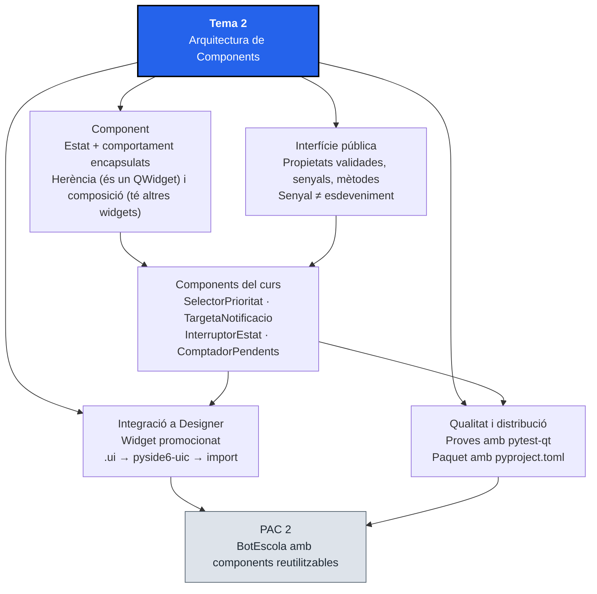
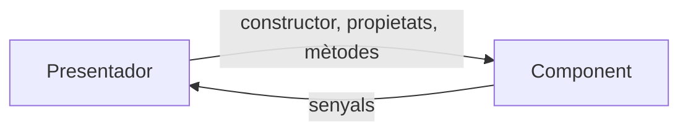

# Tema 2. Arquitectura de Components

## 1. Identificació

* **Mòdul:** 0488. Desenvolupament d'interfícies
* **Curs:** 1r CFGS de Desenvolupament d'Aplicacions Multiplataforma (DAM)
* **Tema:** 2. Arquitectura de Components
* **Durada presencial:** 12 hores
* **RA treballats:** RA3
* **Prerequisits:** Ús bàsic de Qt Widgets Designer i comprensió del bucle d'esdeveniments (Tema 1), **POO bàsica a Python** (incloent-hi propietats, atributs i mètodes de classe, excepcions i funcions `lambda`) i ús bàsic de Git. Si aquesta base no és sòlida, caldrà treballar els materials de reforç; no es pressuposa experiència prèvia creant components de Qt.
* **Projecte transversal:** <mark style="color:violet;">**BotEscola Desktop**</mark>. En aquest tema construïm components propis i reutilitzables: un <mark style="color:red;">`SelectorPrioritat`</mark> (exemple guiat), un <mark style="color:red;">`ComptadorPendents`</mark> (exercici d'aplicació) i una <mark style="color:red;">`TargetaNotificacio`</mark> (PAC 2) que mostrarà el remitent, assumpte, data i estat de cada notificació. Els components es proven amb proves unitàries automàtiques, es documenten, s'empaqueten i s'integren a la finestra principal de l'aplicatiu <mark style="color:violet;">**BotEscola Desktop**</mark>.

### Criteris d'avaluació treballats

#### RA3. Crea components visuals valorant i emprant eines específiques.

* CA 3.1: Identifica les eines per al disseny i prova de components.
* CA 3.2: Crea components visuals.
* CA 3.3: Defineix els seus mètodes i les seves propietats amb assignació de valors per defecte.
* CA 3.4: Determina els esdeveniments a què ha de respondre el component i hi associa les accions corresponents.
* CA 3.5: Realitza proves unitàries sobre els components desenvolupats.
* CA 3.6: Documenta els components creats.
* CA 3.7: Empaqueta components.
* CA 3.8: Programa aplicacions la interfície gràfica de les quals utilitza els components creats.

#### Continguts Orientatius

* 3.1 Concepte de component; característiques.
* 3.2 Propietats, atributs i mètodes.
* 3.3 Esdeveniments; associació d'accions a esdeveniments.
* 3.4 Persistència del component.
* 3.5 Eines per al desenvolupament de components visuals.
* 3.6 Prova dels components.
* 3.7 Empaquetat de components.

## 2. Introducció

En el desenvolupament de programari professional, la regla d'or és el principi **DRY** (_Don't Repeat Yourself_). Quan dissenyem aplicacions, és freqüent trobar conjunts d'elements visuals que funcionen com una única entitat lògica. Per exemple, un selector de color (amb els seus botons i un quadre de previsualització) o una targeta d'usuari (amb foto, nom i botó d'editar).

Copiar i enganxar aquests conjunts de controls múltiples vegades és un error arquitectònic greu: si el client demana canviar el disseny, hauràs d'anar pantalla per pantalla aplicant el canvi. La solució és **crear els nostres propis components**.

En aquest tema aprendrem a heretar de les classes base de Qt per construir components complexos. Definirem les seves propietats, crearem els nostres propis senyals (_Custom Signals_) i ens assegurarem que no es trenquen davant de futurs canvis escrivint **proves unitàries** específiques per a interfícies gràfiques, un pas crític en qualsevol entorn de producció seriós. Finalment, veurem com integrar aquests components creats amb codi dins del nostre estimat editor visual, Qt Widgets Designer, gràcies a la "promoció de widgets".

En acabar el tema, continuarem treballant en el projecte transversal <mark style="color:violet;">**BotEscola Desktop**</mark> i crearem un component de targeta de notificació que encapsuli remitent, assumpte, data i estat, amb un botó per marcar com a llegida. Aquest component serà reutilitzable i provat automàticament amb proves unitàries. Amb això no només aconseguirem un codi més net i modular, sinó que també ens acostarem a les pràctiques professionals de desenvolupament d'interfícies gràfiques.

## 3. Objectius didàctics

En acabar el tema, l'alumne serà capaç de:

1. Comparar les eines per crear i provar components (subclasse en codi, widget promocionat, plugin de Designer, `QUiLoader`, `pytest-qt`, `unittest` amb `QTest`) i justificar l'elecció en un escenari concret.
2. Crear un component visual com a subclasse de `QWidget`, amb layouts interns i sense fitxer `.ui`.
3. Definir les propietats i els mètodes públics d'un component amb valors per defecte, validar els valors no admissibles i serialitzar/restaurar-ne l'estat amb `to_dict()` i `from_dict()`, distingint aquestes operacions del desament persistent en un fitxer.
4. Determinar els esdeveniments a què ha de respondre un component, definir els senyals propis que emet i associar-hi les accions corresponents.
5. Escriure i executar proves unitàries amb `pytest` i `pytest-qt` que verifiquin valors inicials, interacció simulada, senyals emesos i entrades no vàlides.
6. Documentar un component amb docstrings i amb una fitxa que descrigui la seva interfície pública.
7. Organitzar components en un paquet Python i generar-ne una distribució (`wheel`) que es pugui instal·lar en un altre entorn.
8. Utilitzar els components en una aplicació, per codi i com a widget promocionat a Qt Designer, regenerant el mòdul amb `pyside6-uic`.
9. Definir una estratègia de proves per a un component i documentar-ne els resultats amb la comanda, la sortida, les versions i les incidències.

## 4. Mapa conceptual



## 5. Conceptes fonamentals

> **Convenció tipogràfica:** els noms ressaltats en color segueixen la del Tema 1: <mark style="color:red;">**classes de Qt i components**</mark>, <mark style="color:blue;">**propietats i senyals**</mark>, <mark style="color:orange;">**mètodes**</mark> i <mark style="color:violet;">**eines, fitxers i noms del projecte**</mark>.

### 5.0. Què necessitem per entendre un component?

Abans de crear un component propi, hem de poder llegir una classe Python com aquesta:

```python
class SelectorPrioritat(QWidget):
    def __init__(self, parent=None):
        super().__init__(parent)
        self._prioritat = "Normal"
        self._grup = QButtonGroup(self)  # composició: el component té un QButtonGroup
        self._boto_alta = QPushButton("Alta", self)   # ...i un QPushButton
        self._grup.addButton(self._boto_alta)

    def reiniciar(self):
        self._prioritat = "Normal"
```

Per entendre-la només necessitem:

| Concepte                   | En aquest tema                                                             |
| -------------------------- | -------------------------------------------------------------------------- |
| **Classe**                 | La plantilla del component <mark style="color:red;">`SelectorPrioritat`</mark>. |
| **Instància**              | Un objecte concret creat amb `SelectorPrioritat()`.                        |
| **`self`**                 | Referència a la instància actual.                                          |
| **Constructor `__init__`** | Inicialitza l'objecte.                                                     |
| **Atribut**                | Dada que conserva l'estat, com `self._prioritat`.                          |
| **Mètode**                 | Operació que pot fer l'objecte, com <mark style="color:orange;">`reiniciar()`</mark>. |
| **Herència**               | `SelectorPrioritat(`<mark style="color:red;">`QWidget`</mark>`)` reutilitza el comportament de <mark style="color:red;">`QWidget`</mark>. |
| **`super()`**              | Permet inicialitzar la part heretada de <mark style="color:red;">`QWidget`</mark>. |
| **Composició**             | El component conté altres objectes Qt, com <mark style="color:red;">`QPushButton`</mark> i <mark style="color:red;">`QButtonGroup`</mark>. |
| **Propietat de Python (`@property`)** | Atribut controlat per un _getter_ i un _setter_, com `selector.`<mark style="color:blue;">`prioritat`</mark>. |
| **Atribut i mètode de classe** | `NIVELLS` és compartit per totes les instàncies; un `@classmethod` rep `cls` en lloc de `self`, com <mark style="color:orange;">`from_dict`</mark>. |
| **Excepció**               | `raise ValueError(...)` avisa d'un valor no admissible; les proves ho comproven amb `pytest.raises`. |
| **Funció `lambda`**        | Funció anònima d'una sola expressió, com `lambda nivell: print(nivell)`. |

> **Regla didàctica:** si una línia de l'exemple guiat pressuposa un concepte de POO que no apareix aquí, consulta el document de reforç abans de memoritzar-ne la sintaxi.

### 5.1. Concepte de component visual

Un **component** és una unitat reutilitzable que encapsula tres coses: una **estructura visual** (els controls interns i la seva disposició), un **estat** (les dades que guarda) i un **comportament** (com reacciona als esdeveniments). En Qt se sol anomenar _widget_; en altres entorns, com Windows Forms o WPF, se l'anomena _control_.

Un component pot ser des d'un simple botó fins a un reproductor de vídeo complet amb barra de progrés i controls de volum integrats. A nivell de programació, crear un component significa **heretar d'una classe existent** (generalment <mark style="color:red;">`QWidget`</mark> si ho fem des de zero, o de <mark style="color:red;">`QPushButton`</mark> si només volem modificar un botó) i afegir-hi la nostra lògica.

Segons com es construeix, es distingeixen tres tipus de component:

| Tipus                         | Com es crea                                                | Exemples que treballarem                               | Quan és adequat                                          |
| ----------------------------- | ---------------------------------------------------------- | ------------------------------------------------------ | -------------------------------------------------------- |
| **Widget compost**            | Subclasse de <mark style="color:red;">`QWidget`</mark> amb un layout i widgets interns | <mark style="color:red;">`SelectorPrioritat`</mark>, <mark style="color:red;">`TargetaNotificacio`</mark> | Agrupar controls existents amb un comportament propi     |
| **Widget especialitzat**      | Subclasse d'un widget concret (<mark style="color:red;">`QLineEdit`</mark>, <mark style="color:red;">`QPushButton`</mark>, <mark style="color:red;">`QLabel`</mark>) | <mark style="color:red;">`ComptadorPendents`</mark> o un camp que només accepta un port vàlid | Modificar el comportament d'un únic control              |
| **Widget amb dibuixat propi** | Subclasse que sobreescriu <mark style="color:orange;">`paintEvent`</mark> | Indicador gràfic dibuixat a mà (ampliació)             | Aspecte visual que no es pot construir combinant widgets |

En aquest tema treballarem sobretot amb **widgets compostos** i **widgets especialitzats**.

> **Nota:** Les regles QSS àmplies com `QWidget { background-color }` afecten també els widgets dins de <mark style="color:red;">`QListWidget`</mark> i poden tapar el ressaltat de la selecció. Per això, quan es creen components compostos, cal tenir en compte que el seu aspecte pot canviar segons el context on s'utilitzi. La solució passa per emprar un selector específic, com `QListWidget::item:selected` o `QListView::item:selected`, o bé establir un color de fons neutre al component `background-color: transparent;`.

### 5.2. Interfície pública: propietats, mètodes i valors per defecte

La **interfície pública** d'un component és el conjunt d'elements que l'exterior pot utilitzar: el constructor, les propietats, els mètodes i els senyals. Tot el que no forma part d'aquesta interfície (per exemple, els botons interns) es considera privat i, per convenció en Python, el nom comença per `_`.

En parlar de propietats convé distingir-ne tres significats, perquè a Qt convivim amb tots tres:

| Concepte                | Què és                                                                                                          | Exemple                             |
| ----------------------- | --------------------------------------------------------------------------------------------------------------- | ----------------------------------- |
| **Propietat de Qt**     | Propietat registrada al sistema de meta-objectes de Qt; és la que mostra l'editor de propietats de Qt Designer | <mark style="color:blue;">`enabled`</mark>, <mark style="color:blue;">`toolTip`</mark>, <mark style="color:blue;">`windowTitle`</mark> |
| **Propietat de Python** | Atribut accessible com a variable però controlat per un _getter_ i, opcionalment, un _setter_ (`@property`)     | `selector.`<mark style="color:blue;">`prioritat`</mark> |
| **Atribut d'instància** | Variable interna de l'objecte, sense control d'accés                                                            | `self._prioritat`                   |

Als nostres components exposarem l'estat amb **propietats de Python**: permeten validar el valor que s'assigna i decidir quan s'emet un senyal. Les propietats de Qt (<mark style="color:red;">`Property`</mark>) són una ampliació.

Un component ha de tenir sempre un **estat inicial vàlid**, encara que qui l'utilitza no passi cap paràmetre. Per això el constructor assigna valors per defecte i valida els valors rebuts. Hi ha una convenció important: `parent=None` és sempre el **primer** paràmetre del constructor, tal com fan els widgets de Qt. El motiu és tècnic i el veurem al punt 5.7: el codi que genera <mark style="color:violet;">`pyside6-uic`</mark> crea els widgets promocionats passant-hi el pare com a primer argument.

### 5.3. Esdeveniments i senyals propis

A Qt hi ha dos mecanismes que sovint es confonen:

|                        | Senyal (<mark style="color:red;">`Signal`</mark>)           | Esdeveniment (<mark style="color:red;">`QEvent`</mark>)                                                               |
| ---------------------- | ----------------------------------------------------------- | --------------------------------------------------------------------------------------------------------------------- |
| **Nivell**             | Alt: "ha passat una cosa" (<mark style="color:blue;">`clicked`</mark>, <mark style="color:blue;">`prioritat_canviada`</mark>) | Baix: entrada o sistema (clic, tecla, canvi de mida, pintat)                                                          |
| **Com es rep**         | Connectant-lo a un slot (qualsevol funció o mètode)         | Sobreescrivint un handler virtual (<mark style="color:orange;">`mousePressEvent`</mark>, <mark style="color:orange;">`keyPressEvent`</mark>, <mark style="color:orange;">`resizeEvent`</mark>) o amb un filtre d'esdeveniments |
| **Qui el genera / distribueix** | L'objecte que declara el senyal, cridant <mark style="color:orange;">`emit()`</mark> | L'esdeveniment pot originar-se al sistema operatiu, a Qt o a l'aplicació; el bucle d'esdeveniments el distribueix als objectes corresponents |
| **Ús en un component** | Formen la interfície pública cap a l'exterior               | Són un detall intern; si l'exterior ho ha de saber, es converteix en un senyal                                        |

Fins ara hem consumit senyals que Qt ja ofereix (<mark style="color:blue;">`clicked`</mark>, <mark style="color:blue;">`textChanged`</mark>). Un component també pot **declarar senyals propis** per avisar de coses que només ell coneix. Per exemple, si dissenyem un component de "Selector de Prioritat" (Baixa, Normal, Alta), aquest ha d'emetre un senyal **propi** tipus <mark style="color:blue;">`prioritat_canviada`</mark> enviant el nou valor. A PySide6 es fa amb <mark style="color:red;">`Signal`</mark>`(tipus)`, declarat **a nivell de classe**, i s'emet amb <mark style="color:orange;">`emit()`</mark>.

Decidir quins esdeveniments atén un component és una tasca de disseny que es documenta amb una taula:

| Esdeveniment d'entrada          | Acció interna                       | Senyal de sortida                                   |
| ------------------------------- | ----------------------------------- | --------------------------------------------------- |
| L'usuari prem un botó de nivell | Actualitza <mark style="color:blue;">`prioritat`</mark> i els botons | <mark style="color:blue;">`prioritat_canviada(str)`</mark>, només si el valor canvia |

La regla d'or de la comunicació és que **la informació entra pel constructor, propietats i mètodes, i els avisos surten a través de senyals**:



Així el component no necessita conèixer la finestra on viu, i pot reutilitzar-se en qualsevol lloc.

### 5.4. Serialització i persistència de l'estat del component

La **persistència** és la capacitat de conservar les dades més enllà de la vida de l'objecte en memòria. No es desen els widgets, sinó **les dades que defineixen el seu estat**. Cal distingir la representació de l'estat de la seva conservació efectiva. Treballem tres nivells:

1. **Serialització i restauració** (aquest tema): el component ofereix <mark style="color:orange;">`to_dict()`</mark>, que retorna un diccionari amb dades simples (text, números, booleans), i <mark style="color:orange;">`from_dict()`</mark>, que crea un component a partir d'aquest diccionari. Aquests mètodes, per si sols, **no desen res en disc**; permeten representar i reconstruir l'estat.
2. **Fitxer o preferències d'usuari**: un diccionari es pot desar en JSON amb el mòdul `json`, o bé utilitzar <mark style="color:red;">`QSettings`</mark> (ampliació) per recordar, per exemple, l'última prioritat triada entre execucions.
3. **Base de dades** (Tema 4): el component no hi accedeix directament; el Presentador o la capa de dades li proporciona la informació.

Exemple mínim de persistència en JSON, un cop `component.to_dict()` retorna les dades del component:

```python
import json

# Desar l'estat en un fitxer.
with open("estat_component.json", "w", encoding="utf-8") as fitxer:
    json.dump(component.to_dict(), fitxer, ensure_ascii=False, indent=2)

# Llegir-lo i reconstruir el component (la classe ha d'implementar from_dict).
with open("estat_component.json", encoding="utf-8") as fitxer:
    dades = json.load(fitxer)
component_restaurat = type(component).from_dict(dades)
```

Una prova d'anada i tornada comprova que `from_dict(component.to_dict())` reconstrueix les mateixes dades. Si també es vol provar la persistència, cal verificar el desament i la lectura del fitxer, no només el diccionari.

### 5.5. Estructura i empaquetat de components

Per reutilitzar un component no n'hi ha prou amb tenir-lo en un fitxer. Cal distingir tres nivells:

| Terme           | Què és                                                                            | Exemple                                       |
| --------------- | --------------------------------------------------------------------------------- | --------------------------------------------- |
| **Mòdul**       | Un fitxer `.py`                                                                   | <mark style="color:violet;">`components/selector.py`</mark> |
| **Paquet**      | Una carpeta de mòduls, amb un fitxer <mark style="color:violet;">`__init__.py`</mark> que la identifica com a paquet | `components/`                                 |
| **Distribució** | El paquet empaquetat i versionat perquè es pugui instal·lar amb `pip`             | <mark style="color:violet;">`botescola_modules-0.1.0-py3-none-any.whl`</mark> |

Amb el paquet ja es pot fer `from components.selector import SelectorPrioritat`. La distribució permet instal·lar-lo en un altre projecte o entorn virtual. Per generar-la s'utilitza un fitxer <mark style="color:violet;">`pyproject.toml`</mark>, que descriu el nom, la versió, les dependències i els paquets que s'inclouen:

```toml
[build-system]
requires = ["setuptools>=68"]
build-backend = "setuptools.build_meta"

[project]
name = "botescola-modules"
version = "0.1.0"
description = "Components visuals reutilitzables de BotEscola Desktop"
requires-python = ">=3.10"
dependencies = ["PySide6"]

[tool.setuptools.packages.find]
include = ["components*"]
```

La línia `include` és necessària perquè a l'arrel del projecte també hi ha carpetes que **no** formen part del component (`ui/`, `generated/`, `tests/`); sense indicar què s'empaqueta, `setuptools` pot no saber-ho decidir i fallar.

> **Nota:** en una llibreria real triaríem un nom de paquet més específic (per exemple `botescola_modules`) per evitar col·lisions amb altres paquets. Aquí mantenim `components` per simplicitat; és una limitació coneguda.

L'empaquetat d'aquest tema és el d'una **llibreria de components**. El d'una aplicació completa amb instal·lador (PyInstaller, Inno Setup) correspon al RA7 i es treballarà al Tema 5.

### 5.6. Eines per al desenvolupament i la prova de components

Escollir l'eina de desenvolupament concreta depèn de qui utilitzarà el component i com es distribuirà:

| Necessitat                            | Eina                                   | Avantatges                                                           | Limitacions                                                        |
| ------------------------------------- | -------------------------------------- | -------------------------------------------------------------------- | ------------------------------------------------------------------ |
| Crear el component                    | Subclasse de <mark style="color:red;">`QWidget`</mark> en Python | Control total, fàcil de provar i versionar                           | No apareix a la paleta de Designer                                 |
| Usar-lo a Designer                    | **Widget promocionat**                 | No cal cap instal·lació                                              | Designer només mostra el widget base, no la vista prèvia real      |
| Usar-lo a Designer amb vista prèvia   | Plugin de Designer                     | El component apareix a la paleta                                     | Instal·lació i manteniment més complexos; fora de l'abast del tema |
| Carregar un `.ui` en temps d'execució | <mark style="color:red;">`QUiLoader`</mark> amb <mark style="color:orange;">`registerCustomWidget`</mark> | No cal generar codi                                                  | Flux alternatiu al que seguim (generació amb <mark style="color:violet;">`pyside6-uic`</mark>) |
| Provar amb Qt                         | <mark style="color:violet;">`pytest`</mark> + <mark style="color:violet;">`pytest-qt`</mark> | Codi curt; `qtbot` simula ratolí i teclat; captura errors dels slots | Dependència externa                                                |
| Provar sense dependències             | `unittest` + <mark style="color:red;">`QTest`</mark> | Ve amb Python i Qt                                                   | Més verbós                                                         |
| Empaquetar                            | `setuptools` + `build`                 | Estàndard i molt documentat                                          | Alternatives: `hatchling`, `flit`, `poetry`                        |
| Documentar                            | Docstrings i fitxa en Markdown         | Sense eines addicionals                                              | El manual complet arriba al Tema 5 (MkDocs)                        |

Un component ha de garantir que sempre funciona igual. En comptes de provar-ho manualment prement botons a mà cada vegada que fem un canvi de codi, escriurem **proves unitàries** automatitzades.

Per a <mark style="color:violet;">**BotEscola Desktop**</mark> utilitzarem <mark style="color:violet;">**`pytest`**</mark> (un framework de proves molt utilitzat a Python) i <mark style="color:violet;">**`pytest-qt`**</mark> (un connector que ens permet instanciar finestres sense bloquejar el sistema i disposa de l'eina `qtbot` per simular que un ratolí fa clic virtualment sobre el nostre component). També empaquetarem els components amb **`setuptools`** i els distribuirem com a **paquet Python**. La decisió obeeix a la necessitat de mantenir un flux coherent amb el Tema 1, sense haver d'instal·lar res a Designer i amb la possibilitat d'automatitzar les proves.

### 5.7. Widgets promocionats

Un component escrit en Python no apareix a la paleta de Qt Designer. Per situar-lo en un formulari s'utilitza la **promoció de widgets**:

1. A la finestra/formulari que estem dissenyant dins de Qt s'afegeix un widget base (per exemple, de tipus <mark style="color:red;">`QWidget`</mark> o <mark style="color:red;">`QLabel`</mark>) al lloc on ha d'anar el component, fent de _placeholder_.
2. Amb el botó dret, _Promocionar a…_, s'indica el nom de la classe i el **mòdul Python** on es troba.
3. <mark style="color:violet;">`pyside6-uic`</mark> afegeix al fitxer generat l'`import` del component i el crearà en lloc del widget base.

La promoció és una instrucció perquè el codi generat instanciï la classe pròpia en lloc del widget base. És diferent de carregar un `.ui` dinàmicament amb <mark style="color:red;">`QUiLoader`</mark>, on el widget personalitzat s'ha de registrar amb el loader. Tres conseqüències pràctiques:

* En una promoció utilitzada amb <mark style="color:violet;">`pyside6-uic`</mark>, el camp _Archivo de cabecera_ s'utilitza per indicar el mòdul que ha de generar-se a l'`import`. En el nostre exemple escriurem `components.selector`; no hi posarem ni el nom de la classe ni una ruta amb `/`. **Per evitar errors, comprova sempre la línia d'`import` real del fitxer <mark style="color:violet;">`ui_*.py`</mark> generat**, perquè és la verificació definitiva.
* El codi generat crea el component passant-hi el pare com a **primer argument posicional** (`SelectorPrioritat(self.centralwidget)`). Per això `parent=None` ha de ser el primer paràmetre del constructor i la resta han de tenir valors per defecte.
* A l'editor de propietats de Qt Widgets Designer només es veuen les propietats del widget base. Les propietats i els senyals propis s'utilitzen des del codi Python.

### 5.8. Proves unitàries de components i estratègia de proves

Una **prova unitària** verifica una peça petita de codi de manera aïllada i automàtica. Té tres parts (esquema _Arrange–Act–Assert_): es prepara l'escenari (per exemple, es crea el component), s'executa una acció (un clic simulat) i es comprova el resultat amb un `assert`.

<mark style="color:violet;">`pytest`</mark> és l'eina que configura i executa les proves. Busca fitxers `test_*.py` i funcions `test_*`. <mark style="color:violet;">`pytest-qt`</mark> hi afegeix el _fixture_ **`qtbot`**, que:

* Proporciona la <mark style="color:red;">`QApplication`</mark> necessària sense haver d'iniciar el bucle amb <mark style="color:orange;">`app.exec()`</mark>;
* Permet simular ratolí i teclat (<mark style="color:orange;">`mouseClick`</mark>, <mark style="color:orange;">`keyClick`</mark>);
* Permet esperar un senyal (<mark style="color:orange;">`waitSignal`</mark>) o comprovar que no s'emet (<mark style="color:orange;">`assertNotEmitted`</mark>);
* Tanca i elimina al final de cada prova els widgets registrats amb <mark style="color:orange;">`addWidget`</mark>;
* Fa fallar la prova si hi ha excepcions dins d'un slot.

Què s'ha de provar en un component? El seu **contracte públic**: valors per defecte, canvis d'estat, senyals emesos (amb les dades que porten) i comportament davant d'entrades no vàlides. No es proven els detalls estètics (píxels, colors) ni el codi intern de Qt.

Una **estratègia de proves** és el pla que decideix què es prova, com, amb quines eines i quan es considera acceptable el resultat. Té limitacions que convé conèixer: una prova que passa no demostra que no hi hagi errors, només que aquell cas funciona; les proves automàtiques no substitueixen les manuals per a aspectes visuals i d'usabilitat; i unes proves massa lligades als detalls interns es trenquen en refactoritzar. Aquest tema treballa les proves **unitàries automàtiques** i les **manuals d'integració** sobre un component; les altres modalitats (integració, regressió, volum, estrès, seguretat i recursos) s'aborden al Tema 5.

## 6. Entorn de treball

### 6.1. Estructura del projecte

Partim del projecte <mark style="color:violet;">**BotEscola Desktop**</mark> del Tema 1 i hi afegim els paquets `components/` i `tests/`, la documentació dels components i els fitxers de configuració:

```
botescola/
├── ui/
│   └── botescola.ui
├── generated/
│   └── ui_botescola.py
├── styles/
│   ├── botescola.qss
│   └── alt_contrast.qss      <-- Ampliació PAC 1
├── components/               <-- RA3: components reutilitzables (paquet)
│   ├── __init__.py
│   ├── selector.py
│   ├── targeta.py
│   ├── interruptor.py        <-- exercici D
│   └── comptador.py          <-- exercici E i PAC 2
├── tests/                    <-- proves unitàries
│   ├── test_selector.py
│   ├── test_targeta.py
│   ├── test_interruptor.py
│   └── test_comptador.py
├── docs/
│   └── components.md         <-- documentació dels components
├── dades.py                  <-- dades de prova (Tema 1), ampliades a la PAC 2
├── botescola_app.py
├── pyproject.toml
├── pytest.ini
├── contrast.py
├── taula_contrast.md
└── README.md
```

La carpeta `components/` no conté cap fitxer `.ui` ni depèn de `generated/`: un component ha de poder funcionar sense l'aplicació on s'utilitza. Durant l'exemple guiat (apartat 7) es poden crear fitxers auxiliars de prova (<mark style="color:violet;">`prova_selector.py`</mark> o <mark style="color:violet;">`ui/prova_selector.ui`</mark>) que no formen part del lliurament final de <mark style="color:violet;">**BotEscola Desktop**</mark>.

### 6.2. Dependències

Amb l'entorn virtual del Tema 1 activat, instal·la les eines de prova i d'empaquetat:

```bash
python -m pip install pytest pytest-qt build
```

* <mark style="color:violet;">`pytest`</mark> i <mark style="color:violet;">`pytest-qt`</mark>: execució de les proves i _fixture_ `qtbot`.
* `build`: generació de la distribució del paquet a partir de <mark style="color:violet;">`pyproject.toml`</mark>.

Comprova les versions amb les quals treballes, perquè s'han de registrar a l'informe de proves:

```bash
python -c "import sys, PySide6; print(sys.version.split()[0], PySide6.__version__)"
python -m pytest --version
```

### 6.3. Configuració de `pytest`

Crea el fitxer <mark style="color:violet;">`pytest.ini`</mark> a l'arrel del projecte:

```ini
[pytest]
qt_api = pyside6
pythonpath = .
testpaths = tests
```

* `qt_api = pyside6` indica a <mark style="color:violet;">`pytest-qt`</mark> quina llibreria ha d'utilitzar, encara que n'hi hagi d'altres instal·lades.
* `pythonpath = .` afegeix l'arrel del projecte a la ruta d'importació. Sense aquesta línia, les proves poden fallar amb `ModuleNotFoundError: No module named 'components'`.
* `testpaths = tests` limita la cerca de proves a la carpeta `tests/`.

Executa les proves des de l'arrel del projecte:

```bash
python -m pytest -v
```

> **Nota (Linux i servidors sense pantalla):** si les proves s'executen sense entorn gràfic, cal definir `QT_QPA_PLATFORM=offscreen` abans d'executar <mark style="color:violet;">`pytest`</mark>. A Windows i macOS amb escriptori no cal.

### 6.4. Generació de la distribució

Un cop existeixi <mark style="color:violet;">`pyproject.toml`</mark> (vegeu 5.5), des de l'arrel del projecte:

```bash
python -m build
```

Es crea la carpeta `dist/` amb dos fitxers: un `.whl` (_wheel_, format instal·lable) i un `.tar.gz` (codi font). (`python -m build` crea un entorn aïllat i hi descarrega `setuptools`: la primera vegada cal connexió a Internet.)

Per comprovar que la distribució funciona, instal·la el `.whl` en un **entorn virtual nou** i importa'n el component:

```bash
python -m venv .venv-prova
.venv-prova\Scripts\Activate.ps1
python -m pip install dist/botescola_modules-0.1.0-py3-none-any.whl
python -c "from components import SelectorPrioritat; print('OK')"
```

(A Linux/macOS, l'activació és `source .venv-prova/bin/activate`.)

## 7. Exemple guiat: Component Selector de Prioritat

El nostre formulari requerirà que l'usuari assigni ràpidament una prioritat a una notificació per mitjà de tres botons que funcionin de manera excloent (només un actiu). Donat que aquest selector es pot necessitar a la finestra principal, en un diàleg de configuració o en una futura pantalla de filtres, l'encapsularem en un component propi anomenat <mark style="color:red;">`SelectorPrioritat`</mark>.

### Pas 1. Dissenyar la interfície pública abans de programar

Abans d'escriure codi, decidim què veu l'exterior del component:

| Element     | Nom                                                  | Tipus                        | Descripció                                                              |
| ----------- | ---------------------------------------------------- | ---------------------------- | ----------------------------------------------------------------------- |
| Constructor | <mark style="color:red;">`SelectorPrioritat`</mark>`(parent=None, prioritat="Normal")` | — | `parent` és el primer paràmetre; el nivell inicial té valor per defecte |
| Propietat   | <mark style="color:blue;">`prioritat`</mark>         | `str` (lectura i escriptura) | Nivell actual; ha de ser un valor de `NIVELLS`                          |
| Constant    | `NIVELLS`                                            | `tuple[str]`                 | Valors admesos: `("Baixa", "Normal", "Alta")`                           |
| Senyal      | <mark style="color:blue;">`prioritat_canviada(str)`</mark> | <mark style="color:red;">`Signal`</mark>`(str)` | S'emet **només si el valor canvia**                                     |
| Mètodes     | <mark style="color:orange;">`to_dict()`</mark> / <mark style="color:orange;">`from_dict(dades)`</mark> | — | Representa l'estat com a diccionari i el reconstrueix |

I la taula d'esdeveniments del component:

| Esdeveniment                                      | Acció interna                           | Senyal de sortida                                    |
| ------------------------------------------------- | --------------------------------------- | ---------------------------------------------------- |
| L'usuari prem un dels tres botons                 | Actualitza <mark style="color:blue;">`prioritat`</mark> i el botó marcat | <mark style="color:blue;">`prioritat_canviada(nivell)`</mark> si el valor és diferent |
| El programa assigna `selector.prioritat = "Alta"` | Marca el botó corresponent              | <mark style="color:blue;">`prioritat_canviada("Alta")`</mark> si el valor és diferent |
| Es prem el botó que ja estava marcat              | Cap                                     | Cap                                                  |
| S'assigna un valor no admès                       | Rebutja el canvi                        | Cap; llança `ValueError`                             |

### Pas 2. Programar el component (`components/selector.py`)

```python
"""Selector de prioritat de tres nivells per a BotEscola."""

from PySide6.QtCore import Signal
from PySide6.QtWidgets import QButtonGroup, QHBoxLayout, QPushButton, QWidget


class SelectorPrioritat(QWidget):
    """Selector exclusiu de prioritat (Baixa, Normal, Alta).

    Senyals:
        prioritat_canviada(str): s'emet quan canvia el nivell, amb el nou valor.
    """

    NIVELLS = ("Baixa", "Normal", "Alta")

    # Els senyals es declaren a nivell de classe, mai dins de __init__.
    prioritat_canviada = Signal(str)

    # Constructor amb valors per defecte i validació d'entrada.
    def __init__(self, parent=None, prioritat="Normal"):
        """Crea el selector.

        Args:
            parent: widget pare (opcional).
            prioritat: nivell inicial; ha de ser un valor de NIVELLS.

        Raises:
            ValueError: si `prioritat` no és un nivell admès.
        """
        super().__init__(parent)
        self._prioritat = self._validar(prioritat)

        self._botons = {}
        self._grup = QButtonGroup(self)
        # Per defecte QButtonGroup ja és exclusiu, però és bona pràctica explicitar-ho.
        self._grup.setExclusive(True)

        layout = QHBoxLayout(self)
        layout.setContentsMargins(0, 0, 0, 0)

        for index, nivell in enumerate(self.NIVELLS):
            boto = QPushButton(nivell)
            boto.setCheckable(True)
            boto.setObjectName(f"btn_{nivell.lower()}")
            boto.setToolTip(f"Prioritat {nivell.lower()}")
            self._grup.addButton(boto, index)
            layout.addWidget(boto)
            self._botons[nivell] = boto

        self._botons[self._prioritat].setChecked(True)
        self._grup.idClicked.connect(self._on_boto_premut)

    # Validació interna: només necessita la constant de classe NIVELLS, no l'estat
    # de cap instància; per això rep `cls` (@classmethod) i no `self`.
    @classmethod
    def _validar(cls, valor):
        if valor not in cls.NIVELLS:
            raise ValueError(
                f"Prioritat no vàlida: {valor!r}. Valors admesos: {cls.NIVELLS}"
            )
        return valor

    @property
    def prioritat(self):
        """Nivell de prioritat actual."""
        return self._prioritat

    @prioritat.setter
    def prioritat(self, valor):
        valor = self._validar(valor)
        # Si el valor no ha canviat, no fem res (no emetem senyal).
        if valor == self._prioritat:
            return
        self._prioritat = valor
        # En marcar el botó, es desmarca automàticament l'anterior, gràcies a QButtonGroup.
        self._botons[valor].setChecked(True)
        # Disparem el senyal de prioritat canviada amb el nou valor.
        self.prioritat_canviada.emit(valor)

    # Aquest mètode sí que necessita `self`: treballa amb l'estat de la instància.
    def _on_boto_premut(self, index):
        """Slot intern: tradueix el botó premut a un canvi de prioritat."""
        self.prioritat = self.NIVELLS[index]

    # Constructor alternatiu: rep `cls` i no `self`, de manera que en una subclasse
    # crea una instància de la subclasse i no pas de SelectorPrioritat.
    @classmethod
    def from_dict(cls, dades, parent=None):
        """Crea un selector a partir d'un diccionari creat per `to_dict()`."""
        return cls(parent, dades.get("prioritat", "Normal"))

    def to_dict(self):
        """Retorna l'estat del component com a diccionari de dades simples."""
        return {"prioritat": self._prioritat}
```

I el fitxer <mark style="color:violet;">`components/__init__.py`</mark>, que fa que la carpeta sigui un paquet i n'exposa els components:

```python
"""Components visuals reutilitzables de BotEscola Desktop."""

from .selector import SelectorPrioritat

__all__ = ["SelectorPrioritat"]
__version__ = "0.1.0"
```

(Cada component nou que afegeixis —<mark style="color:red;">`TargetaNotificacio`</mark>, <mark style="color:red;">`InterruptorEstat`</mark>, <mark style="color:red;">`ComptadorPendents`</mark>— s'ha d'importar aquí i afegir a `__all__`.)

### Pas 3. Prova visual ràpida

Abans d'automatitzar res, comprova que el component es veu i respon. Crea un fitxer <mark style="color:violet;">`prova_selector.py`</mark> fora de `components/`:

```python
import sys

from PySide6.QtWidgets import QApplication

from components import SelectorPrioritat

app = QApplication(sys.argv)
selector = SelectorPrioritat()
selector.prioritat_canviada.connect(lambda nivell: print("Nova prioritat:", nivell))
selector.show()
sys.exit(app.exec())
```

Prem els botons i observa la consola. Aquesta és una prova **manual**; al Pas 5 la convertirem en prova automàtica.

### Pas 4. Utilitzar-lo a Qt Widgets Designer (widget promocionat)

> **Nota:** les etiquetes de Qt Widgets Designer es citen en castellà, com al Tema 1.

1. Executa <mark style="color:violet;">**`pyside6-designer`**</mark> i crea un formulari de tipus **Widget**.
2. Afegeix un <mark style="color:red;">`QLabel`</mark> amb el text `Prioritat:` i, al costat, un <mark style="color:red;">`QWidget`</mark> (categoria _Containers_) amb <mark style="color:blue;">`objectName`</mark> `sel_prioritat`.
3. Fes clic dret sobre aquest <mark style="color:red;">`QWidget`</mark> → **Promocionar a…** i omple:
   * **Nombre de la clase base:** <mark style="color:red;">`QWidget`</mark>
   * **Nombre de la clase promocionada:** <mark style="color:red;">`SelectorPrioritat`</mark>
   * **Archivo de cabecera:** `components.selector`
   * Deixa desmarcada l'opció _Archivo de cabecera global_.
4. Prem **Añadir** i després **Promocionar**.
5. Aplica un layout horitzontal al formulari i desa'l com <mark style="color:violet;">`ui/prova_selector.ui`</mark>.
6. Genera el mòdul Python:

```bash
pyside6-uic ui/prova_selector.ui -o generated/ui_prova_selector.py
```

7. Obre <mark style="color:violet;">`generated/ui_prova_selector.py`</mark> **només per llegir-lo** i localitza aquestes dues línies:

```python
from components.selector import SelectorPrioritat
...
self.sel_prioritat = SelectorPrioritat(Form)
```

La primera és l'importació derivada del camp _Archivo de cabecera_; la segona crea el component passant-hi el pare com a **primer argument**. Per això `parent` és el primer paràmetre del constructor.

8. Utilitza el component des d'<mark style="color:violet;">`app.py`</mark>:

```python
import sys

from PySide6.QtWidgets import QApplication, QWidget

from generated.ui_prova_selector import Ui_Form


class Finestra(QWidget):
    def __init__(self):
        super().__init__()
        self.ui = Ui_Form()
        self.ui.setupUi(self)
        self.ui.sel_prioritat.prioritat_canviada.connect(self.mostrar_prioritat)

    def mostrar_prioritat(self, nivell):
        print(f"Prioritat seleccionada: {nivell}")


if __name__ == "__main__":
    app = QApplication(sys.argv)
    finestra = Finestra()
    finestra.show()
    sys.exit(app.exec())
```

Observa que `Finestra` només coneix el senyal i la propietat del component; no sap com està construït per dins.

### Pas 5. Proves unitàries (`tests/test_selector.py`)

```python
import pytest
from PySide6.QtCore import Qt
from PySide6.QtWidgets import QPushButton

from components import SelectorPrioritat


def boto(selector, nom):
    """Localitza un botó intern pel seu objectName."""
    return selector.findChild(QPushButton, nom)


def test_valor_per_defecte(qtbot):
    selector = SelectorPrioritat()
    qtbot.addWidget(selector)

    assert selector.prioritat == "Normal"
    assert boto(selector, "btn_normal").isChecked()
    assert not boto(selector, "btn_alta").isChecked()


def test_clic_canvia_prioritat_i_emet_senyal(qtbot):
    selector = SelectorPrioritat()
    qtbot.addWidget(selector)

    with qtbot.waitSignal(selector.prioritat_canviada, timeout=1000) as blocker:
        qtbot.mouseClick(boto(selector, "btn_alta"), Qt.MouseButton.LeftButton)

    assert blocker.args == ["Alta"]
    assert selector.prioritat == "Alta"
    assert boto(selector, "btn_alta").isChecked()
    assert not boto(selector, "btn_normal").isChecked()


def test_no_emet_senyal_si_no_canvia(qtbot):
    selector = SelectorPrioritat()
    qtbot.addWidget(selector)

    with qtbot.assertNotEmitted(selector.prioritat_canviada):
        qtbot.mouseClick(boto(selector, "btn_normal"), Qt.MouseButton.LeftButton)


def test_valor_no_valid_es_rebutja(qtbot):
    selector = SelectorPrioritat()
    qtbot.addWidget(selector)

    with pytest.raises(ValueError):
        selector.prioritat = "Urgent"
    assert selector.prioritat == "Normal"

    with pytest.raises(ValueError):
        SelectorPrioritat(prioritat="Urgent")


def test_serialitzacio_anada_i_tornada(qtbot):
    original = SelectorPrioritat(prioritat="Alta")
    qtbot.addWidget(original)

    copia = SelectorPrioritat.from_dict(original.to_dict())
    qtbot.addWidget(copia)

    assert copia.prioritat == "Alta"
    assert copia.to_dict() == original.to_dict()
```

Executa `python -m pytest -v`. Han d'aparèixer cinc proves amb `PASSED`.

**Prova de sensibilitat (obligatòria):** canvia temporalment una línia de <mark style="color:violet;">`selector.py`</mark> (per exemple, treu l'<mark style="color:orange;">`emit()`</mark> del _setter_) i torna a executar les proves. Han de fallar. Si una prova no falla quan el codi és incorrecte, no verifica res. Després restaura el codi.

### Pas 6. Documentar el component

La documentació aplica a dos nivells:

1. **Docstrings** dins del codi, com les que has vist al Pas 2: què fa la classe, quins senyals emet i, a cada mètode, els arguments i les excepcions.
2. **Fitxa del component** a <mark style="color:violet;">`docs/components.md`</mark>, pensada per a qui l'utilitzi sense llegir-ne el codi:

```markdown
## SelectorPrioritat

**Propòsit:** seleccionar una de tres prioritats de manera exclusiva.
**Mòdul:** `components.selector` · **Hereta de:** `QWidget`

### Constructor
`SelectorPrioritat(parent=None, prioritat="Normal")`

### Propietats
| Nom | Tipus | Valor per defecte | Descripció |
|---|---|---|---|
| `prioritat` | `str` | `"Normal"` | Nivell actual. `ValueError` si no és a `NIVELLS`. |

### Senyals
| Nom | Paràmetres | Quan s'emet |
|---|---|---|
| `prioritat_canviada` | `str` | Quan el nivell canvia (per clic o per codi). |

### Ús
    selector = SelectorPrioritat()
    selector.prioritat_canviada.connect(handler)

### Proves
`tests/test_selector.py` (5 proves).
```

## 8. Anàlisi tècnica

Un cop el component funciona, cal ser capaç d'explicar-ho i modificar-ho.

**Estructura de la classe**

* <mark style="color:red;">`SelectorPrioritat`</mark>`(`<mark style="color:red;">`QWidget`</mark>`)` és un **widget compost**: no dibuixa res per si mateix, sinó que conté un layout amb tres <mark style="color:red;">`QPushButton`</mark>.
* `NIVELLS` és una constant de classe: és l'únic lloc on es defineixen els valors admesos. Afegir un nivell implica canviar una sola línia (vegeu l'exercici B).
* `_botons` i `_grup` són atributs **privats** (prefix `_`): l'exterior no ha de dependre'n.

**Propietats i valors per defecte**

* <mark style="color:blue;">`prioritat`</mark> és una propietat de Python (`@property`). El _setter_ valida el valor, evita canvis redundants i és l'únic lloc on s'emet el senyal. Així, un clic i una assignació per codi tenen exactament el mateix comportament.
* `prioritat="Normal"` és el valor per defecte, i `parent=None` va **primer** perquè el codi generat per <mark style="color:violet;">`pyside6-uic`</mark> el passa com a primer argument (Pas 4).
* El constructor valida <mark style="color:blue;">`prioritat`</mark> abans de construir els botons i el layout: si el valor és incorrecte, llança `ValueError` i el component no arriba a quedar en un estat invàlid.

**Senyals i esdeveniments**

* <mark style="color:blue;">`prioritat_canviada`</mark> `=` <mark style="color:red;">`Signal`</mark>`(str)` es declara **a la classe**: Qt necessita el senyal com a atribut de classe per associar-lo a cada instància. Declarat dins de `__init__` (`self.x = Signal(str)`) no funciona.
* <mark style="color:red;">`QButtonGroup`</mark> amb <mark style="color:orange;">`setExclusive(True)`</mark> garanteix que només hi ha un botó marcat. Abans d'utilitzar-lo, calia programar-ho manualment i era fàcil deixar dos botons marcats.
* <mark style="color:blue;">`idClicked`</mark> envia l'identificador del botó premut; el component el tradueix a un nivell.

**Comunicació amb l'exterior**

* El component rep dades pel constructor i la propietat, i avisa amb el senyal. No coneix <mark style="color:violet;">`botescola_app.py`</mark> ni cap finestra: el Presentador és qui decideix què fer amb el canvi.

**Serialització de l'estat**

* <mark style="color:orange;">`to_dict()`</mark> retorna dades simples (en aquest exemple, un `str`) i <mark style="color:orange;">`from_dict()`</mark> les converteix de nou en component. El diccionari es pot convertir a JSON o passar a una base de dades sense arrossegar cap objecte de Qt. La serialització no és persistència fins que les dades s'escriuen en un suport i es poden recuperar posteriorment.

**Proves**

* `qtbot.`<mark style="color:orange;">`addWidget()`</mark> fa que <mark style="color:violet;">`pytest-qt`</mark> tanqui i elimini el widget en acabar la prova.
* <mark style="color:orange;">`findChild`</mark>`(`<mark style="color:red;">`QPushButton`</mark>`, "btn_alta")` localitza el botó per l'<mark style="color:blue;">`objectName`</mark>, tal com al Tema 1 utilitzàvem els noms per localitzar controls.
* <mark style="color:orange;">`waitSignal`</mark> ha d'estar **al voltant** de l'acció que provoca el senyal; el `blocker.args` conté els paràmetres emesos.
* <mark style="color:orange;">`assertNotEmitted`</mark> prova un comportament negatiu, que és tan important com el positiu.

## 9. Exercicis progressius

Tots els exercicis es lliuren a través d'un repositori de GitHub, amb el codi font i les captures que s'indiquin. Els fitxers generats per <mark style="color:violet;">`pyside6-uic`</mark> s'inclouen, però no es modifiquen manualment.

**Ús de la IA:** pots utilitzar-la per consultar documentació o per explicar un error, però has de ser capaç de justificar cada línia del que lliures i de modificar-la sense ajuda. A l'exercici D, com a mínim, has de deixar constància (en un comentari o al <mark style="color:violet;">`README.md`</mark>) de quines decisions de disseny has pres tu i per què.

### Exercici A — Reproducció

Crea l'estructura de carpetes de l'apartat 6.1 i reprodueix <mark style="color:violet;">`components/__init__.py`</mark>, <mark style="color:violet;">`components/selector.py`</mark> i <mark style="color:violet;">`tests/test_selector.py`</mark>. Configura <mark style="color:violet;">`pytest.ini`</mark> i executa `python -m pytest -v`.

**Lliurament:** captura de la sortida amb les cinc proves en `PASSED` i captura de la prova de sensibilitat (una prova fallant després de trencar el codi a propòsit).

### Exercici B — Modificació

Afegeix un quart nivell, `"Crítica"`, al <mark style="color:red;">`SelectorPrioritat`</mark>.

1. Modifica el component canviant el mínim possible. Justifica per què a la lògica d'estat i validació n'hi ha prou amb canviar `NIVELLS`.
2. Afegeix una prova que verifiqui que en prémer `Crítica` s'emet `"Crítica"`.
3. Converteix les proves de clic en una única prova amb `@pytest.mark.parametrize` (https://docs.pytest.org/en/stable/how-to/parametrize.html) que recorri els quatre nivells.
4. **Pista de disseny:** el component genera l'<mark style="color:blue;">`objectName`</mark> amb `nivell.lower()`; amb `Crítica` en resulta `btn_crítica` (amb accent), cosa que incompleix la bona pràctica de mantenir l'absència d'accents als identificadors interns. Normalitza la generació de l'<mark style="color:blue;">`objectName`</mark> perquè es generi sense accents (`btn_critica`) i utilitza aquest identificador a la prova.

**Lliurament:** codi modificat, proves i una frase que expliqui quina part de la lògica no ha calgut tocar i per què.

### Exercici C — Diagnosi

Cada un dels tres casos següents falla. Per a cadascun, indica el símptoma, la causa i la correcció, i comprova-ho executant el codi.

**Cas 1.** Un company té el component a <mark style="color:violet;">`components/barra_cerca.py`</mark> (classe `BarraCerca`). Quan executa l'aplicació, obté `ModuleNotFoundError: No module named 'BarraCerca'`. Al fitxer generat hi apareix:

```python
from BarraCerca import BarraCerca
```

Quin camp del diàleg _Promocionar a…_ està mal omplert i quin valor exacte hi ha d'escriure?

**Cas 2.** Un component defineix el senyal així i falla en connectar-lo:

```python
class Cercador(QWidget):
    def __init__(self, parent=None):
        super().__init__(parent)
        self.text_canviat = Signal(str)
```

```python
cercador.text_canviat.connect(handler)   # AttributeError
```

**Cas 3.** Aquest codi hauria d'emetre el nivell corresponent en prémer cada botó, però en prémer qualsevol botó s'emet sempre `"Alta"`:

```python
for nivell in ("Baixa", "Normal", "Alta"):
    boto = QPushButton(nivell)
    boto.clicked.connect(lambda: self.set_prioritat(nivell))
    layout.addWidget(boto)
```

Explica per què passa i proposa dues correccions: una amb una funció `lambda` i una sense.

**Lliurament:** un document breu (Markdown) amb els tres diagnòstics i el codi corregit.

### Exercici D — Repte

Crea el component <mark style="color:red;">`InterruptorEstat`</mark> al paquet `components/`. Ha de permetre triar entre dos estats, "Actiu" i "Inactiu".

Requisits mínims:

* utilitza dos <mark style="color:red;">`QRadioButton`</mark> dins d'un layout;
* emet un senyal <mark style="color:blue;">`estat_canviat`</mark> amb un booleà (`True` = actiu);
* té un estat inicial vàlid encara que no se li passi cap paràmetre;
* inclou docstrings.

**No hi ha instruccions pas a pas.** Has de decidir: la interfície pública (nom de la propietat, valor per defecte, mètodes), si s'emet el senyal quan es torna a triar el mateix estat, si cal validar alguna entrada i com es persisteix l'estat. Escriu les proves que justifiquin cada decisió.

**Lliurament:** <mark style="color:violet;">`components/interruptor.py`</mark>, <mark style="color:violet;">`tests/test_interruptor.py`</mark> (mínim quatre proves) i una fitxa a <mark style="color:violet;">`docs/components.md`</mark>.

### Exercici E — Aplicació al projecte

<mark style="color:violet;">**BotEscola Desktop**</mark> ha de mostrar quantes notificacions queden pendents, és a dir, sense llegir. Crea el component <mark style="color:red;">`ComptadorPendents`</mark>, una subclasse de <mark style="color:red;">`QLabel`</mark> (**widget especialitzat**), amb:

* constructor <mark style="color:red;">`ComptadorPendents`</mark>`(parent=None, total=0)` (recorda: `parent` va primer);
* una propietat <mark style="color:blue;">`total`</mark> (enter, valor per defecte 0; llança `ValueError` si és negatiu);
* un text que depèn del valor: `Cap notificació pendent`, `1 notificació pendent` o `N notificacions pendents`;
* un senyal <mark style="color:blue;">`sense_pendents`</mark> que s'emet quan <mark style="color:blue;">`total`</mark> passa a 0.

Escriu-ne les proves amb `@pytest.mark.parametrize` per als casos 0, 1 i 5, i una prova per al valor negatiu.

**Lliurament:** component (<mark style="color:violet;">`components/comptador.py`</mark>), proves (<mark style="color:violet;">`tests/test_comptador.py`</mark>) i captura de la seva execució.

### Exercici F — Anàlisi de tecnologies

L'equip de <mark style="color:violet;">**BotEscola Desktop**</mark> vol reutilitzar el mateix <mark style="color:red;">`SelectorPrioritat`</mark> en dues aplicacions diferents de l'escola, mantingudes per persones diferents. Compara, en un text de 8 a 12 línies, tres opcions: (1) copiar el fitxer <mark style="color:violet;">`selector.py`</mark> a cada projecte, (2) distribuir-lo com a paquet instal·lable i utilitzar-lo com a widget promocionat, i (3) crear un plugin per a Qt Designer. Recomana una opció i justifica-la en termes de manteniment, versionat, instal·lació i prova.

## 10. Errors habituals

| Símptoma                                                                                 | Causa probable                                                                                                                               | Solució                                                                                                         | Prevenció                                                                       |
| ---------------------------------------------------------------------------------------- | -------------------------------------------------------------------------------------------------------------------------------------------- | --------------------------------------------------------------------------------------------------------------- | ------------------------------------------------------------------------------- |
| `AttributeError` en fer `connect` sobre un senyal propi (l'objecte és de tipus `Signal`) | El senyal s'ha declarat dins de `__init__` amb `self.`                                                                                       | Mou la declaració a nivell de classe, a sota del nom de la classe                                               | Declara tots els senyals just després de la definició de la classe              |
| `ModuleNotFoundError: No module named 'BarraCerca'` en executar l'aplicació              | Al diàleg _Promocionar a…_, _Archivo de cabecera_ conté el nom de la classe                                                                  | Escriu la ruta del mòdul amb punts: `components.barra_cerca`, i regenera amb `pyside6-uic`                      | Llegeix la línia d'`import` que apareix al fitxer `ui_*.py` generat             |
| `SyntaxError` en importar `ui_*.py`                                                      | _Archivo de cabecera_ s'ha escrit amb barres (`components/selector`)                                                                         | Substitueix les barres per punts: `components.selector`                                                         | Comprova l'`import` generat                                                     |
| `ModuleNotFoundError: No module named 'components'` en executar `pytest`                 | L'arrel del projecte no està a la ruta d'importació                                                                                          | Afegeix `pythonpath = .` a `pytest.ini` o executa `python -m pytest` des de l'arrel                             | Inclou `pytest.ini` al repositori                                               |
| El fitxer de proves no s'executa o `pytest` no en troba cap                              | El fitxer o les funcions no segueixen la nomenclatura (`test_*.py` o `*_test.py`; funcions `test_*`), o no estan dins de `testpaths`         | Reanomena fitxers i funcions                                                                                    | Executa `python -m pytest --collect-only` per veure què descobreix              |
| El component es mostra amb mida zero o amb controls superposats                          | Els controls interns no estan dins d'un layout                                                                                               | Crea un layout amb `QHBoxLayout(self)` (o el que correspongui) i afegeix-hi els controls                        | No posicionis controls sense layout; comprova el component sol amb `prova_*.py` |
| `TypeError` o el component rep el widget pare com a dada (`remitent` és un `QWidget`)    | El constructor no té `parent` com a primer paràmetre; el codi generat el passa en primera posició                                            | Reordena: `__init__(self, parent=None, ...)`                                                                    | Mantén sempre `parent=None` primer, com fan els widgets de Qt                   |
| La prova falla amb `TimeoutError` de `waitSignal`                                        | L'acció que provoca el senyal és fora del bloc `with`, o el senyal no s'emet                                                                 | Posa `mouseClick` dins del `with`; comprova que l'acció fa realment el canvi                                    | Escriu primer el cas fallit (prova de sensibilitat)                             |
| Totes les `lambda` d'un bucle utilitzen l'últim valor                                    | Les `lambda` capturen la variable, no el valor (_late binding_)                                                                              | Fixa el valor: `lambda _c=False, n=nivell: ...`, o usa `functools.partial`, o `QButtonGroup` amb identificadors | No connectis `lambda` dins d'un bucle sense fixar el valor                      |
| `python -m build` falla amb `Multiple top-level packages discovered`                     | `setuptools` troba `ui/`, `generated/`, `tests/`... i no sap quins empaquetar                                                                | Afegeix a `pyproject.toml`: `[tool.setuptools.packages.find]` amb `include = ["components*"]`                   | Defineix explícitament què s'empaqueta                                          |
| `QWidget: Must construct a QApplication before a QWidget` en una prova                   | El widget es crea fora d'una prova, o sense `qtbot`                                                                                          | Crea els components dins de les proves i demana la _fixture_ `qtbot`                                            | No instanciïs widgets a nivell de mòdul                                         |
| L'element seleccionat de la llista no es veu o el text es veu superposat quan conté una targeta | El fons del widget de la targeta (per la regla `QWidget { background-color }` del Tema 1) tapa el ressaltat de selecció, o el `QListWidgetItem` té text assignat | Dona al component un fons transparent des del `.qss`, crea el `QListWidgetItem` sense text i comprova la selecció amb ratolí i teclat | Prova la selecció i el focus visibles abans de donar la integració per acabada  |

## 11. Bones pràctiques

* **Interfície pública petita i documentada.** Tot el que no cal que l'exterior utilitzi és privat (`_nom`). El que és públic es documenta i es prova.
* **Un component no coneix l'aplicació.** No importa `botescola_app`, no crida mètodes de la finestra pare, no llegeix variables globals. Rep dades i emet senyals.
* **Estat inicial vàlid.** Valors per defecte coherents i validació de les entrades. Un valor invàlid s'ha de rebutjar amb una excepció clara, no acceptar-lo en silenci.
* **Senyals amb nom d'esdeveniment i dades mínimes.** <mark style="color:blue;">`prioritat_canviada(str)`</mark> és millor que `canvi(object)`. Emet només quan hi ha un canvi real.
* **`parent=None` primer al constructor.** Facilita la promoció al Designer i és coherent amb els widgets de Qt.
* **Nomenclatura.** Classes en `CamelCase`; mètodes, propietats i senyals en `snake_case`; <mark style="color:blue;">`objectName`</mark> amb prefix de tipus (`btn_`, `lbl_`, i prefixos descriptius per als components propis, com `sel_` per als selectors o `lbl_` per a etiquetes especialitzades, tal com vam establir al Tema 1); **l'absència d'accents i espais és essencial** (també quan els noms es generin dinàmicament per codi).
* **Sempre amb layouts.** Cap coordenada absoluta, ni tan sols dins d'un component petit.
* **Accessibilitat des de l'origen.** L'estat no depèn només del color (per exemple, la targeta mostra el text "Nova" o "Llegida"); els botons tenen text clar i <mark style="color:blue;">`toolTip`</mark>; si el text visible no és prou descriptiu, s'assigna <mark style="color:orange;">`setAccessibleName`</mark>. Els colors i la tipografia no es fixen dins del component: els hereta del full d'estil de l'aplicació, de manera que un canvi de paleta no obliga a tocar els components.
* **Les proves verifiquen el contracte, no la implementació.** Prova valors, senyals i errors; no depenguis de l'ordre intern dels widgets. Per localitzar controls interns, utilitza <mark style="color:blue;">`objectName`</mark>.
* **Una prova ha de poder fallar.** Comprova-ho trencant el codi a propòsit.
* **No editis mai el codi generat.** Els components es promocionen i s'integren; el fitxer <mark style="color:violet;">`ui_*.py`</mark> es regenera.
* **Versiona el paquet.** Cada canvi de la interfície pública implica actualitzar la versió a <mark style="color:violet;">`pyproject.toml`</mark> i el `__version__` del paquet.

## 12. PAC 2: Component `TargetaNotificacio` i integració a BotEscola Desktop

### Context

Al panell esquerre de <mark style="color:violet;">**BotEscola Desktop**</mark> (Tema 1), cada notificació es mostrava com un text a <mark style="color:red;">`QListWidget`</mark>. La direcció vol veure, de cada notificació, qui l'envia, quin és l'assumpte, quan s'ha rebut i si ja s'ha llegit, i poder marcar-la com a llegida directament des de la llista. A més, cada notificació tindrà una prioritat editable i la capçalera mostrarà el recompte de notificacions pendents.

Aquests elements es construeixen com a components reutilitzables i s'integren a l'aplicació.

### Requisits funcionals

**Component `TargetaNotificacio` (`components/targeta.py`)**

1. Hereta de <mark style="color:red;">`QWidget`</mark> i es construeix **només amb codi** (sense fitxer `.ui`), amb layouts interns.
2. Constructor: <mark style="color:red;">`TargetaNotificacio`</mark>`(parent=None, id=0, remitent="", assumpte="", data="", llegida=False)`.
3. Mostra remitent, assumpte, data i un text d'estat (`Nova` o `Llegida`). L'assumpte ha de poder ocupar més d'una línia si és llarg (<mark style="color:orange;">`setWordWrap(True)`</mark>). Els controls interns tenen <mark style="color:blue;">`objectName`</mark> `lbl_remitent`, `lbl_assumpte`, `lbl_data` i `lbl_estat`: les proves els localitzen amb <mark style="color:orange;">`findChild`</mark>.
4. Conté un botó `Marcar com a llegida` (<mark style="color:blue;">`objectName`</mark> `btn_llegida`) que, en prémer-lo:
   * passa la targeta a l'estat llegida (el text d'estat canvia a `Llegida` i el botó es desactiva);
   * emet **una sola vegada** el senyal <mark style="color:blue;">`llegida_clicada(int)`</mark> amb l'identificador (`id`) de la notificació.
5. Exposa, com a propietats **de només lectura**, almenys <mark style="color:blue;">`llegida`</mark>, <mark style="color:blue;">`id`</mark>, <mark style="color:blue;">`remitent`</mark>, <mark style="color:blue;">`assumpte`</mark> i <mark style="color:blue;">`data`</mark>.
6. <mark style="color:orange;">`to_dict()`</mark> retorna un diccionari amb aquestes cinc dades (`id`, `remitent`, `assumpte`, `data` i `llegida`), i <mark style="color:orange;">`from_dict(dades, parent=None)`</mark> crea una targeta a partir d'aquest.
7. Si `remitent` o `assumpte` no són text (`str`), el constructor llança `TypeError`.

> **Decisió de disseny:** el senyal transporta l'**identificador** (`id`) de la notificació i no l'assumpte, perquè dues notificacions poden tenir el mateix assumpte i el Presentador ha de saber quina s'ha marcat. L'ús de la clau `id` manté la compatibilitat directa amb els diccionaris de <mark style="color:violet;">`dades.py`</mark> definits al Tema 1.

**Components `SelectorPrioritat` i `ComptadorPendents` a la finestra principal**

8. Afegeix al panell de detall de <mark style="color:violet;">`ui/botescola.ui`</mark> un <mark style="color:red;">`SelectorPrioritat`</mark> com a **widget promocionat** (sobre un <mark style="color:red;">`QWidget`</mark>), amb <mark style="color:blue;">`objectName`</mark> `sel_prioritat`.
9. En seleccionar una notificació, el selector mostra la seva prioritat. En canviar-la, es desa a l'estructura de dades i s'actualitza el missatge d'estat, que comença amb el prefix `Prioritat:` seguit de la notificació afectada i el nivell (convenció de la PAC 1).
10. **Component de l'exercici E:** afegeix a la capçalera del panell esquerre de <mark style="color:violet;">`ui/botescola.ui`</mark>, al costat de l'etiqueta `Notificacions per revisar`, un <mark style="color:red;">`ComptadorPendents`</mark> com a **widget promocionat** (sobre un <mark style="color:red;">`QLabel`</mark>, amb <mark style="color:blue;">`objectName`</mark> `lbl_pendents` i _Archivo de cabecera_ `components.comptador`), i regenera <mark style="color:violet;">`generated/ui_botescola.py`</mark>. Mostrarà el nombre de notificacions no llegides (en aquest tema, «pendent» vol dir «sense llegir») i s'actualitzarà en iniciar l'aplicació i cada cop que se'n marqui una com a llegida.

**Integració a `botescola_app.py`**

11. La llista mostra cada notificació amb una <mark style="color:red;">`TargetaNotificacio`</mark> (creant un <mark style="color:red;">`QListWidgetItem`</mark> sense text i utilitzant <mark style="color:orange;">`setSizeHint`</mark> i <mark style="color:orange;">`setItemWidget`</mark>). En seleccionar-ne una, continua apareixent el detall.
12. En marcar una targeta com a llegida, el Presentador actualitza les seves dades, posa al dia el comptador de pendents i mostra un missatge d'estat que comença amb el prefix `Llegida:` i inclou la notificació afectada (per exemple, el remitent o l'assumpte).
13. **Dades de prova:** l'estructura de dades de la PAC 1 La llista continua anomenant-se `NOTIFICACIONS_PROVA` (<mark style="color:violet;">`dades.py`</mark>) s'amplia amb `llegida` (inicialment `False`) i `prioritat` (per defecte `"Normal"`) per a cada notificació, mantenint els camps `id`, `remitent`, `assumpte`, `data` i `detall`.

### Requisits no funcionals

* Els components no importen res de <mark style="color:violet;">`botescola_app.py`</mark> ni de `generated/`.
* Tots els mètodes i classes públiques tenen docstring.
* Els components es poden provar sense mostrar la finestra principal.
* L'estat d'una targeta (nova o llegida) es pot identificar sense dependre només del color.
* La targeta no defineix estils propis (<mark style="color:orange;">`setStyleSheet`</mark>): utilitza el full d'estil <mark style="color:violet;">`styles/botescola.qss`</mark> del Tema 1, ampliat si cal amb un selector per al component.
* La navegació amb teclat continua funcionant: el botó de cada targeta es pot activar amb `Tab` i barra espaiadora.
* L'ordre de tabulació de la PAC 1 s'actualitza per incloure el selector de prioritat: llista, detall, selector de prioritat, aprovar, descartar.
* L'element seleccionat de la llista continua sent **visible** quan conté una targeta: comprova que el fons de la targeta no tapa el ressaltat de la selecció i, si cal, afegeix una regla per al component a <mark style="color:violet;">`styles/botescola.qss`</mark>.

### Restriccions

* Cap coordenada absoluta.
* <mark style="color:red;">`TargetaNotificacio`</mark> no pot dependre de cap fitxer `.ui`.
* No s'edita <mark style="color:violet;">`ui_botescola.py`</mark> manualment.
* No hi ha persistència en base de dades: les dades continuen sent de prova.
* Els components no tenen cap referència directa al Presentador: només emeten senyals.

### Tasques

1. Escriu la **taula d'interfície pública** i la **taula d'esdeveniments** de <mark style="color:red;">`TargetaNotificacio`</mark> (com al Pas 1 de l'exemple guiat) abans de programar.
2. Programa <mark style="color:violet;">`components/targeta.py`</mark> i actualitza <mark style="color:violet;">`components/__init__.py`</mark> perquè exposi tots els components del paquet.
3. Escriu <mark style="color:violet;">`tests/test_targeta.py`</mark> amb els casos de l'apartat 13.
4. Promociona <mark style="color:red;">`SelectorPrioritat`</mark> (al panell de detall) i <mark style="color:red;">`ComptadorPendents`</mark> (a la capçalera del panell esquerre, al costat de `Notificacions per revisar`) a <mark style="color:violet;">`ui/botescola.ui`</mark>, regenera el mòdul amb <mark style="color:violet;">`pyside6-uic`</mark> i integra'ls al Presentador.
5. Integra <mark style="color:red;">`TargetaNotificacio`</mark> per codi a la llista de <mark style="color:violet;">**BotEscola Desktop**</mark> i connecta'n el senyal <mark style="color:blue;">`llegida_clicada`</mark> perquè actualitzi les dades, el <mark style="color:red;">`ComptadorPendents`</mark> i la barra d'estat.
6. Documenta els components a <mark style="color:violet;">`docs/components.md`</mark>.
7. Genera la distribució amb `python -m build` i comprova la instal·lació en un entorn nou.
8. Executa la bateria de proves, completa la taula de resultats i redacta l'informe de proves (vegeu 13.3).

### Criteris d'acceptació

* [ ] `python -m pytest -v` s'executa sense errors i totes les proves passen.
* [ ] <mark style="color:red;">`TargetaNotificacio`</mark>, <mark style="color:red;">`SelectorPrioritat`</mark> i <mark style="color:red;">`ComptadorPendents`</mark> no depenen de cap fitxer `.ui` ni de l'aplicació.
* [ ] Els senyals emeten exactament les dades indicades i només quan correspon.
* [ ] Els valors per defecte són vàlids i les entrades incorrectes són rebutjades.
* [ ] <mark style="color:red;">`SelectorPrioritat`</mark> i <mark style="color:red;">`ComptadorPendents`</mark> es promocionen a Designer i el fitxer generat conté els `import` corresponents (`components.selector` i `components.comptador`).
* [ ] La llista de <mark style="color:violet;">**BotEscola Desktop**</mark> mostra les targetes i el detall segueix responent a la selecció.
* [ ] Marcar una targeta com a llegida actualitza el comptador de la capçalera esquerra i el missatge d'estat.
* [ ] L'element seleccionat de la llista es distingeix visualment, també quan conté una targeta.
* [ ] La distribució `.whl` es genera i es pot instal·lar en un entorn virtual net.
* [ ] Hi ha docstrings, fitxa de components i informe de proves.

### Evidències de lliurament

* Repositori Git (o `.zip`) amb: `components/`, `tests/`, <mark style="color:violet;">`docs/components.md`</mark>, <mark style="color:violet;">`ui/botescola.ui`</mark>, <mark style="color:violet;">`generated/ui_botescola.py`</mark>, <mark style="color:violet;">`dades.py`</mark>, <mark style="color:violet;">`botescola_app.py`</mark>, <mark style="color:violet;">`pyproject.toml`</mark> i <mark style="color:violet;">`pytest.ini`</mark>.
* Fitxer `.whl` generat a `dist/` (o captura de `python -m build` amb èxit).
* Captura de la sortida de `python -m pytest -v`.
* Informe de proves (13.3).
* Captura de <mark style="color:violet;">**BotEscola Desktop**</mark> amb les targetes, el comptador de pendents i el selector.

### Rúbrica de la PAC

| Criteri observable | Insuficient                                                      | Suficient                                               | Bo                                                             |
| ------------------ | ---------------------------------------------------------------- | ------------------------------------------------------- | -------------------------------------------------------------- |
| Component          | El component depèn de fitxers externs o no té valors per defecte | Funciona amb valors per defecte i layouts               | A més, valida entrades i té constructor amb `parent` primer    |
| Senyals            | Crida directament mètodes de la finestra                         | Emet el senyal amb les dades correctes                  | A més, no emet si no hi ha canvi i ho prova                    |
| Proves             | Menys de 4 proves o no verifiquen res                            | Cobreixen valors inicials, senyal i entrada invàlida    | A més, comproven l'anada i tornada de l'estat                  |
| Documentació       | Sense docstrings                                                 | Docstrings i fitxa amb interfície pública               | A més, exemple d'ús i referència a les proves                  |
| Empaquetat         | Sense paquet o `.whl`                                            | Paquet amb `.whl` generat                               | A més, instal·lat i verificat en un entorn nou                 |
| Integració         | Només per codi o només amb Designer, o falta algun component     | `TargetaNotificacio` integrat per codi i `SelectorPrioritat` i `ComptadorPendents` promocionats a Designer, funcionant | A més, sense codi generat editat i amb regeneració documentada |

## 13. Proves

### 13.1. Proves unitàries de `TargetaNotificacio`

<mark style="color:violet;">`tests/test_targeta.py`</mark> ha d'incloure, com a mínim:

| Cas                   | Procediment                                   | Resultat esperat                                                                                |
| --------------------- | --------------------------------------------- | ----------------------------------------------------------------------------------------------- |
| Valors per defecte    | Crear `TargetaNotificacio()`                  | `llegida` és `False`; el text d'estat és `Nova`; el botó és actiu                               |
| Dades mostrades       | Crear amb remitent, assumpte i data           | Les etiquetes mostren aquests textos                                                            |
| Marcar com a llegida  | Clic sobre `btn_llegida` dins de `waitSignal` | El senyal `llegida_clicada` s'emet amb l'identificador (`id`); `llegida` és `True`; el botó es desactiva |
| Senyal únic           | Marcar com a llegida i tornar a fer clic      | El segon clic no emet cap senyal (`assertNotEmitted`)                                           |
| Creació com a llegida | Crear amb `llegida=True`                      | El text d'estat és `Llegida`; el botó està desactivat                                           |
| Entrada incorrecta    | Crear amb `remitent=123`                      | Llança `TypeError`                                                                              |
| Anada i tornada       | `from_dict(t.to_dict())`                      | La nova targeta té les mateixes dades i el mateix `to_dict()`                                   |
| Assumpte llarg        | Crear amb un assumpte de més de 200 caràcters | No llança excepcions; el text es guarda sencer                                                  |

### 13.2. Proves manuals d'integració

Aquestes proves **no** són automàtiques i es registren a l'informe:

| Cas                  | Procediment                                    | Resultat esperat                                                                               |
| -------------------- | ---------------------------------------------- | ---------------------------------------------------------------------------------------------- |
| Visualització        | Executa BotEscola Desktop                      | La llista mostra una targeta per notificació i la capçalera esquerra mostra el comptador de pendents |
| Selecció             | Selecciona una targeta                         | El detall correspon a la notificació i l'element seleccionat es distingeix visualment          |
| Prioritat            | Canvia la prioritat amb el ratolí i amb teclat | El missatge d'estat (prefix `Prioritat:`) indica el canvi i el selector mostra el nou valor    |
| Marcar com a llegida | Prem el botó d'una targeta                     | La targeta canvia a `Llegida`; el comptador disminueix; el missatge d'estat comença per `Llegida:` i indica la notificació afectada |
| Teclat               | Recorre la finestra amb `Tab`                  | El focus arriba als botons de les targetes i del selector, en l'ordre definit                  |
| Redimensió           | Redueix i amplia la finestra                   | Les targetes i la capçalera no se superposen                                                   |

### 13.3. Estratègia i informe de proves

L'**estratègia de proves** és un document breu (una pàgina) que inclou:

1. **Objectiu:** què es vol garantir (per exemple, que el contracte públic dels components no es trenca).
2. **Abast:** quins components es proven i **què no es prova** (per exemple, l'aspecte visual).
3. **Tipus de proves i eines:** unitàries automàtiques (<mark style="color:violet;">`pytest`</mark> i <mark style="color:violet;">`pytest-qt`</mark>) i manuals d'integració.
4. **Criteris d'acceptació:** totes les proves en verd i cap incidència oberta.
5. **Limitacions:** una prova verda no demostra l'absència d'errors.

L'**informe de resultats** es lliura en el mateix document i conté:

| Element        | Contingut                                                             |
| -------------- | --------------------------------------------------------------------- |
| Entorn         | Sistema operatiu, versions de Python, PySide6, `pytest` i `pytest-qt` |
| Comanda        | `python -m pytest -v`                                                 |
| Sortida        | Resum amb nombre de proves i resultat (captura o text)                |
| Proves manuals | Taula 13.2 amb el **resultat obtingut** de cada cas                   |
| Incidències    | Errors trobats, causa i correcció                                     |
| Conclusió      | Si el component es considera acceptat i per què                       |

Si una prova falla, el component no es considera lliurable fins que es corregeix. Registra el resultat real, no només l'esperat.

## 14. Autoavaluació

1. Què és un widget promocionat i quin camp de _Promocionar a..._ determina l'`import` del fitxer generat?
2. Donat aquest codi, què passa quan es fa `selector.prioritat = "Alta"` per segona vegada seguida i per què?

    ```python
    @prioritat.setter
    def prioritat(self, valor):
        valor = self._validar(valor)
        if valor == self._prioritat:
            return
        self._prioritat = valor
        self.prioritat_canviada.emit(valor)
    ```
3. On s'ha de declarar un senyal propi?\
   a) Dins de `__init__`, amb `self.` · b) A nivell de classe · c) Al fitxer `.ui` · d) A `pytest.ini`
4. Per què `parent=None` ha de ser el primer paràmetre del constructor d'un component que es promociona a Designer?
5. Aquesta prova no detecta que el component ha deixat d'emetre el senyal. Per què i com es corregeix?

    ```python
    def test_clic(qtbot):
        selector = SelectorPrioritat()
        qtbot.addWidget(selector)
        qtbot.mouseClick(selector.findChild(QPushButton, "btn_alta"), Qt.MouseButton.LeftButton)
        assert selector.prioritat == "Alta"
    ```
6. Quina diferència hi ha entre un mòdul, un paquet i una distribució? Posa'n un exemple de cadascun del projecte.
7. Un company proposa que la targeta, quan es marqui com a llegida, cridi directament `finestra.actualitza_comptador()`. Quin principi de disseny s'incompleix i què proposes?
8. Per què cal executar la prova de sensibilitat (trencar el codi a propòsit)?
9. Una prova passa a l'ordinador de l'alumne però falla al d'un company amb `ModuleNotFoundError: No module named 'components'`. Indica dues causes possibles.
10. Digues, per a cadascuna d'aquestes proves, si és adequada com a prova unitària de component: (a) comprovar que el botó `Alta` té color de fons vermell; (b) comprovar que s'emet `prioritat_canviada("Alta")` en prémer el botó; (c) comprovar que `SelectorPrioritat(prioritat="X")` llança `ValueError`.

### Solucions orientatives

1. És un widget genèric (per exemple, un `QWidget` o un `QLabel`) que a Designer es "promou" a una classe pròpia. El camp _Archivo de cabecera_ indica el mòdul Python de l'`import` (`components.selector`); _Nombre de la clase promocionada_ és el nom de la classe.
2. No s'emet cap senyal, perquè el valor ja és el mateix i el _setter_ retorna abans d'emetre. Això evita notificacions redundants.
3. b) A nivell de classe. Declarat dins de `__init__` no es comporta com un senyal.
4. Perquè el codi generat per `pyside6-uic` crea el component passant-hi el pare com a primer argument posicional. Si el primer paràmetre és un altre, el component rep el pare com a dada equivocada.
5. Perquè només comprova l'estat (`prioritat`), que canvia encara que no s'emeti cap senyal. Cal envoltar el clic amb `qtbot.waitSignal(selector.prioritat_canviada)` i comprovar `blocker.args`.
6. Mòdul: `components/selector.py`. Paquet: la carpeta `components/` amb `__init__.py`. Distribució: `botescola_modules-0.1.0-py3-none-any.whl`.
7. Es trenca la independència del component (coneix la finestra). Cal que emeti un senyal (`llegida_clicada`) i que el Presentador el connecti a l'acció.
8. Perquè una prova que no falla mai no verifica res; la sensibilitat comprova que la prova detecta errors reals.
9. (Per exemple) falta `pythonpath = .` a `pytest.ini` o no s'executa des de l'arrel del projecte; o `components/` no té `__init__.py` en aquell entorn.
10. (a) No: depèn de l'aspecte i és fràgil. (b) Sí: és el contracte públic. (c) Sí: comprova la validació.

## 15. Repàs final

**Què hem après**

* Un component encapsula estructura, estat i comportament, i es comunica amb l'exterior només per la seva interfície pública: constructor, propietats, mètodes i senyals.
* La informació entra per constructor, propietats i mètodes; els avisos surten amb senyals. Aquesta regla és la que fa que un component sigui reutilitzable.
* Els components es poden provar automàticament amb <mark style="color:violet;">`pytest`</mark> i <mark style="color:violet;">`pytest-qt`</mark>, i una prova només té valor si pot fallar.
* Un paquet Python es pot distribuir com a `wheel` i utilitzar-se des d'altres projectes, i es pot integrar a Qt Designer com a widget promocionat.

**Què hauríem de saber fer**

* Dissenyar la interfície pública d'un component abans de programar-lo.
* Crear un component amb valors per defecte, validació, senyals i estat exportable.
* Escriure proves que cobreixin valors inicials, senyals, entrades invàlides i anada i tornada de l'estat.
* Documentar el component, empaquetar-lo i comprovar-ne la instal·lació.

## 16. Checklist de competències

* [ ] Descric un component amb la seva interfície pública (constructor, propietats, mètodes i senyals) abans de programar-lo.
* [ ] Creo un component com a subclasse de `QWidget` amb layouts interns i sense fitxer `.ui`.
* [ ] Defineixo propietats amb valors per defecte i valido les entrades no admissibles.
* [ ] Declaro senyals propis a nivell de classe i els emeto només quan correspon.
* [ ] Faig que el component desi i restauri el seu estat amb `to_dict()` i `from_dict()`.
* [ ] Escric proves amb `qtbot` que verifiquen valors inicials, senyals i errors.
* [ ] Demostro que una prova pot fallar trencant el codi a propòsit.
* [ ] Documento un component amb docstrings i una fitxa amb la seva interfície pública.
* [ ] Organitzo els components en un paquet i en genero una distribució instal·lable.
* [ ] Promociono un component a Qt Designer i n'identifico l'`import` al fitxer generat.
* [ ] Redacto una estratègia de proves i un informe amb comandes, versions, resultats i incidències.

## 17. Referències tècniques actualitzades

* Qt for Python — fitxers `.ui`, `pyside6-uic` i integració amb Python.\
  [https://doc.qt.io/qtforpython-6/tutorials/basictutorial/uifiles.html](https://doc.qt.io/qtforpython-6/tutorials/basictutorial/uifiles.html)
* Qt for Python — `Property`.\
  [https://doc.qt.io/qtforpython-6/PySide6/QtCore/Property.html](https://doc.qt.io/qtforpython-6/PySide6/QtCore/Property.html)
* Qt for Python — `QUiLoader.registerCustomWidget()`.\
  [https://doc.qt.io/qtforpython-6/PySide6/QtUiTools/QUiLoader.html](https://doc.qt.io/qtforpython-6/PySide6/QtUiTools/QUiLoader.html)
* Qt Widgets Designer — Widgets promocionats.\
  [https://doc.qt.io/qt-6/designer-using-custom-widgets.html](https://doc.qt.io/qt-6/designer-using-custom-widgets.html)
* Qt for Python — Widgets personalitzats per a Designer.\
  [https://doc.qt.io/qtforpython-6/tools/pyside-designer.html](https://doc.qt.io/qtforpython-6/tools/pyside-designer.html)
* pytest — Parametrizing tests.\
  [https://docs.pytest.org/en/stable/how-to/parametrize.html](https://docs.pytest.org/en/stable/how-to/parametrize.html)
* pytest-qt — documentació.\
  [https://pytest-qt.readthedocs.io/](https://pytest-qt.readthedocs.io/)
* Python Packaging User Guide — Writing your `pyproject.toml`.\
  [https://packaging.python.org/en/latest/guides/writing-pyproject-toml/](https://packaging.python.org/en/latest/guides/writing-pyproject-toml/)

## 18. Glossari

* **Component:** unitat reutilitzable que encapsula estructura visual, estat i comportament, amb una interfície pública.
* **Distribució:** paquet Python empaquetat i versionat que es pot instal·lar amb `pip`, com un fitxer `.whl`.
* **Docstring:** cadena de text col·locada al principi d'una classe, funció o mòdul que en documenta l'ús.
* **Esdeveniment (`QEvent`):** notificació de baix nivell que pot provenir del sistema operatiu, de l'entrada de l'usuari o de Qt. El bucle d'esdeveniments els recupera i els distribueix als objectes corresponents; un widget o aplicació també pot generar o enviar determinats esdeveniments.
* **`findChild`:** mètode de Qt que localitza un objecte fill pel seu tipus i `objectName`.
* **Fixture:** recurs que `pytest` prepara i injecta a una prova, com `qtbot`.
* **Interfície pública:** conjunt d'elements d'un component (constructor, propietats, mètodes i senyals) que l'exterior pot utilitzar.
* **Late binding:** comportament de les funcions `lambda` que capturen una variable i no el seu valor en el moment de crear-les.
* **Mòdul:** fitxer Python (`.py`).
* **Paquet:** carpeta de mòduls Python identificada per un fitxer `__init__.py`.
* **Persistència (de l'estat):** capacitat de conservar dades en un suport (fitxer, preferències o base de dades) i recuperar-les en un altre moment.
* **Serialització:** conversió de l'estat a un format transportable o emmagatzemable, com un diccionari o JSON. `to_dict()` no desa dades per si mateix; cal escriure el resultat en un suport per obtenir persistència.
* **Prova unitària:** prova automàtica que verifica una peça petita de codi de manera aïllada.
* **`pytest` / `pytest-qt`:** framework de proves de Python i el seu connector per a aplicacions Qt.
* **`qtbot`:** fixture de `pytest-qt` per simular ratolí i teclat i esperar senyals.
* **Propietat (de Python):** atribut accessible com a variable però controlat per un _getter_ i, opcionalment, un _setter_ (`@property`).
* **Widget promocionat:** widget de Designer que es substitueix, en generar el codi, per una classe pròpia indicada per l'usuari.
* **Senyal (`Signal`):** mecanisme d'un objecte Qt per avisar que ha passat alguna cosa; es declara a nivell de classe i s'emet amb `emit()`.
* **Wheel (`.whl`):** format de distribució de paquets Python instal·lable directament amb `pip`.