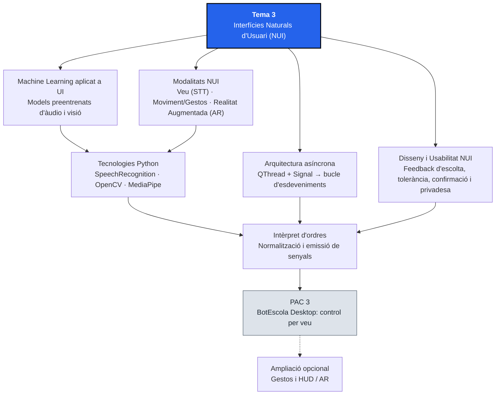

# Tema 3. Interfícies Naturals d'Usuari (NUI)

## 1. Identificació

* **Mòdul:** 0488. Desenvolupament d'interfícies
* **Curs:** 1r CFGS de Desenvolupament d'Aplicacions Multiplataforma (DAM)
* **Tema:** 3. Interfícies Naturals d'Usuari (NUI)
* **Durada presencial:** 10 hores
* **RA treballats:** RA2
* **Prerequisits:** Domini del bucle d'esdeveniments, senyals, slots i accions (`QAction`) a PySide6 (Tema 1), creació de classes i senyals propis (`Signal`), proves unitàries amb `pytest-qt` i components de `BotEscola Desktop` (Tema 2).
* **Projecte transversal:** <mark style="color:violet;">**BotEscola Desktop**</mark>. En aquest tema s'incorpora principalment el **control per veu** a la finestra principal per navegar per les notificacions, canviar-ne la prioritat, marcar-les com a llegides o activar les ordres d'aprovar i descartar. La detecció de gestos amb càmera és una ampliació opcional. La captura es fa en segon pla per no bloquejar el bucle d'esdeveniments de la GUI, i la interfície continua admetent ratolí i teclat com a vies alternatives.

### Criteris d'avaluació treballats

#### RA2. Genera interfícies naturals d'usuari valorant i emprant eines específiques.

* CA 2.1: Identifica les eines disponibles per a l'aprenentatge automàtic orientat a la interfície d'usuari.
* CA 2.2: Analitza les eines disponibles per al reconeixement de la parla.
* CA 2.3: Analitza les eines disponibles per a la detecció del moviment.
* CA 2.4: Analitza les eines disponibles per a la realitat augmentada.
* CA 2.5: Dissenya interfícies naturals d'usuari.
* CA 2.6: Programa aplicacions que inclouen interfícies naturals d'usuari.

#### Continguts Orientatius

* 2.1 Característiques de les interfícies naturals d'usuari (NUI). Evolució: CLI, GUI i NUI.
* 2.2 Eines i models d'aprenentatge automàtic (Machine Learning) aplicats a la interfície d'usuari.
* 2.3 Reconeixement de la parla (Speech-to-Text) i ordres de veu.
* 2.4 Detecció de moviment i reconeixement gestual mitjançant visió per computador.
* 2.5 Fonaments i eines de realitat augmentada (AR) aplicades a les interfícies.
* 2.6 Integració asíncrona de sensors (micròfon i càmera) amb el bucle d'esdeveniments de la GUI.

## 2. Introducció

Fins ara hem interactuat amb <mark style="color:violet;">**BotEscola Desktop**</mark> mitjançant els perifèrics clàssics d'una interfície gràfica d'usuari (GUI): el ratolí i el teclat. Tanmateix, hi ha contextos d'ús —com ara accessibilitat motriu, entorns industrials amb les mans ocupades, dispositius mòbils o quioscos interactius— on parlar a l'aplicació o fer un gest davant la càmera resulta molt més directe i inclusiu. Aquest paradigma s'anomena **Interfície Natural d'Usuari (NUI, _Natural User Interface_)**.

En aquest tema explorarem com els models d'**aprenentatge automàtic (_Machine Learning_)** permeten traduir dades físiques complexes en informació útil per a una aplicació. La pràctica obligatòria se centra en el reconeixement de la parla amb <mark style="color:violet;">**`SpeechRecognition`**</mark>. També estudiarem <mark style="color:violet;">**`OpenCV`**</mark>, <mark style="color:violet;">**`MediaPipe`**</mark> i la **realitat augmentada (AR)**; la implementació de la càmera i dels gestos es proposa com a ampliació opcional.

A nivell arquitectònic, integrar un micròfon o una càmera planteja un repte fonamental que ja vam anticipar al Tema 1 (apartat 5.3): **capturar àudio o processar vídeo és una operació bloquejant**. Si escoltem el micròfon dins del fil principal de Qt, la finestra es congelarà. Per resoldre-ho, aprendrem a aïllar l'escolta en un fil de treball (<mark style="color:red;">**`QThread`**</mark>) que es comunicarà amb el Presentador exclusivament a través de **senyals propis** (<mark style="color:red;">**`Signal`**</mark>), reutilitzant les mateixes accions (<mark style="color:red;">**`QAction`**</mark>) i components que ja tenim construïts.

Finalment, un micròfon i una càmera capten dades personals: al llarg del tema tractarem també la **privadesa** i com provar tot el sistema sense maquinari físic.

## 3. Objectius didàctics

En acabar el tema, l'alumne serà capaç de:

1. Comparar els paradigmes CLI, GUI i NUI i identificar les eines d'aprenentatge automàtic que fan possible la interacció per veu, moviment i realitat augmentada.
2. Analitzar i seleccionar llibreries de reconeixement de la parla (en núvol i locals) segons els requisits de latència, privadesa i connexió.
3. Analitzar les eines de visió per computador i detecció d'estructures corporals (`OpenCV`, `MediaPipe`) i les tecnologies de realitat augmentada.
4. Dissenyar un catàleg d'ordres de veu i conèixer els riscos de les ordres gestuals, aplicant criteris d'usabilitat, prevenció de falsos positius, retroalimentació visual i privadesa (heurístiques de Nielsen).
5. Implementar l'escolta de veu en un fil secundari (<mark style="color:red;">`QThread`</mark>) per no bloquejar el bucle d'esdeveniments principal (<mark style="color:orange;">`app.exec()`</mark>) i entendre com s'aplicaria el mateix patró a la captura de càmera opcional.
6. Dissenyar un component intèrpret d'ordres que normalitzi el text reconegut i el tradueixi en senyals de Qt deslligats del maquinari físic.
7. Connectar els senyals de la interfície natural amb les accions (<mark style="color:red;">`QAction`</mark>) i components (<mark style="color:red;">`SelectorPrioritat`</mark>, <mark style="color:red;">`TargetaNotificacio`</mark>) de <mark style="color:violet;">**BotEscola Desktop**</mark>.
8. Verificar el comportament de la lògica NUI amb proves unitàries automàtiques (`pytest-qt`) mitjançant injecció o simulació (_mocking_), sense dependre d'un micròfon o càmera físics durant el test.

## 4. Mapa conceptual



## 5. Conceptes fonamentals

> **Convenció tipogràfica:** els noms ressaltats en color segueixen la dels Temes 1 i 2: <mark style="color:red;">**classes de Qt i components**</mark>, <mark style="color:blue;">**propietats i senyals**</mark>, <mark style="color:orange;">**mètodes**</mark> i <mark style="color:violet;">**eines, fitxers i noms del projecte**</mark>.

### 5.1. De la GUI a la NUI i el paper del Machine Learning

L'evolució de les interfícies d'usuari es pot resumir en tres grans etapes:

| Paradigma | Nom complet | Mecanisme d'interacció | Corba d'aprenentatge per a l'usuari |
| :--- | :--- | :--- | :--- |
| **CLI** | _Command Line Interface_ | Ordres textuals escrites amb sintaxi estricta | Alta (cal memoritzar ordres) |
| **GUI** | _Graphical User Interface_ | Metàfores visuals (finestres, icones, menús, punter) | Baixa (reconeixement visual) |
| **NUI** | _Natural User Interface_ | Accions humanes com la veu, els gestos, el tacte o la mirada | Pot ser baixa, però depèn que les accions siguin descobribles i rebin retroalimentació clara |

Per què les interfícies naturals depenen de l'**aprenentatge automàtic (_Machine Learning_)**? Amb programació tradicional (`if/else`) és inviable escriure regles fixes per reconèixer una paraula pronunciada per persones amb accents i timbres diferents o per localitzar una mà amb condicions de llum variables. En una NUI moderna utilitzem **models preentrenats** d'aprenentatge profund (_Deep Learning_) que transformen dades no estructurades (àudio o imatge) en dades estructurades (cadenes de text o coordenades 3D de punts clau):

| Àmbit NUI | Entrada física | Tasca del model de ML | Sortida estructurada per a la UI |
| :--- | :--- | :--- | :--- |
| **Veu (STT)** | Ona acústica del micròfon | Reconeixement de la parla (_Speech-to-Text_) | Cadena de text (`"aprovar"`) |
| **Moviment / Gestos** | Fotograma RGB de la càmera | Detecció de _landmarks_ (punts de la mà, rostre o cos) | Coordenades (x, y, z) dels 21 punts de la mà |
| **Realitat Augmentada (AR)** | Vídeo + sensors inercials | Seguiment espacial (SLAM), detecció de plans i marcadors | Matriu de posició per superposar elements gràfics |

Un model d'ML **no és infal·lible**: retorna la interpretació més probable, no una certesa. Per això tota NUI ha de preveure l'error (ordre mal entesa, gest fals) i oferir sempre una via alternativa i un retorn visible a l'usuari.

### 5.2. Reconeixement de la parla (Speech-to-Text)

El reconeixement de la parla converteix l'àudio capturat pel micròfon en text que l'aplicació pot interpretar. Dins l'ecosistema Python, la llibreria de referència per desacoblar la captura d'àudio del motor de reconeixement és <mark style="color:violet;">**`SpeechRecognition`**</mark>, que actua com a façana (_wrapper_) davant de múltiples motors:

| Motor / Eina | Execució | Avantatges | Limitacions |
| :--- | :--- | :--- | :--- |
| **Google Speech Recognition** (via `SpeechRecognition.recognize_google()`) | En núvol (online) | No cal descarregar models; pot donar resultats útils per a ordres curtes | Requereix Internet; l'àudio s'envia a un servei extern; la clau genèrica és per a proves/ús personal i pot ser revocada; la precisió depèn de l'idioma i de l'entorn |
| **Vosk** | Local (offline) | Privadesa; funciona sense Internet; hi ha un model petit per al català (`vosk-model-small-ca-0.4`) | Cal descarregar i provar el model; el rendiment varia segons l'idioma, l'acústica i el vocabulari |
| **Whisper (local)** | Local (offline) | Alta precisió i multilingüe; privadesa | Els models grans consumeixen molta CPU/RAM; sense GPU la latència pot ser alta per a ordres en temps real |
| **Wit.ai / Azure / AWS Transcribe** | En núvol (online) | Integració empresarial i models personalitzables | Clau d'API, cost per ús i l'àudio surt de l'equip |

> **Privadesa.** La veu és una dada personal. En un centre educatiu (amb alumnat, de vegades menor d'edat) cal informar l'usuari de **quin motor s'utilitza i on es processa l'àudio**, limitar-ne la captació i no desar gravacions si no és necessari. Per a un ús real cal valorar un motor local, les obligacions de protecció de dades i el context concret. En aquest tema utilitzem `recognize_google()` com a via didàctica senzilla; la clau genèrica no és una solució de producció i el servei en núvol implica enviar-hi l'àudio.

En una aplicació d'escriptori com <mark style="color:violet;">**BotEscola Desktop**</mark>, no n'hi ha prou amb obtenir el text transcrit: cal un **intèrpret d'ordres** que normalitzi la cadena (passar a minúscules, eliminar espais sobrants, accents i signes de puntuació) i la compari amb un **vocabulari tancat de sinònims** (per exemple, tant `"aprova"` com `"aprovar"` o `"aprovar notificacio"` han d'activar la mateixa ordre).

La coincidència **exacta** amb un vocabulari tancat és una decisió de disseny: evita falsos positius (una frase llarga amb la paraula «aprovar» enmig d'una conversa no executarà res), però rebutja frases naturals com «aprova aquesta notificació». Cercar paraules clau dins la frase seria més flexible, però augmentaria el risc d'activacions accidentals.

### 5.3. Detecció de moviment i gestos per visió per computador

Per controlar una interfície amb el moviment de les mans sense tocar cap perifèric, es combinen dues eines principals en Python:

* <mark style="color:violet;">**`OpenCV`**</mark> (`cv2`): gestiona l'accés a la càmera web (`VideoCapture`), la lectura fotograma a fotograma i les transformacions bàsiques d'imatge (inversió en mode mirall amb `cv2.flip`, conversió de BGR a RGB amb `cv2.cvtColor`).
* <mark style="color:violet;">**`MediaPipe`**</mark>: conjunt d'eines de visió amb models d'aprenentatge automàtic. Amb l'API actual (_MediaPipe Tasks_), <mark style="color:red;">`HandLandmarker`</mark> localitza els **21 punts clau (_landmarks_)** de la mà; <mark style="color:red;">`GestureRecognizer`</mark> pot classificar gestos com `Thumb_Up` o `Closed_Fist`. Cal configurar la tasca adequada i descarregar el fitxer de model (`.task`) corresponent. La velocitat i el rendiment depenen de l'equip i de la configuració; no s'ha de donar per garantit que qualsevol model funcioni en temps real sobre CPU.

> **Compte amb tutorials antics.** Molts exemples d'internet usen `mp.solutions.hands` («MediaPipe Hands», API _legacy_). Aquesta API està deprecada i a les versions recents de `mediapipe` ja no hi és (`AttributeError: module 'mediapipe' has no attribute 'solutions'`). En aquest tema s'utilitza sempre l'API de _Tasks_.

Cada _landmark_ té coordenades `x` i `y` **normalitzades** entre `0.0` i `1.0` respecte de l'amplada i l'alçada del fotograma (poden sortir lleugerament del rang si la mà queda parcialment fora de la imatge) i una `z` de profunditat relativa al canell. Atenció: l'eix `y` **creix cap avall** a les imatges.

A partir d'aquests punts, l'aplicació pot deduir gestos simples sense entrenar cap xarxa neuronal nova. Per exemple, un dit està aixecat si la seva punta té una `y` **menor** que la de l'articulació intermèdia (en una mà vertical davant la càmera):

```python
NOMS_DITS = ("index", "cor", "anular", "menovell")
PUNTES = (8, 12, 16, 20)         # puntes dels quatre dits (sense el polze)
ARTICULACIONS = (6, 10, 14, 18)  # articulacions PIP dels quatre dits


def estat_dits(punts):
    """Retorna si cadascun dels quatre dits (sense el polze) sembla aixecat."""
    return {
        nom: punts[punta].y < punts[art].y
        for nom, punta, art in zip(NOMS_DITS, PUNTES, ARTICULACIONS)
    }


def dits_aixecats(punts):
    """Compta els dits aixecats (sense el polze) a partir de 21 landmarks."""
    return sum(estat_dits(punts).values())
```

La funció `estat_dits()` conserva la identitat de cada dit, de manera que es pot distingir «només l'índex» d'«un dit qualsevol». La comparació de coordenades és una **heurística didàctica**, no un classificador robust: depèn de l'orientació de la mà i no tracta el polze. Prova aquestes funcions amb punts inventats, sense càmera. Un desplaçament horitzontal (_swipe_) es pot detectar comparant la `x` del canell entre fotogrames.

### 5.4. Realitat Augmentada (AR) aplicada a les interfícies

Mentre que la **Realitat Virtual (VR)** substitueix completament l'entorn físic per un d'artificial, la **Realitat Augmentada (AR)** superposa informació i controls digitals sobre la imatge del món real en temps real.

| Enfocament d'AR | Com funciona | Tecnologies destacades | Cas d'ús en interfícies |
| :--- | :--- | :--- | :--- |
| **Basada en marcadors** | Detecta un patró visual conegut i hi ancora un panell informatiu. Els marcadors ArUco i els codis QR són formats diferents. | `OpenCV` (`cv2.aruco.ArucoDetector` per a ArUco; `cv2.QRCodeDetector` per a QR), Vuforia | Escanejar l'etiqueta d'una aula o equipament escolar i superposar-hi les incidències obertes sobre el vídeo |
| **Sense marcadors (_Markerless_ / SLAM)** | Detecta superfícies planes (taules, parets) i calcula la profunditat de l'escena | ARCore (Android), ARKit (iOS), WebXR | Col·locar panells flotants o previsualitzar objectes 3D en l'espai físic |
| **Superposició sobre punts detectats (_HUD_)** | Ancora indicadors visuals sobre punts anatòmics detectats amb ML | `MediaPipe` + `OpenCV` / Qt | Mostrar un indicador d'estat o un menú flotant que segueix la posició de la mà de l'usuari |

En una aplicació d'escriptori amb PySide6 i <mark style="color:violet;">`OpenCV`</mark>, l'ampliació opcional pot implementar un visor de càmera o un HUD (_Heads-Up Display_) dibuixant gràfics i etiquetes d'estat sobre els fotogrames, convertint la matriu d'imatge (BGR a RGB) a <mark style="color:red;">`QImage`</mark> i mostrant-la en un <mark style="color:red;">`QLabel`</mark>. Si la `QImage` es crea a partir del buffer d'una matriu, cal fer-ne una còpia (`.copy()`) abans d'enviar-la per un senyal: la matriu original es reutilitza i es pot destruir.

> Les APIs i els constructors del mòdul `cv2.aruco` poden variar segons la versió d'OpenCV; les versions recents utilitzen `ArucoDetector`. Per als codis QR, l'eina corresponent és `QRCodeDetector`. Consulta la documentació de la versió instal·lada.

### 5.5. Disseny i usabilitat en interfícies naturals

Una interfície natural mal dissenyada genera frustració perquè pateix el problema de la **manca de descobribilitat** (les ordres de veu o els gestos són invisibles si ningú explica quins existeixen) i el risc d'**activació accidental** (l'anomenat efecte _Midas Touch_: l'usuari parla amb un company o es toca la cara i l'aplicació executa una ordre no desitjada).

Per això, les **heurístiques de Nielsen** i els principis d'accessibilitat del Tema 1 es tradueixen en regles concretes per a la NUI:

1. **Visibilitat de l'estat del sistema (heurística 1):** l'usuari ha de saber en tot moment si el micròfon o la càmera estan inactius, escoltant o processant, i quina frase o gest acaba d'interpretar el sistema. Mai utilitzis només el color (per exemple, un punt verd/vermell); acompanya-ho d'un text explícit com `Veu: escoltant...` o `Veu: inactiva`.
2. **Control i llibertat de l'usuari (heurística 3):** l'escolta per veu o càmera s'ha de poder activar i desactivar fàcilment (mode _Push-to-Talk_ o un interruptor clar d'escolta contínua) per garantir la privadesa i evitar falsos positius. Algunes NUI afegeixen una **paraula d'activació** (_wake word_) abans de cada ordre.
3. **Prevenció d'errors (heurística 5):** una ordre destructiva com `Descartar…` activada per veu o gest **mai** ha d'eliminar la notificació directament sense passar pel diàleg de confirmació o per un segon pas explícit. En gestos, exigeix que el gest es mantingui estable un instant abans d'acceptar-lo.
4. **Multimodalitat i no exclusivitat:** la NUI és una via addicional d'accés, no un substitut que elimini el teclat o el ratolí. Per mantenir una única font de veritat (Tema 1, apartat 5.9.5), les ordres NUI activen les mateixes <mark style="color:red;">`QAction`</mark> de la finestra i respecten si estan habilitades (<mark style="color:orange;">`isEnabled()`</mark>).
5. **Privadesa i consentiment:** l'usuari ha de saber quan s'activa el micròfon o la càmera, i l'aplicació no ha de desar àudio ni imatges si no cal.

### 5.6. Concurrència a Qt: `QThread` i comunicació per senyals

Al Tema 1 (apartat 5.3) vam veure que el bucle d'esdeveniments (<mark style="color:orange;">`app.exec()`</mark>) corre en el **fil principal** (_main thread_). Si dins d'un _slot_ cridem `recognizer.listen(source)` o fem un bucle `while` llegint la càmera amb `cap.read()`, el fil principal es queda aturat esperant dades i la finestra deixa de repintar-se i de respondre als clics.

A més, a Qt hi ha una regla estricta de seguretat: **cap fil secundari pot modificar directament un widget de la interfície gràfica**. Tota modificació visual s'ha de fer des del fil principal.

La solució arquitectònica d'aquest exemple consisteix a crear una subclasse de <mark style="color:red;">**`QThread`**</mark> que executi l'escolta dins del mètode <mark style="color:orange;">**`run()`**</mark> i emeti **senyals propis** (<mark style="color:red;">**`Signal`**</mark>) cap al Presentador. (Qt també admet el patró alternatiu d'un objecte _worker_ mogut a un fil amb `moveToThread()`; aquí usem la subclasse perquè és més fàcil de seguir.) La càmera només s'implementa a l'ampliació opcional.

```mermaid
sequenceDiagram
    participant U as Usuari (veu; gest opcional)
    participant W as Fil secundari (QThread)
    participant I as Intèrpret NUI
    participant P as Presentador (Fil principal GUI)
    participant A as QAction / Widgets

    U->>W: Pronuncia "aprovar" (veu; gest només a l'ampliació)
    Note over W: Captura i reconeix en segon pla<br/>sense bloquejar app.exec()
    W->>I: Emet text_reconegut("aprovar")
    I->>P: Emet ordre_detectada("aprovar")
    P->>A: Comprova isEnabled() i crida act_aprovar.trigger()
```

Quan un senyal s'emet des d'un fil i el receptor és un objecte que viu al fil principal, Qt el **posa en cua** (_queued connection_) i el slot s'executa de manera segura dins del fil principal. Per això:

* Connecta sempre els senyals del fil a **mètodes d'un `QObject`** (el Presentador o l'intèrpret) i no a `lambda`: així és evident en quin fil s'executa el codi, i un `lambda` que toqués un widget podria incomplir la regla anterior.
* Per demanar que un fil acabi, no s'utilitza `terminate()` (pot deixar recursos oberts): s'usa <mark style="color:orange;">`requestInterruption()`</mark> i el bucle de `run()` consulta <mark style="color:orange;">`isInterruptionRequested()`</mark>. **La petició és consultiva**: no interromp per si sola una crida bloquejant a un dispositiu o a la xarxa. Per això cal posar límits de temps a les operacions i no destruir l'objecte `QThread` fins que hagi acabat.

## 6. Entorn de treball

### 6.1. Estructura del projecte

Ampliem l'estructura de <mark style="color:violet;">**BotEscola Desktop**</mark> del Tema 2 afegint-hi el paquet `nui/` per als components d'interfície natural i els seus fitxers de proves a `tests/`:

```
botescola/
├── ui/
│   └── botescola.ui
├── generated/
│   └── ui_botescola.py
├── styles/
│   ├── botescola.qss
│   └── alt_contrast.qss
├── components/               <-- Tema 2 (RA3)
│   ├── __init__.py
│   ├── selector.py
│   ├── targeta.py
│   └── comptador.py
├── nui/                      <-- Tema 3 (RA2): interfícies naturals
│   ├── __init__.py
│   ├── interpret.py          <-- traducció de text (i gestos, si s'amplia) a ordres i senyals
│   ├── escoltador_veu.py     <-- QThread de reconeixement de veu
│   ├── detector_gestos.py    <-- QThread de càmera i gestos (exercici D, opcional)
│   └── models/               <-- fitxers .task de MediaPipe (exercici D, opcional)
├── tests/
│   ├── test_selector.py
│   ├── test_targeta.py
│   ├── test_comptador.py
│   └── test_nui.py           <-- proves de l'intèrpret, de l'escoltador i de la cadena NUI
├── docs/
│   ├── components.md
│   └── nui.md                <-- catàleg d'ordres NUI, arquitectura i privadesa
├── dades.py
├── botescola_app.py
├── pyproject.toml
├── pytest.ini
├── contrast.py
├── taula_contrast.md
└── README.md
```

Separar `nui/interpret.py` (lògica pura de reconeixement d'ordres i emissió de senyals) de `nui/escoltador_veu.py` (accés al micròfon físic) ens permetrà **provar tota la lògica amb `pytest-qt`** i fins i tot simular ordres a l'aula en ordinadors que no tinguin micròfon ni càmera.

Com que al Tema 2 la distribució contenia només els components, cal actualitzar el `pyproject.toml` si ara també s'hi inclou el paquet NUI. **Substitueix els camps corresponents de la taula `[project]` existent; no afegeixis una segona taula `[project]`.** El nom i la versió s'actualitzen per reflectir el canvi, i les eines de càmera continuen sent opcionals:

```toml
[project]
name = "botescola-modules"
version = "0.2.0"
description = "Paquets Python reutilitzables de BotEscola Desktop"
requires-python = ">=3.10"
dependencies = ["PySide6", "SpeechRecognition[audio]"]

[project.optional-dependencies]
gestos = ["opencv-python", "mediapipe"]

[tool.setuptools.packages.find]
include = ["components*", "nui*"]
```

Aquesta configuració empaqueta els paquets `components` i `nui`; no converteix per si sola l'aplicació completa en un instal·lador. Les proves continuen localitzant els mòduls gràcies a `pythonpath = .` de <mark style="color:violet;">`pytest.ini`</mark> (Tema 2). Si al final del tema s'ha fet l'ampliació de gestos, instal·la també les dependències opcionals corresponents.

### 6.2. Dependències

Amb l'entorn virtual activat, instal·la la dependència obligatòria per al reconeixement de veu:

```bash
python -m pip install "SpeechRecognition[audio]"
```

L'extra `[audio]` instal·la `PyAudio`, que permet accedir al micròfon. A Linux pot caldre instal·lar abans la llibreria del sistema (`sudo apt install portaudio19-dev`) i a macOS, `brew install portaudio`. **Només per a l'ampliació opcional de càmera i gestos**, instal·la també:

```bash
python -m pip install opencv-python mediapipe
```

> **Nota sobre `PyAudio` i el maquinari d'aula:** si en algun equip no hi ha micròfon físic, o `PyAudio` no es pot instal·lar per a la teva versió de Python, **no pots quedar-te bloquejat**: `import speech_recognition` funciona igualment (només `sr.Microphone()` falla), les proves automàtiques no necessiten micròfon i el **simulador d'ordres** (exercici E) permet demostrar tot el flux NUI sense maquinari.

Comprova les versions instal·lades i documenta-les al <mark style="color:violet;">`README.md`</mark>. La primera ordre és suficient per a la PAC obligatòria; executa la segona només si has instal·lat les dependències opcionals de gestos:

```bash
python -c "import speech_recognition as sr; print('SpeechRecognition', sr.__version__)"
python -c "import cv2, mediapipe as mp; print('OpenCV', cv2.__version__, '| MediaPipe', mp.__version__)"
```

## 7. Exemple guiat: Intèrpret i Escoltador d'ordres de veu per a BotEscola

Volem que l'usuari pugui controlar <mark style="color:violet;">**BotEscola Desktop**</mark> dient en veu alta ordres com `"següent"`, `"anterior"`, `"llegida"`, `"prioritat alta"` o `"aprovar"`.

### Pas 1. Dissenyar el catàleg d'ordres i la interfície pública

Abans de programar, definim les ordres admeses, les frases que les activen i quin senyal emetrà el nostre component `InterpretOrdres`:

| Ordre canònica | Frases reconegudes (un cop normalitzades: sense accents ni majúscules) | Senyal emès | Efecte al Presentador |
| :--- | :--- | :--- | :--- |
| `"seguent"` | `"seguent"`, `"seguent notificacio"`, `"avancar"` | <mark style="color:blue;">`ordre_detectada("seguent")`</mark> | Selecciona la fila següent de `lst_notificacions` |
| `"anterior"` | `"anterior"`, `"notificacio anterior"`, `"enrere"` | <mark style="color:blue;">`ordre_detectada("anterior")`</mark> | Selecciona la fila anterior de `lst_notificacions` |
| `"llegida"` | `"llegida"`, `"marcar com a llegida"`, `"marcar llegida"` | <mark style="color:blue;">`ordre_detectada("llegida")`</mark> | Marca la targeta seleccionada com a llegida |
| `"aprovar"` | `"aprovar"`, `"aprova"`, `"aprovar notificacio"` | <mark style="color:blue;">`ordre_detectada("aprovar")`</mark> | Crida `act_aprovar.trigger()` si està habilitada |
| `"descartar"` | `"descartar"`, `"descarta"`, `"descartar notificacio"`, `"eliminar"` | <mark style="color:blue;">`ordre_detectada("descartar")`</mark> | Crida `act_descartar.trigger()` si està habilitada (amb confirmació) |
| Canvi de prioritat | `"prioritat baixa"`, `"prioritat normal"`, `"prioritat alta"` | <mark style="color:blue;">`prioritat_detectada(nivell)`</mark> | Assigna `"Baixa"`, `"Normal"` o `"Alta"` a `sel_prioritat` |
| No reconeguda | Qualsevol altra frase | <mark style="color:blue;">`ordre_desconeguda(text)`</mark> | Informa a la barra d'estat amb el prefix `Veu:` |

### Pas 2. Programar l'intèrpret d'ordres (`nui/interpret.py`)

Aquest component hereta de <mark style="color:red;">`QObject`</mark> (no necessita representació visual pròpia, però sí emetre senyals de Qt) i no depèn de cap micròfon ni càmera. També accepta noms de gest (`processar_gest`), que utilitzarà l'exercici D:

```python
"""Intèrpret d'ordres naturals (veu i gestos) per a BotEscola Desktop."""

import unicodedata
from PySide6.QtCore import QObject, Signal


class InterpretOrdres(QObject):
    """Tradueix frases de text o noms de gest en senyals d'ordre per a la UI.

    Senyals:
        ordre_detectada(str): nom canònic de l'ordre ('seguent', 'anterior',
            'llegida', 'aprovar', 'descartar').
        prioritat_detectada(str): nivell ('Baixa', 'Normal', 'Alta').
        ordre_desconeguda(str): text original quan no coincideix amb cap ordre.
    """

    ordre_detectada = Signal(str)
    prioritat_detectada = Signal(str)
    ordre_desconeguda = Signal(str)

    # Els sinònims s'escriuen ja normalitzats: minúscules i SENSE accents.
    SINONIMS = {
        "seguent": ("seguent", "seguent notificacio", "avancar"),
        "anterior": ("anterior", "notificacio anterior", "enrere"),
        "llegida": ("llegida", "marcar com a llegida", "marcar llegida"),
        "aprovar": ("aprovar", "aprova", "aprovar notificacio"),
        "descartar": ("descartar", "descarta", "descartar notificacio", "eliminar"),
    }

    PRIORITATS = {
        "prioritat baixa": "Baixa",
        "prioritat normal": "Normal",
        "prioritat alta": "Alta",
    }

    # Nom del gest (el decideix el detector de gestos) -> ordre canònica.
    GESTOS = {
        "dit_index": "seguent",
        "puny_tancat": "llegida",
        "ma_oberta": "aprovar",
    }

    @staticmethod
    def normalitzar(text):
        """Minúscules, sense espais sobrants, sense accents ni puntuació."""
        if not isinstance(text, str):
            raise TypeError("El text d'entrada ha de ser de tipus str.")
        sense_accents = "".join(
            c for c in unicodedata.normalize("NFD", text.lower())
            if unicodedata.category(c) != "Mn"
        )
        nomes_alfanumeric = "".join(
            c for c in sense_accents if c.isalnum() or c.isspace()
        )
        return " ".join(nomes_alfanumeric.split())

    def processar_text(self, text):
        """Analitza una frase i emet el senyal corresponent."""
        normalitzat = self.normalitzar(text)
        if not normalitzat:
            return

        if normalitzat in self.PRIORITATS:
            self.prioritat_detectada.emit(self.PRIORITATS[normalitzat])
            return

        for ordre, variants in self.SINONIMS.items():
            if normalitzat in variants:
                self.ordre_detectada.emit(ordre)
                return

        self.ordre_desconeguda.emit(text.strip())

    def processar_gest(self, nom_gest):
        """Tradueix el nom d'un gest a una ordre canònica i l'emet."""
        ordre = self.GESTOS.get(nom_gest)
        if ordre is None:
            self.ordre_desconeguda.emit(str(nom_gest))
        else:
            self.ordre_detectada.emit(ordre)
```

### Pas 3. Programar el fil d'escolta de veu (`nui/escoltador_veu.py`)

Ara creem el <mark style="color:red;">`QThread`</mark> que utilitza <mark style="color:violet;">`SpeechRecognition`</mark> en segon pla i envia el text capturat mitjançant senyals. L'aturada es fa amb <mark style="color:orange;">`requestInterruption()`</mark>, el mecanisme previst per Qt:

```python
"""Fil de treball per a la captura i reconeixement de veu en segon pla."""

from PySide6.QtCore import QThread, Signal

try:
    import speech_recognition as sr
except ImportError:
    sr = None


class EscoltadorVeu(QThread):
    """Captura àudio del micròfon en un fil separat sense bloquejar la GUI.

    Senyals:
        text_reconegut(str): frase transcrita pel motor STT.
        estat_escolta(str): canvi d'estat ('escoltant', 'processant', 'inactiu').
        error_veu(str): missatge d'error comprensible per a l'usuari.
    """

    text_reconegut = Signal(str)
    estat_escolta = Signal(str)
    error_veu = Signal(str)

    def __init__(self, parent=None, idioma="ca-ES"):
        super().__init__(parent)
        self._idioma = idioma

    @property
    def idioma(self):
        """Codi d'idioma utilitzat pel reconeixedor (per defecte 'ca-ES')."""
        return self._idioma

    def aturar(self):
        """Sol·licita l'aturada ordenada: el bucle de run() acaba en el proper cicle."""
        self.requestInterruption()

    def run(self):
        """Mètode executat al fil secundari en cridar start()."""
        if sr is None:
            self.error_veu.emit("La llibreria SpeechRecognition no està instal·lada.")
            self.estat_escolta.emit("inactiu")
            return

        reconeixedor = sr.Recognizer()
        # Evita que una petició al servei remot pugui esperar indefinidament.
        reconeixedor.operation_timeout = 5
        try:
            with sr.Microphone() as font:
                reconeixedor.adjust_for_ambient_noise(font, duration=0.5)
                while not self.isInterruptionRequested():
                    self.estat_escolta.emit("escoltant")
                    try:
                        audio = reconeixedor.listen(font, timeout=1, phrase_time_limit=4)
                    except sr.WaitTimeoutError:
                        continue

                    if self.isInterruptionRequested():
                        break

                    self.estat_escolta.emit("processant")
                    try:
                        text = reconeixedor.recognize_google(audio, language=self._idioma)
                        self.text_reconegut.emit(text)
                    except sr.UnknownValueError:
                        self.error_veu.emit("No s'ha pogut entendre l'ordre de veu.")
                    except sr.RequestError:
                        self.error_veu.emit("Servei de reconeixement de veu no disponible.")
                    except sr.TimeoutError:
                        self.error_veu.emit("Temps d'espera del servei de veu excedit.")
        except (OSError, AttributeError):
            # OSError: no hi ha micròfon. AttributeError: PyAudio no està instal·lat.
            self.error_veu.emit("No s'ha pogut accedir al micròfon (comprova que n'hi ha un i que PyAudio està instal·lat).")
        finally:
            self.estat_escolta.emit("inactiu")
```

Exposem les classes a <mark style="color:violet;">`nui/__init__.py`</mark>:

```python
"""Mòdul d'interfícies naturals d'usuari (NUI) de BotEscola Desktop."""

from .interpret import InterpretOrdres
from .escoltador_veu import EscoltadorVeu

__all__ = ["InterpretOrdres", "EscoltadorVeu"]
```

### Pas 4. Connectar la NUI amb les `QAction` i els components del Presentador

Al Presentador (<mark style="color:violet;">`botescola_app.py`</mark>), l'`EscoltadorVeu` alimenta l'`InterpretOrdres`, i aquest activa les accions i els components existents. Primer, les connexions (dins de `__init__`, després de `setupUi`). Observa que **tots els slots són mètodes de la finestra**, no `lambda`:

```python
from PySide6.QtWidgets import QPushButton
from nui import InterpretOrdres, EscoltadorVeu

ESTATS_VEU = {
    "inactiu": "Veu: inactiva",
    "escoltant": "Veu: escoltant...",
    "processant": "Veu: processant...",
}

# Dins de __init__ de la finestra principal (Presentador):
self.interpret = InterpretOrdres(self)
self.escoltador = EscoltadorVeu(self)
self._tancament_pendent = False

self.escoltador.text_reconegut.connect(self.interpret.processar_text)
self.escoltador.finished.connect(self.escolta_finalitzada)
self.escoltador.estat_escolta.connect(self.actualitzar_estat_nui)
self.escoltador.error_veu.connect(self.mostrar_missatge_veu)

self.interpret.ordre_detectada.connect(self.executar_ordre_nui)
self.interpret.prioritat_detectada.connect(self.canviar_prioritat_nui)
self.interpret.ordre_desconeguda.connect(self.ordre_nui_desconeguda)

self.ui.act_escoltar_veu.toggled.connect(self.alternar_escolta)
self.ui.btn_simular_veu.clicked.connect(self.simular_veu)
self.ui.txt_simular_veu.returnPressed.connect(self.simular_veu)
```

Després, l'activació i l'estat de l'escolta. Quan el fil acaba (per aturada o per error, per exemple si no hi ha micròfon), l'acció marcable es desmarca perquè no quedi un estat fals:

```python
def alternar_escolta(self, activa):
    if activa:
        if not self.escoltador.isRunning():
            self.escoltador.start()
    elif self.escoltador.isRunning():
        self.ui.act_escoltar_veu.setEnabled(False)   # fins que el fil acabi
        self.mostrar_missatge_veu("Aturant escolta de veu…")
        self.escoltador.aturar()

def escolta_finalitzada(self):
    self.ui.act_escoltar_veu.setChecked(False)
    self.ui.act_escoltar_veu.setEnabled(True)

def actualitzar_estat_nui(self, estat):
    self.ui.lbl_estat_nui.setText(ESTATS_VEU.get(estat, ESTATS_VEU["inactiu"]))

def mostrar_missatge_veu(self, missatge):
    self.statusBar().showMessage(f"Veu: {missatge}", 5000)

def ordre_nui_desconeguda(self, text):
    self.mostrar_missatge_veu(f"ordre no reconeguda «{text}»")

def simular_veu(self):
    self.interpret.processar_text(self.ui.txt_simular_veu.text())
    self.ui.txt_simular_veu.clear()
```

Finalment, l'execució de les ordres. Les ordres de veu **no dupliquen lògica**: aprovar i descartar passen per la `QAction` (amb el diàleg de confirmació del Tema 1); «llegida» activa el mateix botó de la targeta que un clic de ratolí (així s'emet `llegida_clicada` i el Presentador fa el que ja feia al Tema 2); i la prioritat es canvia a través de la propietat de `SelectorPrioritat`, que emet `prioritat_canviada`:

```python
def executar_ordre_nui(self, ordre):
    fila = self.ui.lst_notificacions.currentRow()

    if ordre == "seguent":
        self.moure_seleccio(fila + 1)
    elif ordre == "anterior":
        self.moure_seleccio(fila - 1)
    elif ordre == "llegida":
        self.marcar_llegida_nui()
    elif ordre == "aprovar":
        self.disparar_accio_nui(self.ui.act_aprovar)
    elif ordre == "descartar":
        self.disparar_accio_nui(self.ui.act_descartar)

def moure_seleccio(self, nova_fila):
    llista = self.ui.lst_notificacions
    if 0 <= nova_fila < llista.count():
        llista.setCurrentRow(nova_fila)
        self.mostrar_missatge_veu(f"notificació {nova_fila + 1} de {llista.count()}.")
    else:
        self.mostrar_missatge_veu("no hi ha més notificacions en aquesta direcció.")

def disparar_accio_nui(self, accio):
    if accio.isEnabled():
        accio.trigger()
    else:
        self.mostrar_missatge_veu("ordre no disponible: cal seleccionar una notificació.")

def marcar_llegida_nui(self):
    item = self.ui.lst_notificacions.currentItem()
    if item is None:
        self.mostrar_missatge_veu("cal seleccionar una notificació.")
        return
    targeta = self.ui.lst_notificacions.itemWidget(item)
    boto = targeta.findChild(QPushButton, "btn_llegida")
    if boto is not None and boto.isEnabled():
        boto.click()          # mateix camí que un clic de ratolí
    else:
        self.mostrar_missatge_veu("la notificació ja estava llegida.")

def canviar_prioritat_nui(self, nivell):
    if self.ui.lst_notificacions.currentItem() is None:
        self.mostrar_missatge_veu("cal seleccionar una notificació.")
        return
    self.ui.sel_prioritat.prioritat = nivell   # emet prioritat_canviada si el valor canvia
```

Connecta també `self.escoltador.finished` a `self.escolta_finalitzada` durant la inicialització, i inicialitza `self._tancament_pendent = False`. En tancar la finestra, no esperis bloquejant el fil gràfic ni destrueixis un `QThread` que encara corre: ajorna el tancament fins que el senyal `finished` confirmi que ha acabat.

```python
def closeEvent(self, event):
    if self.escoltador.isRunning():
        event.ignore()
        if not self._tancament_pendent:
            self._tancament_pendent = True
            self.mostrar_missatge_veu("Aturant escolta de veu abans de tancar…")
            self.escoltador.aturar()
            self.escoltador.finished.connect(self._tancar_quan_acabi)
        return
    super().closeEvent(event)

def _tancar_quan_acabi(self):
    self._tancament_pendent = False
    self.close()
```

`requestInterruption()` no pot tallar una lectura de micròfon o una petició de xarxa que estigui bloquejada; el temps màxim de petició i els temps de `listen()` ajuden a fer que el fil pugui comprovar la interrupció i acabar. Si el controlador de maquinari no respon, l'aplicació encara ha de tractar aquesta situació explícitament.

Observa com, quan l'usuari diu `"descartar"`, es crida `self.ui.act_descartar.`<mark style="color:orange;">`trigger()`</mark>, de manera que apareix el mateix diàleg de confirmació que vam programar al Tema 1. No es duplica cap lògica.

### Pas 5. Proves unitàries amb `pytest-qt` (`tests/test_nui.py`)

Com que `InterpretOrdres` està deslligat del micròfon físic, podem provar-lo de manera determinista i instantània amb `qtbot`. Per a `EscoltadorVeu` utilitzem dues tècniques de **simulació**: emetre nosaltres mateixos el senyal `text_reconegut` (com si el micròfon hagués sentit alguna cosa) i substituir la llibreria `sr` per una de falsa amb `monkeypatch` (_mocking_):

```python
import pytest
from nui import InterpretOrdres, EscoltadorVeu
from nui import escoltador_veu as mod_veu


@pytest.mark.parametrize("entrada,esperat", [
    ("  Següent   Notificació ", "seguent notificacio"),
    ("ANTERIOR", "anterior"),
    ("Aprovar!", "aprovar"),
])
def test_normalitzar(entrada, esperat):
    assert InterpretOrdres.normalitzar(entrada) == esperat


@pytest.mark.parametrize("frase,ordre_esperada", [
    ("Següent", "seguent"),
    ("  següent notificació ", "seguent"),
    ("ANTERIOR", "anterior"),
    ("Marcar com a llegida", "llegida"),
    ("Aprovar notificació", "aprovar"),
    ("descartar", "descartar"),
])
def test_ordres_valides_emeten_senyal(qtbot, frase, ordre_esperada):
    interpret = InterpretOrdres()
    with qtbot.waitSignal(interpret.ordre_detectada, timeout=1000) as blocker:
        interpret.processar_text(frase)
    assert blocker.args == [ordre_esperada]


@pytest.mark.parametrize("frase,nivell", [
    ("Prioritat baixa", "Baixa"),
    ("prioritat NORMAL", "Normal"),
    ("prioritat alta", "Alta"),
])
def test_prioritat_per_veu(qtbot, frase, nivell):
    interpret = InterpretOrdres()
    with qtbot.waitSignal(interpret.prioritat_detectada, timeout=1000) as blocker:
        interpret.processar_text(frase)
    assert blocker.args == [nivell]


def test_ordre_desconeguda_emet_avis(qtbot):
    interpret = InterpretOrdres()
    with qtbot.waitSignal(interpret.ordre_desconeguda, timeout=1000) as blocker:
        interpret.processar_text("obrir el navegador")
    assert blocker.args == ["obrir el navegador"]


def test_cadena_buida_no_emet_res(qtbot):
    interpret = InterpretOrdres()
    with qtbot.assertNotEmitted(interpret.ordre_detectada):
        with qtbot.assertNotEmitted(interpret.ordre_desconeguda):
            interpret.processar_text("   ")


def test_entrada_no_textual_llanca_typeerror():
    interpret = InterpretOrdres()
    with pytest.raises(TypeError):
        interpret.processar_text(1234)


def test_gest_es_tradueix_a_ordre(qtbot):
    interpret = InterpretOrdres()
    with qtbot.waitSignal(interpret.ordre_detectada, timeout=1000) as blocker:
        interpret.processar_gest("dit_index")
    assert blocker.args == ["seguent"]


def test_cadena_escoltador_interpret_sense_maquinari(qtbot):
    escoltador = EscoltadorVeu()          # no s'inicia: no toca el micròfon
    interpret = InterpretOrdres()
    escoltador.text_reconegut.connect(interpret.processar_text)
    with qtbot.waitSignal(interpret.ordre_detectada, timeout=1000) as blocker:
        escoltador.text_reconegut.emit("Aprova")
    assert blocker.args == ["aprovar"]


def test_sense_microfon_emet_error(qtbot, monkeypatch):
    class FalsSR:
        class WaitTimeoutError(Exception): ...
        class UnknownValueError(Exception): ...
        class RequestError(Exception): ...

        class Recognizer: ...

        @staticmethod
        def Microphone():
            raise OSError("sense micròfon")

    monkeypatch.setattr(mod_veu, "sr", FalsSR)
    escoltador = EscoltadorVeu()
    with qtbot.waitSignal(escoltador.error_veu, timeout=1000) as blocker:
        escoltador.run()                   # cridat directament: s'executa síncron al test
    assert "micròfon" in blocker.args[0]
```

Fixa't que en aquesta prova cridem `run()` directament: dins d'un test **sí** és correcte (volem que s'executi de manera síncrona); en l'aplicació, en canvi, mai.

## 8. Anàlisi tècnica

* <mark style="color:red;">`QThread`</mark> encapsula un fil del sistema operatiu. El codi que s'escriu dins de <mark style="color:orange;">`run()`</mark> és l'únic que s'executa en el fil secundari, i s'inicia sempre cridant <mark style="color:orange;">`start()`</mark> (mai cridant `run()` directament a l'aplicació, perquè llavors s'executaria en el fil principal i bloquejaria la finestra).
* <mark style="color:orange;">`aturar()`</mark> es crida des del fil principal i només fa <mark style="color:orange;">`requestInterruption()`</mark>; el bucle de `run()` consulta <mark style="color:orange;">`isInterruptionRequested()`</mark> i acaba netament. Com que `listen()` és bloquejant, l'aturada normalment esperarà que acabi el temps de captura actual; la petició al servei remot queda limitada per `operation_timeout`. El `closeEvent` no bloqueja el fil gràfic ni destrueix l'objecte en execució: ajorna el tancament fins al senyal `finished`. Un problema del controlador d'àudio encara pot requerir gestió específica.
* Els senyals del fil arriben al Presentador **posats en cua** (_queued_) i s'executen al fil principal, sempre que el receptor sigui un mètode d'un `QObject` que hi viu. Per això evitem els `lambda` com a slots de senyals de fil.
* `unicodedata.normalize("NFD", ...)` separa les lletres base dels seus accents diacrítics (categoria `"Mn"`), de manera que `"Següent"` i `"seguent"` produeixen exactament la mateixa clau interna. Els sinònims del diccionari s'han d'escriure **ja normalitzats**: una alternativa més robusta seria normalitzar-los en construir l'índex.
* Separar `InterpretOrdres` d'`EscoltadorVeu` aplica el principi de **separació de responsabilitats**: el fil s'ocupa del maquinari i l'intèrpret s'ocupa de les regles de la interfície. Això és el que fa possible la injecció i la simulació a les proves.
* Abans d'activar una acció per veu (`self.ui.act_aprovar.trigger()`), es comprova <mark style="color:orange;">`isEnabled()`</mark>: si no hi ha cap notificació seleccionada, una ordre de veu tampoc pot aprovar ni descartar res.
* «Llegida» i «prioritat» reutilitzen camins que ja existeixen (el botó de la targeta i la propietat de `SelectorPrioritat`), de manera que el recompte de pendents, les dades i els missatges `Llegida:` / `Prioritat:` es mantenen coherents tant amb ratolí com amb veu.
* `recognize_google` envia l'àudio a un servei extern amb una clau genèrica pensada per a proves: és acceptable en una pràctica, però no en un producte real (vegeu 5.2).

## 9. Exercicis progressius

Tots els exercicis es lliuren a través del repositori de GitHub amb el codi font i les captures indicades.

**Ús de la IA:** pots utilitzar-la per consultar documentació o entendre l'ús d'una llibreria, però has de poder explicar i modificar en directe al laboratori qualsevol fragment del codi lliurat. A l'exercici D i a la PAC, com a mínim, has de deixar constància (en un comentari o al `README.md`) de quines decisions de disseny has pres tu i per què.

### Exercici A — Reproducció

Crea el paquet `nui/` amb <mark style="color:violet;">`interpret.py`</mark>, <mark style="color:violet;">`escoltador_veu.py`</mark> i <mark style="color:violet;">`__init__.py`</mark>, i el fitxer de proves <mark style="color:violet;">`tests/test_nui.py`</mark>. Afegeix `nui*` a <mark style="color:violet;">`pyproject.toml`</mark>. Executa `python -m pytest -v` i verifica que tant les proves dels components del Tema 2 com les noves proves de NUI passen en verd.

**Lliurament:** codi i captura de la sortida de `pytest`.

### Exercici B — Modificació: noves ordres de veu

Amplia `InterpretOrdres` perquè reconegui dues ordres noves:

1. `"primera"` (sinònims: `"primera"`, `"primera notificacio"`, `"inici"`), per seleccionar el primer element de la llista.
2. `"ultima"` (sinònims: `"ultima"`, `"ultima notificacio"`, `"final"`), per seleccionar l'últim element de la llista.

Afegeix les proves corresponents a <mark style="color:violet;">`tests/test_nui.py`</mark> utilitzant `@pytest.mark.parametrize`, i fes que el Presentador executi les dues ordres noves (reutilitza `moure_seleccio`).

**Lliurament:** codi modificat, proves i una frase que expliqui quina part del codi no ha calgut tocar i per què.

### Exercici C — Diagnosi

Analitza els quatre fragments següents, identifica el símptoma i la causa de l'error, i escriu la versió corregida:

**Cas 1.** La finestra es congela completament quan l'usuari prem el botó d'escoltar:

```python
self.ui.btn_escoltar.clicked.connect(self.escoltador.run)
```

**Cas 2.** L'aplicació tanca de cop amb un error de segmentació o avís de fils de Qt quan l'escoltador reconeix una paraula:

```python
# Dins del mètode run() d'una subclasse de QThread:
text = reconeixedor.recognize_google(audio, language="ca-ES")
self.finestra.ui.lbl_estat_nui.setText(f"Reconegut: {text}")
```

**Cas 3.** Un alumne afegeix el sinònim `"següent"` (amb dièresi) al diccionari `SINONIMS`, però quan prova `interpret.processar_text("següent")` s'emet `ordre_desconeguda`. Explica per què passa tenint en compte com funciona `normalitzar()` i proposa dues maneres de corregir-ho.

**Cas 4.** Quan no hi ha micròfon, apareix l'avís a la barra d'estat, però l'acció «Escoltar veu» continua marcada i no es pot tornar a activar:

```python
self.ui.act_escoltar_veu.toggled.connect(self.alternar_escolta)
# alternar_escolta només crida start() o aturar(); ningú no sap que el fil ha acabat
```

### Exercici D — Ampliació opcional: detector de gestos i superposició AR (`nui/detector_gestos.py`)

Si vols fer aquesta ampliació, crea un segon fil <mark style="color:red;">`DetectorGestos`</mark> (subclasse de <mark style="color:red;">`QThread`</mark>) que utilitzi <mark style="color:violet;">`OpenCV`</mark> i <mark style="color:violet;">`MediaPipe`</mark> (API _Tasks_, amb `HandLandmarker` i el fitxer de model descarregat a `nui/models/`) per detectar gestos i superposar informació d'estat sobre el fotograma (HUD de realitat augmentada). Alternativament, pots detectar marcadors ArUco amb `OpenCV`.

* Escriu una funció pura `traduir_gest(punts)` que, a partir dels 21 _landmarks_, retorni el nom del gest (per exemple: `"ma_oberta"` si hi ha 4 dits aixecats, `"puny_tancat"` si no n'hi ha cap, `"dit_index"` si només és aixecat l'índex) o `None`. Utilitza `estat_dits()` de l'apartat 5.3 per comprovar **quins** dits estan aixecats; `dits_aixecats()` només en retorna el nombre.
* Emet el senyal <mark style="color:blue;">`gest_detectat(str)`</mark> amb el nom del gest. Per evitar l'efecte _Midas Touch_, un gest només es dona per vàlid si es manté estable almenys 0,5 s, i després s'aplica un temps de refredament (_cooldown_) d'almenys 1,5 s perquè un mateix gest mantingut no dispari l'ordre desenes de vegades per segon.
* Dibuixa sobre el fotograma un rètol visual amb el gest detectat i emet <mark style="color:blue;">`fotograma_llest(QImage)`</mark> per poder previsualitzar la càmera en un <mark style="color:red;">`QLabel`</mark> opcional.
* Connecta `gest_detectat` a `InterpretOrdres.processar_gest` i desa `act_camera_gestos` com a acció marcable, igual que `act_escoltar_veu`.

_Pistes:_ `cv2.VideoCapture(0)`, `cv2.flip(fotograma, 1)` (mode mirall), `cv2.cvtColor(..., cv2.COLOR_BGR2RGB)` i `mp.Image(image_format=mp.ImageFormat.SRGB, data=rgb)`. Per a una càmera en bucle de vídeo, configura `HandLandmarker` amb `running_mode=VisionRunningMode.VIDEO` i crida `landmarker.detect_for_video(imatge, timestamp_ms)` amb marques de temps creixents; `landmarker.detect(imatge)` correspon al mode `IMAGE`. El resultat conté `hand_landmarks`. Allibera la càmera (`cap.release()`) en acabar `run()` i fes `.copy()` de la `QImage` abans d'enviar-la per senyal.

**Lliurament:** <mark style="color:violet;">`nui/detector_gestos.py`</mark>, prova unitària de `traduir_gest()` amb punts inventats (sense càmera) i captura de pantalla.

### Exercici E — Aplicació al projecte: Simulador d'ordres NUI

Per garantir que la interfície natural es pot provar i avaluar en qualsevol ordinador encara que no tingui micròfon, afegeix a la finestra de <mark style="color:violet;">**BotEscola Desktop**</mark> una zona de control NUI que inclogui:

* una acció marcable `act_escoltar_veu` (`&Escoltar veu`, drecera `Ctrl+M`) al menú `Notificacions` i a la barra d'eines;
* una etiqueta d'estat NUI (`lbl_estat_nui`) que mostri sempre amb text (i no només amb color) si la veu està inactiva (`Veu: inactiva`), escoltant (`Veu: escoltant...`) o processant (`Veu: processant...`);
* un camp de text ràpid (`txt_simular_veu`) i un botó (`btn_simular_veu`, text `Simular ordre`) que enviïn el text escrit directament a `self.interpret.processar_text(...)`, emulant exactament la recepció d'una ordre del fil de veu.

Aquest exercici és una ampliació opcional i no és necessari per completar la PAC 3, que se centra en el control per veu. Si el fas, podràs reutilitzar-ne el codi en futures pràctiques.

**Lliurament:** `ui/botescola.ui` i codi del Presentador actualitzats, i una captura de la finestra amb una ordre simulada.

### Exercici F — Anàlisi de tecnologies

La direcció d'una escola vol instal·lar un quiosc informatiu a l'entrada del centre perquè les famílies puguin consultar avisos generals mitjançant ordres de veu. Redacta una anàlisi de 8 a 12 línies comparant un motor de reconeixement de veu en núvol (com `recognize_google()`) amb un motor local offline (com Vosk o Whisper). Valora el soroll del passadís, la necessitat de connexió, la latència i la **privadesa** (qui parla, quines dades es capten i on es processen). Pots afegir una nota sobre els reptes de la càmera com a ampliació.

**Lliurament:** document breu en Markdown amb la recomanació justificada.

## 10. Errors habituals

| Símptoma | Causa probable | Solució | Prevenció |
| :--- | :--- | :--- | :--- |
| La finestra es congela en activar el micròfon o la càmera opcional | S'ha executat el bucle de captura al fil principal o s'ha cridat `run()` en lloc de `start()` | Inicia el `QThread` amb `start()` i mantén tota la captura bloquejant dins de `run()`; configura `operation_timeout` per a les peticions de xarxa | Mai cridis `listen()` ni `VideoCapture.read()` en un slot de la finestra |
| L'aplicació falla o es tanca inesperadament en actualitzar un `QLabel` des del fil de veu | S'ha modificat un widget directament des de `QThread.run()` | Emet un `Signal` des del `QThread` i connecta'l a un mètode de la finestra principal | Els fils secundaris només emeten senyals; mai toquen widgets |
| `QThread: Destroyed while thread is still running` en tancar la finestra | La finestra es tanca mentre el bucle de `run()` encara està actiu | Demana la interrupció i ajorna el tancament fins que `finished` confirmi que el fil ha acabat | No confiïs només en `requestInterruption()`: no talla una operació bloquejant |
| El tancament queda pendent mentre s'atura el fil | `listen()` o una operació de xarxa encara està bloquejada i el fil només comprova la interrupció entre cicles | Usa `timeout` i `phrase_time_limit` curts, configura `operation_timeout` i reprèn el tancament quan s'emet `finished` | No destrueixis el `QThread` mentre continua en execució; mai usis `terminate()` |
| Un sol gest davant la càmera executa l'acció 30 vegades seguides | Es processa cada fotograma (30 fps) sense control de repetició (_debounce_ / _cooldown_) | Emet només quan el gest canvia o quan ha passat un interval mínim (p. ex. 1,5 s) | Dissenyar una màquina d'estats amb temps d'espera entre ordres |
| Les proves de `pytest` es queden bloquejades esperant àudio o fallen en un servidor sense micròfon | Els tests instancien `sr.Microphone()` directament en lloc de provar `InterpretOrdres` o simular el senyal | Prova `InterpretOrdres` passant-li cadenes de text, emet `escoltador.text_reconegut.emit(...)` o substitueix `sr` amb `monkeypatch` | Separa sempre la captura de maquinari de la lògica d'interpretació |
| Una ordre de veu executa `Aprovar` encara que no hi hagi cap notificació seleccionada | El handler de veu crida el mètode intern sense comprovar si l'acció està activa | Comprova `self.ui.act_aprovar.isEnabled()` i dispara `act_aprovar.trigger()` | Reutilitza les `QAction` com a única porta d'entrada de les ordres |
| `AttributeError: Could not find PyAudio; check installation` | `PyAudio` (o la llibreria `portaudio` del sistema) no està instal·lat | Instal·la `SpeechRecognition[audio]` (i `portaudio` a Linux/macOS) o usa el simulador | Captura `(OSError, AttributeError)` a `run()` i emet `error_veu` |
| Una ordre que has afegit (per exemple, `"següent"` amb dièresi) mai no es reconeix | El sinònim s'ha escrit amb accents però `normalitzar()` els elimina de l'entrada | Escriu els sinònims ja normalitzats (sense accents) o normalitza'ls en construir l'índex | Prova cada sinònim nou amb `@pytest.mark.parametrize` |
| `ModuleNotFoundError: No module named 'nui'` en executar `pytest` o `python -m build` | Falta `__init__.py` a `nui/`, `nui*` a `pyproject.toml` o `pythonpath = .` a `pytest.ini` | Afegeix el que falti i executa des de l'arrel del projecte | Revisa l'estructura de l'apartat 6.1 |
| `AttributeError: module 'mediapipe' has no attribute 'solutions'` | S'ha copiat codi antic que usa l'API _legacy_ (`mp.solutions.hands`) | Migra a l'API _Tasks_ (`HandLandmarker`) amb el fitxer `.task` | Usa només documentació recent de MediaPipe |
| L'acció «Escoltar veu» queda marcada tot i que el fil ha acabat | Ningú no sincronitza l'acció amb el senyal `finished` del fil | Connecta `finished` a un mètode que desmarqui l'acció | Deriva l'estat de l'acció de l'estat real del fil |

## 11. Bones pràctiques

* **Aïlla la captura de maquinari en un <mark style="color:red;">`QThread`</mark>.** Tant el micròfon com la càmera s'han d'executar fora del fil principal i comunicar-se únicament amb <mark style="color:red;">`Signal`</mark>.
* **Connecta els senyals dels fils a mètodes de la finestra, no a `lambda`.** Així el codi del Presentador s'executa sempre al fil principal.
* **Atura els fils amb <mark style="color:orange;">`requestInterruption()`</mark>, mai amb `terminate()`.** En tancar la finestra (<mark style="color:orange;">`closeEvent`</mark>), ajorna el tancament fins al senyal `finished`, sense bloquejar el fil gràfic ni destruir un fil que continua actiu.
* **Separa la captura física de la interpretació lògica.** `EscoltadorVeu` obté text; `InterpretOrdres` decideix quina ordre representa. Això fa que el codi sigui provable amb <mark style="color:violet;">`pytest-qt`</mark> sense micròfon.
* **Reutilitza les <mark style="color:red;">`QAction`</mark> del Tema 1 i els components del Tema 2.** Una ordre de veu o un gest és només un accelerant més, com una drecera de teclat: ha d'activar la mateixa `QAction` i respectar-ne l'estat (`isEnabled()`).
* **Informa sempre de l'estat de l'escolta.** L'usuari ha de veure clarament (amb text i no només amb color) quan el micròfon o la càmera estan actius i quina última ordre s'ha reconegut.
* **Mantén la confirmació en les ordres destructives.** Dir `"descartar"` per veu ha d'obrir el diàleg de confirmació, mai esborrar sense preguntar.
* **Respecta la privadesa.** Informa de quin motor es fa servir i on es processa l'àudio, no desis gravacions ni fotogrames, i prefereix motors locals en un ús real.
* **Respecta la nomenclatura del projecte.** Mantén els prefixos d'<mark style="color:blue;">`objectName`</mark> (`act_`, `lbl_`, `txt_`, `btn_`, `sel_`) sense accents ni espais, i conserva les regles de contrast de <mark style="color:violet;">`styles/botescola.qss`</mark>.

## 12. PAC 3: Control per veu a BotEscola Desktop

### Context

La direcció del centre vol que <mark style="color:violet;">**BotEscola Desktop**</mark> es pugui utilitzar en sessions de revisió ràpida i per part d'usuaris amb mobilitat reduïda mitjançant **ordres de veu**, sense perdre les garanties d'usabilitat, accessibilitat i arquitectura assolides als Temes 1 i 2. La PAC obligatòria se centra en la veu i en un simulador de text per poder provar el flux sense micròfon; el control gestual amb càmera és una ampliació opcional.

### Requisits funcionals

**Mòdul d'interpretació i escolta (`nui/`)**

1. Crea el paquet `nui/` amb la classe <mark style="color:red;">`InterpretOrdres`</mark> (<mark style="color:violet;">`nui/interpret.py`</mark>) i el fil <mark style="color:red;">`EscoltadorVeu`</mark> (<mark style="color:violet;">`nui/escoltador_veu.py`</mark>), i inclou-lo a <mark style="color:violet;">`pyproject.toml`</mark>.
2. <mark style="color:red;">`InterpretOrdres`</mark> normalitzarà el text rebut (minúscules, sense espais duplicats, sense accents i sense signes de puntuació) i reconeixerà, com a mínim, les ordres canòniques:
   * `"seguent"` i `"anterior"` (navegació per la llista de notificacions);
   * `"llegida"` (marcar la notificació seleccionada com a llegida);
   * `"aprovar"` i `"descartar"` (accions sobre la notificació seleccionada);
   * `"prioritat baixa"`, `"prioritat normal"` i `"prioritat alta"` (canvi de nivell al <mark style="color:red;">`SelectorPrioritat`</mark>).
3. <mark style="color:red;">`InterpretOrdres`</mark> emetrà els senyals <mark style="color:blue;">`ordre_detectada(str)`</mark>, <mark style="color:blue;">`prioritat_detectada(str)`</mark> i <mark style="color:blue;">`ordre_desconeguda(str)`</mark>. Si rep un valor que no és `str`, llançarà `TypeError`.
4. <mark style="color:red;">`EscoltadorVeu`</mark> heretarà de <mark style="color:red;">`QThread`</mark>, executarà l'escolta amb <mark style="color:violet;">`SpeechRecognition`</mark> dins de <mark style="color:orange;">`run()`</mark> i emetrà <mark style="color:blue;">`text_reconegut(str)`</mark>, <mark style="color:blue;">`estat_escolta(str)`</mark> (`"inactiu"`, `"escoltant"`, `"processant"`) i <mark style="color:blue;">`error_veu(str)`</mark>. Inclourà el mètode <mark style="color:orange;">`aturar()`</mark> i, si no hi ha micròfon, emetrà `error_veu` i acabarà sense bloquejar l'aplicació.

**Integració a la finestra principal (`ui/botescola.ui` i `botescola_app.py`)**

5. Afegeix una acció marcable (`checkable`) amb <mark style="color:blue;">`objectName`</mark> `act_escoltar_veu`, text `&Escoltar veu` i drecera `Ctrl+M` al menú `&Notificacions` i a la barra d'eines `tb_principal`. Quan s'activi, iniciarà <mark style="color:red;">`EscoltadorVeu`</mark>; quan es desactivi, cridarà <mark style="color:orange;">`aturar()`</mark>. Si el fil acaba pel seu compte (per exemple, per un error de micròfon), l'acció es desmarcarà.
6. Afegeix a la interfície una zona de control i simulació NUI, visible a la finestra principal, amb:
   * una etiqueta d'estat (<mark style="color:blue;">`objectName`</mark> `lbl_estat_nui`) que mostri l'estat actual de la NUI amb text explícit (`Veu: inactiva`, `Veu: escoltant...`, `Veu: processant...`);
   * un camp <mark style="color:red;">`QLineEdit`</mark> (<mark style="color:blue;">`objectName`</mark> `txt_simular_veu`) i un botó <mark style="color:red;">`QPushButton`</mark> (<mark style="color:blue;">`objectName`</mark> `btn_simular_veu`, text `Simular ordre`) que permetin enviar qualsevol frase a `self.interpret.processar_text(...)` tant prement el botó com prement `Intro` (<mark style="color:blue;">`returnPressed`</mark>) al camp.
7. Quan es detecti una ordre vàlida:
   * `"seguent"` i `"anterior"` mouran la selecció de `lst_notificacions` dins dels límits vàlids de la llista, i la barra d'estat informarà de la posició o que no hi ha més notificacions;
   * `"llegida"` marcarà com a llegida la <mark style="color:red;">`TargetaNotificacio`</mark> seleccionada, actualitzant el <mark style="color:red;">`ComptadorPendents`</mark> (`lbl_pendents`) i la barra d'estat amb el prefix `Llegida:`;
   * `"prioritat baixa"`, `"prioritat normal"` i `"prioritat alta"` actualitzaran el <mark style="color:red;">`SelectorPrioritat`</mark> (`sel_prioritat`), les dades i el missatge d'estat amb el prefix `Prioritat:`; Si la prioritat ja era la mateixa, no es farà res i la barra d'estat ho indicarà;
   * `"aprovar"` i `"descartar"` dispararan `act_aprovar.trigger()` i `act_descartar.trigger()` només si estan habilitades (el descart mantindrà el diàleg de confirmació);
   * sense cap notificació seleccionada, les ordres que n'actuen no faran res i la barra d'estat ho indicarà.
8. Els missatges propis de la NUI a la barra d'estat (canvis d'escolta, navegació per veu o ordres desconegudes) començaran amb el prefix `Veu:`.
9. L'ordre de tabulació s'actualitzarà per incloure els controls nous: llista, detall, selector de prioritat, aprovar, descartar, `txt_simular_veu` i `btn_simular_veu`.
10. En tancar la finestra (<mark style="color:orange;">`closeEvent`</mark>), si el fil d'escolta està en execució, es demanarà l'aturada amb <mark style="color:orange;">`aturar()`</mark> i s'ajornarà el tancament fins que el senyal `finished` confirmi que el fil ha acabat. No es destruirà un `QThread` que encara estigui en execució.

**Ampliació opcional: gestos i càmera**

11. Incorpora <mark style="color:red;">`DetectorGestos`</mark> (<mark style="color:violet;">`nui/detector_gestos.py`</mark>) amb <mark style="color:violet;">`OpenCV`</mark> / <mark style="color:violet;">`MediaPipe`</mark> (o marcadors ArUco) connectat al mateix <mark style="color:red;">`InterpretOrdres`</mark> mitjançant `processar_gest`, amb una acció marcable `act_camera_gestos` per activar/desactivar la càmera i una etiqueta amb superposició d'informació d'estat sobre el vídeo (HUD).

### Requisits no funcionals

* La interfície no es bloquejarà en cap moment mentre l'escolta de veu o la càmera estiguin actives.
* L'estat del micròfon (`inactiu`, `escoltant`, `processant`) no dependrà només del color i complirà les ràtios de contrast de <mark style="color:violet;">`styles/botescola.qss`</mark>.
* El catàleg d'ordres de veu, l'arquitectura NUI (diagrama de comunicació fil–Presentador) i una nota de **privadesa** (quin motor es fa servir i on es processa l'àudio) estaran documentats a <mark style="color:violet;">`docs/nui.md`</mark>.
* Totes les proves unitàries de `tests/` s'executaran sense necessitat de tenir un micròfon ni una càmera connectats.

### Restriccions

* Cap fil secundari (<mark style="color:red;">`QThread`</mark>) pot accedir ni modificar directament cap widget de la finestra.
* No s'edita <mark style="color:violet;">`generated/ui_botescola.py`</mark> manualment.
* Les ordres d'aprovar i descartar no poden duplicar el codi dels handlers: han de passar per `act_aprovar` i `act_descartar`.
* Els identificadors <mark style="color:blue;">`objectName`</mark> i les claus canòniques d'ordres no contindran accents ni espais.
* L'aplicació no desarà cap àudio ni cap fotograma a disc.

### Tasques

1. Documenta a <mark style="color:violet;">`docs/nui.md`</mark> la taula del catàleg d'ordres (frase, ordre canònica, senyal emès i acció sobre la interfície), el diagrama de comunicació entre el fil i el Presentador i la nota de privadesa.
2. Implementa <mark style="color:violet;">`nui/interpret.py`</mark> i <mark style="color:violet;">`nui/escoltador_veu.py`</mark> (i opcionalment <mark style="color:violet;">`nui/detector_gestos.py`</mark>).
3. Escriu les proves unitàries a <mark style="color:violet;">`tests/test_nui.py`</mark> cobrint els casos de l'apartat 13.1.
4. Actualitza <mark style="color:violet;">`ui/botescola.ui`</mark> amb l'acció `act_escoltar_veu` i els controls de l'estat i simulador NUI (`lbl_estat_nui`, `txt_simular_veu`, `btn_simular_veu`), i regenera <mark style="color:violet;">`generated/ui_botescola.py`</mark>.
5. Connecta els senyals de <mark style="color:red;">`InterpretOrdres`</mark> i <mark style="color:red;">`EscoltadorVeu`</mark> a <mark style="color:violet;">`botescola_app.py`</mark> i gestiona l'aturada del fil a <mark style="color:orange;">`closeEvent`</mark>.
6. Comprova que els nous controls mantenen un contrast vàlid amb <mark style="color:violet;">`styles/botescola.qss`</mark> (actualitza `taula_contrast.md` si cal) i l'ordre de tabulació.
7. Executa totes les proves automàtiques i manuals (apartat 13) i prepara la demostració tècnica.

### Criteris d'acceptació

* [ ] `python -m pytest -v` executa totes les proves (Temes 2 i 3) i passen en verd sense requerir micròfon físic.
* [ ] <mark style="color:red;">`InterpretOrdres`</mark> normalitza majúscules, espais, accents i puntuació, i emet els senyals exactes especificats.
* [ ] <mark style="color:red;">`EscoltadorVeu`</mark> s'executa en un <mark style="color:red;">`QThread`</mark> sense congelar la finestra i es tanca netament en sortir.
* [ ] L'ordre `act_escoltar_veu` és accessible des del menú, la barra d'eines i la drecera `Ctrl+M`, i es desmarca si el fil acaba per error.
* [ ] `lbl_estat_nui` mostra amb text clar l'estat d'escolta en tot moment.
* [ ] Tant des del micròfon com des del simulador (`txt_simular_veu`), es pot navegar entre notificacions, canviar la prioritat, marcar com a llegida, aprovar i descartar (amb confirmació); el micròfon físic no és necessari per a les proves automàtiques.
* [ ] Sense cap notificació seleccionada, les ordres d'acció (`"aprovar"`, `"descartar"`, `"llegida"` i prioritat) no executen cap acció i s'informa amb el prefix `Veu:`.
* [ ] L'ordre de tabulació inclou els controls nous i el focus és visible.
* [ ] El catàleg d'ordres, l'arquitectura NUI i la nota de privadesa estan documentats a <mark style="color:violet;">`docs/nui.md`</mark>.

### Evidències de lliurament

* Repositori Git (o `.zip`) amb: `nui/`, `components/`, `tests/`, <mark style="color:violet;">`docs/nui.md`</mark>, <mark style="color:violet;">`ui/botescola.ui`</mark>, <mark style="color:violet;">`generated/ui_botescola.py`</mark>, <mark style="color:violet;">`dades.py`</mark>, <mark style="color:violet;">`botescola_app.py`</mark>, <mark style="color:violet;">`styles/botescola.qss`</mark>, <mark style="color:violet;">`pyproject.toml`</mark>, <mark style="color:violet;">`pytest.ini`</mark> i <mark style="color:violet;">`README.md`</mark> (amb versions de Python, PySide6 i `SpeechRecognition`; documenta també `OpenCV` i `MediaPipe` si has fet l'ampliació de gestos).
* Captura de la sortida de `python -m pytest -v` amb tots els tests de `tests/` en `PASSED`.
* Document <mark style="color:violet;">`docs/nui.md`</mark> amb el catàleg d'ordres, la nota de privadesa i la taula de proves completada (apartat 13.3).
* Captures de pantalla (o vídeo breu / demostració a l'aula) mostrant el simulador d'ordres i l'execució de navegació, canvi de prioritat i aprovació/descart per veu simulada. Les captures de la càmera només són necessàries si es presenta l'ampliació opcional.

### Rúbrica de la PAC

| Criteri observable | Insuficient | Suficient | Bo |
| :--- | :--- | :--- | :--- |
| Arquitectura asíncrona (`QThread`) | Captura àudio al fil principal bloquejant la finestra, o modifica widgets des del fil secundari | `EscoltadorVeu` hereta de `QThread`, es comunica per `Signal` i no bloqueja la GUI | A més, limita el temps de les peticions, gestiona errors de maquinari/xarxa, desmarca l'acció en acabar i ajorna el tancament fins a `finished`; els gestos són opcionals |
| Intèrpret d'ordres (`InterpretOrdres`) | Compara cadenes sense normalitzar o barreja la lògica amb el micròfon | Normalitza el text (majúscules, espais, accents) i emet `ordre_detectada`, `prioritat_detectada` i `ordre_desconeguda` | A més, tracta la puntuació, valida tipus (`TypeError`), té sinònims ben estructurats i està totalment desacoblat del maquinari |
| Integració amb BotEscola Desktop | Duplica la lògica dels botons o permet aprovar/descartar sense selecció ni confirmació | Navega per la llista, canvia la prioritat, marca com a llegida i activa `act_aprovar` i `act_descartar` respectant `isEnabled()`; inclou `act_escoltar_veu` i el simulador d'ordres | A més, reutilitza els camins del Tema 1 i 2 (`QAction`, botó de la targeta, propietat del selector), informa amb `Veu:` als límits de la llista i actualitza l'ordre de tabulació |
| Usabilitat i feedback NUI | No s'indica si el micròfon està escoltant o només s'indica amb color | `lbl_estat_nui` informa textualment de l'estat (`inactiu`, `escoltant`, `processant`) i la barra d'estat mostra l'ordre | A més, manté les ràtios de contrast del Tema 1 i l'accés complet amb teclat (`Ctrl+M` i tabulació) |
| Proves i documentació | Les proves requereixen micròfon físic, o falten casos bàsics o la documentació | `tests/test_nui.py` verifica ordres vàlides, prioritats, ordres desconegudes i errors de tipus; inclou `docs/nui.md` amb el catàleg d'ordres | A més, utilitza `@pytest.mark.parametrize`, simula l'escoltador (emissió de senyals o `monkeypatch`), documenta les proves manuals i la nota de privadesa |

## 13. Proves

### 13.1. Proves unitàries de NUI (`tests/test_nui.py`)

| Cas | Procediment | Resultat esperat |
| :--- | :--- | :--- |
| Normalització | Passar `"  Següent   Notificació "` i `"Aprovar!"` a `normalitzar()` | Retorna `"seguent notificacio"` i `"aprovar"` |
| Ordres de navegació i acció | Cridar `processar_text()` amb frases de `"seguent"`, `"anterior"`, `"llegida"`, `"aprovar"`, `"descartar"` | S'emet `ordre_detectada` amb la clau canònica corresponent |
| Ordres de prioritat | Cridar `processar_text()` amb `"Prioritat alta"`, `"prioritat normal"`, `"prioritat baixa"` | S'emet `prioritat_detectada` amb `"Alta"`, `"Normal"` o `"Baixa"` |
| Ordre desconeguda | Cridar `processar_text("tancar sessió")` | S'emet `ordre_desconeguda("tancar sessió")` i no s'emet `ordre_detectada` |
| Cadena buida | Cridar `processar_text("   ")` | No s'emet cap senyal (`qtbot.assertNotEmitted`) |
| Entrada no vàlida | Cridar `processar_text(None)` o `processar_text(123)` | Llança `TypeError` |
| Gest | Cridar `processar_gest("dit_index")` | S'emet `ordre_detectada("seguent")` |
| Cadena sense maquinari | Connectar `EscoltadorVeu.text_reconegut` a `InterpretOrdres.processar_text` i emetre `"Aprova"` | S'emet `ordre_detectada("aprovar")` |
| Micròfon absent | Substituir `sr` per una versió falsa que llança `OSError` i cridar `run()` | S'emet `error_veu` amb un missatge sobre el micròfon |

### 13.2. Proves manuals d'integració i demostració a l'aula

| Cas | Procediment | Resultat esperat | Resultat obtingut |
| :--- | :--- | :--- | :--- |
| Activació d'escolta | Prem `Ctrl+M` o el botó `Escoltar veu` de la barra d'eines | `lbl_estat_nui` canvia a `Veu: escoltant...` sense congelar la finestra; si no hi ha micròfon, la barra d'estat avisa amb `Veu:` i l'acció es desmarca | |
| Navegació NUI | Dona l'ordre `"següent"` i després `"anterior"` (per veu o amb el simulador) | La selecció de `lst_notificacions` baixa i puja, i el detall s'actualitza | |
| Límits de la llista | Amb l'última notificació seleccionada, dona l'ordre `"següent"` | No canvia la selecció i la barra d'estat avisa amb `Veu:` | |
| Canvi de prioritat NUI | Selecciona una notificació i dona l'ordre `"prioritat alta"` | `sel_prioritat` marca `Alta`, es desa la dada i la barra d'estat mostra `Prioritat: ...` | |
| Marcar com a llegida NUI | Selecciona una notificació no llegida i dona l'ordre `"llegida"` | La targeta passa a `Llegida`, `lbl_pendents` disminueix en 1 i la barra d'estat mostra `Llegida: ...` | |
| Aprovar i descartar NUI | Amb una notificació seleccionada, dona l'ordre `"descartar"` | S'obre el diàleg de confirmació de descart; en cancel·lar no s'elimina res | |
| Protecció sense selecció | Inicia l'aplicació sense selecció i envia l'ordre `"aprovar"` | No s'executa l'aprovació perquè `act_aprovar` està inhabilitada, i la barra d'estat ho indica amb `Veu:` | |
| Ordre no reconeguda | Envia la frase `"comprar entrades"` | La barra d'estat mostra un avís que comença per `Veu:` indicant que l'ordre no s'ha reconegut | |
| Teclat | Recorre la finestra amb `Tab` | El focus és visible i passa pels controls nous (`txt_simular_veu`, `btn_simular_veu`) en l'ordre definit | |
| Tancament segur | Activa l'escolta de veu i tanca la finestra principal | L'aplicació es tanca sense errors ni processos penjats a la consola | |

### 13.3. Estratègia i informe de proves

L'**estratègia de proves** és un document breu (una pàgina) que inclou:

1. **Objectiu:** què es vol garantir (per exemple, que la lògica d'interpretació d'ordres és correcta i independent del maquinari).
2. **Abast:** què es prova (intèrpret, cadena escoltador–intèrpret, integració a la finestra) i **què no es prova** (la precisió del motor de reconeixement, el comportament amb un micròfon o una càmera reals i el soroll de l'entorn).
3. **Tipus de proves i eines:** unitàries automàtiques (<mark style="color:violet;">`pytest`</mark> i <mark style="color:violet;">`pytest-qt`</mark>, amb simulació del maquinari) i manuals d'integració.
4. **Criteris d'acceptació:** totes les proves en verd i cap incidència oberta.
5. **Limitacions:** una prova verda amb text simulat no demostra que el reconeixement funcioni bé a l'aula.

L'**informe de resultats** es lliura en el mateix document i conté:

| Element | Contingut |
| :--- | :--- |
| Entorn | Sistema operatiu, versions de Python, PySide6, `SpeechRecognition`, `pytest` i `pytest-qt`; afegeix versions d'`OpenCV` i `MediaPipe` només si s'ha provat l'ampliació de gestos |
| Comanda | `python -m pytest -v` |
| Sortida | Resum amb nombre de proves i resultat (captura o text) |
| Proves manuals | Taula 13.2 amb el **resultat obtingut** de cada cas |
| Incidències | Errors trobats, causa i correcció |
| Conclusió | Si la funcionalitat NUI es considera acceptada i per què |

Si una prova falla, la funcionalitat no es considera lliurable fins que es corregeix. Registra el resultat real, no només l'esperat.

## 14. Autoavaluació

1. Quina diferència hi ha entre una GUI i una NUI, i per què les NUI actuals es basen en models de _Machine Learning_?
2. Què passa amb la finestra de Qt si cridem `reconeixedor.listen(font)` directament dins d'un slot connectat al clic d'un botó? Per què?
3. Quin mètode s'ha de cridar per iniciar l'execució d'un `QThread` en un fil separat?\
   a) `fil.run()` · b) `fil.exec()` · c) `fil.start()` · d) `fil.connect()`
4. Per què no és segur fer `self.finestra.ui.lbl_resultat.setText(text)` des de dins del mètode `run()` d'un `QThread`? Com s'ha de fer?
5. Quins avantatges té separar la classe `InterpretOrdres` de la classe `EscoltadorVeu`? Cita'n almenys dos.
6. Compara el reconeixement de veu en núvol mitjançant `recognize_google()` amb un motor local offline (com Vosk o Whisper) pel que fa a privadesa i requisits de xarxa.
7. Quina és la funció de `MediaPipe` respecte d'`OpenCV` en un sistema de detecció gestual de la mà?
8. En què es diferencia la Realitat Augmentada (AR) de la Realitat Virtual (VR)? Posa un exemple d'ús de marcadors ArUco en una interfície.
9. Per què una ordre de veu com `"descartar"` no ha d'esborrar directament una notificació sense passar pel diàleg de confirmació? Amb quina heurística de Nielsen es relaciona?
10. Per què cal afegir un temps de refredament (_cooldown_) o detecció de canvi d'estat quan es llegeixen gestos de la càmera a 30 fotogrames per segon?
11. Per què, en tancar la finestra, cal demanar l'aturada del fil i confirmar que ha acabat abans de destruir-lo? Què fa (i què no fa) `requestInterruption()` i per què es prefereix a `terminate()`?
12. Com pots provar el codi d'`EscoltadorVeu` en un ordinador sense micròfon? Descriu una tècnica.

### Solucions orientatives

1. La GUI utilitza metàfores visuals (finestres, botons, punter) controlades amb ratolí i teclat; la NUI utilitza formes d'interacció humanes directes com la veu o els gestos. Cal _Machine Learning_ perquè les entrades d'àudio i vídeo tenen una variabilitat enorme (accents, soroll, il·luminació) que no es pot resoldre amb regles fixes.
2. La finestra es congela i deixa de respondre perquè `listen()` és una operació bloquejant que atura el fil principal on corre el bucle d'esdeveniments (`app.exec()`).
3. c) `fil.start()`. Cridar `run()` directament executaria el codi en el fil actual sense crear cap fil nou.
4. Perquè els widgets de Qt no són _thread-safe_ i només es poden modificar des del fil principal. El `QThread` ha d'emetre un `Signal(str)` i el Presentador l'ha de connectar a un mètode que actualitzi el `QLabel`.
5. Permet executar proves unitàries automàtiques amb `pytest-qt` sense dependre d'un micròfon físic, i permet reutilitzar el mateix intèrpret per a diferents fonts d'entrada (veu, gestos o el simulador de text).
6. El motor en núvol no exigeix descarregar models pesats a l'equip però envia l'àudio a servidors externs i necessita Internet; el motor local garanteix la privadesa i funciona sense connexió a canvi d'ocupar espai en disc i consumir més CPU/RAM local.
7. `OpenCV` captura els fotogrames de la càmera i manipula la imatge; `MediaPipe` hi aplica models de _Machine Learning_ per extreure les coordenades dels 21 punts clau (_landmarks_) de la mà.
8. La VR reemplaça completament el món real per un entorn virtual; l'AR superposa elements digitals sobre la imatge real. Amb marcadors ArUco podem apuntar amb la càmera a l'etiqueta d'un equip informàtic i veure superposades en pantalla les seves dades i incidències.
9. Perquè el reconeixement de veu pot patir falsos positius (soroll ambient o paraules semblants) i descartar és una acció destructiva. Es relaciona amb la prevenció d'errors (heurística 5 de Nielsen) i amb el control i llibertat de l'usuari (heurística 3).
10. Perquè si un gest es manté 1 segon davant d'una càmera a 30 fps, sense _cooldown_ es detectaria 30 vegades seguides i l'ordre s'executaria de manera repetida i incontrolada.
11. Si la finestra es destrueix mentre el fil continua en marxa, Qt avisa (`QThread: Destroyed while thread is still running`) i l'aplicació pot fallar. `requestInterruption()` és una petició consultiva, no una interrupció forçada; cal limitar les operacions bloquejants i confirmar el final amb `finished` abans de destruir el fil. `terminate()` talla el fil en sec i pot deixar recursos (com el micròfon) oberts.
12. Substituint la part de maquinari: emetent manualment el senyal `text_reconegut` com si el micròfon hagués sentit una frase, o substituint `sr` amb `monkeypatch` per una versió falsa (_mock_) que simula un micròfon absent o una frase reconeguda.

## 15. Repàs final

**Què hem après**

* Les interfícies naturals d'usuari (NUI) poden incorporar veu, moviment i realitat augmentada recolzant-se en models d'aprenentatge automàtic que transformen àudio i vídeo en dades estructurades, amb una part d'incertesa que el disseny ha de preveure.
* Capturar el micròfon o la càmera és una operació bloquejant: a Qt s'executa dins d'un <mark style="color:red;">`QThread`</mark> (iniciat amb <mark style="color:orange;">`start()`</mark> i aturat amb <mark style="color:orange;">`requestInterruption()`</mark>) i es comunica amb la finestra exclusivament mitjançant senyals (<mark style="color:red;">`Signal`</mark>) connectats a mètodes del Presentador.
* Desacoblar l'intèrpret d'ordres (<mark style="color:red;">`InterpretOrdres`</mark>) del fil de captura física (<mark style="color:red;">`EscoltadorVeu`</mark>) permet verificar tot el catàleg d'ordres amb proves unitàries automàtiques a <mark style="color:violet;">`pytest-qt`</mark>, simulant el maquinari.
* En una aplicació ben estructurada, les ordres de veu —i els gestos, si s'implementen com a ampliació— no dupliquen la lògica: activen les mateixes <mark style="color:red;">`QAction`</mark> del Tema 1 i actualitzen els mateixos components del Tema 2, oferint feedback textual i respectant la privadesa.

**Què hauríem de saber fer**

* Seleccionar i justificar eines de reconeixement de la parla i conèixer les opcions de visió per computador i realitat augmentada, tenint en compte la privadesa.
* Programar un fil de captura amb <mark style="color:red;">`QThread`</mark> i aturar-lo de manera segura en desactivar l'escolta i en tancar l'aplicació.
* Dissenyar un intèrpret d'ordres que normalitzi el text i emeti senyals propis.
* Integrar el control per veu i el simulador NUI a <mark style="color:violet;">**BotEscola Desktop**</mark> i provar-lo amb <mark style="color:violet;">`pytest-qt`</mark> sense micròfon ni càmera.

## 16. Checklist de competències

* [ ] Identifico el paper dels models de _Machine Learning_ en el reconeixement de veu i conec les opcions aplicables als gestos i a la realitat augmentada.
* [ ] Comparo motors de reconeixement de la parla locals i en núvol segons privadesa, connexió i latència.
* [ ] Explico, a nivell conceptual, com es combinen `OpenCV` i `MediaPipe` (API _Tasks_) per detectar punts clau de la mà i superposar informació (AR); la implementació pràctica és una ampliació opcional.
* [ ] Executo tasques bloquejants d'àudio o vídeo dins d'un `QThread` utilitzant `start()` i sense congelar la finestra.
* [ ] Comunico els fils secundaris amb el Presentador únicament a través de `Signal`, connectats a mètodes i sense tocar widgets des de `run()`.
* [ ] Demano l'aturada amb `requestInterruption()` i no destrueixo el fil fins que ha acabat; en tancar la finestra, ajorno el tancament fins a `finished`.
* [ ] Normalitzo les entrades de text (majúscules, espais, accents, puntuació) en un component intèrpret desacoblat del maquinari.
* [ ] Connecto les ordres NUI amb les `QAction` i els components de l'aplicació respectant `isEnabled()` i els diàlegs de confirmació.
* [ ] Mostro sempre amb text clar l'estat de l'escolta (`inactiu`, `escoltant`, `processant`).
* [ ] Escric proves unitàries amb `pytest-qt` que verifiquen el catàleg d'ordres NUI i simulen el maquinari (senyals o `monkeypatch`).
* [ ] Documento quin motor es fa servir, on es processa l'àudio i quines implicacions té per a la privadesa.

## 17. Referències tècniques actualitzades

* Qt for Python — `QThread` i multithreading a Qt.\
  [https://doc.qt.io/qtforpython-6/PySide6/QtCore/QThread.html](https://doc.qt.io/qtforpython-6/PySide6/QtCore/QThread.html)
* Qt — Threads and QObjects (connexions en cua entre fils).\
  [https://doc.qt.io/qt-6/threads-qobject.html](https://doc.qt.io/qt-6/threads-qobject.html)
* SpeechRecognition — Documentació i motors suportats a Python.\
  [https://pypi.org/project/SpeechRecognition/](https://pypi.org/project/SpeechRecognition/)
* Vosk — Reconeixement de la parla offline i catàleg de models.\
  [https://alphacephei.com/vosk/](https://alphacephei.com/vosk/)
* OpenCV-Python — Documentació oficial i mòdul de marcadors ArUco.\
  [https://docs.opencv.org/4.x/d6/d00/tutorial_py_root.html](https://docs.opencv.org/4.x/d6/d00/tutorial_py_root.html)
* Google AI Edge / MediaPipe — Hand Landmarker per a Python (API _Tasks_ i modes IMAGE, VIDEO i LIVE_STREAM).\
  [https://ai.google.dev/edge/mediapipe/solutions/vision/hand_landmarker/python](https://ai.google.dev/edge/mediapipe/solutions/vision/hand_landmarker/python)
* Vosk — catàleg oficial de models, inclòs `vosk-model-small-ca-0.4`.\
  [https://alphacephei.com/vosk/models](https://alphacephei.com/vosk/models)

## 18. Glossari

* **ArUco:** tipus de marcador fiducial (patró quadrat en blanc i negre) que `OpenCV` pot detectar per ancorar-hi informació en AR.
* **Cooldown (temps de refredament):** interval mínim d'espera entre dues deteccions consecutives d'un mateix gest per evitar que s'executi desenes de vegades per segon.
* **Fil principal (_Main Thread_ / _GUI Thread_):** fil d'execució on corre el bucle d'esdeveniments de Qt (`app.exec()`) i l'únic des del qual és segur crear o modificar widgets.
* **HUD (_Heads-Up Display_):** superposició d'indicadors visuals i informació d'estat directament sobre la imatge de vídeo o el camp de visió de l'usuari.
* **Intèrpret d'ordres:** component que normalitza una entrada (text o gest) i la tradueix a una ordre canònica emesa com a senyal, independent del maquinari que l'ha captada.
* **Landmark (punt clau):** coordenada anatòmica (per exemple, un nus o la punta d'un dit de la mà) detectada per un model de visió per computador com `MediaPipe`.
* **Machine Learning (aprenentatge automàtic):** branca de la intel·ligència artificial basada en models entrenats amb dades per reconèixer patrons complexos com la veu o els gestos.
* **Midas Touch:** problema d'una interfície que interpreta com a ordres accions que l'usuari no volia fer (parlar amb algú, tocar-se la cara).
* **Mock (simulació):** objecte fals que substitueix una part del sistema (per exemple, el micròfon) perquè les proves siguin deterministes.
* **Multimodalitat:** capacitat d'una interfície per oferir diverses vies d'interacció complementàries (teclat, ratolí, veu, gestos) per assolir els mateixos objectius.
* **NUI (_Natural User Interface_):** interfície que permet interactuar amb el programari mitjançant accions humanes naturals com la parla, el moviment o el tacte.
* **`QThread`:** classe de Qt per gestionar fils d'execució secundaris i executar tasques bloquejants sense congelar la interfície gràfica.
* **Realitat Augmentada (AR):** tecnologia que superposa elements digitals (text, gràfics o objectes 3D) sobre la visió del món físic en temps real.
* **Speech-to-Text (STT):** conversió automàtica de la parla en text.
* **_Thread-safe_:** codi o objecte que es pot utilitzar des de diversos fils sense risc d'errors; els widgets de Qt no ho són.
* **Wake word (paraula d'activació):** paraula o frase que cal dir abans d'una ordre per evitar activacions accidentals.