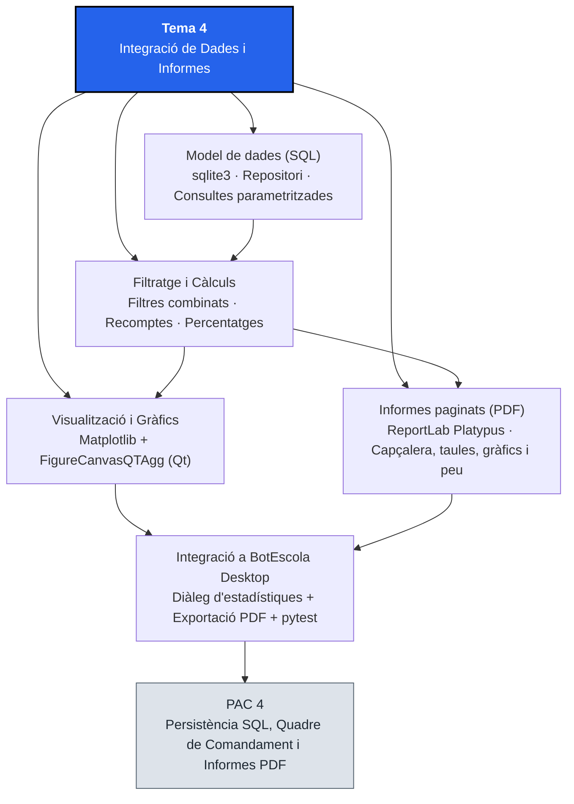
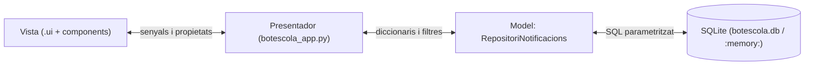

# Tema 4. Integració de Dades i Informes

## 1. Identificació

* **Mòdul:** 0488. Desenvolupament d'interfícies[cite: 1, 2, 3, 4]
* **Curs:** 1r CFGS de Desenvolupament d'Aplicacions Multiplataforma (DAM)[cite: 1, 2, 3, 4]
* **Tema:** 4. Integració de Dades i Informes
* **Durada presencial:** 14 hores[cite: 1]
* **RA treballats:** RA5[cite: 1]
* **Prerequisits:** Fonaments de SQL i bases de datos relacionals[cite: 1], arquitectura MVP amb PySide6 i fulls d'estil QSS (Tema 1)[cite: 2], creació de components i proves unitàries amb `pytest-qt` (Tema 2)[cite: 3] i integració amb `BotEscola Desktop` (Temes 1 a 3)[cite: 2, 3, 4].
* **Projecte transversal:** <mark style="color:violet;">**BotEscola Desktop**</mark>[cite: 2, 3, 4]. En aquest tema substituïm les dades de prova en memòria per una capa de persistència SQL (<mark style="color:violet;">`sqlite3`</mark>), incorporem filtres dinàmics d'informació, construïm un quadre de comandament amb gràfics estadístics incrustats (<mark style="color:violet;">`Matplotlib`</mark>) i generem informes analítics en format PDF (<mark style="color:violet;">`ReportLab`</mark>) amb camps calculats, agrupacions, capçaleres i peus de pàgina[cite: 1].

### Criteris d'avaluació treballats

#### RA5. Crea informes avaluant i utilitzant eines gràfiques.

* CA 5.1: Identifica les eines disponibles per a la generació d'informes.
* CA 5.2: Estableix la connexió amb l'origen de dades.
* CA 5.3: Defineix les consultes d'obtenció de dades.
* CA 5.4: Aplica filtres sobre les dades de l'informe.
* CA 5.5: Estructura l'informe amb encapçalaments, peus i seccions.
* CA 5.6: Inclou valors calculats, contadors i totals.
* CA 5.7: Incorpora gràfics generats a partir de les dades.
* CA 5.8: Genera i integra informes dins de l'aplicació gràfica.

#### Continguts Orientatius

* 5.1 Eines de generació d'informes i visualització de dades. Característiques.
* 5.2 Connexió a orígens de dades relacionals i consultes parametritzades[cite: 1].
* 5.3 Filtratge d'informació des de la interfície i en les consultes[cite: 1].
* 5.4 Estructura d'un informe: títol, capçalera, cos (detall i agrupacions), resum i peu de pàgina.
* 5.5 Valors calculats, recomptes, percentatges i subtotals.
* 5.6 Creació i incrustació de gràfics en aplicacions d'escriptori i en documents[cite: 1].
* 5.7 Exportació i integració d'informes a l'aplicació[cite: 1].

## 2. Introducció

Fins al Tema 3, <mark style="color:violet;">**BotEscola Desktop**</mark> ha treballat amb una llista de diccionaris de prova definida a <mark style="color:violet;">`dades.py`</mark>[cite: 2, 3, 4]: cada vegada que tancàvem la finestra, els canvis de prioritat, les notificacions marcades com a llegides o els estats d'aprovació es perdien[cite: 2, 3]. En una aplicació de gestió real, la capa del **Model** (Tema 1, apartat 5.2) es connecta a una base de dades relacional i ofereix a la direcció del centre eines per **filtrar les comunicacions, visualitzar-ne l'evolució en gràfics i exportar informes en PDF** llestos per arxivar o presentar en una reunió[cite: 1, 2].

En aquest tema completarem l'arquitectura **MVP (Model–Vista–Presentador)**[cite: 2] introduint un repositori de dades basat en <mark style="color:violet;">**`sqlite3`**</mark> amb consultes SQL parametritzades[cite: 1]. A partir d'aquestes dades, treballarem les dues vessants dels informes empresarials en una interfície gràfica[cite: 1]:

1. **Quadres de comandament interactius en pantalla (_Dashboards_):** incrustarem gràfics de <mark style="color:violet;">**`Matplotlib`**</mark> nativament com a widgets de Qt mitjançant <mark style="color:red;">**`FigureCanvasQTAgg`**</mark>[cite: 1].
2. **Documents d'informe estructurats en PDF:** utilitzarem el motor <mark style="color:violet;">**`ReportLab`**</mark> (<mark style="color:violet;">`platypus`</mark>) per compondre documents paginats amb capçalera institucional, taules d'agrupació, camps calculats (totals i percentatges), gràfics estadístics i numeració de pàgines al peu[cite: 1].

Tot el càlcul de mètriques, el filtratge SQL i la generació del fitxer PDF es dissenyaran desacoblats dels widgets perquè es puguin verificar de manera automàtica amb <mark style="color:violet;">**`pytest`**</mark> i <mark style="color:violet;">**`pytest-qt`**</mark>[cite: 1, 3, 4].

## 3. Objectius didàctics

En acabar el tema, l'alumne serà capaç de:

1. Comparar les eines de generació d'informes i visualització (motors programàtics com `ReportLab`, plantilles HTML/CSS com `WeasyPrint`, dissenyadors visuals com `JasperReports`, i llibreries gràfiques com `Matplotlib` o `QtCharts`) i justificar-ne l'elecció[cite: 1].
2. Connectar l'aplicació a una base de dades SQLite mitjançant un repositori que encapsuli les consultes SQL parametritzades i mantingui la separació del patró MVP[cite: 1, 2].
3. Aplicar filtres combinats (per prioritat, estat de lectura o text) sobre les dades tant a la vista principal com en la generació d'informes, evitant vulnerabilitats d'injecció SQL[cite: 1].
4. Estructurar un informe professional dividint-lo en encapçalament, resum executiu, seccions de detall o agrupació, i peu de pàgina amb data i numeració.
5. Calcular variables agregades (recomptes, totals, percentatges i ràtios) a partir de consultes SQL o d'estructures de dades i verificar-ne l'exactitud[cite: 1].
6. Crear gràfics estadístics clars i accessibles amb `Matplotlib`, incrustar-los com a widgets dins d'una finestra o diàleg de PySide6 i incorporar-los dins d'un informe PDF[cite: 1].
7. Generar informes en format PDF amb `ReportLab` i integrar l'acció d'exportació i el quadre de comandament a la barra de menús i barra d'eines de <mark style="color:violet;">**BotEscola Desktop**</mark>[cite: 1, 2].
8. Escriure proves unitàries amb `pytest` (usant bases de dades en memòria `:memory:` i directoris temporals `tmp_path`) que comprovin les consultes, els filtres, els càlculs i la generació vàlida del PDF[cite: 1, 3].

## 4. Mapa conceptual



## 5. Conceptes fonamentals

> **Convenció tipogràfica:** els noms ressaltats en color segueixen la dels Temes 1, 2 i 3: <mark style="color:red;">**classes de Qt, components i motors**</mark>, <mark style="color:blue;">**propietats i senyals**</mark>, <mark style="color:orange;">**mètodes i funcions**</mark> i <mark style="color:violet;">**eines, fitxers i noms del projecte**</mark>[cite: 2, 3, 4].

### 5.1. Eines de generació d'informes i visualització

En el desenvolupament d'aplicacions de gestió es distingeixen dos tipus d'eines segons si l'objectiu és analitzar dades en pantalla o produir un document tancat per imprimir o signar[cite: 1]:

| Categoria | Eina / Tecnologia | Enfocament | Avantatges | Limitacions |
| :--- | :--- | :--- | :--- | :--- |
| **Generadors d'informes en PDF (codi)** | <mark style="color:violet;">**`ReportLab`**</mark> (Python)[cite: 1] | Construcció programàtica d'elements (`Paragraph`, `Table`, `Image`) o dibuix sobre llenç (`Canvas`) | Estàndard industrial en Python; ràpid, sense dependències externes del sistema operatiu; control exacte de paginació | Disseny declaratiu en codi Python (sense editor visual d'arrossegar i deixar anar) |
| **Generadors basats en plantilles HTML** | **WeasyPrint**, **wkhtmltopdf** | Converteixen una plantilla HTML + CSS (sovint amb `Jinja2`) a PDF | Aprofita coneixements de maquetació web i CSS `@page` | Requereix llibreries natives del sistema (Pango, Cairo) que compliquen l'empaquetat a Windows |
| **Suites d'informes visuals (BI / ERP)** | **JasperReports** (Jaspersoft Studio), **Crystal Reports**, **Power BI** | Editor visual que genera plantilles (`.jrxml`) connectades a JDBC/SQL | Disseny visual WYSIWYG pensat per a grans volums corporatius | Requereix màquina virtual Java o servidors dedicats; pesat per a una aplicació d'escriptori Python |
| **Llibreries de gràfics en pantalla i imatge** | <mark style="color:violet;">**`Matplotlib`**</mark>[cite: 1], **PySide6.QtCharts**, **Plotly** | Generació de gràfics de barres, línies o sectors a partir de sèries de dades | `Matplotlib` ofereix tant un widget natiu per a Qt (`FigureCanvasQTAgg`) com exportació directa a PNG/PDF[cite: 1] | `QtCharts` té llicència GPL/Comercial (no LGPL); `Plotly` està orientat al navegador |

> **Decisió tecnològica per a BotEscola Desktop:** utilitzarem <mark style="color:violet;">**`Matplotlib`**</mark> i <mark style="color:violet;">**`ReportLab`**</mark> perquè tots dos s'instal·len com a paquets Python purs amb `pip`, tenen llicències lliures compatibles amb LGPL (a diferència de `QtCharts`), no exigeixen instal·lar programari extern al sistema operatiu i permeten provar la generació en tests automatitzats[cite: 1].

### 5.2. Connexió a l'origen de dades i el patró Repositori dins d'MVP

Al Tema 1 vam establir que la **Vista** (`.ui`) no coneix les dades i que el **Presentador** coordina la interacció amb el **Model**[cite: 2]. Quan les dades passen a viure en una base de dades relacional (<mark style="color:violet;">**`sqlite3`**</mark>, inclosa de sèrie a Python), escriure sentències `SELECT` o `UPDATE` barrejades dins dels _slots_ de la finestra principal seria un error greu de manteniment[cite: 2].

Per evitar-ho, encapsulem l'accés a la base de dades en una classe **Repositori** (<mark style="color:red;">`RepositoriNotificacions`</mark>):



Tres regles tècniques essencials en treballar amb SQL des d'una interfície:

1. **Consultes sempre parametritzades (`?`):** mai concatenis el text d'un camp de cerca (`QLineEdit`) ni d'un desplegable (`QComboBox`) dins d'un _f-string_ SQL. Utilitza marcadors de posició `?` i passa els valors com a tupla al segon argument d'<mark style="color:orange;">`execute(sql, parametres)`</mark>. Això impedeix qualsevol **injecció SQL** i gestiona automàticament les cometes i els caràcters especials.
2. **Files com a diccionaris:** configurant `conn.row_factory = sqlite3.Row`, cada fila retornada es pot convertir en un `dict` amb les mateixes claus que ja utilitzen <mark style="color:red;">`TargetaNotificacio`</mark> i <mark style="color:violet;">`dades.py`</mark> (`id`, `remitent`, `assumpte`, `data`, `detall`, `llegida`, `prioritat`)[cite: 2, 3]. Així els components del Tema 2 no s'han de modificar[cite: 3].
3. **Suport per a `:memory:`:** si el constructor del repositori rep la ruta de la base de dades com a paràmetre (`ruta_bd="botescola.db"`), les proves unitàries li poden passar `":memory:"` per crear una base de dades efímera en RAM, ràpida i completament aïllada en cada test.

### 5.3. Filtratge de dades i consultes d'agregació

Una aplicació de gestió ha de permetre acotar quins registres es mostren a la finestra i quins s'inclouen a l'informe[cite: 1]. A <mark style="color:violet;">**BotEscola Desktop**</mark> combinarem tres criteris de filtre:

* **Per prioritat:** `"Totes"`, `"Baixa"`, `"Normal"` o `"Alta"`[cite: 3].
* **Per estat de lectura:** `"Totes"`, `"Pendents"` (`llegida = 0`) o `"Llegides"` (`llegida = 1`)[cite: 3].
* **Per text lliure:** cerca parcial (`LIKE ?`) dins del `remitent` o de l'`assumpte`[cite: 2, 3].

Quan un filtre val `"Totes"` o el camp de cerca està buit, la condició no s'afegeix (o s'avalua com a certa), i quan l'usuari restringeix diversos filtres alhora, es combinen amb `AND` construint la llista de paràmetres `?` de manera segura.

A més dels registres individuals, un informe necessita **dades agregades i camps calculats**[cite: 1]:

* **Recomptes i totals (`COUNT`, `SUM`):** total de notificacions, total de pendents, total de llegides i desglossament per nivell de prioritat (`GROUP BY prioritat`) o per estat de resolució (`aprovada`, `descartada`, `pendent`).
* **Valors calculats i percentatges:** per exemple, la **taxa de lectura** ($\text{llegides} / \text{total} \times 100$). Cal protegir sempre el càlcul contra la **divisió per zero** quan el filtre aplicat no retorna cap notificació (`total == 0`).

### 5.4. Anatomia i estructura d'un informe professional

Un informe empresarial no és un bolcat cru d'una taula SQL[cite: 1]. Perquè sigui llegible, auditable i comprensible per si sol fora de l'aplicació, s'estructura en cinc seccions clàssiques:

```
┌─────────────────────────────────────────────────────────────┐
│ CAPÇALERA DE PÀGINA: Logotip / Nom del centre · Data emissió│
├─────────────────────────────────────────────────────────────┤
│ 1. TÍTOL I CONTEXT (Filtres aplicats en generar l'informe)  │
│                                                             │
│ 2. RESUM EXECUTIU (Camps calculats: Totals i Percentatges)  │
│    [ Total: 12 ]  [ Pendents: 4 ]  [ Taxa lectura: 66,7% ]  │
│                                                             │
│ 3. VISUALITZACIÓ GRÀFICA (Gràfic de barres per prioritat)   │
│                                                             │
│ 4. COS / DETALL I AGRUPACIONS (Taula de registres filtrats) │
│    ID │ Data       │ Remitent │ Assumpte │ Prioritat │ Estat│
│    ───┼────────────┼──────────┼──────────┼───────────┼──────│
│     1 │ 2026-10-15 │ Direcció │ Claustre │ Alta      │ Nova │
│    ...                                                      │
├─────────────────────────────────────────────────────────────┤
│ PEU DE PÀGINA: BotEscola Desktop                Pàgina 1 / 2│
└─────────────────────────────────────────────────────────────┘
```

> **Principi de traçabilitat:** l'informe ha d'indicar explícitament **quins filtres estaven actius** en el moment de generar-lo (per exemple, `Filtre aplicat: Prioritat = Alta · Estat = Pendents`). Sense aquesta dada, un lector podria pensar que el document mostra totes les notificacions del centre.

### 5.5. Gràfics amb `Matplotlib`: en pantalla (`FigureCanvasQTAgg`) i en document

<mark style="color:violet;">**`Matplotlib`**</mark> separa l'estructura del gràfic (<mark style="color:red;">**`Figure`**</mark> i els seus eixos `Axes`) del lloc on es renderitza (_backend_):

* **En una finestra de PySide6:** s'utilitza el llenç <mark style="color:red;">**`FigureCanvasQTAgg`**</mark> (del mòdul `matplotlib.backends.backend_qtagg`), que **hereta de `QWidget`**[cite: 3]. Per tant, es pot afegir a qualsevol `QVBoxLayout` o dins d'un component propi exactament igual que un botó o una etiqueta[cite: 1, 2, 3].
* **Dins d'un informe PDF:** la mateixa <mark style="color:red;">`Figure`</mark> es pot exportar a un buffer de memòria (<mark style="color:red;">`io.BytesIO`</mark>) en format PNG d'alta resolució (`dpi=150`) amb <mark style="color:orange;">`fig.savefig(buffer, format="png")`</mark> i inserir-se com a imatge vectorial/rasteritzada dins del flux de <mark style="color:violet;">`ReportLab`</mark> sense deixar fitxers temporals escampats pel disc[cite: 1].

> **Bona pràctica amb `Matplotlib` en aplicacions GUI:** crea sempre les figures amb la classe orientada a objectes <mark style="color:red;">`Figure()`</mark> (de `matplotlib.figure`) en lloc de la interfície global `pyplot` (`plt.figure()`). `pyplot` manté referències globals en memòria i pot entrar en conflicte amb el bucle d'esdeveniments de Qt o amb l'execució de tests a `pytest`[cite: 2, 3].

**Accessibilitat en gràfics (connexió amb el Tema 1):**

* **No depenguis només del color:** afegeix l'etiqueta amb el valor numèric exacte sobre cada barra (<mark style="color:orange;">`ax.bar_label(...)`</mark>) i títols clars als eixos[cite: 2]. Així el gràfic és comprensible fins i tot imprès en blanc i negre[cite: 2].
* **Usa la mateixa paleta verificada:** reutilitza els colors de <mark style="color:violet;">`styles/botescola.qss`</mark> (per exemple `#2563EB`, `#1F2933`, `#52606D`)[cite: 2].

### 5.6. Generació de PDF amb `ReportLab` (`platypus`)

<mark style="color:violet;">**`ReportLab`**</mark> ofereix dos nivells d'abstracció:

1. **Baix nivell (`pdfgen.canvas.Canvas`):** dibuixa textos i línies indicant coordenades $(x, y)$ en punts tipogràfics (1 punt = 1/72 de polzada; un full A4 mesura $595{,}27 \times 841{,}89$ punts). S'utilitza per dibuixar elements fixos repetitius com la **capçalera i el peu de cada pàgina**.
2. **Alt nivell (`platypus` — _Page Layout and Typography Using Scripts_):** construeix el document (<mark style="color:red;">`SimpleDocTemplate`</mark>) a partir d'una llista d'elements fluïbles (_flowables_) com <mark style="color:red;">`Paragraph`</mark>, <mark style="color:red;">`Spacer`</mark>, <mark style="color:red;">`Table`</mark> i <mark style="color:red;">`Image`</mark>. `Platypus` calcula automàticament l'espai disponible i divideix les taules llargues en diverses pàgines (repetint la fila de capçalera de la taula amb `repeatRows=1`).

Combinem tots dos nivells passant una funció de _callback_ als paràmetres `onFirstPage` i `onLaterPages` de <mark style="color:orange;">`doc.build(elements, onFirstPage=..., onLaterPages=...)`</mark> perquè cada pàgina tingui la seva capçalera i el peu amb el número de pàgina (`canvas.getPageNumber()`).

## 6. Entorn de treball

### 6.1. Estructura del projecte

Ampliem l'estructura de <mark style="color:violet;">**BotEscola Desktop**</mark> afegint el paquet `informes/` (que conté el repositori SQLite, el generador de PDF i el component de gràfics) i el fitxer de proves <mark style="color:violet;">`tests/test_informes.py`</mark>:

```
botescola/
├── ui/
│   └── botescola.ui
├── generated/
│   └── ui_botescola.py
├── styles/
│   ├── botescola.qss
│   └── alt_contrast.qss
├── components/               <-- Tema 2 (RA3)
│   ├── __init__.py
│   ├── selector.py
│   ├── targeta.py
│   └── comptador.py
├── nui/                      <-- Tema 3 (RA2)
│   ├── __init__.py
│   ├── interpret.py
│   └── escoltador_veu.py
├── informes/                 <-- Tema 4 (RA5): dades SQL, gràfics i PDF
│   ├── __init__.py
│   ├── repositori.py         <-- connexió SQLite, consultes, filtres i mètriques
│   ├── grafics.py            <-- widget FigureCanvasQTAgg i generació de figures
│   └── generador_pdf.py      <-- construcció de l'informe PDF amb ReportLab
├── tests/
│   ├── test_selector.py
│   ├── test_targeta.py
│   ├── test_comptador.py
│   ├── test_nui.py
│   └── test_informes.py      <-- proves de SQL, filtres, càlculs, gràfics i PDF
├── docs/
│   ├── components.md
│   ├── nui.md
│   └── informes.md           <-- disseny de consultes, estructura de l'informe i proves
├── dades.py                  <-- llavor inicial de dades per poblar la BD si és buida
├── botescola_app.py
├── pyproject.toml
├── pytest.ini
├── contrast.py
├── taula_contrast.md
└── README.md
```

Actualitza <mark style="color:violet;">`pyproject.toml`</mark> per incloure el nou paquet `informes*`[cite: 3, 4]:

```toml
[tool.setuptools.packages.find]
include = ["components*", "nui*", "informes*"]
```

### 6.2. Dependències

Amb l'entorn virtual activat, instal·la <mark style="color:violet;">`matplotlib`</mark> i <mark style="color:violet;">`reportlab`</mark> (<mark style="color:violet;">`sqlite3`</mark> ja forma part de la llibreria estàndard de Python)[cite: 1]:

```bash
python -m pip install matplotlib reportlab
```

Comprova les versions instal·lades per registrar-les al <mark style="color:violet;">`README.md`</mark> i a l'informe de proves[cite: 2, 3, 4]:

```bash
python -c "import sqlite3, matplotlib, reportlab; print('SQLite', sqlite3.sqlite_version, '| Matplotlib', matplotlib.__version__, '| ReportLab', reportlab.Version)"
```

## 7. Exemple guiat: Persistència SQLite, Gràfic incrustat i Informe PDF

### Pas 1. Dissenyar l'esquema de dades, les consultes i les mètriques

La taula `notificacions` d'SQLite emmagatzema tots els camps que ja utilitzava l'aplicació als Temes 1, 2 i 3, més l'`estat_resolucio` (`'pendent'`, `'aprovada'`, `'descartada'`) perquè les accions d'aprovar i descartar també quedin persistides[cite: 2, 3]:

| Camp SQL | Tipus SQLite | Valor per defecte | Equivalència al diccionari Python |
| :--- | :--- | :--- | :--- |
| `id` | `INTEGER PRIMARY KEY` | Autoincremental | `int` (`id`)[cite: 2, 3] |
| `remitent` | `TEXT NOT NULL` | — | `str` (`remitent`)[cite: 2, 3] |
| `assumpte` | `TEXT NOT NULL` | — | `str` (`assumpte`)[cite: 2, 3] |
| `data` | `TEXT NOT NULL` | — | `str` (`data` en format `YYYY-MM-DD`)[cite: 2, 3] |
| `detall` | `TEXT NOT NULL` | `''` | `str` (`detall`)[cite: 2] |
| `llegida` | `INTEGER NOT NULL` | `0` | `bool` (`False` = `0`, `True` = `1`)[cite: 3] |
| `prioritat` | `TEXT NOT NULL` | `'Normal'` | `str` (`'Baixa'`, `'Normal'`, `'Alta'`)[cite: 3] |
| `estat_resolucio` | `TEXT NOT NULL` | `'pendent'` | `str` (`'pendent'`, `'aprovada'`, `'descartada'`) |

### Pas 2. Programar el repositori SQLite (`informes/repositori.py`)

```python
"""Repositori SQLite per a les notificacions i mètriques d'informes de BotEscola."""

import sqlite3


class RepositoriNotificacions:
    """Gestiona la persistència SQL, el filtratge i els càlculs agregats."""

    PRIORITATS = ("Baixa", "Normal", "Alta")

    def __init__(self, ruta_bd="botescola.db", dades_inicials=None):
        """Obre la connexió i crea l'esquema si no existeix.

        Args:
            ruta_bd: camí al fitxer SQLite o ':memory:' per a proves unitàries.
            dades_inicials: llista opcional de diccionaris per poblar la taula si és buida.
        """
        self._conn = sqlite3.connect(ruta_bd)
        self._conn.row_factory = sqlite3.Row
        self._crear_taula()
        if dades_inicials and self.comptar_total() == 0:
            self.inserir_lot(dades_inicials)

    def _crear_taula(self):
        self._conn.execute(
            """
            CREATE TABLE IF NOT EXISTS notificacions (
                id INTEGER PRIMARY KEY AUTOINCREMENT,
                remitent TEXT NOT NULL,
                assumpte TEXT NOT NULL,
                data TEXT NOT NULL,
                detall TEXT NOT NULL DEFAULT '',
                llegida INTEGER NOT NULL DEFAULT 0,
                prioritat TEXT NOT NULL DEFAULT 'Normal',
                estat_resolucio TEXT NOT NULL DEFAULT 'pendent'
            )
            """
        )
        self._conn.commit()

    @staticmethod
    def _fila_a_dict(fila):
        d = dict(fila)
        d["llegida"] = bool(d["llegida"])
        return d

    def inserir_lot(self, llista_notificacions):
        """Insereix una llista de diccionaris de notificació."""
        with self._conn:
            for n in llista_notificacions:
                self._conn.execute(
                    """
                    INSERT INTO notificacions
                        (id, remitent, assumpte, data, detall, llegida, prioritat, estat_resolucio)
                    VALUES (?, ?, ?, ?, ?, ?, ?, ?)
                    """,
                    (
                        n.get("id"),
                        n["remitent"],
                        n["assumpte"],
                        n["data"],
                        n.get("detall", ""),
                        int(bool(n.get("llegida", False))),
                        n.get("prioritat", "Normal"),
                        n.get("estat_resolucio", "pendent"),
                    ),
                )

    def comptar_total(self):
        cur = self._conn.execute("SELECT COUNT(*) FROM notificacions")
        return cur.fetchone()[0]

    def obtenir_notificacions(self, prioritat="Totes", estat_lectura="Totes", cerca=""):
        """Retorna la llista de notificacions aplicant filtres combinats parametritzats."""
        condicions = []
        parametres = []

        if prioritat and prioritat != "Totes":
            condicions.append("prioritat = ?")
            parametres.append(prioritat)

        if estat_lectura == "Pendents":
            condicions.append("llegida = 0")
        elif estat_lectura == "Llegides":
            condicions.append("llegida = 1")

        text = cerca.strip()
        if text:
            condicions.append("(remitent LIKE ? OR assumpte LIKE ?)")
            patro = f"%{text}%"
            parametres.extend([patro, patro])

        sql = "SELECT * FROM notificacions"
        if condicions:
            sql += " WHERE " + " AND ".join(condicions)
        sql += " ORDER BY data DESC, id ASC"

        cur = self._conn.execute(sql, tuple(parametres))
        return [self._fila_a_dict(f) for f in cur.fetchall()]

    def actualitzar_llegida(self, id_notificacio, llegida=True):
        with self._conn:
            self._conn.execute(
                "UPDATE notificacions SET llegida = ? WHERE id = ?",
                (int(bool(llegida)), id_notificacio),
            )

    def actualitzar_prioritat(self, id_notificacio, prioritat):
        if prioritat not in self.PRIORITATS:
            raise ValueError(f"Prioritat no vàlida: {prioritat!r}")
        with self._conn:
            self._conn.execute(
                "UPDATE notificacions SET prioritat = ? WHERE id = ?",
                (prioritat, id_notificacio),
            )

    def actualitzar_resolucio(self, id_notificacio, estat_resolucio):
        if estat_resolucio not in ("pendent", "aprovada", "descartada"):
            raise ValueError(f"Estat de resolució no vàlid: {estat_resolucio!r}")
        with self._conn:
            self._conn.execute(
                "UPDATE notificacions SET estat_resolucio = ? WHERE id = ?",
                (estat_resolucio, id_notificacio),
            )

    def calcular_resum(self, prioritat="Totes", estat_lectura="Totes", cerca=""):
        """Calcula contadors, percentatges i totals per prioritat sobre el conjunt filtrat."""
        registres = self.obtenir_notificacions(prioritat, estat_lectura, cerca)
        total = len(registres)
        llegides = sum(1 for r in registres if r["llegida"])
        pendents = total - llegides
        taxa_lectura = round((llegides / total) * 100.0, 1) if total > 0 else 0.0

        per_prioritat = {nivell: 0 for nivell in self.PRIORITATS}
        for r in registres:
            nivell = r.get("prioritat", "Normal")
            if nivell in per_prioritat:
                per_prioritat[nivell] += 1

        aprovades = sum(1 for r in registres if r.get("estat_resolucio") == "aprovada")
        descartades = sum(1 for r in registres if r.get("estat_resolucio") == "descartada")

        return {
            "total": total,
            "llegides": llegides,
            "pendents": pendents,
            "taxa_lectura": taxa_lectura,
            "per_prioritat": per_prioritat,
            "aprovades": aprovades,
            "descartades": descartades,
        }

    def tancar(self):
        """Tanca la connexió amb la base de dades."""
        self._conn.close()
```

### Pas 3. Programar el component de gràfics amb `Matplotlib` (`informes/grafics.py`)

Creem tant una funció que construeix la <mark style="color:red;">`Figure`</mark> (reutilitzable pel PDF) com el widget <mark style="color:red;">`GraficPrioritats`</mark> basat en <mark style="color:red;">`FigureCanvasQTAgg`</mark> per incrustar-lo a Qt[cite: 1]:

```python
"""Gràfics estadístics amb Matplotlib per a finestra Qt i exportació a PDF."""

import io
from matplotlib.backends.backend_qtagg import FigureCanvasQTAgg
from matplotlib.figure import Figure
from PySide6.QtWidgets import QVBoxLayout, QWidget


def crear_figura_prioritats(per_prioritat):
    """Crea una Figure de Matplotlib amb el nombre de notificacions per prioritat."""
    nivells = ["Baixa", "Normal", "Alta"]
    valors = [ int(per_prioritat.get(n, 0)) for n in nivells ]
    colors = ["#52606D", "#2563EB", "#1D4ED8"]

    figura = Figure(figsize=(5.5, 3.0), dpi=100)
    ax = figura.add_subplot(111)

    barres = ax.bar(nivells, valors, color=colors, edgecolor="#1F2933", width=0.55)
    ax.bar_label(barres, padding=3, fontweight="bold", color="#1F2933")

    ax.set_title("Notificacions per nivell de prioritat", fontsize=11, fontweight="bold", color="#1F2933")
    ax.set_xlabel("Prioritat", color="#1F2933")
    ax.set_ylabel("Nombre de notificacions", color="#1F2933")
    ax.set_ylim(0, max(valors + [1]) + 1.5)
    ax.yaxis.get_major_locator().set_params(integer=True)
    ax.spines["top"].set_visible(False)
    ax.spines["right"].set_visible(False)

    figura.tight_layout()
    return figura


def figura_a_bytes_png(figura, dpi=150):
    """Exporta una Figure de Matplotlib a un buffer BytesIO en format PNG."""
    buffer = io.BytesIO()
    figura.savefig(buffer, format="png", dpi=dpi)
    buffer.seek(0)
    return buffer


class GraficPrioritats(QWidget):
    """Widget de Qt que incrusta el gràfic de barres de prioritats."""

    def __init__(self, parent=None):
        super().__init__(parent)
        self._figura = crear_figura_prioritats({"Baixa": 0, "Normal": 0, "Alta": 0})
        self._canvas = FigureCanvasQTAgg(self._figura)

        layout = QVBoxLayout(self)
        layout.setContentsMargins(0, 0, 0, 0)
        layout.addWidget(self._canvas)

    def actualitzar(self, per_prioritat):
        """Redibuixa el gràfic amb el nou diccionari de recomptes per prioritat."""
        nivells = ["Baixa", "Normal", "Alta"]
        valors = [ int(per_prioritat.get(n, 0)) for n in nivells ]
        colors = ["#52606D", "#2563EB", "#1D4ED8"]

        self._figura.clear()
        ax = self._figura.add_subplot(111)
        barres = ax.bar(nivells, valors, color=colors, edgecolor="#1F2933", width=0.55)
        ax.bar_label(barres, padding=3, fontweight="bold", color="#1F2933")

        ax.set_title("Notificacions per nivell de prioritat", fontsize=11, fontweight="bold", color="#1F2933")
        ax.set_xlabel("Prioritat", color="#1F2933")
        ax.set_ylabel("Nombre de notificacions", color="#1F2933")
        ax.set_ylim(0, max(valors + [1]) + 1.5)
        ax.yaxis.get_major_locator().set_params(integer=True)
        ax.spines["top"].set_visible(False)
        ax.spines["right"].set_visible(False)

        self._figura.tight_layout()
        self._canvas.draw()
```

### Pas 4. Programar el generador d'informes en PDF (`informes/generador_pdf.py`)

Utilitzem <mark style="color:violet;">`ReportLab`</mark> per construir un PDF paginat amb capçalera, peu de pàgina numerat, taula de valors calculats, el gràfic de `Matplotlib` i la taula detallada de notificacions[cite: 1]:

```python
"""Generador d'informes analítics en PDF amb ReportLab i Matplotlib."""

from datetime import datetime
from pathlib import Path

from reportlab.lib import colors
from reportlab.lib.pagesizes import A4
from reportlab.lib.styles import getSampleStyleSheet
from reportlab.lib.units import cm
from reportlab.platypus import Image, Paragraph, SimpleDocTemplate, Spacer, Table, TableStyle

from .grafics import crear_figura_prioritats, figura_a_bytes_png


def _dibuixar_capcalera_i_peu(canvas, doc):
    """Dibuixa l'encapçalament institucional i el peu amb número de pàgina."""
    canvas.saveState()
    amplada, alcada = A4

    # Capçalera
    canvas.setFont("Helvetica-Bold", 9)
    canvas.setFillColor(colors.HexColor("#1F2933"))
    canvas.drawString(2 * cm, alcada - 1.5 * cm, "BotEscola Desktop — Informe de Comunicacions")
    canvas.setFont("Helvetica", 8)
    canvas.drawRightString(
        amplada - 2 * cm,
        alcada - 1.5 * cm,
        f"Data d'emissió: {datetime.now().strftime('%Y-%m-%d %H:%M')}",
    )
    canvas.setStrokeColor(colors.HexColor("#52606D"))
    canvas.line(2 * cm, alcada - 1.7 * cm, amplada - 2 * cm, alcada - 1.7 * cm)

    # Peu de pàgina
    canvas.line(2 * cm, 1.8 * cm, amplada - 2 * cm, 1.8 * cm)
    canvas.setFont("Helvetica", 8)
    canvas.drawString(2 * cm, 1.3 * cm, "Mòdul 0488 · Desenvolupament d'interfícies")
    canvas.drawRightString(amplada - 2 * cm, 1.3 * cm, f"Pàgina {canvas.getPageNumber()}")
    canvas.restoreState()


def generar_informe_pdf(ruta_sortida, notificacions, resum, descripcio_filtres="Cap filtre (totes)"):
    """Genera un fitxer PDF amb resum executiu, gràfic i taula de detall.

    Args:
        ruta_sortida: camí del fitxer PDF a crear (str o Path).
        notificacions: llista de diccionaris de notificacions filtrades.
        resum: diccionari retornat per RepositoriNotificacions.calcular_resum().
        descripcio_filtres: text que documenta els filtres aplicats.

    Returns:
        Path del fitxer PDF generat.
    """
    desti = Path(ruta_sortida)
    doc = SimpleDocTemplate(
        str(desti),
        pagesize=A4,
        leftMargin=2 * cm,
        rightMargin=2 * cm,
        topMargin=2.4 * cm,
        bottomMargin=2.4 * cm,
        title="Informe de Notificacions BotEscola",
    )

    estils = getSampleStyleSheet()
    elements = []

    # 1. Títol i filtres aplicats
    elements.append(Paragraph("Informe d'Estat de Notificacions", estils["Title"]))
    elements.append(Paragraph(f"<b>Filtres aplicats:</b> {descripcio_filtres}", estils["Normal"]))
    elements.append(Spacer(1, 0.5 * cm))

    # 2. Secció de valors calculats (Resum executiu)
    elements.append(Paragraph("1. Resum Executiu i Indicadors", estils["Heading2"]))
    dades_resum = [
        ["Total notificacions", "Llegides", "Pendents", "Taxa de lectura", "Aprovades", "Descartades"],
        [
            str(resum["total"]),
            str(resum["llegides"]),
            str(resum["pendents"]),
            f"{resum['taxa_lectura']:.1f} %",
            str(resum.get("aprovades", 0)),
            str(resum.get("descartades", 0)),
        ],
    ]
    taula_resum = Table(dades_resum, colWidths=[2.8 * cm] * 6)
    taula_resum.setStyle(
        TableStyle([
            ("BACKGROUND", (0, 0), (-1, 0), colors.HexColor("#2563EB")),
            ("TEXTCOLOR", (0, 0), (-1, 0), colors.HexColor("#FFFFFF")),
            ("FONTNAME", (0, 0), (-1, 0), "Helvetica-Bold"),
            ("ALIGN", (0, 0), (-1, -1), "CENTER"),
            ("GRID", (0, 0), (-1, -1), 0.75, colors.HexColor("#52606D")),
            ("BACKGROUND", (0, 1), (-1, 1), colors.HexColor("#F0F2F5")),
            ("PADDING", (0, 0), (-1, -1), 6),
        ])
    )
    elements.append(taula_resum)
    elements.append(Spacer(1, 0.6 * cm))

    # 3. Gràfic estadístic incrustat
    elements.append(Paragraph("2. Distribució per Nivell de Prioritat", estils["Heading2"]))
    figura = crear_figura_prioritats(resum["per_prioritat"])
    buffer_png = figura_a_bytes_png(figura)
    elements.append(Image(buffer_png, width=13.5 * cm, height=7.4 * cm))
    elements.append(Spacer(1, 0.6 * cm))

    # 4. Taula de detall de notificacions
    elements.append(Paragraph("3. Detall de Notificacions", estils["Heading2"]))
    files_detall = [["ID", "Data", "Remitent", "Assumpte", "Prioritat", "Estat"]]
    for n in notificacions:
        estat_txt = "Llegida" if n.get("llegida") else "Nova"
        files_detall.append([
            str(n.get("id", "")),
            str(n.get("data", "")),
            str(n.get("remitent", "")),
            str(n.get("assumpte", ""))[:45],
            str(n.get("prioritat", "Normal")),
            estat_txt,
        ])

    if len(files_detall) == 1:
        files_detall.append(["—", "—", "Sense registres per als filtres seleccionats", "—", "—", "—"])

    taula_detall = Table(
        files_detall,
        colWidths=[1.2 * cm, 2.4 * cm, 3.4 * cm, 5.6 * cm, 2.2 * cm, 2.0 * cm],
        repeatRows=1,
    )
    taula_detall.setStyle(
        TableStyle([
            ("BACKGROUND", (0, 0), (-1, 0), colors.HexColor("#1F2933")),
            ("TEXTCOLOR", (0, 0), (-1, 0), colors.HexColor("#FFFFFF")),
            ("FONTNAME", (0, 0), (-1, 0), "Helvetica-Bold"),
            ("FONTSIZE", (0, 0), (-1, -1), 8.5),
            ("GRID", (0, 0), (-1, -1), 0.5, colors.HexColor("#52606D")),
            ("ROWBACKGROUNDS", (0, 1), (-1, -1), [colors.HexColor("#FFFFFF"), colors.HexColor("#F0F2F5")]),
            ("VALIGN", (0, 0), (-1, -1), "MIDDLE"),
            ("PADDING", (0, 0), (-1, -1), 5),
        ])
    )
    elements.append(taula_detall)

    doc.build(elements, onFirstPage=_dibuixar_capcalera_i_peu, onLaterPages=_dibuixar_capcalera_i_peu)
    return desti
```

I exposem les classes i funcions del paquet a <mark style="color:violet;">`informes/__init__.py`</mark>:

```python
"""Paquet de persistència SQL, gràfics i informes PDF de BotEscola Desktop."""

from .repositori import RepositoriNotificacions
from .grafics import GraficPrioritats, crear_figura_prioritats
from .generador_pdf import generar_informe_pdf

__all__ = [
    "RepositoriNotificacions",
    "GraficPrioritats",
    "crear_figura_prioritats",
    "generar_informe_pdf",
]
```

### Pas 5. Integració de filtres, quadre de comandament i exportació PDF al Presentador

Al Presentador (<mark style="color:violet;">`botescola_app.py`</mark>), substituïm la llista en memòria per una instància de <mark style="color:red;">`RepositoriNotificacions`</mark> (poblada inicialment amb <mark style="color:violet;">`dades.py`</mark> si la base de dades és nova) i afegim dos mètodes associats a les noves <mark style="color:red;">`QAction`</mark>:

```python
from PySide6.QtWidgets import QDialog, QFileDialog, QLabel, QVBoxLayout
from informes import GraficPrioritats, RepositoriNotificacions, generar_informe_pdf
from dades import NOTIFICACIONS_PROVA

# Dins de __init__:
self.repositori = RepositoriNotificacions("botescola.db", dades_inicials=NOTIFICACIONS_PROVA)

self.ui.cmb_filtre_prioritat.currentTextChanged.connect(self.aplicar_filtres)
self.ui.cmb_filtre_estat.currentTextChanged.connect(self.aplicar_filtres)
self.ui.txt_cerca.textChanged.connect(self.aplicar_filtres)

self.ui.act_quadre_comandament.triggered.connect(self.mostrar_quadre_comandament)
self.ui.act_exportar_pdf.triggered.connect(self.exportar_informe_pdf)
```

I els mètodes per mostrar el diàleg amb el gràfic i per desar el PDF amb <mark style="color:red;">`QFileDialog`</mark>:

```python
def filtres_actuals(self):
    return (
        self.ui.cmb_filtre_prioritat.currentText(),
        self.ui.cmb_filtre_estat.currentText(),
        self.ui.txt_cerca.text(),
    )

def descriure_filtres(self):
    prio, estat, cerca = self.filtres_actuals()
    text_cerca = f"«{cerca.strip()}»" if cerca.strip() else "cap"
    return f"Prioritat: {prio} · Estat: {estat} · Cerca: {text_cerca}"

def mostrar_quadre_comandament(self):
    resum = self.repositori.calcular_resum(*self.filtres_actuals())
    dialeg = QDialog(self)
    dialeg.setWindowTitle("Quadre de comandament — BotEscola")
    dialeg.resize(580, 400)

    layout = QVBoxLayout(dialeg)
    lbl_resum = QLabel(
        f"Total: {resum['total']} · Llegides: {resum['llegides']} "
        f"· Pendents: {resum['pendents']} · Taxa de lectura: {resum['taxa_lectura']:.1f} %"
    )
    lbl_resum.setObjectName("lbl_resum_kpi")
    grafic = GraficPrioritats(dialeg)
    grafic.actualitzar(resum["per_prioritat"])

    layout.addWidget(lbl_resum)
    layout.addWidget(grafic)
    dialeg.exec()

def exportar_informe_pdf(self):
    ruta, _ = QFileDialog.getSaveFileName(
        self,
        "Exportar informe en PDF",
        "informe_notificacions.pdf",
        "Documents PDF (*.pdf)",
    )
    if not ruta:
        self.statusBar().showMessage("Cancel·lada: exportació d'informe PDF.", 5000)
        return

    prio, estat, cerca = self.filtres_actuals()
    notificacions = self.repositori.obtenir_notificacions(prio, estat, cerca)
    resum = self.repositori.calcular_resum(prio, estat, cerca)
    generar_informe_pdf(ruta, notificacions, resum, self.descriure_filtres())
    self.statusBar().showMessage(f"Informe generat: {ruta}", 5000)
```

### Pas 6. Proves unitàries amb `:memory:` i `tmp_path` (`tests/test_informes.py`)

Amb una base de dades en memòria (`:memory:`) i el _fixture_ `tmp_path` de <mark style="color:violet;">`pytest`</mark>, provem les consultes SQL, els filtres, els càlculs, el widget del gràfic i la generació real del fitxer PDF sense embrutar el disc:

```python
import pytest
from informes import GraficPrioritats, RepositoriNotificacions, generar_informe_pdf


MOSTRA = [
    {
        "id": 1,
        "remitent": "Direcció",
        "assumpte": "Convocatòria de claustre",
        "data": "2026-10-15",
        "detall": "Ordre del dia del claustre.",
        "llegida": False,
        "prioritat": "Alta",
    },
    {
        "id": 2,
        "remitent": "Secretaria",
        "assumpte": " Termini d'avaluacions",
        "data": "2026-10-16",
        "detall": "Tancament d'actes.",
        "llegida": True,
        "prioritat": "Normal",
    },
    {
        "id": 3,
        "remitent": "Coordinació TIC",
        "assumpte": "Manteniment de servidors",
        "data": "2026-10-17",
        "detall": "Aturada programada.",
        "llegida": False,
        "prioritat": "Alta",
    },
]


@pytest.fixture
def repo():
    r = RepositoriNotificacions(":memory:", dades_inicials=MOSTRA)
    yield r
    r.tancar()


def test_ filtre_per_prioritat_i_estat(repo):
    altes = repo.obtenir_notificacions(prioritat="Alta")
    assert len(altes) == 2

    altes_pendents = repo.obtenir_notificacions(prioritat="Alta", estat_lectura="Pendents")
    assert len(altes_pendents) == 2

    llegides = repo.obtenir_notificacions(estat_lectura="Llegides")
    assert len(llegides) == 1
    assert llegides[0]["remitent"] == "Secretaria"


def test_filtre_cerca_textual_i_seguretat_sql(repo):
    resultat = repo.obtenir_notificacions(cerca="claustre")
    assert len(resultat) == 1
    assert resultat[0]["id"] == 1

    # Intent d'injecció SQL: s'ha de tractar com a text literal sense trencar la taula
    malicios = repo.obtenir_notificacions(cerca="' OR '1'='1")
    assert malicios == []
    assert repo.comptar_total() == 3


def test_calcul_resum_i_divisio_per_zero(repo):
    resum = repo.calcular_resum()
    assert resum["total"] == 3
    assert resum["llegides"] == 1
    assert resum["pendents"] == 2
    assert resum["taxa_lectura"] == pytest.approx(33.3, 0.1)
    assert resum["per_prioritat"] == {"Baixa": 0, "Normal": 1, "Alta": 2}

    resum_buit = repo.calcular_resum(prioritat="Baixa")
    assert resum_buit["total"] == 0
    assert resum_buit["taxa_lectura"] == 0.0


def test_actualitzacio_persistencia_sql(repo):
    repo.actualitzar_llegida(1, True)
    repo.actualitzar_prioritat(1, "Baixa")
    actualitzada = [n for n in repo.obtenir_notificacions() if n["id"] == 1][0]
    assert actualitzada["llegida"] is True
    assert actualitzada["prioritat"] == "Baixa"


def test_widget_grafic_s_instancia_i_actualitza(qtbot):
    widget = GraficPrioritats()
    qtbot.addWidget(widget)
    widget.actualitzar({"Baixa": 1, "Normal": 3, "Alta": 2})


def test_generacio_pdf_crea_fitxer_valid(repo, tmp_path):
    desti = tmp_path / "informe_test.pdf"
    notificacions = repo.obtenir_notificacions()
    resum = repo.calcular_resum()

    ruta_resultat = generar_informe_pdf(desti, notificacions, resum, "Prioritat: Totes")
    assert ruta_resultat.exists()
    contingut = ruta_resultat.read_bytes()
    assert contingut.startswith(b"%PDF-")
    assert len(contingut) > 1000
```

## 8. Anàlisi tècnica

* **Consultes parametritzades (`?`):** quan fem `self._conn.execute(sql, tuple(parametres))`, el motor d'SQLite compila l'estructura de la consulta per separat de les dades. Encara que l'usuari escrigui cometes o codi SQL al cercador (`' OR '1'='1`), es cerca com a cadena literal i mai modifica l'estructura del `WHERE`.
* **Conversió de tipus SQLite ↔ Python:** SQLite no té un tipus `BOOLEAN` natiu i desa `0` i `1`. El mètode `_fila_a_dict()` reconverteix `llegida` a `bool` (`True`/`False`) perquè <mark style="color:red;">`TargetaNotificacio`</mark> i les proves del Tema 2 rebin exactament el mateix contracte de dades[cite: 3].
* **Aïllament en proves amb `:memory:` i `tmp_path`:** cada prova obté un repositori net amb el _fixture_ `repo` sense crear ni modificar `botescola.db`, i el test del PDF escriu dins de `tmp_path` i comprova la signatura binària `%PDF-` del fitxer generat.
* **Gràfics en memòria (`io.BytesIO`):** `figura_a_bytes_png()` genera la imatge PNG en RAM i la passa directament a `reportlab.platypus.Image`. Així no es creen fitxers `.png` intermedis al disc ni hi ha problemes de permisos d'escriptura.
* **Coherència amb les `QAction` del Tema 1:** tant el quadre de comandament (`act_quadre_comandament`) com l'exportació a PDF (`act_exportar_pdf`) tenen punts suspensius al text (`&Quadre de comandament…`, `&Exportar informe PDF…`) perquè tots dos obren un diàleg abans d'executar-se (Tema 1, apartat 5.9.4)[cite: 2].

## 9. Exercicis progressius

Tots els exercicis es lliuren al repositori de GitHub amb el codi font i les captures indicades.

**Ús de la IA:** pots utilitzar-la per consultar sintaxi de `Matplotlib` o `ReportLab`, però has de poder justificar cada consulta SQL, cada càlcul i cada estil de taula, i modificar-los al laboratori sense ajuda.

### Exercici A — Reproducció

Crea el paquet `informes/` amb <mark style="color:violet;">`repositori.py`</mark>, <mark style="color:violet;">`grafics.py`</mark>, <mark style="color:violet;">`generador_pdf.py`</mark> i <mark style="color:violet;">`__init__.py`</mark>, i el fitxer de proves <mark style="color:violet;">`tests/test_informes.py`</mark>. Actualitza <mark style="color:violet;">`pyproject.toml`</mark> i executa `python -m pytest -v`.

**Lliurament:** codi i captura amb totes les proves dels Temes 2, 3 i 4 en `PASSED`.

### Exercici B — Modificació: agrupació i subtotals per remitent

Amplia <mark style="color:red;">`RepositoriNotificacions`</mark> amb un mètode <mark style="color:orange;">`comptar_per_remitent()`</mark> que executi una consulta SQL amb `GROUP BY remitent` i retorni una llista de tuples o diccionaris amb el total de notificacions i quantes en queden pendents per a cada remitent.

Inclou aquesta taula d'agrupació com a secció addicional a `generar_informe_pdf()` i afegeix una prova unitària a <mark style="color:violet;">`tests/test_informes.py`</mark> que en verifiqui el càlcul.

### Exercici C — Diagnosi

Analitza els tres casos següents, indica el símptoma i la causa del problema, i escriu el codi corregit:

**Cas 1.** Un alumne filtra les notificacions així i l'aplicació falla amb un `sqlite3.OperationalError` quan l'usuari cerca un text amb apòstrof com `l'escola` (a més de ser vulnerable a injecció SQL):

```python
sql = f"SELECT * FROM notificacions WHERE assumpte LIKE '%{text_cerca}%'"
cur = self._conn.execute(sql)
```

**Cas 2.** L'aplicació genera l'informe quan hi ha notificacions, però tanca amb `ZeroDivisionError` quan l'usuari aplica un filtre que no retorna cap registre i prem `Exportar informe PDF…`:

```python
taxa_lectura = (llegides / total) * 100
```

**Cas 3.** Un alumne afegeix un gràfic utilitzant `matplotlib.pyplot` (`plt.bar(...)`) dins d'un diàleg de Qt. Després d'obrir i tancar el diàleg diverses vegades, apareixen avisos de memòria (`More than 20 figures have been opened`) o s'obre una finestra externa aliena a Qt. Explica per què cal usar `Figure()` i `FigureCanvasQTAgg`.

### Exercici D — Repte: Segon gràfic d'estat de lectura i resolució

Afegeix a <mark style="color:violet;">`informes/grafics.py`</mark> una segona visualització (per exemple, un gràfic de barres horitzontals o de sectors amb etiquetes numèriques clares) que mostri la distribució de les notificacions segons el seu estat (`Pendents de llegir`, `Llegides`, `Aprovades`, `Descartades`).

* Mostra els dos gràfics al diàleg del quadre de comandament i incorpora'ls també al PDF si hi ha almenys 1 notificació.
* Assegura't que el gràfic no depèn només del color (inclou les quantitats o percentatges al costat de cada categoria)[cite: 2].

### Exercici E — Aplicació al projecte: Barra de filtres a la finestra principal

Afegeix a la part superior del panell esquerre de <mark style="color:violet;">`ui/botescola.ui`</mark> (sota la capçalera de `Notificacions per revisar` i `lbl_pendents`) una barra de filtratge amb:

* un <mark style="color:red;">`QComboBox`</mark> (<mark style="color:blue;">`objectName`</mark> `cmb_filtre_prioritat`) amb els valors `Totes`, `Baixa`, `Normal`, `Alta`;
* un <mark style="color:red;">`QComboBox`</mark> (<mark style="color:blue;">`objectName`</mark> `cmb_filtre_estat`) amb els valors `Totes`, `Pendents`, `Llegides`;
* un <mark style="color:red;">`QLineEdit`</mark> (<mark style="color:blue;">`objectName`</mark> `txt_cerca`) amb <mark style="color:blue;">`placeholderText`</mark> `Cerca per remitent o assumpte...`.

Quan canviï qualsevol dels tres controls, la llista `lst_notificacions` es recarregarà amb els registres filtrats del repositori SQL i la barra d'estat indicarà quantes notificacions es mostren (`Filtre: N notificacions mostrades.`).

### Exercici F — Anàlisi de tecnologies

Un equip de desenvolupament ha d'escollir com generar els butlletins de notes trimestrals en PDF d'una aplicació d'escriptori feta amb Python i PySide6 que s'instal·larà a 80 ordinadors amb Windows i Linux sense connexió a cap servidor central. Compara en 8-12 línies les tres opcions següents: (1) `ReportLab`, (2) `WeasyPrint` (HTML/CSS a PDF) i (3) `JasperReports`. Recomana una opció justificant-la en termes de dependències del sistema, facilitat de distribució, rendiment i manteniment.

## 10. Errors habituals

| Símptoma | Causa probable | Solució | Prevenció |
| :--- | :--- | :--- | :--- |
| Error de sintaxi SQL en cercar paraules amb apòstrof (`l'acta`) o risc d'injecció SQL | S'ha construït la consulta concatenant cadenes o amb _f-strings_ | Utilitza marcadors `?` i passa els valors com a tupla a `execute(sql, params)` | Prohibeix els _f-strings_ dins de sentències SQL |
| `ZeroDivisionError` en obrir el quadre de comandament o exportar el PDF | El filtre actiu retorna 0 notificacions i es divideix per `total` sense comprovar-ho | Calcula el percentatge amb `if total > 0 else 0.0` | Afegeix sempre un test amb conjunt de dades buit |
| Els canvis de prioritat o d'estat es perden en reiniciar l'aplicació | S'ha fet `execute("UPDATE ...")` sense confirmar la transacció (`commit`) o només s'ha modificat la vista | Utilitza `with self._conn:` o crida `self._conn.commit()` després de cada `INSERT`/`UPDATE` | Escriu un test que llegeixi la dada des del repositori després d'actualitzar-la |
| `TargetaNotificacio` rep un `int` (`0` o `1`) a `llegida` en lloc d'un `bool` | SQLite emmagatzema els booleans com a enters `0` i `1` | Converteix `d["llegida"] = bool(d["llegida"])` a `_fila_a_dict()` | Mantén el contracte de tipus del Tema 2 |
| S'obre una finestra emergent externa de Matplotlib quan s'executen les proves | S'ha utilitzat `matplotlib.pyplot` (`plt.show()` o `plt.figure()`) en lloc de `Figure()` | Construeix els gràfics amb `from matplotlib.figure import Figure` | No importis `matplotlib.pyplot` dins d'una aplicació Qt |
| El gràfic surt amb les etiquetes tallades al widget o al PDF | Falta ajustar els marges interns de la figura abans de dibuixar o desar | Crida `figura.tight_layout()` abans de `canvas.draw()` o `savefig()` | Comprova visualment el PDF generat i la redimensió del diàleg |
| Les proves modifiquen el fitxer `botescola.db` real del projecte | Els tests instancien `RepositoriNotificacions()` amb la ruta per defecte | Passa sempre `":memory:"` o `tmp_path / "test.db"` als tests de `pytest` | Crea un _fixture_ `repo` a `test_informes.py` |

## 11. Bones pràctiques

* **Tota consulta SQL ha de ser parametritzada (`?`).** Cap dada provinent de l'usuari es concatena mai a una cadena SQL.
* **El Presentador no escriu SQL.** Totes les consultes i càlculs d'agregació viuen a <mark style="color:red;">`RepositoriNotificacions`</mark> (el Model).
* **Documenta els filtres dins de l'informe.** Tot informe PDF ha de mostrar a la capçalera o sota el títol quins filtres estaven actius quan es va generar.
* **Protegeix els camps calculats davant de conjunts buits.** Un informe o un gràfic generat amb 0 registres no ha de llançar mai una excepció: ha de mostrar zeros i una fila indicativa.
* **Fes que els gràfics siguin accessibles.** Afegeix etiquetes de valor sobre les barres (`bar_label`), títols als eixos i colors coherents amb la paleta de l'aplicació[cite: 2].
* **Exporta els gràfics a memòria (`BytesIO`) per inserir-los al PDF.** Evita crear fitxers d'imatge temporals al disc.
* **Prova amb `:memory:` i `tmp_path`.** Les proves unitàries de dades i d'informes han de ser ràpides, deterministes i no deixar rastre al sistema de fitxers.

## 12. PAC 4: Persistència SQL, Quadre de Comandament i Informes PDF a BotEscola Desktop

### Context

La direcció del centre necessita que <mark style="color:violet;">**BotEscola Desktop**</mark> conservi totes les notificacions i els seus canvis en una base de dades local, permeti filtrar-les ràpidament des de la finestra principal, ofereixi un quadre de comandament amb gràfics sobre el volum d'avisos i generi informes oficials en PDF per a les reunions de coordinació[cite: 1].

### Requisits funcionals

**Capa de dades i càlculs (`informes/repositori.py`)**

1. Crea la classe <mark style="color:red;">`RepositoriNotificacions`</mark> connectada a SQLite (`botescola.db` per defecte, o `:memory:` per a tests). Si la taula és buida i rep `dades_inicials` (des de <mark style="color:violet;">`dades.py`</mark>), la poblarà automàticament.
2. Implementarà consultes **parametritzades (`?`)** per:
   * obtenir les notificacions filtrades combinant `prioritat` (`"Totes"`, `"Baixa"`, `"Normal"`, `"Alta"`), `estat_lectura` (`"Totes"`, `"Pendents"`, `"Llegides"`) i `cerca` textual sobre `remitent` o `assumpte`;
   * actualitzar i persistir l'estat `llegida`, la `prioritat` i l'`estat_resolucio` (`"pendent"`, `"aprovada"`, `"descartada"`).
3. El mètode <mark style="color:orange;">`calcular_resum(prioritat, estat_lectura, cerca)`</mark> retornarà un diccionari amb els valors calculats sobre el conjunt filtrat: `total`, `llegides`, `pendents`, `taxa_lectura` (percentatge amb 1 decimal, `0.0` si `total == 0`), `per_prioritat` (`{"Baixa": n, "Normal": n, "Alta": n}`), `aprovades` i `descartades`.

**Gràfics i generació de PDF (`informes/grafics.py` i `informes/generador_pdf.py`)**

4. Crea el widget <mark style="color:red;">`GraficPrioritats`</mark> (utilitzant <mark style="color:red;">`Figure`</mark> i <mark style="color:red;">`FigureCanvasQTAgg`</mark>) que mostri un gràfic de barres del nombre de notificacions per prioritat amb el valor numèric visible sobre cada barra (`bar_label`)[cite: 1].
5. Crea la funció <mark style="color:orange;">`generar_informe_pdf(ruta_sortida, notificacions, resum, descripcio_filtres)`</mark> amb <mark style="color:violet;">`ReportLab`</mark> que generi un document PDF A4 estructurat amb[cite: 1]:
   * **capçalera i peu** a cada pàgina (nom de l'aplicació, data/hora d'emissió i número de pàgina);
   * **títol i descripció explícita dels filtres aplicats**;
   * **taula de resum executiu** amb els valors calculats (`total`, `llegides`, `pendents`, `taxa_lectura`, `aprovades`, `descartades`);
   * **gràfic estadístic** generat amb `Matplotlib` i inserit des de memòria (`BytesIO`);
   * **taula de detall** de les notificacions filtrades (amb la capçalera repetida si ocupa més d'una pàgina, `repeatRows=1`).

**Integració a la finestra principal (`ui/botescola.ui` i `botescola_app.py`)**

6. Afegeix al panell esquerre de <mark style="color:violet;">`ui/botescola.ui`</mark> els controls de filtre: `cmb_filtre_prioritat`, `cmb_filtre_estat` i `txt_cerca`, i fes que actualitzin immediatament la llista de targetes i el <mark style="color:red;">`ComptadorPendents`</mark> (`lbl_pendents`)[cite: 3].
7. Afegeix un menú `&Informes` a la barra de menús (situat abans d'`A&juda`, respectant la convenció del Tema 1)[cite: 2] i a la barra d'eines amb dues accions (`QAction`)[cite: 2]:
   * `act_quadre_comandament`: text `&Quadre de comandament…`, drecera `Ctrl+G`, que obre un diàleg amb els indicadors resumits i el widget <mark style="color:red;">`GraficPrioritats`</mark> segons els filtres actuals;
   * `act_exportar_pdf`: text `&Exportar informe PDF…`, drecera `Ctrl+P` (<mark style="color:red;">`QKeySequence.StandardKey.Print`</mark>), que demana la ruta amb <mark style="color:red;">`QFileDialog`</mark>, genera el PDF amb les dades filtrades actuals i mostra el missatge d'estat amb el prefix `Informe generat:` (o `Cancel·lada:` si es cancel·la el diàleg)[cite: 2].
8. Totes les accions d'usuari ja existents (marcar una targeta com a llegida, canviar la prioritat a `sel_prioritat`, aprovar o descartar —tant amb ratolí/teclat com per veu NUI—)[cite: 2, 3, 4] persistiran ara el canvi a <mark style="color:red;">`RepositoriNotificacions`</mark>.
9. En tancar la finestra (<mark style="color:orange;">`closeEvent`</mark>), a més d'aturar el fil de veu del Tema 3, es tancarà la connexió a la base de dades amb `self.repositori.tancar()`[cite: 4].

**Ampliació (opcional)**

10. Incorpora al PDF i al quadre de comandament la taula d'agrupació per remitent (Exercici B) i un segon gràfic d'estats (Exercici D), o afegeix una ordre de veu `"exportar informe"` i `"estadistiques"` a l'<mark style="color:red;">`InterpretOrdres`</mark> del Tema 3 que dispari `act_exportar_pdf.trigger()` i `act_quadre_comandament.trigger()`[cite: 4].

### Requisits no funcionals

* Els nous controls de filtre (`cmb_filtre_prioritat`, `cmb_filtre_estat`, `txt_cerca`) estaran estilats a <mark style="color:violet;">`styles/botescola.qss`</mark> complint les ràtios de contrast de WCAG 2.2 (≥ 4,5:1 per a text i ≥ 3:1 per a vores i indicador de focus)[cite: 2].
* Els mnemònics de la barra de menús no tindran conflictes (`&Fitxer`, `&Notificacions`, `&Visualitza`, `&Informes`, `A&juda`)[cite: 2].
* El gràfic mostrarà etiquetes numèriques directes sobre les barres perquè cap informació depengui només del color[cite: 2].
* Les proves de `tests/test_informes.py` s'executaran amb `:memory:` i `tmp_path` sense modificar `botescola.db`.

### Restriccions

* Prohibida la concatenació de cadenes o _f-strings_ amb valors d'usuari dins de consultes SQL (ús obligatori de `?`).
* Prohibida la importació de `matplotlib.pyplot` dins del codi de l'aplicació.
* No s'edita <mark style="color:violet;">`generated/ui_botescola.py`</mark> manualment[cite: 2, 3, 4].
* No es deixen fitxers `.png` temporals al disc en generar el PDF.

### Tasques

1. Documenta a <mark style="color:violet;">`docs/informes.md`</mark> l'esquema de la taula SQL, el disseny de les consultes parametritzades i l'estructura de seccions de l'informe PDF.
2. Implementa <mark style="color:violet;">`informes/repositori.py`</mark>, <mark style="color:violet;">`informes/grafics.py`</mark> i <mark style="color:violet;">`informes/generador_pdf.py`</mark>.
3. Escriu la bateria de proves unitàries a <mark style="color:violet;">`tests/test_informes.py`</mark> cobrint els casos de l'apartat 13.1.
4. Actualitza <mark style="color:violet;">`ui/botescola.ui`</mark> amb la barra de filtres i el menú `&Informes` (`act_quadre_comandament` i `act_exportar_pdf`), i regenera <mark style="color:violet;">`generated/ui_botescola.py`</mark>[cite: 2].
5. Connecta el repositori, els filtres, el quadre de comandament i l'exportació PDF a <mark style="color:violet;">`botescola_app.py`</mark>.
6. Verifica i actualitza <mark style="color:violet;">`styles/botescola.qss`</mark> (incloent-hi l'estil de `QComboBox`) i l'ordre de tabulació[cite: 2].
7. Genera un informe PDF de mostra i completa l'informe de proves a <mark style="color:violet;">`docs/informes.md`</mark>.

### Criteris d'acceptació

* [ ] `python -m pytest -v` executa totes les proves dels Temes 2, 3 i 4 i totes passen en verd.
* [ ] Els canvis de lectura, prioritat i aprovació/descart persisteixen a `botescola.db` entre execucions de l'aplicació.
* [ ] Els filtres de prioritat, estat de lectura i cerca textual es poden combinar i actualitzen la llista sense errors ni vulnerabilitats SQL.
* [ ] El diàleg del quadre de comandament (`Ctrl+G`) mostra els indicadors i el gràfic de `Matplotlib` incrustat com a widget de Qt[cite: 1].
* [ ] L'exportació (`Ctrl+P`) genera un fitxer PDF vàlid amb capçalera, peu numerat, filtres aplicats, taula de valors calculats, gràfic i taula de detall[cite: 1].
* [ ] Quan els filtres seleccionats retornen 0 notificacions, tant el quadre de comandament com l'exportació PDF funcionen sense llançar `ZeroDivisionError`.
* [ ] Els controls nous compleixen les regles de contrast de `styles/botescola.qss` i tenen focus visible amb teclat[cite: 2].

### Evidències de lliurament

* Repositori Git (o `.zip`) amb: `informes/`, `components/`, `nui/`, `tests/`, <mark style="color:violet;">`docs/informes.md`</mark>, <mark style="color:violet;">`ui/botescola.ui`</mark>, <mark style="color:violet;">`generated/ui_botescola.py`</mark>, <mark style="color:violet;">`dades.py`</mark>, <mark style="color:violet;">`botescola_app.py`</mark>, <mark style="color:violet;">`styles/botescola.qss`</mark>, <mark style="color:violet;">`pyproject.toml`</mark>, <mark style="color:violet;">`pytest.ini`</mark> i <mark style="color:violet;">`README.md`</mark>[cite: 2, 3, 4].
* Un fitxer PDF d'exemple generat per l'aplicació (`docs/exemple_informe.pdf`)[cite: 1].
* Captura de la sortida de `python -m pytest -v` amb tots els tests en `PASSED`[cite: 3, 4].
* Captures de pantalla de la finestra principal amb filtres aplicats i del diàleg del quadre de comandament obert.
* Document <mark style="color:violet;">`docs/informes.md`</mark> amb el disseny i l'informe de proves completat (apartat 13.3).

### Rúbrica de la PAC

| Criteri observable | Insuficient | Suficient | Bo |
| :--- | :--- | :--- | :--- |
| Connexió SQL i Model (`RepositoriNotificacions`) | Concatena cadenes a l'SQL, escriu SQL dins de la finestra o no persisteix els canvis | Repositori separat amb SQLite i consultes parametritzades (`?`); persisteix lectura, prioritat i resolució | A més, admet `:memory:`, inicialitza dades si és buida i manté el contracte de diccionaris amb els components del Tema 2 |
| Filtratge i valors calculats | Els filtres no es poden combinar o el càlcul falla amb 0 registres (`ZeroDivisionError`) | Filtra per prioritat, estat i text; calcula totals, pendents, taxa de lectura i recompte per prioritat | A més, protegeix la divisió per zero, inclou recomptes de resolució o agrupació per remitent i actualitza la barra d'estat |
| Gràfics (`Matplotlib` + Qt) | Usa `pyplot.show()` en una finestra externa o el gràfic no s'actualitza amb les dades | Incrusta `FigureCanvasQTAgg` dins d'un widget/diàleg de Qt i mostra les dades reals del repositori | A més, mostra etiquetes de valor sobre cada barra (`bar_label`), usa la paleta de l'aplicació i l'exporta a `BytesIO` |
| Informe PDF (`ReportLab`) | Genera un PDF sense estructura o sense dades reals de la base de dades | Crea un PDF amb capçalera, peu numerat, filtres aplicats, taula de valors calculats, gràfic i taula de detall | A més, repeteix la capçalera de taula en canvis de pàgina (`repeatRows=1`) i gestiona netament el cas de 0 registres |
| Proves i integració UI | Les proves toquen el fitxer `botescola.db` real o falten les accions al menú/barra d'eines | Menú `&Informes` amb `QAction` i dreceres (`Ctrl+G`, `Ctrl+P`); `test_informes.py` amb `:memory:` i `tmp_path` | A més, prova la resistència a injecció SQL, verifica els bytes `%PDF-` del fitxer i manté el contrast QSS als nous controls |

## 13. Proves

### 13.1. Proves unitàries d'informes i dades (`tests/test_informes.py`)

| Cas | Procediment | Resultat esperat |
| :--- | :--- | :--- |
| Inicialització i recompte | Crear `RepositoriNotificacions(":memory:", dades_inicials=MOSTRA)` | `comptar_total()` retorna `3` i `llegida` és de tipus `bool` |
| Filtres combinats | Cridar `obtenir_notificacions(prioritat="Alta", estat_lectura="Pendents")` | Retorna només les notificacions que compleixen totes dues condicions |
| Cerca i injecció SQL | Cercar un terme existent i després `"' OR '1'='1"` | El primer retorna el registre; el segon retorna `[]` i la taula continua intacta |
| Càlcul de resum | Cridar `calcular_resum()` amb dades i amb un filtre que retorni 0 files | Calcula `total`, `llegides`, `pendents` i `taxa_lectura` correctament; amb 0 files `taxa_lectura` és `0.0` |
| Persistència d'actualitzacions | Cridar `actualitzar_llegida()` i `actualitzar_prioritat()` | Els canvis es reflecteixen en tornar a consultar el repositori; una prioritat invàlida llança `ValueError` |
| Widget gràfic | Instanciar `GraficPrioritats` amb `qtbot` i cridar `actualitzar(...)` | S'executa sense excepcions ni obrir finestres externes |
| Generació de PDF | Cridar `generar_informe_pdf(tmp_path / "test.pdf", ...)` | El fitxer existeix, comença per `b"%PDF-"` i té mida > 1000 bytes |

### 13.2. Proves manuals d'integració

| Cas | Procediment | Resultat esperat | Resultat obtingut |
| :--- | :--- | :--- | :--- |
| Persistència entre sessions | Marca una notificació com a llegida, canvia-li la prioritat, tanca l'aplicació i torna-la a obrir | Els canvis es conserven en reobrir la finestra | |
| Filtratge combinat | Selecciona `Prioritat: Alta`, `Estat: Pendents` i escriu part d'un assumpte a `txt_cerca` | La llista mostra només les targetes coincidents i la barra d'estat indica el recompte | |
| Filtre sense resultats | Escriu un text inexistent a `txt_cerca` i obre el quadre de comandament (`Ctrl+G`) | La llista queda buida i el quadre de comandament mostra zeros (`0.0 %`) sense cap error | |
| Quadre de comandament | Prem `Ctrl+G` o el botó `Quadre de comandament…` | S'obre el diàleg amb els indicadors i el gràfic de barres amb etiquetes numèriques | |
| Exportació PDF i cancel·lació | Prem `Ctrl+P`, cancel·la el diàleg i torna a prémer `Ctrl+P` desant el fitxer | En cancel·lar mostra `Cancel·lada:`; en desar crea el PDF i mostra `Informe generat:` | |
| Verificació del PDF | Obre el fitxer PDF generat amb un visor de documents | Es veuen la capçalera, la data, els filtres aplicats, la taula de resum, el gràfic, el detall i el peu numerat | |

### 13.3. Estratègia i informe de proves

Segueix el mateix format dels Temes 2 i 3 i inclou-lo a <mark style="color:violet;">`docs/informes.md`</mark>[cite: 3, 4]:

| Element | Contingut |
| :--- | :--- |
| Entorn | Sistema operatiu, versions de Python, PySide6, SQLite, `Matplotlib`, `ReportLab`, `pytest` i `pytest-qt` |
| Comanda | `python -m pytest -v` |
| Sortida | Resum amb el nombre total de proves (Temes 2, 3 i 4) i resultat |
| Proves manuals | Taula 13.2 completada amb el **resultat obtingut** |
| Incidències | Errors trobats durant el desenvolupament (SQL, càlculs, maquetació PDF), causa i correcció |
| Conclusió | Validació final del mòdul d'informes i persistència |

## 14. Autoavaluació

1. Per què és obligatori utilitzar consultes parametritzades amb `?` en lloc d'_f-strings_ quan filtrem dades a partir d'un `QLineEdit`?
2. Quin avantatge té passar `":memory:"` com a ruta de la base de dades a `RepositoriNotificacions` durant l'execució dels tests amb `pytest`?
3. Quina classe de `Matplotlib` permet incrustar una figura com si fos un `QWidget` dins d'un layout de PySide6?\
   a) `plt.show()` · b) `SimpleDocTemplate` · c) `FigureCanvasQTAgg` · d) `QPixmap`
4. Per què no s'ha d'utilitzar `matplotlib.pyplot` (`plt`) per crear gràfics dins d'una aplicació d'escriptori amb Qt?
5. Quin problema pot aparèixer en calcular el percentatge de notificacions llegides quan l'usuari aplica un filtre molt restrictiu, i com s'evita?
6. Quina diferència hi ha a `ReportLab` entre dibuixar sobre el `canvas` i construir el document amb `platypus` (`SimpleDocTemplate`, `Paragraph`, `Table`)? Quan s'utilitza cadascun?
7. Per què és important que l'informe PDF mostri explícitament quins filtres estaven actius quan es va generar?
8. Com podem inserir un gràfic de `Matplotlib` dins d'un PDF de `ReportLab` sense haver de desar un fitxer `.png` temporal al disc dur?
9. Per què les accions `Quadre de comandament…` i `Exportar informe PDF…` porten punts suspensius al final del seu nom al menú?
10. Com podem comprovar dins d'una prova unitària automàtica que `generar_informe_pdf()` ha creat realment un fitxer PDF vàlid sense obrir cap visor extern?

### Solucions orientatives

1. Perquè la concatenació de cadenes permet que un text amb cometes trenqui la sintaxi SQL o executi una **injecció SQL**. Amb `?`, el motor tracta el valor estrictament com a dada literal.
2. Crea una base de dades nova i aïllada en memòria RAM per a cada test: és molt més ràpida, no modifica el fitxer `botescola.db` de l'aplicació i garanteix que els tests siguin repetibles.
3. c) `FigureCanvasQTAgg`.
4. Perquè `pyplot` gestiona un estat global pensat per a scripts interactius, pot obrir finestres externes alienes a Qt i acumular figures en memòria. Cal instanciar `Figure()` directament.
5. Si el filtre retorna 0 registres (`total == 0`), dividir `llegides / total` llança `ZeroDivisionError`. S'evita comprovant `if total > 0 else 0.0`.
6. El `canvas` posiciona elements amb coordenades fixes $(x, y)$ i és idoni per a la capçalera i el peu de pàgina; `platypus` gestiona el flux del contingut (paràgrafs, taules, salts de pàgina automàtics) i és idoni per al cos de l'informe.
7. Per garantir la traçabilitat i evitar interpretacions errònies: qui llegeix el PDF imprès ha de saber si aquelles dades corresponen a totes les notificacions del centre o només a un subconjunt filtrat.
8. Guardant la figura en un buffer de memòria `io.BytesIO` amb `figura.savefig(buffer, format="png")`, fent `buffer.seek(0)` i passant aquest buffer a `reportlab.platypus.Image`.
9. Perquè totes dues obren un quadre de diàleg intermedi (el diàleg del gràfic o el `QFileDialog` per triar on desar el fitxer) abans de completar l'acció, seguint l'estàndard de menús del Tema 1[cite: 2].
10. Utilitzant el _fixture_ `tmp_path` de `pytest` i comprovant que el fitxer existeix (`exists()`), que els seus primers bytes corresponen a la capçalera de l'estàndard PDF (`read_bytes().startswith(b"%PDF-")`) i que té una mida mínima raonable.

## 15. Repàs final

**Què hem après**

* En el patró MVP, l'accés a la base de dades relacional (<mark style="color:violet;">`sqlite3`</mark>) s'encapsula en una classe **Repositori** que executa consultes parametritzades (`?`) i retorna diccionaris compatibles amb els components de la Vista[cite: 2, 3].
* Un informe professional combina **dades filtrades**, **valors calculats** (totals, recomptes i percentatges protegits contra la divisió per zero), **gràfics** i una **estructura clara** (capçalera, context dels filtres, resum, detall i peu numerat)[cite: 1].
* <mark style="color:violet;">`Matplotlib`</mark> permet mostrar gràfics interactius dins de finestres Qt mitjançant <mark style="color:red;">`FigureCanvasQTAgg`</mark> i exportar la mateixa <mark style="color:red;">`Figure`</mark> a un buffer <mark style="color:red;">`BytesIO`</mark> per incrustar-la en documents PDF[cite: 1].
* <mark style="color:violet;">`ReportLab`</mark> (`platypus`) compon informes paginats en PDF de manera programàtica i permet verificar-ne la generació en proves automàtiques amb <mark style="color:violet;">`pytest`</mark>[cite: 1].

**Què hauríem de saber fer**

* Connectar una aplicació PySide6 a una base de dades SQLite mantenint les consultes SQL fora dels handlers de la finestra[cite: 1, 2].
* Implementar filtres combinats i càlculs agregats i provar-los amb bases de dades en memòria (`:memory:`).
* Incrustar un gràfic de `Matplotlib` en un diàleg de Qt i exportar un informe complet en PDF amb `ReportLab`[cite: 1].

## 16. Checklist de competències

* [ ] Comparo eines de generació d'informes i visualització (`ReportLab`, `WeasyPrint`, `JasperReports`, `Matplotlib`) segons l'arquitectura del projecte[cite: 1].
* [ ] Encapsulo la connexió i les consultes SQL dins d'una classe repositori separada de la interfície.
* [ ] Escric totes les consultes SQL amb paràmetres `?`, evitant qualsevol concatenació de text d'usuari.
* [ ] Aplico filtres combinats (prioritat, estat i cerca textual) sobre l'origen de dades[cite: 1].
* [ ] Calculo totals, recomptes per grup i percentatges controlant el cas de 0 registres.
* [ ] Incrusto gràfics de `Matplotlib` dins de PySide6 amb `FigureCanvasQTAgg` i sense usar `pyplot`[cite: 1].
* [ ] Dissenyo gràfics amb etiquetes de valor (`bar_label`) que no depenen únicament del color[cite: 2].
* [ ] Genero informes PDF amb `ReportLab` que inclouen capçalera, peu numerat, filtres aplicats, resum calculat, gràfic i taula de detall[cite: 1].
* [ ] Escric proves unitàries amb `:memory:` i `tmp_path` per verificar les consultes, els càlculs i la creació del PDF.

## 17. Referències tècniques actualitzades

* Python Standard Library — `sqlite3` DB-API 2.0 interface for SQLite databases.\
  [https://docs.python.org/3/library/sqlite3.html](https://docs.python.org/3/library/sqlite3.html)
* Matplotlib — Embedding in Qt (`FigureCanvasQTAgg`).\
  [https://matplotlib.org/stable/gallery/user_interfaces/embedding_in_qt_sgskip.html](https://matplotlib.org/stable/gallery/user_interfaces/embedding_in_qt_sgskip.html)
* ReportLab — User Guide (Platypus, Tables and Canvas).\
  [https://docs.reportlab.com/reportlab/userguide/ch5_platypus/](https://docs.reportlab.com/reportlab/userguide/ch5_platypus/)
* pytest — Temporary directories and files (`tmp_path`).\
  [https://docs.pytest.org/en/stable/how-to/tmp_path.html](https://docs.pytest.org/en/stable/how-to/tmp_path.html)

## 18. Glossari

* **Camp calculat:** valor d'un informe que no s'emmagatzema directament en una columna de cada fila, sinó que es deriva d'una fórmula o agregació (com un percentatge o un total)[cite: 1].
* **Consulta parametritzada:** sentència SQL que separa l'estructura de la consulta de les dades mitjançant marcadors de posició (`?`), evitant la injecció SQL.
* **`Figure` i `FigureCanvasQTAgg`:** objecte de `Matplotlib` que conté el dibuix del gràfic i el widget adaptador que permet incrustar-lo dins d'una interfície Qt.
* **Flowable:** element de contingut de `ReportLab Platypus` (`Paragraph`, `Table`, `Image`, `Spacer`) que s'ajusta i es pagina automàticament dins del document.
* **Injecció SQL (_SQL Injection_):** vulnerabilitat de seguretat que es produeix quan l'entrada d'un usuari es concatena directament en una ordre SQL i n'altera el comportament.
* **Platypus:** motor de maquetació d'alt nivell de `ReportLab` per construir documents PDF paginats a partir d'una llista d'elements fluïbles.
* **Quadre de comandament (_Dashboard_):** vista o finestra resumida que presenta els indicadors clau (KPI) i gràfics estadístics per facilitar la presa de decisions[cite: 1].
* **Repositori:** patró de disseny que aïlla la lògica d'accés a dades (consultes SQL) de la resta de l'aplicació, oferint mètodes de domini nets al Presentador.
* **SQLite (`:memory:`):** mode d'execució d'SQLite que crea la base de dades íntegrament en memòria RAM i l'elimina en tancar la connexió, ideal per a proves unitàries.