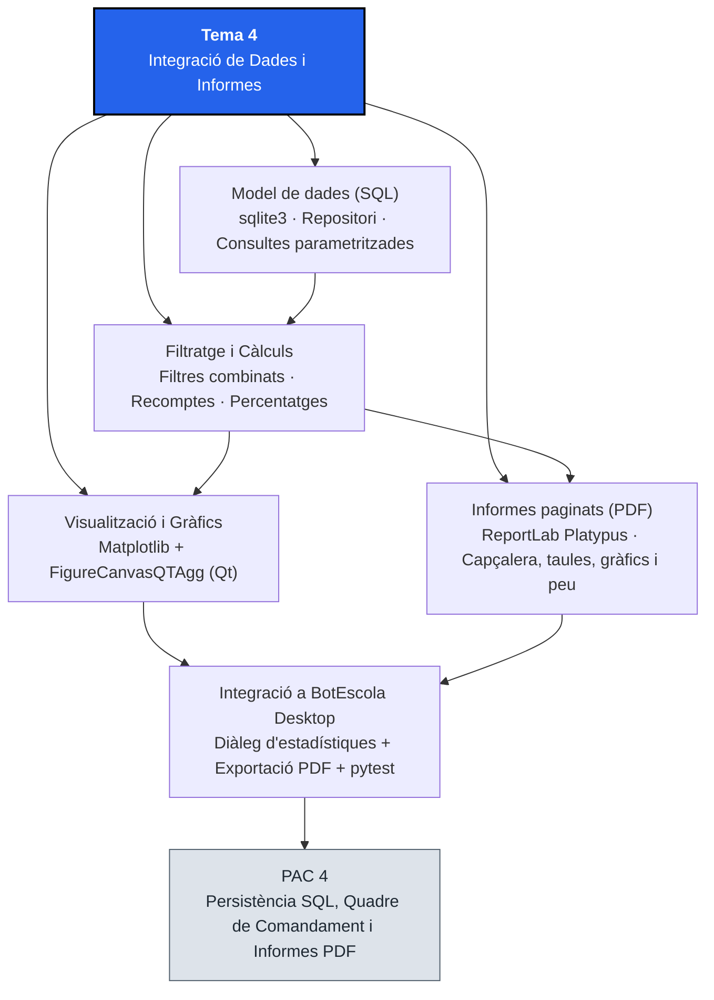
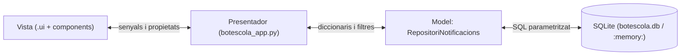

# Tema 4. Integració de Dades i Informes

## 1. Identificació

* **Mòdul:** 0488. Desenvolupament d'interfícies
* **Curs:** 1r CFGS de Desenvolupament d'Aplicacions Multiplataforma (DAM)
* **Tema:** 4. Integració de Dades i Informes
* **Durada presencial:** 13 hores (2h Teoria + 6h Pràctica Guiada + 5h PAC)
* **RA treballats:** RA5
* **Prerequisits:** Fonaments de SQL i bases de dades relacionals, arquitectura MVP amb PySide6 i fulls d'estil QSS (Tema 1), creació de components i proves unitàries amb `pytest-qt` (Tema 2), control per veu i fils (`QThread`, Tema 3) i integració amb `BotEscola Desktop` (Temes 1 a 3).
* **Projecte transversal:** <mark style="color:violet;">**BotEscola Desktop**</mark>. En aquest tema substituïm les dades de prova en memòria per una capa de persistència SQL (<mark style="color:violet;">`sqlite3`</mark>), incorporem filtres dinàmics d'informació, construïm un quadre de comandament amb gràfics estadístics incrustats (<mark style="color:violet;">`Matplotlib`</mark>) i generem informes analítics en format PDF (<mark style="color:violet;">`ReportLab`</mark>) amb camps calculats, agrupacions, capçaleres i peus de pàgina.

### Criteris d'avaluació treballats

#### RA5. Crea informes avaluant i utilitzant eines gràfiques.

* CA 5.1: Identifica les eines disponibles per a la generació d'informes.
* CA 5.2: Estableix la connexió amb l'origen de dades.
* CA 5.3: Defineix les consultes d'obtenció de dades.
* CA 5.4: Aplica filtres sobre les dades de l'informe.
* CA 5.5: Estructura l'informe amb encapçalaments, peus i seccions.
* CA 5.6: Inclou valors calculats, contadors i totals.
* CA 5.7: Incorpora gràfics generats a partir de les dades.
* CA 5.8: Genera i integra informes dins de l'aplicació gràfica.

#### Continguts Orientatius

* 5.1 Eines de generació d'informes i visualització de dades. Característiques.
* 5.2 Connexió a orígens de dades relacionals i consultes parametritzades.
* 5.3 Filtratge d'informació des de la interfície i en les consultes.
* 5.4 Estructura d'un informe: títol, capçalera, cos (detall i agrupacions), resum i peu de pàgina.
* 5.5 Valors calculats, recomptes, percentatges i subtotals.
* 5.6 Creació i incrustació de gràfics en aplicacions d'escriptori i en documents.
* 5.7 Exportació i integració d'informes a l'aplicació.

## 2. Introducció

Fins al Tema 3, <mark style="color:violet;">**BotEscola Desktop**</mark> ha treballat amb una llista de diccionaris de prova definida a <mark style="color:violet;">`dades.py`</mark>: cada vegada que tancàvem la finestra, els canvis de prioritat, les notificacions marcades com a llegides o els estats d'aprovació es perdien. En una aplicació de gestió real, la capa del **Model** (Tema 1, apartat 5.2) es connecta a una base de dades relacional i ofereix a la direcció del centre eines per **filtrar les comunicacions, visualitzar-ne l'evolució en gràfics i exportar informes en PDF** llestos per arxivar o presentar en una reunió.

En aquest tema completarem l'arquitectura **MVP (Model–Vista–Presentador)** introduint un repositori de dades basat en <mark style="color:violet;">**`sqlite3`**</mark> amb consultes SQL parametritzades. A partir d'aquestes dades, treballarem les dues vessants dels informes empresarials en una interfície gràfica:

1. **Quadres de comandament interactius en pantalla (_Dashboards_):** incrustarem gràfics de <mark style="color:violet;">**`Matplotlib`**</mark> nativament com a widgets de Qt mitjançant <mark style="color:red;">**`FigureCanvasQTAgg`**</mark>.
2. **Documents d'informe estructurats en PDF:** utilitzarem el motor <mark style="color:violet;">**`ReportLab`**</mark> (<mark style="color:violet;">`platypus`</mark>) per compondre documents paginats amb capçalera institucional, taules d'agrupació, camps calculats (totals i percentatges), gràfics estadístics i numeració de pàgines al peu.

Tot el càlcul de mètriques, el filtratge SQL i la generació del fitxer PDF es dissenyaran desacoblats dels widgets perquè es puguin verificar de manera automàtica amb <mark style="color:violet;">**`pytest`**</mark> i <mark style="color:violet;">**`pytest-qt`**</mark>.

## 3. Objectius didàctics

En acabar el tema, l'alumne serà capaç de:

1. Comparar les eines de generació d'informes i visualització (motors programàtics com `ReportLab`, plantilles HTML/CSS com `WeasyPrint`, dissenyadors visuals com `JasperReports`, i llibreries gràfiques com `Matplotlib` o `QtCharts`) i justificar-ne l'elecció.
2. Connectar l'aplicació a una base de dades SQLite mitjançant un repositori que encapsuli les consultes SQL parametritzades i mantingui la separació del patró MVP.
3. Aplicar filtres combinats (per prioritat, estat de lectura o text) sobre les dades tant a la vista principal com en la generació d'informes, evitant vulnerabilitats d'injecció SQL.
4. Estructurar un informe professional dividint-lo en encapçalament, resum executiu, seccions de detall o agrupació, i peu de pàgina amb data i numeració.
5. Calcular variables agregades (recomptes, totals, percentatges i ràtios) a partir de consultes SQL o d'estructures de dades i verificar-ne l'exactitud.
6. Crear gràfics estadístics clars i accessibles amb `Matplotlib`, incrustar-los com a widgets dins d'una finestra o diàleg de PySide6 i incorporar-los dins d'un informe PDF.
7. Generar informes en format PDF amb `ReportLab` i integrar l'acció d'exportació i el quadre de comandament a la barra de menús i barra d'eines de <mark style="color:violet;">**BotEscola Desktop**</mark>.
8. Escriure proves unitàries amb `pytest` (usant bases de dades en memòria `:memory:` i directoris temporals `tmp_path`) que comprovin les consultes, els filtres, els càlculs i la generació vàlida del PDF.

## 4. Mapa conceptual



## 5. Conceptes fonamentals

> **Convenció tipogràfica:** els noms ressaltats en color segueixen la dels Temes 1, 2 i 3: <mark style="color:red;">**classes de Qt, components i motors**</mark>, <mark style="color:blue;">**propietats i senyals**</mark>, <mark style="color:orange;">**mètodes i funcions**</mark> i <mark style="color:violet;">**eines, fitxers i noms del projecte**</mark>.

### 5.1. Eines de generació d'informes i visualització

En el desenvolupament d'aplicacions de gestió es distingeixen dos tipus d'eines segons si l'objectiu és analitzar dades en pantalla o produir un document tancat per imprimir o signar:

| Categoria | Eina / Tecnologia | Enfocament | Avantatges | Limitacions |
| :--- | :--- | :--- | :--- | :--- |
| **Generadors d'informes en PDF (codi)** | <mark style="color:violet;">**`ReportLab`**</mark> (Python) | Construcció programàtica d'elements (`Paragraph`, `Table`, `Image`) o dibuix sobre llenç (`Canvas`) | Eina de referència en Python; control exacte de la paginació; l'edició de codi obert té llicència BSD; s'instal·la amb `pip` (amb `Pillow` per a les imatges) | Disseny declaratiu en codi Python (sense editor visual d'arrossegar i deixar anar) |
| **Eines de PDF de Qt** | **`QPdfWriter`** + **`QTextDocument`** (PySide6) | Es dibuixa amb `QPainter` o es renderitza l'HTML/CSS bàsic d'un `QTextDocument` | Cap dependència addicional: ja forma part de PySide6 | Control de la paginació i de les taules llargues més limitat que a `ReportLab` |
| **Generadors basats en plantilles HTML** | **WeasyPrint**, **wkhtmltopdf** | Converteixen una plantilla HTML + CSS (sovint amb `Jinja2`) a PDF | Aprofita coneixements de maquetació web i CSS `@page` | `WeasyPrint` necessita la llibreria nativa Pango, que complica l'empaquetat i la instal·lació a Windows; `wkhtmltopdf` no té manteniment actiu |
| **Suites d'informes visuals** | **JasperReports** (Jaspersoft Studio), **Crystal Reports** | Editor visual WYSIWYG que genera plantilles (`.jrxml` a Jasper) connectables a bases de dades | Pensat per a grans volums corporatius | Requereix Java o servidors dedicats; pesat per a una aplicació d'escriptori Python |
| **Llibreries de gràfics en pantalla i imatge** | <mark style="color:violet;">**`Matplotlib`**</mark>, **PySide6.QtCharts**, **Plotly** | Generació de gràfics de barres, línies o sectors a partir de sèries de dades | `Matplotlib` ofereix un widget natiu per a Qt (`FigureCanvasQTAgg`) i exportació directa a PNG, SVG o PDF; té llicència permissiva | `QtCharts` només es distribueix amb llicència GPL o comercial i condicionaria la llicència de l'aplicació; `Plotly` està orientat al navegador |

> **Decisió tecnològica per a BotEscola Desktop:** utilitzarem <mark style="color:violet;">**`Matplotlib`**</mark> i <mark style="color:violet;">**`ReportLab`**</mark> perquè s'instal·len amb `pip`, tenen llicències permissives (a diferència de `QtCharts`), no exigeixen instal·lar programari extern al sistema operatiu i permeten provar la generació en tests automatitzats.

### 5.2. Connexió a l'origen de dades i el patró Repositori dins d'MVP

Al Tema 1 vam establir que la **Vista** (`.ui`) no coneix les dades i que el **Presentador** coordina la interacció amb el **Model**. Quan les dades passen a viure en una base de dades relacional (<mark style="color:violet;">**`sqlite3`**</mark>, inclosa de sèrie a Python), escriure sentències `SELECT` o `UPDATE` barrejades dins dels _slots_ de la finestra principal seria un error greu de manteniment.

Per evitar-ho, encapsulem l'accés a la base de dades en una classe **Repositori** (<mark style="color:red;">`RepositoriNotificacions`</mark>):



Quatre regles tècniques essencials en treballar amb SQL des d'una interfície:

1. **Consultes sempre parametritzades (`?`):** mai concatenis el text d'un camp de cerca (`QLineEdit`) ni d'un desplegable (`QComboBox`) dins d'un _f-string_ SQL. Utilitza marcadors de posició `?` i passa els valors com a tupla al segon argument d'<mark style="color:orange;">`execute(sql, parametres)`</mark>. Això impedeix qualsevol **injecció SQL** i gestiona automàticament les cometes i els caràcters especials.
2. **Files com a diccionaris:** configurant `conn.row_factory = sqlite3.Row`, cada fila retornada es pot convertir en un `dict` amb les mateixes claus que ja utilitzen <mark style="color:red;">`TargetaNotificacio`</mark> i <mark style="color:violet;">`dades.py`</mark> (`id`, `remitent`, `assumpte`, `data`, `detall`, `llegida`, `prioritat`). Així els components del Tema 2 no s'han de modificar.
3. **Suport per a `:memory:`:** si el constructor del repositori rep la ruta de la base de dades com a paràmetre (`ruta_bd="botescola.db"`), les proves unitàries li poden passar `":memory:"` per crear una base de dades efímera en RAM, ràpida i completament aïllada en cada test.

4. **Només els valors van amb `?`:** els marcadors substitueixen **valors**, no noms de columna ni operadors. Els filtres tancats (prioritat, estat de lectura) es validen contra una llista i la clàusula `WHERE` es construeix només amb fragments fixos del programa; el text de l'usuari viatja sempre com a paràmetre.

### 5.3. Filtratge de dades i consultes d'agregació

Una aplicació de gestió ha de permetre acotar quins registres es mostren a la finestra i quins s'inclouen a l'informe. A <mark style="color:violet;">**BotEscola Desktop**</mark> combinarem tres criteris de filtre:

* **Per prioritat:** `"Totes"`, `"Baixa"`, `"Normal"` o `"Alta"`.
* **Per estat de lectura:** `"Totes"`, `"Pendents"` (`llegida = 0`) o `"Llegides"` (`llegida = 1`).
* **Per text lliure:** cerca parcial (`LIKE ?`) dins del `remitent` o de l'`assumpte`. Atenció: `%` i `_` són comodins del `LIKE`; si l'usuari els escriu, s'han d'escapar perquè es cerquin com a caràcters literals (clàusula `ESCAPE`).

Quan un filtre val `"Totes"` o el camp de cerca està buit, la condició no s'afegeix (o s'avalua com a certa), i quan l'usuari restringeix diversos filtres alhora, es combinen amb `AND` construint la llista de paràmetres `?` de manera segura.

A més dels registres individuals, un informe necessita **dades agregades i camps calculats**:

* **Recomptes i totals (`COUNT`, `SUM`):** total de notificacions, total de pendents, total de llegides i desglossament per nivell de prioritat (`GROUP BY prioritat`) o per estat de resolució (`aprovada`, `descartada`, `sense_resoldre`).
* **Valors calculats i percentatges:** per exemple, la **taxa de lectura** (`llegides / total × 100`). Cal protegir sempre el càlcul contra la **divisió per zero** quan el filtre aplicat no retorna cap notificació (`total == 0`).

### 5.4. Anatomia i estructura d'un informe professional

Un informe empresarial no és un bolcat cru d'una taula SQL. Perquè sigui llegible, auditable i comprensible per si sol fora de l'aplicació, s'estructura en cinc seccions clàssiques:

```
┌─────────────────────────────────────────────────────────────┐
│ CAPÇALERA DE PÀGINA: Logotip / Nom del centre · Data emissió│
├─────────────────────────────────────────────────────────────┤
│ 1. TÍTOL I CONTEXT (Filtres aplicats en generar l'informe)  │
│                                                             │
│ 2. RESUM EXECUTIU (Camps calculats: Totals i Percentatges)  │
│    [ Total: 12 ]  [ Pendents: 4 ]  [ Taxa lectura: 66.7 %]  │
│                                                             │
│ 3. VISUALITZACIÓ GRÀFICA (Gràfic de barres per prioritat)   │
│                                                             │
│ 4. COS / DETALL I AGRUPACIONS (Taula de registres filtrats) │
│ ID │ Data       │ Remitent │ Assumpte │ Prio │ Lect. │ Res. │
│────┼────────────┼──────────┼──────────┼──────┼───────┼──────│
│ 1  │ 2026-10-15 │ Direcció │ Claustre │ Alta │ Nova  │ —    │
│    ...                                                      │
├─────────────────────────────────────────────────────────────┤
│ PEU DE PÀGINA: BotEscola Desktop                    Pàgina 1│
└─────────────────────────────────────────────────────────────┘
```

> **Principi de traçabilitat:** l'informe ha d'indicar explícitament **quins filtres estaven actius** en el moment de generar-lo (per exemple, `Filtre aplicat: Prioritat = Alta · Estat = Pendents`). Sense aquesta dada, un lector podria pensar que el document mostra totes les notificacions del centre.

### 5.5. Gràfics amb `Matplotlib`: en pantalla (`FigureCanvasQTAgg`) i en document

<mark style="color:violet;">**`Matplotlib`**</mark> separa l'estructura del gràfic (<mark style="color:red;">**`Figure`**</mark> i els seus eixos `Axes`) del lloc on es renderitza (_backend_):

* **En una finestra de PySide6:** s'utilitza el llenç <mark style="color:red;">**`FigureCanvasQTAgg`**</mark> (del mòdul `matplotlib.backends.backend_qtagg`), que **hereta de `QWidget`**. Per tant, es pot afegir a qualsevol `QVBoxLayout` o dins d'un component propi exactament igual que un botó o una etiqueta.
* **Dins d'un informe PDF:** la mateixa <mark style="color:red;">`Figure`</mark> es pot exportar a un buffer de memòria (<mark style="color:red;">`io.BytesIO`</mark>) en format PNG d'alta resolució (`dpi=150`) amb <mark style="color:orange;">`fig.savefig(buffer, format="png")`</mark> i inserir-se com a imatge dins del flux de <mark style="color:violet;">`ReportLab`</mark> sense deixar fitxers temporals escampats pel disc.

> **Bona pràctica amb `Matplotlib` en aplicacions GUI:** crea sempre les figures amb la classe orientada a objectes <mark style="color:red;">`Figure()`</mark> (de `matplotlib.figure`) en lloc de la interfície global `pyplot` (`plt.figure()`). `pyplot` manté referències globals en memòria i pot entrar en conflicte amb el bucle d'esdeveniments de Qt o amb l'execució de tests a `pytest`.

**Accessibilitat en gràfics (connexió amb el Tema 1):**

* **No depenguis només del color:** afegeix l'etiqueta amb el valor numèric exacte sobre cada barra (<mark style="color:orange;">`ax.bar_label(...)`</mark>) i títols clars als eixos. Així el gràfic és comprensible fins i tot imprès en blanc i negre.
* **Usa la mateixa paleta verificada:** reutilitza els colors de <mark style="color:violet;">`styles/botescola.qss`</mark> (per exemple `#2563EB`, `#1F2933`, `#52606D`).

### 5.6. Generació de PDF amb `ReportLab` (`platypus`)

<mark style="color:violet;">**`ReportLab`**</mark> ofereix dos nivells d'abstracció:

1. **Baix nivell (`pdfgen.canvas.Canvas`):** dibuixa textos i línies indicant coordenades (x, y) en punts tipogràfics (1 punt = 1/72 de polzada; un full A4 mesura 595,27 × 841,89 punts). S'utilitza per dibuixar elements fixos repetitius com la **capçalera i el peu de cada pàgina**.
2. **Alt nivell (`platypus` — _Page Layout and Typography Using Scripts_):** construeix el document (<mark style="color:red;">`SimpleDocTemplate`</mark>) a partir d'una llista d'elements fluïbles (_flowables_) com <mark style="color:red;">`Paragraph`</mark>, <mark style="color:red;">`Spacer`</mark>, <mark style="color:red;">`Table`</mark> i <mark style="color:red;">`Image`</mark>. `Platypus` calcula automàticament l'espai disponible i divideix les taules llargues en diverses pàgines (repetint la fila de capçalera de la taula amb `repeatRows=1`).

L'origen de coordenades del `canvas` és la cantonada **inferior esquerra** de la pàgina (per això la capçalera es dibuixa a `alcada - 1.5 * cm`). Un `Paragraph` interpreta el seu text com a marques tipus XML (`<b>`, `&`…): el text que escriu l'usuari s'ha d'**escapar** abans de passar-lo-hi.

Combinem tots dos nivells passant una funció de _callback_ als paràmetres `onFirstPage` i `onLaterPages` de <mark style="color:orange;">`doc.build(elements, onFirstPage=..., onLaterPages=...)`</mark> perquè cada pàgina tingui la seva capçalera i el peu amb el número de pàgina (`canvas.getPageNumber()`).

## 6. Entorn de treball

### 6.1. Estructura del projecte

Ampliem l'estructura de <mark style="color:violet;">**BotEscola Desktop**</mark> afegint el paquet `informes/` (que conté el repositori SQLite, el generador de PDF i el component de gràfics) i el fitxer de proves <mark style="color:violet;">`tests/test_informes.py`</mark>:

```
botescola/
├── ui/
│   └── botescola.ui
├── generated/
│   └── ui_botescola.py
├── styles/
│   ├── botescola.qss
│   └── alt_contrast.qss
├── components/               <-- Tema 2 (RA3)
│   ├── __init__.py
│   ├── selector.py
│   ├── targeta.py
│   └── comptador.py
├── nui/                      <-- Tema 3 (RA2)
│   ├── __init__.py
│   ├── interpret.py
│   └── escoltador_veu.py
├── informes/                 <-- Tema 4 (RA5): dades SQL, gràfics i PDF
│   ├── __init__.py
│   ├── repositori.py         <-- connexió SQLite, consultes, filtres i mètriques
│   ├── grafics.py            <-- widget FigureCanvasQTAgg i generació de figures
│   └── generador_pdf.py      <-- construcció de l'informe PDF amb ReportLab
├── tests/
│   ├── test_selector.py
│   ├── test_targeta.py
│   ├── test_comptador.py
│   ├── test_nui.py
│   └── test_informes.py      <-- proves de SQL, filtres, càlculs, gràfics i PDF
├── docs/
│   ├── components.md
│   ├── nui.md
│   └── informes.md           <-- disseny de consultes, estructura de l'informe i proves
├── dades.py                  <-- llavor inicial (NOTIFICACIONS_PROVA) per poblar la BD si és buida
├── botescola.db              <-- es crea en la primera arrencada; NO es puja a Git
├── botescola_app.py
├── pyproject.toml
├── pytest.ini
├── contrast.py
├── taula_contrast.md
└── README.md
```

> **Nota sobre `dades.py`:** aquest tema suposa que <mark style="color:violet;">`dades.py`</mark> exporta la llista de diccionaris amb el nom `NOTIFICACIONS_PROVA` (camps `id`, `remitent`, `assumpte`, `data` en format `YYYY-MM-DD`, `detall`, `llegida` i `prioritat`). Si al teu projecte es diu d'una altra manera, adapta la importació del Pas 5.

El fitxer `botescola.db` conté dades locals i es regenera des de `dades.py`: afegeix-lo a `.gitignore`. En canvi, el PDF d'exemple de l'entrega sí que s'inclou.

> **Nota per a desplegament:** durant el desenvolupament guardem la BD al directori del projecte per simplificar l'exercici. En una aplicació instal·lada, aquest directori pot no ser escrivible; convé desar les dades en una ubicació d'usuari pròpia de l'aplicació amb `QStandardPaths.writableLocation(QStandardPaths.StandardLocation.AppDataLocation)` (retorna una `str`) i crear-hi el directori si no existeix (`Path(ruta).mkdir(parents=True, exist_ok=True)`). Abans cal fixar `QCoreApplication.setOrganizationName(...)` i `QCoreApplication.setApplicationName("BotEscola")`: sense aquests noms, Qt construeix la ruta amb el nom de l'executable (per exemple, `python`) i no amb el de l'aplicació.

Actualitza <mark style="color:violet;">`pyproject.toml`</mark>: inclou el paquet nou i afegeix les dues dependències noves a la llista `dependencies` que ja tens (**edita la taula `[project]` existent; no n'afegeixis una segona**):

```toml
[project]
name = "botescola-modules"
version = "0.3.0"
description = "Paquets Python reutilitzables de BotEscola Desktop"
requires-python = ">=3.10"
dependencies = ["PySide6", "SpeechRecognition", "matplotlib", "reportlab"]   # la resta de camps, tal com els tens

[project.optional-dependencies]
micro = ["PyAudio"]                       # només per al micròfon (Tema 3)
gestos = ["opencv-python", "mediapipe"]   # ampliació opcional de gestos (Tema 3)

[tool.setuptools.packages.find]
include = ["components*", "nui*", "informes*"]
```

`PyAudio` continua sent un extra opcional, com al Tema 3: una dependència obligatòria no ha d'impedir instal·lar el projecte en un equip on `PyAudio` no es pot compilar.

### 6.2. Dependències

Amb l'entorn virtual activat, instal·la <mark style="color:violet;">`matplotlib`</mark> i <mark style="color:violet;">`reportlab`</mark> (<mark style="color:violet;">`sqlite3`</mark> ja forma part de la llibreria estàndard de Python; `reportlab` instal·la també `Pillow`, necessari per inserir imatges):

```bash
python -m pip install matplotlib reportlab
```

El gràfic usa `bar_label`, que exigeix `Matplotlib` 3.4 o superior. La primera vegada que s'importa, `Matplotlib` construeix una memòria cau de tipus de lletra i pot trigar uns segons: és normal.

Comprova les versions instal·lades per registrar-les al <mark style="color:violet;">`README.md`</mark> i a l'informe de proves:

```bash
python -c "import sqlite3, matplotlib, reportlab; print('SQLite', sqlite3.sqlite_version, '| Matplotlib', matplotlib.__version__, '| ReportLab', reportlab.Version)"
```

## 7. Exemple guiat: Persistència SQLite, gràfic incrustat i informe PDF

### Pas 1. Dissenyar l'esquema de dades, les consultes i les mètriques

La taula `notificacions` d'SQLite emmagatzema tots els camps que ja utilitzava l'aplicació als Temes 1, 2 i 3, més l'`estat_resolucio` (`'sense_resoldre'`, `'aprovada'`, `'descartada'`) perquè les accions d'aprovar i descartar també quedin persistides:

| Camp SQL | Tipus SQLite | Valor per defecte | Restricció | Equivalència al diccionari Python |
| :--- | :--- | :--- | :--- | :--- |
| `id` | `INTEGER PRIMARY KEY` | Autoincremental | — | `int` (`id`) |
| `remitent` | `TEXT NOT NULL` | — | — | `str` (`remitent`) |
| `assumpte` | `TEXT NOT NULL` | — | — | `str` (`assumpte`) |
| `data` | `TEXT NOT NULL` | — | — | `str` (`data`, format `YYYY-MM-DD`) |
| `detall` | `TEXT NOT NULL` | `''` | — | `str` (`detall`) |
| `llegida` | `INTEGER NOT NULL` | `0` | `CHECK (llegida IN (0, 1))` | `bool` (`False` = `0`, `True` = `1`) |
| `prioritat` | `TEXT NOT NULL` | `'Normal'` | `CHECK (prioritat IN ('Baixa', 'Normal', 'Alta'))` | `str` |
| `estat_resolucio` | `TEXT NOT NULL` | `'sense_resoldre'` | `CHECK (estat_resolucio IN ('sense_resoldre', 'aprovada', 'descartada'))` | `str` |

Fixa't en el vocabulari: al llarg de l'aplicació, **«pendents» vol dir «sense llegir»** (Tema 2), mentre que l'estat de resolució és un altre eix i per això el seu valor inicial es diu `sense_resoldre` i no `pendent`. Les restriccions `CHECK` fan que la **base de dades** rebutgi valors invàlids encara que el codi Python s'oblidi de validar-los.

### Pas 2. Programar el repositori SQLite (`informes/repositori.py`)

```python
"""Repositori SQLite per a les notificacions i mètriques d'informes de BotEscola."""

import sqlite3


class RepositoriNotificacions:
    """Gestiona la persistència SQL, el filtratge i els càlculs agregats.

    Els valors que venen de l'usuari es passen sempre com a paràmetres (`?`).
    Els únics fragments de SQL que es concatenen (WHERE, GROUP BY) són
    constants del programa, mai text de l'usuari.
    """

    PRIORITATS = ("Baixa", "Normal", "Alta")
    ESTATS_LECTURA = ("Totes", "Pendents", "Llegides")
    ESTATS_RESOLUCIO = ("sense_resoldre", "aprovada", "descartada")

    def __init__(self, ruta_bd="botescola.db", dades_inicials=None):
        """Obre la connexió i crea l'esquema si no existeix.

        Args:
            ruta_bd: camí al fitxer SQLite o ':memory:' per a proves unitàries.
            dades_inicials: llista opcional de diccionaris per poblar la taula si és buida.
        """
        self._conn = sqlite3.connect(ruta_bd)
        self._conn.row_factory = sqlite3.Row
        self._crear_taula()
        if dades_inicials and self.comptar_total() == 0:
            self.inserir_lot(dades_inicials)

    def _crear_taula(self):
        self._conn.execute(
            """
            CREATE TABLE IF NOT EXISTS notificacions (
                id INTEGER PRIMARY KEY AUTOINCREMENT,
                remitent TEXT NOT NULL,
                assumpte TEXT NOT NULL,
                data TEXT NOT NULL,
                detall TEXT NOT NULL DEFAULT '',
                llegida INTEGER NOT NULL DEFAULT 0
                    CHECK (llegida IN (0, 1)),
                prioritat TEXT NOT NULL DEFAULT 'Normal'
                    CHECK (prioritat IN ('Baixa', 'Normal', 'Alta')),
                estat_resolucio TEXT NOT NULL DEFAULT 'sense_resoldre'
                    CHECK (estat_resolucio IN ('sense_resoldre', 'aprovada', 'descartada'))
            )
            """
        )
        self._conn.commit()

    @staticmethod
    def _fila_a_dict(fila):
        d = dict(fila)
        d["llegida"] = bool(d["llegida"])
        return d

    @staticmethod
    def _valor_llegida(llegida):
        """Accepta només bool (rebutja, p. ex., 'False', que Python avalua com a True) i el passa a 0/1."""
        if not isinstance(llegida, bool):
            raise TypeError("llegida ha de ser un valor booleà")
        return int(llegida)

    def inserir_lot(self, llista_notificacions):
        """Insereix una llista de diccionaris de notificació (en una sola transacció)."""
        with self._conn:
            for n in llista_notificacions:
                self._conn.execute(
                    """
                    INSERT INTO notificacions
                        (id, remitent, assumpte, data, detall, llegida, prioritat, estat_resolucio)
                    VALUES (?, ?, ?, ?, ?, ?, ?, ?)
                    """,
                    (
                        n.get("id"),
                        n["remitent"],
                        n["assumpte"],
                        n["data"],
                        n.get("detall", ""),
                        self._valor_llegida(n.get("llegida", False)),
                        n.get("prioritat", "Normal"),
                        n.get("estat_resolucio", "sense_resoldre"),
                    ),
                )

    def comptar_total(self):
        return self._conn.execute("SELECT COUNT(*) FROM notificacions").fetchone()[0]

    @staticmethod
    def _escapar_like(text):
        """Escapa `\\`, `%` i `_` perquè la cerca els tracti com a caràcters literals."""
        return text.replace("\\", "\\\\").replace("%", "\\%").replace("_", "\\_")

    @classmethod
    def _construir_filtre(cls, prioritat, estat_lectura, cerca):
        """Retorna (clausula_where, parametres) per als filtres combinats.

        Valida els filtres tancats (prioritat i estat de lectura) i només afegeix
        fragments fixos a la clàusula; el text de cerca viatja com a paràmetre.
        """
        if prioritat not in ("Totes",) + cls.PRIORITATS:
            raise ValueError(f"Filtre de prioritat no vàlid: {prioritat!r}")
        if estat_lectura not in cls.ESTATS_LECTURA:
            raise ValueError(f"Filtre d'estat de lectura no vàlid: {estat_lectura!r}")

        condicions = []
        parametres = []

        if prioritat != "Totes":
            condicions.append("prioritat = ?")
            parametres.append(prioritat)

        if estat_lectura == "Pendents":
            condicions.append("llegida = 0")
        elif estat_lectura == "Llegides":
            condicions.append("llegida = 1")

        text = (cerca or "").strip()
        if text:
            condicions.append("(remitent LIKE ? ESCAPE '\\' OR assumpte LIKE ? ESCAPE '\\')")
            patro = f"%{cls._escapar_like(text)}%"
            parametres.extend([patro, patro])

        clausula = (" WHERE " + " AND ".join(condicions)) if condicions else ""
        return clausula, tuple(parametres)

    def obtenir_notificacions(self, prioritat="Totes", estat_lectura="Totes", cerca=""):
        """Retorna la llista de notificacions aplicant filtres combinats parametritzats."""
        clausula, parametres = self._construir_filtre(prioritat, estat_lectura, cerca)
        cur = self._conn.execute(
            "SELECT * FROM notificacions" + clausula + " ORDER BY data DESC, id ASC",
            parametres,
        )
        return [self._fila_a_dict(f) for f in cur.fetchall()]

    def obtenir_per_id(self, id_notificacio):
        """Retorna la notificació amb aquest id o None si no existeix."""
        fila = self._conn.execute(
            "SELECT * FROM notificacions WHERE id = ?", (id_notificacio,)
        ).fetchone()
        return self._fila_a_dict(fila) if fila else None

    def _executar_actualitzacio(self, sql, parametres, id_notificacio):
        with self._conn:                       # confirma (commit) o desfà (rollback)
            cur = self._conn.execute(sql, parametres)
        if cur.rowcount == 0:
            raise KeyError(f"No existeix cap notificació amb id {id_notificacio!r}")

    def actualitzar_llegida(self, id_notificacio, llegida=True):
        self._executar_actualitzacio(
            "UPDATE notificacions SET llegida = ? WHERE id = ?",
            (self._valor_llegida(llegida), id_notificacio),
            id_notificacio,
        )

    def actualitzar_prioritat(self, id_notificacio, prioritat):
        if prioritat not in self.PRIORITATS:
            raise ValueError(f"Prioritat no vàlida: {prioritat!r}")
        self._executar_actualitzacio(
            "UPDATE notificacions SET prioritat = ? WHERE id = ?",
            (prioritat, id_notificacio),
            id_notificacio,
        )

    def actualitzar_resolucio(self, id_notificacio, estat_resolucio):
        if estat_resolucio not in self.ESTATS_RESOLUCIO:
            raise ValueError(f"Estat de resolució no vàlid: {estat_resolucio!r}")
        self._executar_actualitzacio(
            "UPDATE notificacions SET estat_resolucio = ? WHERE id = ?",
            (estat_resolucio, id_notificacio),
            id_notificacio,
        )

    def calcular_resum(self, prioritat="Totes", estat_lectura="Totes", cerca=""):
        """Calcula contadors, percentatges i totals per prioritat sobre el conjunt filtrat.

        Els comptatges es fan amb agregats SQL (COUNT, SUM, GROUP BY) reutilitzant
        exactament el mateix filtre que la llista.
        """
        clausula, parametres = self._construir_filtre(prioritat, estat_lectura, cerca)

        fila = self._conn.execute(
            "SELECT COUNT(*) AS total, "
            "COALESCE(SUM(llegida), 0) AS llegides, "
            "COALESCE(SUM(estat_resolucio = 'aprovada'), 0) AS aprovades, "
            "COALESCE(SUM(estat_resolucio = 'descartada'), 0) AS descartades "
            "FROM notificacions" + clausula,
            parametres,
        ).fetchone()
        total, llegides = fila["total"], fila["llegides"]

        per_prioritat = {nivell: 0 for nivell in self.PRIORITATS}
        for f in self._conn.execute(
            "SELECT prioritat, COUNT(*) AS n FROM notificacions"
            + clausula + " GROUP BY prioritat",
            parametres,
        ):
            per_prioritat[f["prioritat"]] = f["n"]

        return {
            "total": total,
            "llegides": llegides,
            "pendents": total - llegides,
            "taxa_lectura": round(llegides * 100.0 / total, 1) if total > 0 else 0.0,
            "per_prioritat": per_prioritat,
            "aprovades": fila["aprovades"],
            "descartades": fila["descartades"],
        }

    def tancar(self):
        """Tanca la connexió amb la base de dades."""
        self._conn.close()
```

### Pas 3. Programar el component de gràfics amb `Matplotlib` (`informes/grafics.py`)

Separem el **dibuix** (una funció que només treballa amb uns eixos) del **suport** on es mostra: la mateixa funció serveix per a la <mark style="color:red;">`Figure`</mark> del PDF i per al widget <mark style="color:red;">`GraficPrioritats`</mark>, basat en <mark style="color:red;">`FigureCanvasQTAgg`</mark>. Així no es duplica codi:

```python
"""Gràfics estadístics amb Matplotlib per a finestra Qt i exportació a PDF."""

import io

from PySide6.QtWidgets import QVBoxLayout, QWidget          # abans que el backend de Matplotlib
from matplotlib.backends.backend_qtagg import FigureCanvasQTAgg
from matplotlib.figure import Figure
from matplotlib.ticker import MaxNLocator

NIVELLS = ("Baixa", "Normal", "Alta")
COLORS = ("#52606D", "#2563EB", "#1D4ED8")      # paleta verificada de styles/botescola.qss
COLOR_TEXT = "#1F2933"


def dibuixar_prioritats(ax, per_prioritat):
    """Dibuixa sobre uns eixos el nombre de notificacions per prioritat."""
    valors = [int(per_prioritat.get(n, 0)) for n in NIVELLS]

    barres = ax.bar(NIVELLS, valors, color=COLORS, edgecolor=COLOR_TEXT, width=0.55)
    ax.bar_label(barres, padding=3, fontweight="bold", color=COLOR_TEXT)

    ax.set_title("Notificacions per nivell de prioritat",
                 fontsize=11, fontweight="bold", color=COLOR_TEXT)
    ax.set_xlabel("Prioritat", color=COLOR_TEXT)
    ax.set_ylabel("Nombre de notificacions", color=COLOR_TEXT)
    ax.set_ylim(0, max(valors + [1]) + 1.5)
    ax.yaxis.set_major_locator(MaxNLocator(integer=True))
    ax.spines["top"].set_visible(False)
    ax.spines["right"].set_visible(False)


def crear_figura_prioritats(per_prioritat):
    """Crea una Figure de Matplotlib (sense pyplot) amb el gràfic de prioritats."""
    figura = Figure(figsize=(5.5, 3.0), dpi=100)
    dibuixar_prioritats(figura.add_subplot(111), per_prioritat)
    figura.tight_layout()
    return figura


def figura_a_bytes_png(figura, dpi=150):
    """Exporta una Figure de Matplotlib a un buffer BytesIO en format PNG."""
    buffer = io.BytesIO()
    figura.savefig(buffer, format="png", dpi=dpi)
    buffer.seek(0)
    return buffer


class GraficPrioritats(QWidget):
    """Widget de Qt que incrusta el gràfic de barres de prioritats."""

    def __init__(self, parent=None):
        super().__init__(parent)
        self._figura = crear_figura_prioritats({})
        self._canvas = FigureCanvasQTAgg(self._figura)

        layout = QVBoxLayout(self)
        layout.setContentsMargins(0, 0, 0, 0)
        layout.addWidget(self._canvas)

    @property
    def figura(self):
        """La Figure de Matplotlib (útil per a les proves)."""
        return self._figura

    def actualitzar(self, per_prioritat):
        """Redibuixa el gràfic amb el nou diccionari de recomptes per prioritat."""
        self._figura.clear()
        dibuixar_prioritats(self._figura.add_subplot(111), per_prioritat)
        self._figura.tight_layout()
        self._canvas.draw_idle()
```

### Pas 4. Programar el generador d'informes en PDF (`informes/generador_pdf.py`)

Utilitzem <mark style="color:violet;">`ReportLab`</mark> per construir un PDF paginat amb capçalera, peu de pàgina numerat, taula de valors calculats, el gràfic de `Matplotlib` i la taula detallada de notificacions. Dues precaucions importants:

* Un <mark style="color:red;">`Paragraph`</mark> interpreta el text com a **marques tipus XML** (`<b>`, `&`…). El text que ve de l'usuari (com la cerca que figura a la descripció dels filtres) s'ha d'**escapar** abans de passar-lo-hi, o un `&` o un `<` farien fallar la generació.
* Una cel·la de <mark style="color:red;">`Table`</mark> amb una cadena simple **no s'ajusta**: si el text és més llarg que la columna, se superposa a la veïna. Per això les cel·les amb text variable són `Paragraph`, que sí que fan salts de línia.

```python
"""Generador d'informes analítics en PDF amb ReportLab i Matplotlib."""

from datetime import datetime
from pathlib import Path
from xml.sax.saxutils import escape

from reportlab.lib import colors
from reportlab.lib.enums import TA_CENTER
from reportlab.lib.pagesizes import A4
from reportlab.lib.styles import ParagraphStyle, getSampleStyleSheet
from reportlab.lib.units import cm
from reportlab.platypus import Image, Paragraph, SimpleDocTemplate, Spacer, Table, TableStyle

from .grafics import crear_figura_prioritats, figura_a_bytes_png

TEXT_RESOLUCIO = {
    "sense_resoldre": "Sense resoldre",
    "aprovada": "Aprovada",
    "descartada": "Descartada",
}


def _dibuixar_capcalera_i_peu(canvas, doc):
    """Dibuixa l'encapçalament institucional i el peu amb número de pàgina."""
    canvas.saveState()
    amplada, alcada = A4

    # Capçalera (l'origen de coordenades és la cantonada inferior esquerra)
    canvas.setFont("Helvetica-Bold", 9)
    canvas.setFillColor(colors.HexColor("#1F2933"))
    canvas.drawString(2 * cm, alcada - 1.5 * cm, "BotEscola Desktop — Informe de Comunicacions")
    canvas.setFont("Helvetica", 8)
    canvas.drawRightString(
        amplada - 2 * cm,
        alcada - 1.5 * cm,
        f"Data d'emissió: {datetime.now().strftime('%Y-%m-%d %H:%M')}",
    )
    canvas.setStrokeColor(colors.HexColor("#52606D"))
    canvas.line(2 * cm, alcada - 1.7 * cm, amplada - 2 * cm, alcada - 1.7 * cm)

    # Peu de pàgina
    canvas.line(2 * cm, 1.8 * cm, amplada - 2 * cm, 1.8 * cm)
    canvas.drawString(2 * cm, 1.3 * cm, "BotEscola Desktop")
    canvas.drawRightString(amplada - 2 * cm, 1.3 * cm, f"Pàgina {canvas.getPageNumber()}")
    canvas.restoreState()


def generar_informe_pdf(ruta_sortida, notificacions, resum, descripcio_filtres="Cap filtre (totes)"):
    """Genera un fitxer PDF amb resum executiu, gràfic i taula de detall.

    Args:
        ruta_sortida: camí del fitxer PDF a crear (str o Path).
        notificacions: llista de diccionaris de notificacions filtrades.
        resum: diccionari retornat per RepositoriNotificacions.calcular_resum().
        descripcio_filtres: text que documenta els filtres aplicats.

    Returns:
        Path del fitxer PDF generat.
    """
    desti = Path(ruta_sortida)
    doc = SimpleDocTemplate(
        str(desti),
        pagesize=A4,
        leftMargin=2 * cm,
        rightMargin=2 * cm,
        topMargin=2.4 * cm,
        bottomMargin=2.4 * cm,
        title="Informe de Notificacions BotEscola",
    )

    estils = getSampleStyleSheet()
    estil_cel = ParagraphStyle("Cel", parent=estils["Normal"], fontSize=8.5, leading=10.5)
    estil_cap = ParagraphStyle("Cap", parent=estil_cel, fontName="Helvetica-Bold",
                               textColor=colors.white)
    estil_kpi_cap = ParagraphStyle("KpiCap", parent=estil_cap, alignment=TA_CENTER)
    estil_kpi_val = ParagraphStyle("KpiVal", parent=estil_cel, alignment=TA_CENTER,
                                   fontSize=11, leading=13)

    def par(text, estil):
        # Paragraph interpreta marques XML: el text d'usuari s'escapa sempre.
        return Paragraph(escape(str(text)), estil)

    elements = []

    # 1. Títol i filtres aplicats
    elements.append(Paragraph("Informe d'Estat de Notificacions", estils["Title"]))
    elements.append(Paragraph(
        f"<b>Filtres aplicats:</b> {escape(descripcio_filtres)}", estils["Normal"]))
    elements.append(Spacer(1, 0.5 * cm))

    # 2. Resum executiu (valors calculats)
    elements.append(Paragraph("1. Resum Executiu i Indicadors", estils["Heading2"]))
    capcaleres = ["Total", "Llegides", "Pendents (sense llegir)", "Taxa de lectura",
                  "Aprovades", "Descartades"]
    valors = [
        resum["total"],
        resum["llegides"],
        resum["pendents"],
        f"{resum['taxa_lectura']:.1f} %",
        resum.get("aprovades", 0),
        resum.get("descartades", 0),
    ]
    taula_resum = Table(
        [[par(c, estil_kpi_cap) for c in capcaleres], [par(v, estil_kpi_val) for v in valors]],
        colWidths=[2.8 * cm] * 6,
    )
    taula_resum.setStyle(TableStyle([
        ("BACKGROUND", (0, 0), (-1, 0), colors.HexColor("#2563EB")),
        ("BACKGROUND", (0, 1), (-1, 1), colors.HexColor("#F0F2F5")),
        ("GRID", (0, 0), (-1, -1), 0.75, colors.HexColor("#52606D")),
        ("VALIGN", (0, 0), (-1, -1), "MIDDLE"),
        ("LEFTPADDING", (0, 0), (-1, -1), 4),
        ("RIGHTPADDING", (0, 0), (-1, -1), 4),
        ("TOPPADDING", (0, 0), (-1, -1), 5),
        ("BOTTOMPADDING", (0, 0), (-1, -1), 5),
    ]))
    elements.append(taula_resum)
    elements.append(Spacer(1, 0.6 * cm))

    # 3. Gràfic estadístic incrustat (en memòria, sense fitxers temporals)
    elements.append(Paragraph("2. Distribució per Nivell de Prioritat", estils["Heading2"]))
    figura = crear_figura_prioritats(resum["per_prioritat"])
    elements.append(Image(figura_a_bytes_png(figura), width=13.5 * cm, height=7.4 * cm))
    elements.append(Spacer(1, 0.6 * cm))

    # 4. Taula de detall
    elements.append(Paragraph("3. Detall de Notificacions", estils["Heading2"]))
    files = [[par(c, estil_cap) for c in
              ("ID", "Data", "Remitent", "Assumpte", "Prioritat", "Lectura", "Resolució")]]
    for n in notificacions:
        files.append([
            par(n.get("id", ""), estil_cel),
            par(n.get("data", ""), estil_cel),
            par(n.get("remitent", ""), estil_cel),
            par(n.get("assumpte", ""), estil_cel),
            par(n.get("prioritat", "Normal"), estil_cel),
            par("Llegida" if n.get("llegida") else "Nova", estil_cel),
            par(TEXT_RESOLUCIO.get(n.get("estat_resolucio", "sense_resoldre"), "—"), estil_cel),
        ])

    estil_detall = [
        ("BACKGROUND", (0, 0), (-1, 0), colors.HexColor("#1F2933")),
        ("GRID", (0, 0), (-1, -1), 0.5, colors.HexColor("#52606D")),
        ("ROWBACKGROUNDS", (0, 1), (-1, -1), [colors.HexColor("#FFFFFF"), colors.HexColor("#F0F2F5")]),
        ("VALIGN", (0, 0), (-1, -1), "MIDDLE"),
        ("LEFTPADDING", (0, 0), (-1, -1), 4),
        ("RIGHTPADDING", (0, 0), (-1, -1), 4),
        ("TOPPADDING", (0, 0), (-1, -1), 4),
        ("BOTTOMPADDING", (0, 0), (-1, -1), 4),
    ]
    if len(files) == 1:                                   # cap registre: fila indicativa
        files.append([par("Sense registres per als filtres seleccionats", estil_cel)] + [""] * 6)
        estil_detall.append(("SPAN", (0, 1), (-1, 1)))

    taula_detall = Table(
        files,
        colWidths=[1.0 * cm, 2.2 * cm, 3.0 * cm, 5.0 * cm, 1.9 * cm, 1.7 * cm, 2.2 * cm],
        repeatRows=1,                                     # repeteix la capçalera a cada pàgina
    )
    taula_detall.setStyle(TableStyle(estil_detall))
    elements.append(taula_detall)

    doc.build(elements, onFirstPage=_dibuixar_capcalera_i_peu, onLaterPages=_dibuixar_capcalera_i_peu)
    return desti
```

I exposem les classes i funcions del paquet a <mark style="color:violet;">`informes/__init__.py`</mark>:

```python
"""Paquet de persistència SQL, gràfics i informes PDF de BotEscola Desktop."""

from .repositori import RepositoriNotificacions
from .grafics import GraficPrioritats, crear_figura_prioritats
from .generador_pdf import generar_informe_pdf

__all__ = [
    "RepositoriNotificacions",
    "GraficPrioritats",
    "crear_figura_prioritats",
    "generar_informe_pdf",
]
```

### Pas 5. Integració de filtres, persistència, quadre de comandament i exportació PDF al Presentador

Al Presentador (<mark style="color:violet;">`botescola_app.py`</mark>), la llista en memòria deixa de ser la font de veritat: ho passa a ser <mark style="color:red;">`RepositoriNotificacions`</mark>. El Presentador, doncs, **(1)** crea el repositori, **(2)** reconstrueix la llista amb les targetes del Tema 2 cada vegada que canvia un filtre, **(3)** persisteix cada acció de l'usuari i **(4)** ofereix les dues accions noves. Primer, les importacions i les connexions (dins de `__init__`, després de `setupUi`):

```python
from functools import partial
from pathlib import Path

from PySide6.QtCore import QTimer, Qt
from PySide6.QtWidgets import (QDialog, QFileDialog, QLabel, QListWidgetItem,
                               QMessageBox, QVBoxLayout)

from components import TargetaNotificacio
from dades import NOTIFICACIONS_PROVA
from informes import GraficPrioritats, RepositoriNotificacions, generar_informe_pdf

# Dins de __init__:
ruta_bd = Path(__file__).parent / "botescola.db"
self.repositori = RepositoriNotificacions(ruta_bd, dades_inicials=NOTIFICACIONS_PROVA)

self.ui.cmb_filtre_prioritat.currentTextChanged.connect(self.aplicar_filtres)
self.ui.cmb_filtre_estat.currentTextChanged.connect(self.aplicar_filtres)
self.ui.txt_cerca.textChanged.connect(self.aplicar_filtres)

self.ui.act_quadre_comandament.triggered.connect(self.mostrar_quadre_comandament)
self.ui.act_exportar_pdf.triggered.connect(self.exportar_informe_pdf)

self.recarregar_llista()
self.actualitzar_comptador()
```

Després, la reconstrucció de la llista. Cada element guarda el `id` de la notificació (`Qt.ItemDataRole.UserRole`), de manera que **qualsevol slot pot saber quina notificació té seleccionada sense dependre de la posició a la llista**, que canvia amb els filtres:

```python
def filtres_actuals(self):
    return (
        self.ui.cmb_filtre_prioritat.currentText(),
        self.ui.cmb_filtre_estat.currentText(),
        self.ui.txt_cerca.text(),
    )

def descriure_filtres(self):
    prio, estat, cerca = self.filtres_actuals()
    text_cerca = f"«{cerca.strip()}»" if cerca.strip() else "cap"
    return f"Prioritat: {prio} · Estat: {estat} · Cerca: {text_cerca}"

def id_seleccionat(self):
    item = self.ui.lst_notificacions.currentItem()
    return item.data(Qt.ItemDataRole.UserRole) if item is not None else None

def recarregar_llista(self, id_preseleccionat=None):
    llista = self.ui.lst_notificacions
    llista.clear()          # emet el canvi de selecció (sense selecció): les accions s'inhabiliten
    for dades in self.repositori.obtenir_notificacions(*self.filtres_actuals()):
        targeta = TargetaNotificacio.from_dict(dades, parent=llista)
        targeta.llegida_clicada.connect(self.marcar_llegida)
        item = QListWidgetItem(llista)
        item.setData(Qt.ItemDataRole.UserRole, dades["id"])
        item.setSizeHint(targeta.sizeHint())
        llista.setItemWidget(item, targeta)

    # Després d'una actualització, restaura la selecció només si encara compleix els filtres.
    if id_preseleccionat is not None:
        for index in range(llista.count()):
            if llista.item(index).data(Qt.ItemDataRole.UserRole) == id_preseleccionat:
                llista.setCurrentRow(index)
                break

def aplicar_filtres(self, *_):
    self.recarregar_llista()
    self.statusBar().showMessage(
        f"Filtre: {self.ui.lst_notificacions.count()} notificacions mostrades.", 5000)

def actualitzar_comptador(self):
    # El comptador mostra sempre les notificacions sense llegir de TOTES, no les del filtre.
    self.ui.lbl_pendents.total = self.repositori.calcular_resum()["pendents"]
```

> **Dues decisions de disseny.** (1) El `ComptadorPendents` és un indicador global: no ha de canviar quan l'usuari filtra la llista (si filtrés per `Llegides`, mostraria `0` i enganyaria). (2) Les targetes es creen a partir del diccionari de la BD; el `from_dict` del Tema 2 només utilitza les claus que coneix (`id`, `remitent`, `assumpte`, `data`, `llegida`) i ignora la resta.

El **slot de selecció** del Tema 1 (el que mostra el detall) ha de llegir ara del repositori. S'adapta així (els noms dels widgets de detall són els que ja tens): en canviar el valor del selector no s'ha de disparar la desada, per això se'n bloquegen els senyals:

```python
def mostrar_detall(self, item_actual, _anterior=None):
    if item_actual is None:
        ...                                               # buida el detall, com al Tema 1
        return
    dades = self.repositori.obtenir_per_id(item_actual.data(Qt.ItemDataRole.UserRole))
    ...                                                   # mostra dades["detall"], etc.
    self.ui.sel_prioritat.blockSignals(True)
    self.ui.sel_prioritat.prioritat = dades["prioritat"]
    self.ui.sel_prioritat.blockSignals(False)
```

Els slots que ja tenies passen a **persistir** el canvi (es mostren només les línies noves):

```python
def marcar_llegida(self, id_notificacio):               # senyal llegida_clicada(int) del Tema 2
    self.repositori.actualitzar_llegida(id_notificacio, True)
    self.actualitzar_comptador()
    # No reconstruïm la llista dins del senyal del botó de la targeta: ho ajornem
    # fins que Qt hagi acabat de gestionar el clic. Si el filtre és "Pendents",
    # la notificació desapareixerà de la llista perquè ja no hi coincideix.
    QTimer.singleShot(0, partial(self.recarregar_llista, id_preseleccionat=id_notificacio))
    ...                                                   # missatge d'estat «Llegida: ...» com al Tema 2

def canviar_prioritat(self, nivell):                    # senyal prioritat_canviada del selector
    id_notificacio = self.id_seleccionat()
    if id_notificacio is None:
        return
    self.repositori.actualitzar_prioritat(id_notificacio, nivell)
    QTimer.singleShot(0, partial(self.recarregar_llista, id_preseleccionat=id_notificacio))
    self.statusBar().showMessage(f"Prioritat: notificació {id_notificacio} → {nivell}", 5000)

# Als handlers d'aprovar i descartar del Tema 1, un cop confirmada l'acció:
self.repositori.actualitzar_resolucio(self.id_seleccionat(), "aprovada")     # o "descartada"
```

Les ordres de veu del Tema 3 no s'han de tocar: activen les mateixes `QAction`, el mateix botó de la targeta i la mateixa propietat del selector, de manera que **persisteixen per defecte**.

Finalment, el quadre de comandament, l'exportació i el tancament:

```python
def mostrar_quadre_comandament(self):
    resum = self.repositori.calcular_resum(*self.filtres_actuals())
    dialeg = QDialog(self)
    dialeg.setWindowTitle("Quadre de comandament — BotEscola")
    dialeg.resize(580, 400)

    layout = QVBoxLayout(dialeg)
    lbl_resum = QLabel(
        f"Total: {resum['total']} · Llegides: {resum['llegides']} "
        f"· Pendents: {resum['pendents']} · Taxa de lectura: {resum['taxa_lectura']:.1f} %"
    )
    lbl_resum.setObjectName("lbl_resum_kpi")
    grafic = GraficPrioritats(dialeg)
    grafic.actualitzar(resum["per_prioritat"])

    layout.addWidget(lbl_resum)
    layout.addWidget(grafic)
    dialeg.exec()

def exportar_informe_pdf(self):
    ruta, _ = QFileDialog.getSaveFileName(
        self, "Exportar informe en PDF", "informe_notificacions.pdf", "Documents PDF (*.pdf)")
    if not ruta:
        self.statusBar().showMessage("Cancel·lada: exportació d'informe PDF.", 5000)
        return
    if not ruta.lower().endswith(".pdf"):
        ruta += ".pdf"

    prio, estat, cerca = self.filtres_actuals()
    try:
        generar_informe_pdf(
            ruta,
            self.repositori.obtenir_notificacions(prio, estat, cerca),
            self.repositori.calcular_resum(prio, estat, cerca),
            self.descriure_filtres(),
        )
    except OSError as error:       # fitxer obert en un visor, carpeta sense permís d'escriptura...
        QMessageBox.warning(self, "Exportar informe", f"No s'ha pogut desar el PDF:\n{error}")
        self.statusBar().showMessage("Error: no s'ha pogut generar l'informe PDF.", 5000)
        return
    self.statusBar().showMessage(f"Informe generat: {ruta}", 5000)
```

El tancament de la base de dades va al **final** del `closeEvent` del Tema 3, que ja ajorna el tancament fins que el fil de veu acaba (amb `finished` connectat una sola vegada a `__init__`). L'única línia nova és `self.repositori.tancar()`, just abans de `super().closeEvent(event)`; si el tancament s'ajorna, la connexió ha de continuar oberta:

```python
def closeEvent(self, event):
    if self.escoltador.isRunning():
        event.ignore()
        if not self._tancament_pendent:
            self._tancament_pendent = True
            self.escoltador.aturar()
        return
    if not self._repositori_tancat:         # <-- nou al Tema 4
        self.repositori.tancar()
        self._repositori_tancat = True
    super().closeEvent(event)
```

El patró d'aturada (`requestInterruption()`, temps d'espera a `listen()` i a les peticions de xarxa, i `_tancar_quan_acabi` amb `wait()`) és el del Tema 3.

### Pas 6. Proves unitàries amb `:memory:` i `tmp_path` (`tests/test_informes.py`)

Amb una base de dades en memòria (`:memory:`) i el _fixture_ `tmp_path` de <mark style="color:violet;">`pytest`</mark>, provem les consultes SQL, els filtres, els càlculs, el widget del gràfic i la generació real del fitxer PDF sense embrutar el disc. Fixa't que la **persistència** (que els canvis sobrevisquin al tancament) **no es pot provar amb `:memory:`**: dins d'una mateixa connexió, un canvi sense `commit` també és visible. Per això aquesta prova usa un fitxer a `tmp_path`, tanca el repositori i el torna a obrir.

```python
import pytest

from informes import GraficPrioritats, RepositoriNotificacions, generar_informe_pdf

MOSTRA = [
    {"id": 1, "remitent": "Direcció", "assumpte": "Convocatòria de claustre",
     "data": "2026-10-15", "detall": "Ordre del dia del claustre.",
     "llegida": False, "prioritat": "Alta"},
    {"id": 2, "remitent": "Secretaria", "assumpte": "Termini d'avaluacions",
     "data": "2026-10-16", "detall": "Tancament d'actes.",
     "llegida": True, "prioritat": "Normal", "estat_resolucio": "aprovada"},
    {"id": 3, "remitent": "Coordinació TIC", "assumpte": "Manteniment de servidors",
     "data": "2026-10-17", "detall": "Aturada programada.",
     "llegida": False, "prioritat": "Alta"},
]


@pytest.fixture
def repo():
    r = RepositoriNotificacions(":memory:", dades_inicials=MOSTRA)
    yield r
    r.tancar()


def test_inicialitzacio_i_tipus_bool(repo):
    assert repo.comptar_total() == 3
    assert all(isinstance(n["llegida"], bool) for n in repo.obtenir_notificacions())


def test_filtre_per_prioritat_i_estat(repo):
    assert len(repo.obtenir_notificacions(prioritat="Alta")) == 2
    assert len(repo.obtenir_notificacions(prioritat="Alta", estat_lectura="Pendents")) == 2

    llegides = repo.obtenir_notificacions(estat_lectura="Llegides")
    assert len(llegides) == 1
    assert llegides[0]["remitent"] == "Secretaria"


def test_filtre_cerca_i_seguretat_sql(repo):
    resultat = repo.obtenir_notificacions(cerca="claustre")
    assert [n["id"] for n in resultat] == [1]

    # Un intent d'injecció és text literal: no troba res i no trenca la taula
    assert repo.obtenir_notificacions(cerca="' OR '1'='1") == []
    assert repo.comptar_total() == 3

    # % i _ es cerquen com a caràcters literals, no com a comodins
    assert repo.obtenir_notificacions(cerca="%") == []
    assert repo.obtenir_notificacions(cerca="_") == []


def test_filtre_invalid_llanca_valueerror(repo):
    with pytest.raises(ValueError):
        repo.obtenir_notificacions(estat_lectura="Altres")
    with pytest.raises(ValueError):
        repo.obtenir_notificacions(prioritat="Urgent")


def test_obtenir_per_id(repo):
    assert repo.obtenir_per_id(2)["remitent"] == "Secretaria"
    assert repo.obtenir_per_id(99) is None


def test_calcul_resum(repo):
    resum = repo.calcular_resum()
    assert resum["total"] == 3
    assert resum["llegides"] == 1
    assert resum["pendents"] == 2
    assert resum["taxa_lectura"] == pytest.approx(33.3, abs=0.05)
    assert resum["per_prioritat"] == {"Baixa": 0, "Normal": 1, "Alta": 2}
    assert resum["aprovades"] == 1
    assert resum["descartades"] == 0


def test_resum_sense_registres_no_divideix_per_zero(repo):
    resum = repo.calcular_resum(prioritat="Baixa")
    assert resum["total"] == 0
    assert resum["taxa_lectura"] == 0.0
    assert resum["per_prioritat"] == {"Baixa": 0, "Normal": 0, "Alta": 0}


def test_actualitzacions_i_validacio(repo):
    repo.actualitzar_llegida(1, True)
    repo.actualitzar_prioritat(1, "Baixa")
    repo.actualitzar_resolucio(1, "descartada")
    n = repo.obtenir_per_id(1)
    assert n["llegida"] is True
    assert n["prioritat"] == "Baixa"
    assert n["estat_resolucio"] == "descartada"

    with pytest.raises(ValueError):
        repo.actualitzar_prioritat(1, "Urgent")
    with pytest.raises(ValueError):
        repo.actualitzar_resolucio(1, "pendent")
    with pytest.raises(TypeError):
        repo.actualitzar_llegida(1, "False")
    with pytest.raises(KeyError):
        repo.actualitzar_llegida(99, True)


def test_inserir_lot_rebutja_llegida_no_booleana(repo):
    invalida = dict(MOSTRA[0], id=50, llegida="False")
    with pytest.raises(TypeError):
        repo.inserir_lot([invalida])
    assert repo.comptar_total() == 3          # la transacció s'ha desfet: no s'ha inserit res


def test_persistencia_entre_connexions(tmp_path):
    ruta = tmp_path / "prova.db"
    r1 = RepositoriNotificacions(ruta, dades_inicials=MOSTRA)
    r1.actualitzar_llegida(1, True)
    r1.actualitzar_prioritat(3, "Baixa")
    r1.tancar()

    # Es torna a obrir amb la mateixa llavor: ni es perden els canvis ni es dupliquen les dades
    r2 = RepositoriNotificacions(ruta, dades_inicials=MOSTRA)
    assert r2.comptar_total() == 3
    assert r2.obtenir_per_id(1)["llegida"] is True
    assert r2.obtenir_per_id(3)["prioritat"] == "Baixa"
    r2.tancar()


def test_widget_grafic_mostra_les_dades(qtbot):
    widget = GraficPrioritats()
    qtbot.addWidget(widget)
    widget.actualitzar({"Baixa": 1, "Normal": 3, "Alta": 2})
    alcades = [barra.get_height() for barra in widget.figura.axes[0].patches]
    assert alcades == [1, 3, 2]


def test_generacio_pdf_crea_fitxer_valid(repo, tmp_path):
    desti = tmp_path / "informe_test.pdf"
    ruta_resultat = generar_informe_pdf(
        desti, repo.obtenir_notificacions(), repo.calcular_resum(), "Prioritat: Totes")

    assert ruta_resultat.exists()
    contingut = ruta_resultat.read_bytes()
    assert contingut.startswith(b"%PDF-")
    assert len(contingut) > 1000


def test_pdf_sense_registres_i_amb_text_especial(repo, tmp_path):
    resum = repo.calcular_resum(prioritat="Baixa")
    desti = generar_informe_pdf(
        tmp_path / "buit.pdf", [], resum, "Cerca: «<b>&» (text amb marques XML)")
    assert desti.read_bytes().startswith(b"%PDF-")


def test_pdf_amb_moltes_files_es_genera(tmp_path):
    moltes = [dict(MOSTRA[0], id=i) for i in range(1, 121)]
    resum = {
        "total": 120,
        "llegides": 0,
        "pendents": 120,
        "taxa_lectura": 0.0,
        "per_prioritat": {"Baixa": 0, "Normal": 0, "Alta": 120},
        "aprovades": 0,
        "descartades": 0,
    }
    desti = generar_informe_pdf(tmp_path / "llarg.pdf", moltes, resum)
    contingut = desti.read_bytes()
    assert contingut.startswith(b"%PDF-")
    assert len(contingut) > 1000
    # La paginació i la lectura visual del document continuen sent una prova manual.
```

## 8. Anàlisi tècnica

* **Consultes parametritzades (`?`):** quan fem `self._conn.execute(sql, parametres)`, el motor d'SQLite compila l'estructura de la consulta per separat de les dades. Encara que l'usuari escrigui cometes o codi SQL al cercador (`' OR '1'='1`), es cerca com a cadena literal i mai modifica l'estructura del `WHERE`.
* **Què es pot parametritzar i què no:** els marcadors `?` només substitueixen **valors**, no noms de columna ni operadors. Per això `_construir_filtre()` valida la prioritat i l'estat de lectura contra llistes tancades i només concatena fragments fixos (`prioritat = ?`, `llegida = 0`…); mai text que provingui de l'usuari.
* **Comodins i accents a `LIKE`:** `%` i `_` són comodins dins d'un `LIKE`; `_escapar_like()` els converteix en literals amb la clàusula `ESCAPE`. SQLite només aplica la comparació de majúscules/minúscules de manera insensible per als caràcters ASCII: la cerca actual no normalitza ni elimina accents i, per tant, `direccio` no trobarà `Direcció`. Aquesta limitació s'ha de documentar. Per oferir cerca sense accents cal normalitzar tant el text cercat com els camps comparats (per exemple, mitjançant camps normalitzats o una funció SQL pròpia), no només l'entrada de l'usuari.
* **Agregats a la base de dades:** `calcular_resum()` fa els comptatges amb `COUNT`, `SUM` i `GROUP BY` reutilitzant exactament el mateix filtre que la llista, de manera que la taula, el gràfic i l'informe sempre parlen del mateix conjunt de dades. `SUM(estat_resolucio = 'aprovada')` funciona perquè SQLite avalua una comparació com a `1` o `0`.
* **Transaccions:** `with self._conn:` fa `commit` en acabar el bloc i `rollback` si hi ha una excepció. Sense això, un `UPDATE` queda en una transacció oberta i es perd en tancar l'aplicació.
* **Integritat a la base de dades:** les restriccions `CHECK` rebutgen valors invàlids (`sqlite3.IntegrityError`) encara que algú insereixi dades sense passar pels mètodes validats del repositori.
* **Conversió de tipus SQLite ↔ Python:** SQLite no té un tipus `BOOLEAN` natiu i desa `0` i `1`. El mètode `_fila_a_dict()` reconverteix `llegida` a `bool` perquè <mark style="color:red;">`TargetaNotificacio`</mark> i les proves del Tema 2 rebin exactament el mateix contracte de dades.
* **Un sol fil per a la connexió:** per defecte una connexió `sqlite3` només es pot usar des del fil que l'ha creat. Això encaixa amb el Tema 3: el fil de veu només emet senyals i és el Presentador (fil principal) qui accedeix al repositori.
* **Aïllament en proves amb `:memory:` i `tmp_path`:** cada prova obté un repositori net amb el _fixture_ `repo` sense crear ni modificar `botescola.db`. La prova de persistència usa un fitxer a `tmp_path` perquè `:memory:` no distingeix una dada desada d'una pendent de `commit`.
* **Gràfics en memòria (`io.BytesIO`):** `figura_a_bytes_png()` genera la imatge PNG en RAM i la passa directament a `reportlab.platypus.Image`. Així no es creen fitxers `.png` intermedis. Una figura creada amb `Figure()` (no amb `pyplot`) no queda registrada globalment: el recol·lector d'escombraries la neteja quan deixa de tenir referències.
* **Una funció de dibuix, dos suports:** `dibuixar_prioritats()` només coneix uns eixos; per això serveix per al widget de Qt i per a la figura del PDF sense duplicar codi.
* **Text d'usuari dins de `Paragraph`:** `Paragraph` interpreta marques tipus XML, de manera que cal escapar (`xml.sax.saxutils.escape`) tot el que escriu l'usuari. Les cel·les de `Table` que han d'ajustar-se a l'amplada de la columna són `Paragraph`; una cadena simple no es parteix en línies.
* **Generar el PDF bloqueja la finestra mentre dura:** amb les dades d'una escola és immediat, però amb molts milers de files caldria fer-ho en un `QThread`, com al Tema 3.
* **Coherència amb les `QAction` del Tema 1:** tant el quadre de comandament (`act_quadre_comandament`) com l'exportació a PDF (`act_exportar_pdf`) tenen punts suspensius al text (`&Quadre de comandament…`, `&Exportar informe PDF…`) perquè tots dos obren un diàleg abans d'executar-se (Tema 1, apartat 5.9.4).

## 9. Exercicis progressius

Tots els exercicis es lliuren al repositori de GitHub amb el codi font i les captures indicades.

**Ús de la IA:** pots utilitzar-la per consultar la sintaxi de `Matplotlib` o `ReportLab`, però has de poder justificar cada consulta SQL, cada càlcul i cada estil de taula, i modificar-los al laboratori sense ajuda. A l'exercici D i a la PAC, deixa constància (en un comentari o al `README.md`) de les decisions de disseny que has pres tu i per què.

### Exercici A — Reproducció

Crea el paquet `informes/` amb <mark style="color:violet;">`repositori.py`</mark>, <mark style="color:violet;">`grafics.py`</mark>, <mark style="color:violet;">`generador_pdf.py`</mark> i <mark style="color:violet;">`__init__.py`</mark>, i el fitxer de proves <mark style="color:violet;">`tests/test_informes.py`</mark>. Actualitza <mark style="color:violet;">`pyproject.toml`</mark> i executa `python -m pytest -v`.

**Lliurament:** codi i captura amb totes les proves dels Temes 2, 3 i 4 en `PASSED`.

### Exercici B — Modificació: agrupació i subtotals per remitent

Amplia <mark style="color:red;">`RepositoriNotificacions`</mark> amb un mètode <mark style="color:orange;">`comptar_per_remitent(prioritat, estat_lectura, cerca)`</mark> que executi una consulta SQL amb `GROUP BY remitent` i retorni, per a cada remitent, el total de notificacions i quantes en queden sense llegir. Reutilitza `_construir_filtre()` perquè respecti els filtres actius.

_Pista:_ `SUM(llegida = 0)` compta les notificacions sense llegir dins de cada grup.

Inclou aquesta taula d'agrupació com a secció addicional a `generar_informe_pdf()`; documenta com es passa el resultat de `comptar_per_remitent()` al generador (per exemple, mitjançant un paràmetre opcional nou) i afegeix una prova unitària a <mark style="color:violet;">`tests/test_informes.py`</mark> que en verifiqui el càlcul.

**Lliurament:** codi modificat, prova i una captura de la secció nova del PDF.

### Exercici C — Diagnosi

Analitza els quatre casos següents, indica el símptoma i la causa del problema, i escriu el codi corregit:

**Cas 1.** Un alumne filtra les notificacions així i l'aplicació falla amb un `sqlite3.OperationalError` quan l'usuari cerca un text amb apòstrof com `l'escola` (a més de ser vulnerable a injecció SQL):

```python
sql = f"SELECT * FROM notificacions WHERE assumpte LIKE '%{text_cerca}%'"
cur = self._conn.execute(sql)
```

**Cas 2.** L'aplicació genera l'informe quan hi ha notificacions, però tanca amb `ZeroDivisionError` quan l'usuari aplica un filtre que no retorna cap registre i prem `Exportar informe PDF…`:

```python
taxa_lectura = (llegides / total) * 100
```

**Cas 3.** Un alumne afegeix un gràfic utilitzant `matplotlib.pyplot` (`plt.bar(...)`) dins d'un diàleg de Qt. Després d'obrir i tancar el diàleg diverses vegades, apareixen avisos de memòria (`More than 20 figures have been opened`) o s'obre una finestra externa aliena a Qt. Explica per què cal usar `Figure()` i `FigureCanvasQTAgg`.

**Cas 4.** Els canvis de prioritat funcionen durant la sessió, i les proves amb `:memory:` passen en verd, però en tornar a obrir l'aplicació les prioritats tornen a ser les d'abans. Explica per què les proves no detecten l'error i com es corregeix:

```python
def actualitzar_prioritat(self, id_notificacio, prioritat):
    self._conn.execute(
        "UPDATE notificacions SET prioritat = ? WHERE id = ?",
        (prioritat, id_notificacio),
    )
```

### Exercici D — Repte: gràfic addicional d'estat de resolució

Afegeix a <mark style="color:violet;">`informes/grafics.py`</mark> una segona visualització que mostri la distribució de les notificacions segons l'**estat de resolució**: `Sense resoldre`, `Aprovades` i `Descartades`. El nombre de notificacions `Sense resoldre` es pot calcular com `total - aprovades - descartades` per al mateix conjunt filtrat. Fes servir la mateixa tècnica que a l'exemple: una funció que dibuixa sobre uns eixos, reutilitzada pel widget i pel PDF.

**Important:** l'estat de lectura (`Pendents`/`Llegides`) i l'estat de resolució són dimensions independents. Una notificació aprovada també pot estar llegida o sense llegir; per tant, no s'han de representar `Pendents`, `Llegides`, `Aprovades` i `Descartades` com si fossin quatre categories excloents d'un únic total. Si també vols visualitzar l'estat de lectura, crea'n un altre gràfic separat.

* Mostra els dos gràfics de prioritat i resolució al diàleg del quadre de comandament i incorpora'ls també al PDF si hi ha almenys 1 notificació.
* Assegura't que el gràfic no depèn només del color (inclou les quantitats o percentatges al costat de cada categoria).

**Lliurament:** codi, prova del widget (comprova les dades que dibuixa) i captura del quadre de comandament.

### Exercici E — Aplicació al projecte: barra de filtres a la finestra principal

Afegeix a la part superior del panell esquerre de <mark style="color:violet;">`ui/botescola.ui`</mark> (sota la capçalera de `Notificacions per revisar` i `lbl_pendents`) una barra de filtratge amb:

* un <mark style="color:red;">`QComboBox`</mark> (<mark style="color:blue;">`objectName`</mark> `cmb_filtre_prioritat`) amb els valors `Totes`, `Baixa`, `Normal`, `Alta`;
* un <mark style="color:red;">`QComboBox`</mark> (<mark style="color:blue;">`objectName`</mark> `cmb_filtre_estat`) amb els valors `Totes`, `Pendents`, `Llegides`;
* un <mark style="color:red;">`QLineEdit`</mark> (<mark style="color:blue;">`objectName`</mark> `txt_cerca`) amb <mark style="color:blue;">`placeholderText`</mark> `Cerca per remitent o assumpte...`.

Quan canviï qualsevol dels tres controls, la llista `lst_notificacions` es recarregarà amb els registres filtrats del repositori SQL i la barra d'estat indicarà quantes notificacions es mostren (`Filtre: N notificacions mostrades.`). Comprova que, amb una selecció activa, les ordres de veu del Tema 3 continuen funcionant sobre la llista filtrada.

**Lliurament:** `ui/botescola.ui` i codi del Presentador actualitzats, i captura de la finestra amb un filtre aplicat.

### Exercici F — Anàlisi de tecnologies

Un equip de desenvolupament ha d'escollir com generar els butlletins de notes trimestrals en PDF d'una aplicació d'escriptori feta amb Python i PySide6 que s'instal·larà a 80 ordinadors amb Windows i Linux sense connexió a cap servidor central. Compara en 8-12 línies les quatre opcions següents: (1) `ReportLab`, (2) `WeasyPrint` (HTML/CSS a PDF), (3) `JasperReports` i (4) les eines de PDF de Qt (`QPdfWriter` amb `QTextDocument`). Recomana una opció justificant-la en termes de dependències del sistema, facilitat de distribució, rendiment, control de la paginació i manteniment.

**Lliurament:** document breu en Markdown amb la recomanació justificada.

## 10. Errors habituals

| Símptoma | Causa probable | Solució | Prevenció |
| :--- | :--- | :--- | :--- |
| Error de sintaxi SQL en cercar paraules amb apòstrof (`l'acta`) o risc d'injecció SQL | S'ha construït la consulta concatenant cadenes o amb _f-strings_ | Utilitza marcadors `?` i passa els valors com a tupla a `execute(sql, params)` | Prohibeix els _f-strings_ amb dades d'usuari dins de sentències SQL |
| `ZeroDivisionError` en obrir el quadre de comandament o exportar el PDF | El filtre actiu retorna 0 notificacions i es divideix per `total` sense comprovar-ho | Calcula el percentatge amb `if total > 0 else 0.0` | Afegeix sempre un test amb conjunt de dades buit |
| Els canvis de prioritat o d'estat es perden en reiniciar l'aplicació | S'ha fet `execute("UPDATE ...")` sense confirmar la transacció (`commit`) o només s'ha modificat la vista | Utilitza `with self._conn:` o crida `self._conn.commit()` després de cada `INSERT`/`UPDATE` | Prova la persistència amb un fitxer a `tmp_path` i dues connexions, no amb `:memory:` |
| `TargetaNotificacio` rep un `int` (`0` o `1`) a `llegida` en lloc d'un `bool` | SQLite emmagatzema els booleans com a enters `0` i `1` | Converteix `d["llegida"] = bool(d["llegida"])` a `_fila_a_dict()` | Mantén el contracte de tipus del Tema 2 |
| S'obre una finestra emergent externa de Matplotlib quan s'executen les proves | S'ha utilitzat `matplotlib.pyplot` (`plt.show()` o `plt.figure()`) en lloc de `Figure()` | Construeix els gràfics amb `from matplotlib.figure import Figure` | No importis `matplotlib.pyplot` dins d'una aplicació Qt |
| El gràfic surt amb les etiquetes tallades al widget o al PDF | Falta ajustar els marges interns de la figura abans de dibuixar o desar | Crida `figura.tight_layout()` abans de `canvas.draw_idle()` o `savefig()` | Comprova visualment el PDF generat i la redimensió del diàleg |
| Les proves modifiquen el fitxer `botescola.db` real del projecte | Els tests instancien `RepositoriNotificacions()` amb la ruta per defecte | Passa sempre `":memory:"` o `tmp_path / "test.db"` als tests de `pytest` | Crea un _fixture_ `repo` a `test_informes.py` |
| La generació del PDF falla amb un error d'anàlisi (`ValueError: paraparser: syntax error`) quan l'usuari cerca un text amb `&` o `<` | El text d'usuari s'ha passat sense escapar a un `Paragraph`, que interpreta marques XML | Escapa'l amb `xml.sax.saxutils.escape()` abans de crear el `Paragraph` | Passa tot el text variable per una única funció `par()` que escapa |
| El text d'una cel·la de la taula se superposa a la columna veïna | Una cadena simple a una `Table` no es parteix en línies | Usa `Paragraph` a les cel·les amb text variable | No truncis el text amb `[:45]`: deixa que s'ajusti |
| `PermissionError` en exportar a Windows | El PDF de destí està obert en un visor o la carpeta no és escrivible | Captura `OSError`, avisa l'usuari i deixa que triï una altra ruta | Mostra sempre un missatge d'error comprensible |
| `sqlite3.ProgrammingError: Cannot operate on a closed database` | S'ha cridat `tancar()` (per exemple, en un `closeEvent` que s'ha ajornat) i després s'ha continuat usant el repositori | Tanca la BD només al final del tancament definitiu | Cap altre codi ha de tancar la connexió |
| `sqlite3.IntegrityError: CHECK constraint failed` | S'intenta desar un valor fora de la llista permesa (`prioritat` o `estat_resolucio`) | Corregeix el valor; valida'l abans amb la llista del repositori | Usa les constants `PRIORITATS` i `ESTATS_RESOLUCIO` |
| La cerca no troba `Direcció` quan s'escriu `direccio` | El `LIKE` d'SQLite no elimina accents ni fa una comparació Unicode insensible a majúscules/minúscules | Per donar suport a cerques sense accents, normalitza tant la cerca com els valors comparats (p. ex. en camps normalitzats o amb una funció SQL); si no s'implementa, documenta que cal respectar els accents | Documenta i prova explícitament el comportament a `docs/informes.md` |

## 11. Bones pràctiques

* **Tota consulta SQL ha de ser parametritzada (`?`).** Cap dada provinent de l'usuari es concatena mai a una cadena SQL; només es poden concatenar fragments fixos del programa, i els filtres tancats es validen contra una llista.
* **El Presentador no escriu SQL.** Totes les consultes i càlculs d'agregació viuen a <mark style="color:red;">`RepositoriNotificacions`</mark> (el Model).
* **Fes servir transaccions.** `with self._conn:` garanteix `commit` o `rollback`; i prova la persistència amb un fitxer i dues connexions.
* **Valida també a la base de dades.** Les restriccions `CHECK` són l'última barrera si el codi falla.
* **Documenta els filtres dins de l'informe.** Tot informe PDF ha de mostrar a la capçalera o sota el títol quins filtres estaven actius quan es va generar.
* **Protegeix els camps calculats davant de conjunts buits.** Un informe o un gràfic generat amb 0 registres no ha de llançar mai una excepció: ha de mostrar zeros i una fila indicativa.
* **Escapa el text d'usuari dins del PDF** i usa `Paragraph` a les cel·les que hagin d'ajustar-se.
* **Fes que els gràfics siguin accessibles.** Afegeix etiquetes de valor sobre les barres (`bar_label`), títols als eixos i colors coherents amb la paleta de l'aplicació.
* **Una funció de dibuix, dos suports.** El mateix codi pinta el gràfic de la finestra i el del PDF.
* **Exporta els gràfics a memòria (`BytesIO`) per inserir-los al PDF.** Evita crear fitxers d'imatge temporals al disc.
* **Respecta les dades locals.** `botescola.db` no es puja a Git, i un informe amb remitents i assumptes és un document intern del centre.
* **Prova amb `:memory:` i `tmp_path`.** Les proves unitàries de dades i d'informes han de ser ràpides, deterministes i no deixar rastre al sistema de fitxers.

## 12. PAC 4: Persistència SQL, quadre de comandament i informes PDF a BotEscola Desktop

### Context

La direcció del centre necessita que <mark style="color:violet;">**BotEscola Desktop**</mark> conservi totes les notificacions i els seus canvis en una base de dades local, permeti filtrar-les ràpidament des de la finestra principal, ofereixi un quadre de comandament amb gràfics sobre el volum d'avisos i generi informes oficials en PDF per a les reunions de coordinació.

### Requisits funcionals

**Capa de dades i càlculs (`informes/repositori.py`)**

1. Crea la classe <mark style="color:red;">`RepositoriNotificacions`</mark> connectada a SQLite (`botescola.db` per defecte, o `:memory:` per a tests). Si la taula és buida i rep `dades_inicials` (des de <mark style="color:violet;">`dades.py`</mark>), la poblarà automàticament.
2. Implementarà consultes **parametritzades (`?`)** per:
   * obtenir les notificacions filtrades combinant `prioritat` (`"Totes"`, `"Baixa"`, `"Normal"`, `"Alta"`), `estat_lectura` (`"Totes"`, `"Pendents"`, `"Llegides"`) i `cerca` textual sobre `remitent` o `assumpte`; un filtre amb un valor no vàlid llançarà `ValueError`;
   * obtenir una notificació pel seu `id` (<mark style="color:orange;">`obtenir_per_id()`</mark>);
   * actualitzar i persistir l'estat `llegida`, la `prioritat` i l'`estat_resolucio` (`"sense_resoldre"`, `"aprovada"`, `"descartada"`), amb validació dels valors.
3. El mètode <mark style="color:orange;">`calcular_resum(prioritat, estat_lectura, cerca)`</mark> retornarà un diccionari amb els valors calculats sobre el conjunt filtrat: `total`, `llegides`, `pendents` (sense llegir), `taxa_lectura` (percentatge amb 1 decimal, `0.0` si `total == 0`), `per_prioritat` (`{"Baixa": n, "Normal": n, "Alta": n}`), `aprovades` i `descartades`. Els comptatges es calcularan amb agregats SQL.

**Gràfics i generació de PDF (`informes/grafics.py` i `informes/generador_pdf.py`)**

4. Crea el widget <mark style="color:red;">`GraficPrioritats`</mark> (utilitzant <mark style="color:red;">`Figure`</mark> i <mark style="color:red;">`FigureCanvasQTAgg`</mark>) que mostri un gràfic de barres del nombre de notificacions per prioritat amb el valor numèric visible sobre cada barra (`bar_label`).
5. Crea la funció <mark style="color:orange;">`generar_informe_pdf(ruta_sortida, notificacions, resum, descripcio_filtres)`</mark> amb <mark style="color:violet;">`ReportLab`</mark> que generi un document PDF A4 estructurat amb:
   * **capçalera i peu** a cada pàgina (nom de l'aplicació, data/hora d'emissió i número de pàgina);
   * **títol i descripció explícita dels filtres aplicats** (amb el text d'usuari escapat);
   * **taula de resum executiu** amb els valors calculats (`total`, `llegides`, `pendents`, `taxa_lectura`, `aprovades`, `descartades`);
   * **gràfic estadístic** generat amb `Matplotlib` i inserit des de memòria (`BytesIO`);
   * **taula de detall** de les notificacions filtrades, amb les columnes de lectura i de resolució, amb text que s'ajusta a la cel·la i amb la capçalera repetida si ocupa més d'una pàgina (`repeatRows=1`); si no hi ha cap registre, una fila indicativa.

**Integració a la finestra principal (`ui/botescola.ui` i `botescola_app.py`)**

6. Afegeix al panell esquerre de <mark style="color:violet;">`ui/botescola.ui`</mark> els controls de filtre: `cmb_filtre_prioritat`, `cmb_filtre_estat` i `txt_cerca`, i fes que en canviar-los es reconstrueixi la llista de targetes des del repositori (guardant el `id` a cada element) i la barra d'estat mostri `Filtre: N notificacions mostrades.`. El <mark style="color:red;">`ComptadorPendents`</mark> (`lbl_pendents`) mostrarà sempre les notificacions sense llegir **del total**, no les del filtre.
7. Afegeix un menú `&Informes` a la barra de menús (situat abans d'`A&juda`, respectant la convenció del Tema 1) i a la barra d'eines amb dues accions (`QAction`):
   * `act_quadre_comandament`: text `&Quadre de comandament…`, drecera `Ctrl+Shift+D`, que obre un diàleg amb els indicadors resumits i el widget <mark style="color:red;">`GraficPrioritats`</mark> segons els filtres actuals;
   * `act_exportar_pdf`: text `&Exportar informe PDF…`, drecera `Ctrl+P` (<mark style="color:red;">`QKeySequence.StandardKey.Print`</mark>), que demana la ruta amb <mark style="color:red;">`QFileDialog`</mark>, genera el PDF amb les dades filtrades actuals i mostra el missatge d'estat amb el prefix `Informe generat:` (o `Cancel·lada:` si es cancel·la el diàleg). Si no es pot escriure el fitxer, ho comunica amb un missatge d'error i no es tanca l'aplicació.
8. Totes les accions d'usuari ja existents (marcar una targeta com a llegida, canviar la prioritat a `sel_prioritat`, aprovar o descartar —tant amb ratolí/teclat com per veu NUI—) persistiran ara el canvi a <mark style="color:red;">`RepositoriNotificacions`</mark>, i el slot de selecció llegirà el detall del repositori (`obtenir_per_id`).
9. En tancar la finestra, un cop el fil de veu del Tema 3 ha acabat (`closeEvent`), es tancarà la connexió a la base de dades amb `self.repositori.tancar()`.

**Ampliació (opcional)**

10. Incorpora al PDF i al quadre de comandament la taula d'agrupació per remitent (Exercici B) i el gràfic addicional d'estat de resolució (Exercici D), o afegeix una ordre de veu `"exportar informe"` i `"estadistiques"` a l'<mark style="color:red;">`InterpretOrdres`</mark> del Tema 3 que dispari `act_exportar_pdf.trigger()` i `act_quadre_comandament.trigger()`.

### Requisits no funcionals

* Els nous controls de filtre (`cmb_filtre_prioritat`, `cmb_filtre_estat`, `txt_cerca`) estaran estilats a <mark style="color:violet;">`styles/botescola.qss`</mark> complint les ràtios de contrast de WCAG 2.2 (≥ 4,5:1 per a text i ≥ 3:1 per a vores i indicador de focus), i l'ordre de tabulació inclourà els controls nous.
* Els mnemònics de la barra de menús no tindran conflictes (`&Fitxer`, `&Notificacions`, `&Visualitza`, `&Informes`, `A&juda`).
* El gràfic mostrarà etiquetes numèriques directes sobre les barres perquè cap informació depengui només del color.
* Les proves de `tests/test_informes.py` s'executaran amb `:memory:` i `tmp_path` sense modificar `botescola.db`.
* `docs/informes.md` documentarà l'esquema, el disseny de les consultes i l'estructura de l'informe, i una nota sobre les dades que conté l'informe i on es desa la base de dades.

### Restriccions

* Prohibida la concatenació de cadenes o _f-strings_ amb valors provinents de l'usuari dins de consultes SQL (ús obligatori de `?`). Només es poden concatenar fragments fixos del programa.
* Prohibida la importació de `matplotlib.pyplot` dins del codi de l'aplicació.
* No s'edita <mark style="color:violet;">`generated/ui_botescola.py`</mark> manualment.
* No es deixen fitxers `.png` temporals al disc en generar el PDF.
* `botescola.db` no es puja al repositori.

### Tasques

1. Documenta a <mark style="color:violet;">`docs/informes.md`</mark> l'esquema de la taula SQL, el disseny de les consultes parametritzades i l'estructura de seccions de l'informe PDF.
2. Implementa <mark style="color:violet;">`informes/repositori.py`</mark>, <mark style="color:violet;">`informes/grafics.py`</mark> i <mark style="color:violet;">`informes/generador_pdf.py`</mark>.
3. Escriu la bateria de proves unitàries a <mark style="color:violet;">`tests/test_informes.py`</mark> cobrint els casos de l'apartat 13.1.
4. Actualitza <mark style="color:violet;">`ui/botescola.ui`</mark> amb la barra de filtres i el menú `&Informes` (`act_quadre_comandament` i `act_exportar_pdf`), i regenera <mark style="color:violet;">`generated/ui_botescola.py`</mark>.
5. Connecta el repositori, els filtres, la persistència, el quadre de comandament i l'exportació PDF a <mark style="color:violet;">`botescola_app.py`</mark>, i adapta el `closeEvent`.
6. Verifica i actualitza <mark style="color:violet;">`styles/botescola.qss`</mark> (incloent-hi l'estil de `QComboBox`) i l'ordre de tabulació.
7. Comprova que les proves dels Temes 2 i 3 continuen en verd, genera un informe PDF de mostra i completa l'informe de proves a <mark style="color:violet;">`docs/informes.md`</mark>.

### Criteris d'acceptació

* [ ] `python -m pytest -v` executa totes les proves dels Temes 2, 3 i 4 i totes passen en verd.
* [ ] Els canvis de lectura, prioritat i aprovació/descart persisteixen a `botescola.db` entre execucions de l'aplicació.
* [ ] Els filtres de prioritat, estat de lectura i cerca textual es poden combinar i actualitzen la llista sense errors ni vulnerabilitats SQL.
* [ ] El `ComptadorPendents` no canvia en filtrar la llista.
* [ ] El diàleg del quadre de comandament (`Ctrl+Shift+D`) mostra els indicadors i el gràfic de `Matplotlib` incrustat com a widget de Qt.
* [ ] L'exportació (`Ctrl+P`) genera un fitxer PDF vàlid amb capçalera, peu numerat, filtres aplicats, taula de valors calculats, gràfic i taula de detall, i gestiona un error d'escriptura sense tancar l'aplicació.
* [ ] Quan els filtres seleccionats retornen 0 notificacions, tant el quadre de comandament com l'exportació PDF funcionen sense llançar `ZeroDivisionError`.
* [ ] Una cerca amb `&`, `<` o `%` no trenca ni el filtre ni el PDF.
* [ ] Els controls nous compleixen les regles de contrast de `styles/botescola.qss` i tenen focus visible amb teclat.

### Evidències de lliurament

* Repositori Git (o `.zip`) amb: `informes/`, `components/`, `nui/`, `tests/`, <mark style="color:violet;">`docs/informes.md`</mark>, <mark style="color:violet;">`ui/botescola.ui`</mark>, <mark style="color:violet;">`generated/ui_botescola.py`</mark>, <mark style="color:violet;">`dades.py`</mark>, <mark style="color:violet;">`botescola_app.py`</mark>, <mark style="color:violet;">`styles/botescola.qss`</mark>, <mark style="color:violet;">`pyproject.toml`</mark>, <mark style="color:violet;">`pytest.ini`</mark>, `.gitignore` i <mark style="color:violet;">`README.md`</mark> (amb les versions de Python, PySide6, SQLite, `Matplotlib` i `ReportLab`).
* Un fitxer PDF d'exemple generat per l'aplicació (`docs/exemple_informe.pdf`).
* Captura de la sortida de `python -m pytest -v` amb tots els tests en `PASSED`.
* Captures de pantalla de la finestra principal amb filtres aplicats i del diàleg del quadre de comandament obert.
* Document <mark style="color:violet;">`docs/informes.md`</mark> amb el disseny i l'informe de proves completat (apartat 13.3).

### Rúbrica de la PAC

| Criteri observable | Insuficient | Suficient | Bo |
| :--- | :--- | :--- | :--- |
| Connexió SQL i Model (`RepositoriNotificacions`) | Concatena cadenes a l'SQL, escriu SQL dins de la finestra o no persisteix els canvis | Repositori separat amb SQLite i consultes parametritzades (`?`); persisteix lectura, prioritat i resolució amb `commit` | A més, admet `:memory:`, inicialitza dades si és buida, valida els valors (també amb `CHECK`) i manté el contracte de diccionaris amb els components del Tema 2 |
| Filtratge i valors calculats | Els filtres no es poden combinar o el càlcul falla amb 0 registres (`ZeroDivisionError`) | Filtra per prioritat, estat i text; calcula amb agregats SQL totals, pendents, taxa de lectura i recompte per prioritat | A més, escapa els comodins del `LIKE`, rebutja filtres invàlids, inclou recomptes de resolució o agrupació per remitent i actualitza la barra d'estat |
| Gràfics (`Matplotlib` + Qt) | Usa `pyplot.show()` en una finestra externa o el gràfic no s'actualitza amb les dades | Incrusta `FigureCanvasQTAgg` dins d'un widget/diàleg de Qt i mostra les dades reals del repositori | A més, mostra etiquetes de valor sobre cada barra (`bar_label`), usa la paleta de l'aplicació, exporta la figura a `BytesIO` i reutilitza el mateix codi de dibuix per al widget i el PDF |
| Informe PDF (`ReportLab`) | Genera un PDF sense estructura o sense dades reals de la base de dades, o falla amb text especial a la cerca | Crea un PDF amb capçalera, peu numerat, filtres aplicats, taula de valors calculats, gràfic i taula de detall | A més, escapa el text d'usuari, ajusta el text a les cel·les, repeteix la capçalera de taula en canvis de pàgina (`repeatRows=1`) i gestiona netament el cas de 0 registres i els errors d'escriptura |
| Persistència i integració UI | Els canvis es perden en reobrir l'aplicació, o falten les accions al menú/barra d'eines | Menú `&Informes` amb `QAction` i dreceres (`Ctrl+Shift+D`, `Ctrl+P`); la llista es reconstrueix des del repositori i tots els canvis persisteixen | A més, el comptador de pendents és global, la BD es tanca al final del `closeEvent` i es manté el contrast QSS i l'ordre de tabulació als controls nous |
| Proves | Les proves toquen el fitxer `botescola.db` real o només passen amb `:memory:` sense provar la persistència | `test_informes.py` amb `:memory:` i `tmp_path`: filtres, resum, actualitzacions i PDF | A més, prova la injecció SQL i els comodins, la persistència amb dues connexions, el widget del gràfic i el PDF amb 0 registres, text especial i moltes files |

## 13. Proves

### 13.1. Proves unitàries d'informes i dades (`tests/test_informes.py`)

| Cas | Procediment | Resultat esperat |
| :--- | :--- | :--- |
| Inicialització i recompte | Crear `RepositoriNotificacions(":memory:", dades_inicials=MOSTRA)` | `comptar_total()` retorna `3` i `llegida` és de tipus `bool` |
| Filtres combinats | Cridar `obtenir_notificacions(prioritat="Alta", estat_lectura="Pendents")` | Retorna només les notificacions que compleixen totes dues condicions |
| Cerca, injecció SQL i comodins | Cercar un terme existent, `"' OR '1'='1"`, `"%"` i `"_"` | El primer retorna el registre; els altres retornen `[]` i la taula continua intacta |
| Filtre no vàlid | Cridar `obtenir_notificacions(estat_lectura="Altres")` | Llança `ValueError` |
| Consulta per `id` | Cridar `obtenir_per_id(2)` i `obtenir_per_id(99)` | Retorna la notificació; per a l'`id` inexistent retorna `None` |
| Càlcul de resum | Cridar `calcular_resum()` amb dades i amb un filtre que retorni 0 files | Calcula `total`, `llegides`, `pendents`, `taxa_lectura`, `per_prioritat` i `aprovades` correctament; amb 0 files `taxa_lectura` és `0.0` |
| Actualitzacions i validació | Cridar `actualitzar_llegida()`, `actualitzar_prioritat()` i `actualitzar_resolucio()` | Els canvis es reflecteixen en consultar-los; una prioritat o resolució invàlida llança `ValueError`, un tipus incorrecte de `llegida` (també en inserir) llança `TypeError` i un `id` inexistent llança `KeyError` |
| Persistència | Actualitzar, tancar el repositori i reobrir el mateix fitxer de `tmp_path` amb la mateixa llavor | Els canvis es conserven i no es dupliquen les dades |
| Widget gràfic | Instanciar `GraficPrioritats` amb `qtbot` i cridar `actualitzar({"Baixa": 1, "Normal": 3, "Alta": 2})` | Les barres dibuixades tenen alçades `[1, 3, 2]` |
| Generació de PDF | Cridar `generar_informe_pdf(tmp_path / "test.pdf", ...)` | El fitxer existeix, comença per `b"%PDF-"` i té mida > 1000 bytes |
| PDF amb 0 registres i text especial | Generar-lo amb una llista buida i una descripció amb `<b>&` | Es genera un PDF vàlid sense excepcions |
| PDF amb moltes files | Generar-lo amb 120 notificacions i el resum corresponent a aquestes mateixes dades | Es genera un PDF vàlid; la paginació i la maquetació final també es revisen manualment |

### 13.2. Proves manuals d'integració

| Cas | Procediment | Resultat esperat | Resultat obtingut |
| :--- | :--- | :--- | :--- |
| Persistència entre sessions | Marca una notificació com a llegida, canvia-li la prioritat, aprova'n una altra, tanca l'aplicació i torna-la a obrir | Els canvis es conserven en reobrir la finestra | |
| Filtratge combinat | Selecciona `Prioritat: Alta`, `Estat: Pendents` i escriu part d'un assumpte a `txt_cerca` | La llista mostra només les targetes coincidents i la barra d'estat indica el recompte | |
| Filtre `Pendents` i marcar com a llegida | Amb `Estat: Pendents`, marca una notificació com a llegida | La targeta desapareix de la llista (ja no compleix el filtre), `lbl_pendents` disminueix en 1 i no hi ha cap error | |
| Selecció després d'actualitzar | Amb `Estat: Totes`, selecciona una notificació i canvia-li la prioritat | La mateixa notificació continua seleccionada després de refrescar la llista | |
| Comptador global | Filtra per `Estat: Llegides` | La llista canvia però `lbl_pendents` continua mostrant les notificacions sense llegir del total | |
| Filtre sense resultats | Escriu un text inexistent a `txt_cerca` i obre el quadre de comandament (`Ctrl+Shift+D`) | La llista queda buida i el quadre de comandament mostra zeros (`0.0 %`) sense cap error | |
| Quadre de comandament | Prem `Ctrl+Shift+D` o el botó `Quadre de comandament…` | S'obre el diàleg amb els indicadors i el gràfic de barres amb etiquetes numèriques | |
| Exportació PDF i cancel·lació | Prem `Ctrl+P`, cancel·la el diàleg i torna a prémer `Ctrl+P` desant el fitxer | En cancel·lar mostra `Cancel·lada:`; en desar crea el PDF i mostra `Informe generat:` | |
| Error d'escriptura | Exporta sobre un PDF que tinguis obert en un visor (a Windows) o en una carpeta sense permís | Apareix un missatge d'error i l'aplicació continua oberta | |
| Cerca amb text especial | Escriu `a & <b>` a `txt_cerca` i exporta | S'exporta sense error i els filtres apareixen escrits tal qual al PDF | |
| Veu i persistència | Amb una notificació seleccionada, dona l'ordre de veu `"llegida"` (o simula-la) i reobre l'aplicació | La notificació continua llegida | |
| Verificació del PDF | Obre el fitxer PDF generat amb un visor de documents | Es veuen la capçalera, la data, els filtres aplicats, la taula de resum, el gràfic, el detall (amb lectura i resolució) i el peu numerat | |
| Teclat | Recorre la finestra amb `Tab` | El focus és visible i passa pels controls nous en l'ordre definit | |

### 13.3. Estratègia i informe de proves

Segueix el mateix format dels Temes 2 i 3 i inclou-lo a <mark style="color:violet;">`docs/informes.md`</mark>. L'**estratègia** (una pàgina) ha de dir què es prova (repositori, filtres, càlculs, widget, PDF), **què no es prova** (l'aspecte visual del PDF, que cal revisar manualment, i el rendiment amb molts registres), les eines (`pytest`, `pytest-qt`, `:memory:` i `tmp_path`) i els criteris d'acceptació. L'**informe de resultats** inclou:

| Element | Contingut |
| :--- | :--- |
| Entorn | Sistema operatiu, versions de Python, PySide6, SQLite, `Matplotlib`, `ReportLab`, `pytest` i `pytest-qt` |
| Comanda | `python -m pytest -v` |
| Sortida | Resum amb el nombre total de proves (Temes 2, 3 i 4) i resultat |
| Proves manuals | Taula 13.2 completada amb el **resultat obtingut** |
| Incidències | Errors trobats durant el desenvolupament (SQL, càlculs, maquetació PDF), causa i correcció |
| Conclusió | Validació final del mòdul d'informes i persistència |

## 14. Autoavaluació

1. Per què és obligatori utilitzar consultes parametritzades amb `?` en lloc d'_f-strings_ quan filtrem dades a partir d'un `QLineEdit`?
2. Quin avantatge té passar `":memory:"` com a ruta de la base de dades a `RepositoriNotificacions` durant l'execució dels tests amb `pytest`? Quina cosa **no** es pot provar amb una base de dades en memòria?
3. Quina classe de `Matplotlib` permet incrustar una figura com si fos un `QWidget` dins d'un layout de PySide6?\
   a) `plt.show()` · b) `SimpleDocTemplate` · c) `FigureCanvasQTAgg` · d) `QPixmap`
4. Per què no s'ha d'utilitzar `matplotlib.pyplot` (`plt`) per crear gràfics dins d'una aplicació d'escriptori amb Qt?
5. Quin problema pot aparèixer en calcular el percentatge de notificacions llegides quan l'usuari aplica un filtre molt restrictiu, i com s'evita?
6. Quina diferència hi ha a `ReportLab` entre dibuixar sobre el `canvas` i construir el document amb `platypus` (`SimpleDocTemplate`, `Paragraph`, `Table`)? Quan s'utilitza cadascun?
7. Per què és important que l'informe PDF mostri explícitament quins filtres estaven actius quan es va generar?
8. Com podem inserir un gràfic de `Matplotlib` dins d'un PDF de `ReportLab` sense haver de desar un fitxer `.png` temporal al disc dur?
9. Per què les accions `Quadre de comandament…` i `Exportar informe PDF…` porten punts suspensius al final del seu nom al menú?
10. Com podem comprovar dins d'una prova unitària automàtica que `generar_informe_pdf()` ha creat realment un fitxer PDF vàlid sense obrir cap visor extern?
11. Un usuari cerca `a & b` i la generació del PDF falla. Per què, i com es corregeix?
12. A `calcular_resum()` el `WHERE` es construeix concatenant fragments de text. Per què això no és una injecció SQL, i què hauria de passar perquè ho fos?

### Solucions orientatives

1. Perquè la concatenació de cadenes permet que un text amb cometes trenqui la sintaxi SQL o executi una **injecció SQL**. Amb `?`, el motor tracta el valor estrictament com a dada literal.
2. Crea una base de dades nova i aïllada en memòria RAM per a cada test: és molt més ràpida, no modifica el fitxer `botescola.db` i fa els tests repetibles. En canvi, no permet provar la **persistència** (que les dades sobrevisquin al tancament de la connexió), perquè dins d'una mateixa connexió un canvi sense `commit` també és visible. Això es prova amb un fitxer a `tmp_path`.
3. c) `FigureCanvasQTAgg`.
4. Perquè `pyplot` gestiona un estat global pensat per a scripts interactius, pot obrir finestres externes alienes a Qt i acumular figures en memòria. Cal instanciar `Figure()` directament.
5. Si el filtre retorna 0 registres (`total == 0`), dividir `llegides / total` llança `ZeroDivisionError`. S'evita comprovant `if total > 0 else 0.0`.
6. El `canvas` posiciona elements amb coordenades fixes (x, y) i és idoni per a la capçalera i el peu de pàgina; `platypus` gestiona el flux del contingut (paràgrafs, taules, salts de pàgina automàtics) i és idoni per al cos de l'informe.
7. Per garantir la traçabilitat i evitar interpretacions errònies: qui llegeix el PDF imprès ha de saber si aquelles dades corresponen a totes les notificacions del centre o només a un subconjunt filtrat.
8. Guardant la figura en un buffer de memòria `io.BytesIO` amb `figura.savefig(buffer, format="png")`, fent `buffer.seek(0)` i passant aquest buffer a `reportlab.platypus.Image`.
9. Perquè totes dues obren un quadre de diàleg intermedi (el diàleg del gràfic o el `QFileDialog` per triar on desar el fitxer) abans de completar l'acció, seguint l'estàndard de menús del Tema 1.
10. Utilitzant el _fixture_ `tmp_path` de `pytest` i comprovant que el fitxer existeix (`exists()`), que els seus primers bytes corresponen a la capçalera de l'estàndard PDF (`read_bytes().startswith(b"%PDF-")`) i que té una mida mínima raonable.
11. Perquè un `Paragraph` de `ReportLab` interpreta el text com a marques tipus XML, i el `&` o el `<` sense escapar són una sintaxi invàlida. Es corregeix escapant el text d'usuari amb `xml.sax.saxutils.escape()` abans de crear el `Paragraph`.
12. Perquè els fragments concatenats (`prioritat = ?`, `llegida = 0`…) són constants del programa i els valors de l'usuari sempre viatgen com a paràmetres `?`. Seria una injecció si en algun d'aquests fragments s'hi afegís text provinent de l'usuari (per exemple, un nom de columna o un operador) sense validar-lo contra una llista tancada.

## 15. Repàs final

**Què hem après**

* En el patró MVP, l'accés a la base de dades relacional (<mark style="color:violet;">`sqlite3`</mark>) s'encapsula en una classe **Repositori** que executa consultes parametritzades (`?`), valida els valors i retorna diccionaris compatibles amb els components de la Vista; el Presentador n'és l'únic client i hi persisteix cada acció de l'usuari.
* Un informe professional combina **dades filtrades**, **valors calculats** (totals, recomptes i percentatges protegits contra la divisió per zero), **gràfics** i una **estructura clara** (capçalera, context dels filtres, resum, detall i peu numerat), i ha de ser robust amb conjunts buits i amb text arbitrari de l'usuari.
* <mark style="color:violet;">`Matplotlib`</mark> permet mostrar gràfics dins de finestres Qt mitjançant <mark style="color:red;">`FigureCanvasQTAgg`</mark> i exportar la mateixa <mark style="color:red;">`Figure`</mark> a un buffer <mark style="color:red;">`BytesIO`</mark> per incrustar-la en documents PDF, sense usar `pyplot`.
* <mark style="color:violet;">`ReportLab`</mark> (`platypus`) compon informes paginats en PDF de manera programàtica i es pot verificar amb <mark style="color:violet;">`pytest`</mark>; la persistència, en canvi, només es prova de debò amb un fitxer i dues connexions.

**Què hauríem de saber fer**

* Connectar una aplicació PySide6 a una base de dades SQLite mantenint les consultes SQL fora dels handlers de la finestra.
* Implementar filtres combinats i càlculs agregats i provar-los amb bases de dades en memòria (`:memory:`) i amb fitxers temporals (`tmp_path`).
* Incrustar un gràfic de `Matplotlib` en un diàleg de Qt i exportar un informe complet en PDF amb `ReportLab`.

## 16. Checklist de competències

* [ ] Comparo eines de generació d'informes i visualització (`ReportLab`, `WeasyPrint`, `JasperReports`, `QPdfWriter`, `Matplotlib`) segons l'arquitectura del projecte.
* [ ] Encapsulo la connexió i les consultes SQL dins d'una classe repositori separada de la interfície.
* [ ] Escric totes les consultes SQL amb paràmetres `?` i valido els filtres tancats, evitant qualsevol concatenació de text d'usuari.
* [ ] Faig servir transaccions (`with conn:`) i provo la persistència amb un fitxer i dues connexions.
* [ ] Aplico filtres combinats (prioritat, estat i cerca textual) i reconstrueixo la llista des del repositori.
* [ ] Calculo totals, recomptes per grup i percentatges amb agregats SQL controlant el cas de 0 registres.
* [ ] Incrusto gràfics de `Matplotlib` dins de PySide6 amb `FigureCanvasQTAgg` i sense usar `pyplot`.
* [ ] Dissenyo gràfics amb etiquetes de valor (`bar_label`) que no depenen únicament del color.
* [ ] Genero informes PDF amb `ReportLab` que inclouen capçalera, peu numerat, filtres aplicats, resum calculat, gràfic i taula de detall, escapant el text d'usuari.
* [ ] Escric proves unitàries amb `:memory:` i `tmp_path` per verificar les consultes, els càlculs i la creació del PDF.

## 17. Referències tècniques actualitzades

* Python Standard Library — `sqlite3` DB-API 2.0 interface for SQLite databases.\
  [https://docs.python.org/3/library/sqlite3.html](https://docs.python.org/3/library/sqlite3.html)

* Qt Documentation — `QStandardPaths` and the `AppDataLocation` for application data.\
  [https://doc.qt.io/qt-6/qstandardpaths.html](https://doc.qt.io/qt-6/qstandardpaths.html)
* Matplotlib — Embedding in Qt (`FigureCanvasQTAgg`).\
  [https://matplotlib.org/stable/gallery/user_interfaces/embedding_in_qt_sgskip.html](https://matplotlib.org/stable/gallery/user_interfaces/embedding_in_qt_sgskip.html)
* ReportLab — User Guide (Platypus, Tables and Canvas).\
  [https://docs.reportlab.com/reportlab/userguide/ch5_platypus/](https://docs.reportlab.com/reportlab/userguide/ch5_platypus/)
* pytest — Temporary directories and files (`tmp_path`).\
  [https://docs.pytest.org/en/stable/how-to/tmp_path.html](https://docs.pytest.org/en/stable/how-to/tmp_path.html)
* OWASP — SQL Injection Prevention Cheat Sheet.\
  [https://cheatsheetseries.owasp.org/cheatsheets/SQL_Injection_Prevention_Cheat_Sheet.html](https://cheatsheetseries.owasp.org/cheatsheets/SQL_Injection_Prevention_Cheat_Sheet.html)

## 18. Glossari

* **Camp calculat:** valor d'un informe que no s'emmagatzema directament en una columna de cada fila, sinó que es deriva d'una fórmula o agregació (com un percentatge o un total).
* **Commit / rollback:** confirmació o desfeta d'una transacció SQL. Sense `commit`, els canvis no s'escriuen al fitxer de la base de dades.
* **Consulta parametritzada:** sentència SQL que separa l'estructura de la consulta de les dades mitjançant marcadors de posició (`?`), evitant la injecció SQL.
* **`Figure` i `FigureCanvasQTAgg`:** objecte de `Matplotlib` que conté el dibuix del gràfic i el widget adaptador que permet incrustar-lo dins d'una interfície Qt.
* **Flowable:** element de contingut de `ReportLab Platypus` (`Paragraph`, `Table`, `Image`, `Spacer`) que s'ajusta i es pagina automàticament dins del document.
* **Injecció SQL (_SQL Injection_):** vulnerabilitat de seguretat que es produeix quan l'entrada d'un usuari es concatena directament en una ordre SQL i n'altera el comportament.
* **KPI (_Key Performance Indicator_):** indicador clau que resumeix un aspecte de l'activitat (per exemple, la taxa de lectura).
* **Platypus:** motor de maquetació d'alt nivell de `ReportLab` per construir documents PDF paginats a partir d'una llista d'elements fluïbles.
* **Quadre de comandament (_Dashboard_):** vista o finestra resumida que presenta els indicadors clau (KPI) i gràfics estadístics per facilitar la presa de decisions.
* **Repositori:** patró de disseny que aïlla la lògica d'accés a dades (consultes SQL) de la resta de l'aplicació, oferint mètodes de domini nets al Presentador.
* **Serialització i persistència:** vegeu el Tema 2; aquí la persistència es fa amb una base de dades SQLite.
