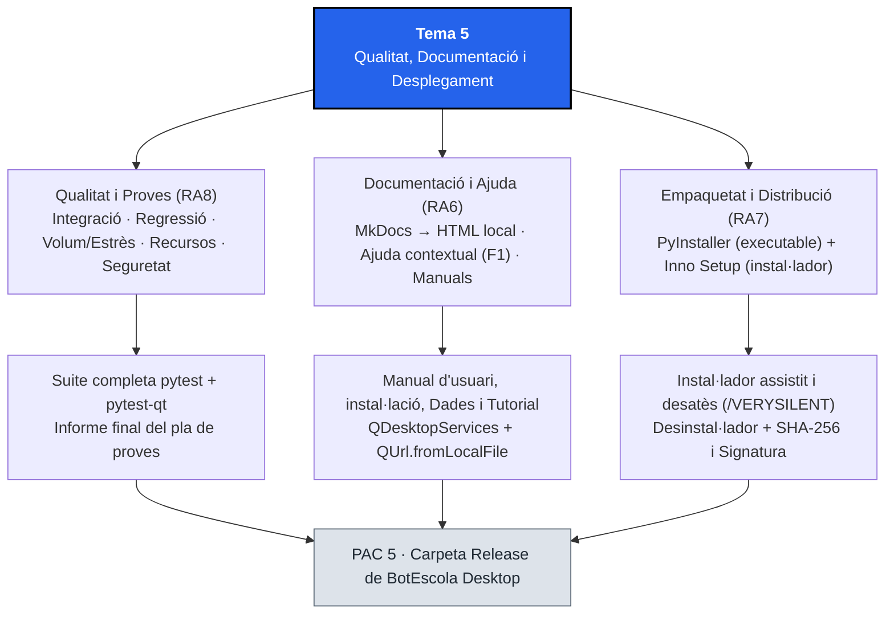
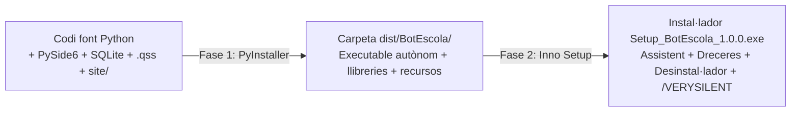

# Tema 5. Qualitat, Documentació i Desplegament

## 1. Identificació

* **Mòdul:** 0488. Desenvolupament d'interfícies
* **Curs:** 1r CFGS de Desenvolupament d'Aplicacions Multiplataforma (DAM)
* **Tema:** 5. Qualitat, Documentació i Desplegament
* **Durada presencial:** 14 hores
* **RA treballats:** RA6, RA7 i RA8 (completant les proves unitàries iniciades al Tema 2)
* **Prerequisits:** Domini de l'arquitectura MVP i d'`actions` (`QAction`) amb PySide6 (Tema 1), empaquetat de paquets Python i proves unitàries amb `pytest-qt` (Tema 2), integració de fils NUI (Tema 3) i persistència SQL i informes PDF (Tema 4).
* **Projecte transversal:** <mark style="color:violet;">**BotEscola Desktop**</mark>. En aquest últim tema tanquem el cicle de vida del producte: executem l'estratègia completa de proves sobre l'aplicació integrada (integració, regressió, volum, estrès, ús de recursos i seguretat), construïm el manual d'usuari i el sistema d'ajuda contextual amb <mark style="color:violet;">**`MkDocs`**</mark> i generem l'executable autònom i l'instal·lador final llest per distribuir al client amb <mark style="color:violet;">**`PyInstaller`**</mark> i <mark style="color:violet;">**`Inno Setup`**</mark>.

### Criteris d'avaluació treballats

#### RA6. Documenta aplicacions seleccionant i utilitzant eines específiques.

* CA 6.1: Identifica sistemes de generació d'ajudes.
* CA 6.2: Genera l'ajuda en els formats habituals per a la plataforma.
* CA 6.3: Genera l'ajuda sensible al context.
* CA 6.4: Documenta l'estructura de la informació persistent.
* CA 6.5: Confecciona el manual d'usuari i la guia de referència.
* CA 6.6: Confecciona els manuals d'instal·lació, configuració i administració.
* CA 6.7: Realitza tutorials.

#### Continguts Orientatius (RA6)

* 6.1 Eines de generació d'ajudes i documentació tècnica (`MkDocs`, `Qt Help`, HTML).
* 6.2 Tipus d'ajuda: en línia, fora de línia i ajuda sensible al context (`F1`, `whatsThis`, `statusTip`, obertura per secció).
* 6.3 Documentació de l'estructura de dades i fitxers de configuració.
* 6.4 Estructura d'un manual d'usuari, guia de referència, guia d'instal·lació i tutorial pas a pas.

#### RA7. Prepara aplicacions per a la seva distribució avaluant i utilitzant eines específiques.

* CA 7.1: Empaqueta l'aplicació per ser instal·lada.
* CA 7.2: Empaqueta l'aplicació per ser instal·lada de forma desatesa.
* CA 7.3: Inclou en el paquet tots els components i llibreries necessaris.
* CA 7.4: Personalitza l'assistent d'instal·lació.
* CA 7.5: Defineix la ubicació dels fitxers i les dreceres d'escriptori i menú d'inici.
* CA 7.6: Prepara paquets que puguin ser desinstal·lats.
* CA 7.7: Signa digitalment els paquets d'instal·lació.
* CA 7.8: Genera paquets per ser distribuïts per Internet o en xarxa local.

#### Continguts Orientatius (RA7)

* 7.1 Empaquetat d'aplicacions d'escriptori: congelació de l'intèrpret (`PyInstaller`) enfront de distribució de paquets Python (`.whl`).
* 7.2 Inclusió de recursos externs (`.qss`, `.ui`, models, documentació) i resolució de rutes en temps d'execució (`sys._MEIPASS`).
* 7.3 Creació d'instal·ladors personalitzats (`Inno Setup`), dreceres, desinstal·lador i instal·lació desatesa (`/SILENT`, `/VERYSILENT`).
* 7.4 Integritat i autenticitat en la distribució: sumes de verificació (`SHA-256`) i signatura digital de codi.

#### RA8. Avalua el funcionament d'aplicacions dissenyant i executant proves.

* CA 8.1: Estableix una estratègia de proves (iniciat al Tema 2).
* CA 8.2: Realitza proves d'integració dels diferents elements.
* CA 8.3: Realitza proves de regressió.
* CA 8.4: Realitza proves de volum i d'estrès.
* CA 8.5: Realitza proves d'ús de recursos per part de l'aplicació.
* CA 8.6: Realitza proves de seguretat.
* CA 8.7: Documenta les proves realitzades i els resultats obtinguts (iniciat al Tema 2).

#### Continguts Orientatius (RA8)

* 8.1 Nivells i tipologies de proves de programari: unitàries, integració, regressió, volum, estrès, recursos i seguretat.
* 8.2 Automatització de proves d'integració i regressió en interfícies gràfiques amb `pytest` i `pytest-qt`.
* 8.3 Mesura de temps de resposta, volum de registres i consum de recursos.
* 8.4 Informe final d'execució del pla de proves i criteris d'alliberament (_Release_).

## 2. Introducció

Un programari que només funciona dins de l'entorn virtual del desenvolupador encara no és un producte acabat. Perquè <mark style="color:violet;">**BotEscola Desktop**</mark> pugui arribar als ordinadors de secretaria i direcció d'un centre educatiu cal superar tres reptes finals que separen un prototip acadèmic d'un lliurament professional:

1. **Garantir la qualitat tècnica global (RA8):** als Temes 2, 3 i 4 hem escrit proves unitàries aïllades per als components, l'intèrpret NUI i el repositori SQL. Ara cal verificar que totes les peces encaixen entre si (**proves d'integració i de regressió**), que la finestra no es degrada quan hi ha centenars o milers de notificacions (**proves de volum, d'estrès i d'ús de recursos**) i que les entrades malicioses o fitxers corruptes no comprometen el sistema (**proves de seguretat**).
2. **Acompanyar l'usuari amb documentació i ajuda contextual (RA6):** aplicant la 10a heurística de Nielsen vista al Tema 1 (_Ajuda i documentació_), utilitzarem <mark style="color:violet;">**`MkDocs`**</mark> per transformar fitxers Markdown en un lloc web d'ajuda estètic i navegable que podrem consultar sense connexió i obrir directament per la secció adequada en prémer `F1` des de qualsevol punt de l'aplicació (**ajuda sensible al context**).
3. **Empaquetar i desplegar sense dependències prèvies (RA7):** l'usuari final no sap què és Python, ni `pip`, ni un entorn virtual. Amb <mark style="color:violet;">**`PyInstaller`**</mark> congelarem l'aplicació, l'intèrpret de Python, les llibreries de Qt i els recursos (`.qss`, ajuda HTML) en una carpeta o executable autònom, i amb <mark style="color:violet;">**`Inno Setup`**</mark> construirem un instal·lador amb assistent personalitzat, dreceres, desinstal·lador, suport per a **instal·lació desatesa** i verificació d'integritat i signatura.

## 3. Objectius didàctics

En acabar el tema, l'alumne serà capaç de:

1. Dissenyar i executar un pla de proves complet que combini proves unitàries, d'integració, de regressió, de volum, d'estrès, d'ús de recursos i de seguretat amb `pytest` i `pytest-qt`, documentant-ne els resultats reals.
2. Comparar les eines de generació de documentació i sistemes d'ajuda (`MkDocs`, `Sphinx`, `Qt Help Framework`) i generar un sistema d'ajuda navegable en HTML estètic a partir de Markdown.
3. Implementar ajuda sensible al context dins de PySide6 combinant `toolTip`, `statusTip`, `whatsThis` i l'acció `F1` (`QKeySequence.StandardKey.HelpContents`) connectada a la secció corresponent del manual local amb `QDesktopServices.openUrl()`.
4. Redactar la documentació completa d'un producte: esquema de persistència, manual d'usuari, guia de referència d'ordres i dreceres, manual d'instal·lació/administració i tutorial pas a pas.
5. Distingir entre l'empaquetat d'una llibreria Python (`.whl`, Tema 2) i la congelació d'una aplicació final (`PyInstaller`), resolent la càrrega de fitxers externs (`.qss`, ajuda HTML) tant en desenvolupament com dins de l'executable congelat.
6. Construir un instal·lador amb assistent personalitzat, dreceres d'escriptori, desinstal·lador i mode d'instal·lació desatesa (silenciosa), i verificar la integritat (`SHA-256`) i el procés de signatura digital del paquet.

## 4. Mapa conceptual



## 5. Conceptes fonamentals

> **Convenció tipogràfica:** els noms ressaltats en color segueixen la dels temes anteriors: <mark style="color:red;">**classes de Qt i components**</mark>, <mark style="color:blue;">**propietats i senyals**</mark>, <mark style="color:orange;">**mètodes i funcions**</mark> i <mark style="color:violet;">**eines, fitxers i noms del projecte**</mark>.

### 5.1. L'espectre complet de les proves de programari (RA8)

Al Tema 2 vam començar l'estratègia de proves amb les **proves unitàries**, que comproven cada classe (`SelectorPrioritat`, `TargetaNotificacio`, `InterpretOrdres`, `RepositoriNotificacions`) de manera aïllada. Quan l'aplicació ja està completa, el pla de proves s'amplia a sis modalitats addicionals que cobreixen tot el comportament del sistema:

| Tipus de prova | Què verifica a BotEscola Desktop | Com l'automatitzem amb `pytest` / Python |
| :--- | :--- | :--- |
| **1. Unitària** (Tema 2) | El contracte públic d'un sol component o classe de manera aïllada | `tests/test_selector.py`, `test_targeta.py`, `test_nui.py`, `test_informes.py` |
| **2. D'integració** | Que la finestra principal (`FinestraBotEscola`), els components, l'intèrpret NUI i el repositori SQL funcionen plegats quan l'usuari fa una acció de cap a cap | Instanciar la finestra completa amb una BD `:memory:`, simular clics o ordres NUI i comprovar tant la Vista com la BD |
| **3. De regressió** | Que els canvis afegits en un tema nou no han trencat cap funcionalitat dels temes anteriors (menús, dreceres, contrast, confirmació de descart) | Executar tota la bateria acumulada de `tests/` en un sol `python -m pytest` abans de cada lliurament |
| **4. De volum i d'estrès** | **Volum:** resposta amb una quantitat elevada de dades (p. ex. 500 o 1.000 notificacions a SQLite). **Estrès:** ràfegues ràpides i repetides de canvis de filtre, seleccions i ordres seguides sense caigudes | Inserir un lot massiu a `:memory:`, mesurar el temps amb `time.perf_counter()` i disparar desenes d'esdeveniments seguits amb `qtbot` |
| **5. D'ús de recursos** | Que l'aplicació no té fuites de memòria (_memory leaks_), no deixa connexions SQL ni fils `QThread` oberts, ni acumula figures de `Matplotlib` en obrir i tancar diàlegs | Mesurar la memòria amb el mòdul estàndard `tracemalloc` abans i després d'un cicle d'operacions i verificar `isRunning() == False` |
| **6. De seguretat** | Resistència a injecció SQL als filtres, entrades malformades o gegants als camps de text, caràcters HTML/scripts a les targetes o l'informe PDF, i permisos de fitxers | Proves parametritzades amb cadenes d'atac (`' OR 1=1 --`, `<script>`, textos de 10.000 caràcters) comprovant que no cau ni altera dades |

### 5.2. Sistemes d'ajuda i documentació d'aplicacions (RA6)

Una aplicació d'escriptori ofereix ajuda a l'usuari en tres capes complementàries, de la més immediata a la més completa:

| Capa d'ajuda | Mecanisme a Qt / Python | Quan s'utilitza | Exemple a BotEscola Desktop |
| :--- | :--- | :--- | :--- |
| **1. Microajuda immediata** | Propietats <mark style="color:blue;">`toolTip`</mark> i <mark style="color:blue;">`statusTip`</mark> (Tema 1) | En passar el ratolí per sobre d'un botó o explorar una opció de menú | `Marca la notificació seleccionada com a aprovada` |
| **2. Ajuda contextual ràpida** | Propietat <mark style="color:blue;">`whatsThis`</mark> (`Shift+F1`) o drecera `F1` que obre la pàgina exacta de la pantalla activa | Quan l'usuari no entén com funciona el panell, el filtre o el diàleg que té davant | Prémer `F1` al quadre de comandament obre directament la secció `informes.html` del manual |
| **3. Manual complet i guies** | Lloc web d'ajuda local generat amb <mark style="color:violet;">**`MkDocs`**</mark> (o col·lecció `.qhc` de `Qt Help`) | Consulta detallada, tutorial pas a pas, resolució de problemes i guia d'instal·lació | Menú `Ajuda > Manual d'usuari` (`F1`), consultable amb navegador sense connexió a Internet |

Per què escollim <mark style="color:violet;">**`MkDocs`**</mark> per al projecte?

* Permet escriure tota la documentació en **Markdown** (`.md`), el mateix format que ja utilitzem al repositori Git des del Tema 1.
* Amb una sola comanda (`mkdocs build`), compila els fitxers `.md` en una carpeta d'**HTML estàtic autocontingut** (`site/`) amb cercador integrat, índex navegable i fulls d'estil responsius.
* En configurar `use_directory_urls: false` a <mark style="color:violet;">`mkdocs.yml`</mark>, els fitxers generats (`index.html`, ` guia_usuari.html`, `instal_lacio.html`) es poden obrir directament des del disc local amb <mark style="color:red;">`QDesktopServices`</mark><mark style="color:orange;">`.openUrl`</mark>`(`<mark style="color:red;">`QUrl`</mark><mark style="color:orange;">`.fromLocalFile(...)`</mark>`)`, sense necessitat d'aixecar cap servidor web ni tenir connexió a Internet.

#### Els quatre documents essencials d'un lliurament professional

El sistema documental d'una aplicació com <mark style="color:violet;">**BotEscola Desktop**</mark> ha de cobrir quatre perfils de necessitat:

1. **Manual d'usuari i guia de referència (CA 6.5):** explica què fa cada pantalla, com filtrar, com aprovar o descartar notificacions, com usar les ordres de veu i una taula de referència ràpida amb totes les dreceres de teclat (`Ctrl+Return`, `Supr`, `Ctrl+M`, `Ctrl+G`, `Ctrl+P`, `F1`, `Ctrl+Q`).
2. **Tutorial guiat pas a pas (CA 6.7):** un recorregut pràctic de 5 minuts ("La teva primera sessió amb BotEscola Desktop") pensat perquè un usuari nou aprengui fent una tasca real de principi a fi.
3. **Manual d'instal·lació, configuració i administració (CA 6.6):** requisits mínims del sistema, com executar l'instal·lador (en mode normal i en mode desatès per a l'administrador de sistemes de l'escola), on es desen els fitxers i com fer una còpia de seguretat.
4. **Documentació de l'estructura de la informació persistent (CA 6.4):** descripció tècnica d'on es guarda el fitxer SQLite (`botescola.db`), l'esquema de la taula `notificacions` (camps, tipus i valors admesos) i l'estructura del diccionari JSON/Python dels components (`to_dict()`).

### 5.3. Empaquetat de l'aplicació: de codi Python a executable autònom (RA7)

Al Tema 2 vam crear una distribució `.whl` (`botescola-modules`) pensada per a **altres programadors Python** que instal·len paquets amb `pip`. En canvi, el **RA7** exigeix lliurar l'aplicació a un **usuari final** en un ordinador on **no hi ha Python instal·lat**.

Aquest procés es fa en dues fases complementàries:



#### Fase 1: Congelació amb `PyInstaller` (`onedir` vs `onefile`)

<mark style="color:violet;">**`PyInstaller`**</mark> analitza totes les importacions de <mark style="color:violet;">`botescola_app.py`</mark> i agrupa l'intèrpret de Python, els binaris de Qt (`PySide6`), les nostres carpetes (`components/`, `nui/`, `informes/`) i els fitxers de dades:

| Mode de PyInstaller | Com funciona | Avantatges | Limitacions |
| :--- | :--- | :--- | :--- |
| **`--onedir`** (recomanat amb instal·lador) | Crea una carpeta `dist/BotEscola/` amb l'executable i una subcarpeta `_internal/` amb les llibreries i recursos | Arrencada immediata; fàcil d'inspeccionar si falta un `.qss` o l'ajuda HTML; ideal per empaquetar després amb `Inno Setup` | S'ha de distribuir comprimit en `.zip` o dins d'un instal·lador |
| **`--onefile`** | Comprimeix tot dins d'un únic fitxer executable | Un sol fitxer per copiar | Arrencada més lenta (descomprimeix tot a una carpeta temporal cada cop que s'obre) i més falsos positius d'antivirus |

#### El problema de les rutes de recursos en aplicacions congelades

Al Tema 1 carregàvem el full d'estil amb `Path(__file__).parent / "styles"`. Quan l'aplicació s'empaqueta amb <mark style="color:violet;">`PyInstaller`</mark>, els fitxers de recursos afegits amb `--add-data` s'ubiquen al directori indicat per `sys._MEIPASS` (o al costat de l'executable). Perquè el mateix codi funcioni **tant en desenvolupament com un cop empaquetat**, centralitzem el càlcul de la ruta base en una petita funció:

```python
import sys
from pathlib import Path


def ruta_recurs(ruta_relativa):
    """Retorna la ruta absoluta a un recurs tant en desenvolupament com a PyInstaller."""
    if getattr(sys, "frozen", False) and hasattr(sys, "_MEIPASS"):
        base = Path(sys._MEIPASS)
    else:
        base = Path(__file__).resolve().parent
    return base / ruta_relativa
```

I un detall crític per a la base de dades SQLite (`botescola.db`): quan l'aplicació s'instal·la a `C:\Program Files\BotEscola\`, l'usuari estàndard **no té permisos d'escriptura** en aquella carpeta. Per això, en producció la base de dades gravable s'ubica a la carpeta de dades de l'usuari obtinguda amb <mark style="color:red;">`QStandardPaths`</mark> (`AppDataLocation`), mentre que els fitxers de només lectura (`styles/botescola.qss`, `site/index.html`) es llegeixen amb `ruta_recurs()`.

### 5.4. Instal·ladors, instal·lació desatesa i signatura digital (RA7)

#### Creació de l'instal·lador amb `Inno Setup`

En entorns Windows (i en entorns Linux mitjançant paquets `.deb` / `AppImage` o executant l'instal·lador), <mark style="color:violet;">**`Inno Setup`**</mark> pren la carpeta generada per `PyInstaller` (`dist/BotEscola/`) a partir d'un script declaratiu (`.iss`) i genera un únic instal·lador professional que:

* **Personalitza l'assistent (CA 7.4):** mostra el nom de l'aplicació, la versió, l'autor/centre, la llicència i la icona.
* **Defineix ubicacions i dreceres (CA 7.5):** copia els fitxers a `{autopf}\BotEscola` i crea les dreceres al menú d'inici i, opcionalment, a l'escriptori.
* **Inclou desinstal·lador automàtic (CA 7.6):** registra l'aplicació al sistema operatiu perquè es pugui desinstal·lar netament des de _Configuració > Aplicacions_.
* **Permet la instal·lació desatesa (CA 7.2):** admet els paràmetres de línia d'ordres estàndard `/SILENT` (mostra només la barra de progrés, sense fer cap pregunta) i `/VERYSILENT` (instal·la en segon pla sense cap finestra, ideal perquè l'administrador TIC del centre ho desplegui a totes les aules d'informàtica amb un script).

#### Integritat (`SHA-256`) i signatura digital de paquets (CA 7.7 i CA 7.8)

Quan un instal·lador es distribueix per Internet o per la intranet del centre educatiu, l'usuari i el sistema operatiu necessiten verificar dues coses:

1. **Integritat (que el fitxer no s'ha corromput ni alterat durant la descàrrega):** es publica l'empremta criptogràfica **SHA-256** del paquet (`checksums.sha256`). Qualsevol canvi d'un sol byte al fitxer produeix un resum completament diferent.
2. **Autenticitat i autoria (signatura digital de codi — _Code Signing_):** es signa l'executable o l'instal·lador amb un certificat criptogràfic X.509 (clau privada del desenvolupador i clau pública verificable).
   * En un entorn comercial s'adquireix un certificat emès per una Autoritat de Certificació (CA) reconeguda pel sistema operatiu.
   * En l'entorn acadèmic del mòdul generarem un **certificat autosignat (_self-signed_)** de prova i signarem el paquet (amb `signtool` a Windows o `openssl` / `gpg` en multiplataforma) per conèixer i aplicar el procediment tècnic complet.

## 6. Entorn de treball

### 6.1. Estructura final del projecte (`Release`)

Aquest és l'estat complet del repositori de <mark style="color:violet;">**BotEscola Desktop**</mark> en finalitzar els cinc temes del mòdul:

```
botescola/
├── ui/
│   └── botescola.ui
├── generated/
│   └── ui_botescola.py
├── styles/
│   ├── botescola.qss
│   └── alt_contrast.qss
├── components/               <-- Tema 2 (RA3)
│   ├── __init__.py
│   ├── selector.py
│   ├── targeta.py
│   └── comptador.py
├── nui/                      <-- Tema 3 (RA2)
│   ├── __init__.py
│   ├── interpret.py
│   └── escoltador_veu.py
├── informes/                 <-- Tema 4 (RA5)
│   ├── __init__.py
│   ├── repositori.py
│   ├── grafics.py
│   └── generador_pdf.py
├── tests/                    <-- Tema 2, 3, 4 i 5 (RA8: suite completa)
│   ├── test_selector.py
│   ├── test_targeta.py
│   ├── test_comptador.py
│   ├── test_nui.py
│   ├── test_informes.py
│   └── test_sistema_ra8.py   <-- proves d'integració, regressió, volum, estrès, recursos i seguretat
├── docs/                     <-- Tema 5 (RA6): font Markdown per a MkDocs
│   ├── index.md              <-- portada i resum del manual d'usuari
│   ├── guia_usuari.md        <-- manual d'usuari i guia de referència (dreceres i menús)
│   ├── tutorial.md           <-- tutorial pas a pas per a nous usuaris
│   ├── instal_lacio.md       <-- manual d'instal·lació, configuració i administració
│   ├── dades_persistents.md  <-- documentació de l'estructura de dades persistent (SQL i JSON)
│   ├── components.md         <-- fitxes de components (Tema 2)
│   ├── nui.md                <-- catàleg d'ordres NUI i privadesa (Tema 3)
│   ├── informes.md           <-- especificació d'informes (Tema 4)
│   └── pla_proves_ra8.md     <-- estratègia i informe final del pla de proves complet
├── installer/                <-- Tema 5 (RA7): configuració d'instal·lador
│   └── botescola.iss         <-- script d'Inno Setup (assistit i desatès)
├── release/                  <-- Carpeta d'evidències de distribució (RA6, RA7, RA8)
│   ├── checksums.sha256      <-- empremta SHA-256 del paquet distribuïble
│   └── informe_release.md    <-- resum de verificació de l'instal·lador i signatura
├── mkdocs.yml                <-- configuració del generador de documentació MkDocs
├── botescola.spec            <-- especificació d'empaquetat de PyInstaller
├── rutes.py                  <-- resolució de rutes per a desenvolupament i PyInstaller
├── dades.py
├── botescola_app.py
├── pyproject.toml
├── pytest.ini
├── contrast.py
├── taula_contrast.md
└── README.md
```

### 6.2. Dependències

Amb l'entorn virtual activat, instal·la <mark style="color:violet;">`mkdocs`</mark> i <mark style="color:violet;">`pyinstaller`</mark>:

```bash
python -m pip install mkdocs pyinstaller
```

Comprova que les eines responen correctament des de la terminal i anota'n les versions al <mark style="color:violet;">`README.md`</mark>:

```bash
python -m mkdocs --version
python -m PyInstaller --version
```

Per generar l'instal·lador `.exe` a Windows, s'utilitza <mark style="color:violet;">**`Inno Setup`**</mark> (gratuït i de codi obert, disponible a `jrsoftware.org`). En entorns Linux o macOS, l'script `.iss` es pot compilar igualment amb `innosetup` sota Wine/contenidor o acompanyar el paquet congelat de `PyInstaller` d'un script d'instal·lació desatesa equivalent.

## 7. Exemple guiat: Proves RA8, Ajuda contextual amb MkDocs i Desplegament

### Pas 1. Resolució de rutes i connexió de l'ajuda sensible al context (`rutes.py`)

Creem el mòdul <mark style="color:violet;">`rutes.py`</mark> a l'arrel del projecte perquè tant els fulls d'estil (`.qss`) com la documentació HTML compilada per `MkDocs` (`site/`) i la base de dades SQLite es localitzin sempre de manera fiable:

```python
"""Resolució de rutes de recursos i dades per a desenvolupament i PyInstaller."""

import sys
from pathlib import Path
from PySide6.QtCore import QStandardPaths, QUrl
from PySide6.QtGui import QDesktopServices


def directori_base():
    """Retorna l'arrel del projecte o la carpeta desempaquetada per PyInstaller."""
    if getattr(sys, "frozen", False) and hasattr(sys, "_MEIPASS"):
        return Path(sys._MEIPASS)
    return Path(__file__).resolve().parent


def ruta_recurs(ruta_relativa):
    """Retorna el Path absolut d'un recurs inclòs amb l'aplicació."""
    return directori_base() / ruta_relativa


def ruta_bd_usuari(nom_fitxer="botescola.db"):
    """Retorna una ruta amb permisos d'escriptura per a la base de dades SQLite."""
    if getattr(sys, "frozen", False):
        carpeta = Path(QStandardPaths.writableLocation(QStandardPaths.StandardLocation.AppDataLocation))
        carpeta.mkdir(parents=True, exist_ok=True)
        return carpeta / nom_fitxer
    return directori_base() / nom_fitxer


def obrir_ajuda_contextual(pagina="index.html", ancora=""):
    """Obre la pàgina corresponent del manual HTML local generat per MkDocs.

    Retorna True si el fitxer existeix, o False si encara no s'ha compilat amb 'mkdocs build'.
    """
    fitxer_html = ruta_recurs(Path("site") / pagina)
    if not fitxer_html.exists():
        return False
    url = QUrl.fromLocalFile(str(fitxer_html))
    if ancora:
        url.setFragment(ancora)
    QDesktopServices.openUrl(url)
    return True
```

Al Presentador (<mark style="color:violet;">`botescola_app.py`</mark>), afegim al menú `A&juda` (Tema 1) l'acció `act_manual_usuari` (`&Manual d'usuari`, drecera estàndard `F1` amb <mark style="color:red;">`QKeySequence.StandardKey.HelpContents`</mark>) i fem que l'ajuda sigui **sensible al context** segons quin control de la finestra té el focus:

```python
def mostrar_ajuda_contextual(self):
    """Obre la secció de l'ajuda corresponent a la zona activa de la finestra (F1)."""
    widget_actiu = self.focusWidget()
    nom = widget_actiu.objectName() if widget_actiu else ""

    if nom in ("cmb_filtre_prioritat", "cmb_filtre_estat", "txt_cerca"):
        pagina, seccio = "guia_usuari.html", "filtratge-i-cerca"
    elif nom in ("txt_simular_veu", "btn_simular_veu"):
        pagina, seccio = "nui.html", "cataleg-dordres-de-veu"
    elif nom == "sel_prioritat":
        pagina, seccio = "guia_usuari.html", " Nivells-de-prioritat"
    else:
        pagina, seccio = "index.html", ""

    if obrir_ajuda_contextual(pagina, seccio.strip().lower()):
        self.statusBar().showMessage(f"Ajuda: oberta la secció «{pagina}».", 5000)
    else:
        self.statusBar().showMessage(
            "Ajuda: manual local no trobat (executa 'mkdocs build').", 5000
        )
```

### Pas 2. Configurar i generar la documentació amb `MkDocs` (`mkdocs.yml`)

Creem el fitxer <mark style="color:violet;">`mkdocs.yml`</mark> a l'arrel del projecte. La propietat `use_directory_urls: false` és essencial perquè els enllaços interns entre pàgines funcionin en obrir els fitxers `.html` directament des del disc sense servidor web:

```yaml
site_name: Manual i Ajuda de BotEscola Desktop
site_description: Documentació d'usuari, instal·lació, dades i proves del projecte BotEscola Desktop
use_directory_urls: false

nav:
  - Inici: index.md
  - Guia d'usuari i referència: guia_usuari.md
  - Tutorial pas a pas: tutorial.md
  - Instal·lació i administració: instal_lacio.md
  - Estructura de dades persistent: dades_persistents.md
  - Components visuals (RA3): components.md
  - Interfície de veu NUI (RA2): nui.md
  - Informes i gràfics (RA5): informes.md
  - Pla i informe de proves (RA8): pla_proves_ra8.md

theme:
  name: readthedocs
  locale: ca
```

Per previsualitzar la documentació en viu mentre l'edites o per generar la carpeta `site/` definitiva:

```bash
# Previsualització en calent al navegador ([http://127.0.0.1:8000](http://127.0.0.1:8000)):
python -m mkdocs serve

# Generació dels fitxers HTML estàtics a la carpeta site/ per distribuir amb l'aplicació:
python -m mkdocs build --clean
```

### Pas 3. Automatitzar les proves avançades del RA8 (`tests/test_sistema_ra8.py`)

Aquest fitxer completa les proves unitàries dels Temes 2, 3 i 4 amb proves d'**integració**, **regressió**, **volum**, **estrès**, **ús de recursos** i **seguretat**:

```python
"""Bateria de proves del sistema per al RA8: integració, regressió, volum, estrès, recursos i seguretat."""

import time
import tracemalloc
import pytest

from informes import RepositoriNotificacions, generar_informe_pdf
from nui import InterpretOrdres
from components import TargetaNotificacio, SelectorPrioritat, ComptadorPendents


def _generar_lot(quantitat):
    """Genera un lot de N notificacions sintètiques per a proves de volum i estrès."""
    nivells = ("Baixa", "Normal", "Alta")
    return [
        {
            "id": i,
            "remitent": f"Departament {(i % 5) + 1}",
            "assumpte": f"Comunicació interna número {i} per revisar",
            "data": f"2026-10-{(i % 28) + 1:02d}",
            "detall": f"Cos detallat de la notificació {i}.",
            "llegida": (i % 3 == 0),
            "prioritat": nivells[i % 3],
        }
        for i in range(1, quantitat + 1)
    ]


# 1. PROVA D'INTEGRACIÓ I REGRESSIÓ (Components + NUI + Repositori SQL)
def test_integracio_flux_complet_nui_component_i_sql(qtbot):
    repo = RepositoriNotificacions(":memory:", dades_inicials=_generar_lot(3))
    interpret = InterpretOrdres()
    comptador = ComptadorPendents(total=repo.calcular_resum()["pendents"])
    selector = SelectorPrioritat(prioritat="Baixa")
    qtbot.addWidget(comptador)
    qtbot.addWidget(selector)

    dades_fila_1 = [n for n in repo.obtenir_notificacions() if n["id"] == 1][0]
    targeta = TargetaNotificacio.from_dict(dades_fila_1)
    qtbot.addWidget(targeta)

    # Connectem el flux com fa el Presentador
    targeta.llegida_clicada.connect(lambda id_n: repo.actualitzar_llegida(id_n, True))
    targeta.llegida_clicada.connect(lambda _id: setattr(comptador, "total", repo.calcular_resum()["pendents"]))
    interpret.prioritat_detectada.connect(lambda niv: setattr(selector, "prioritat", niv))
    selector.prioritat_canviada.connect(lambda niv: repo.actualitzar_prioritat(1, niv))

    # Executem accions integrades: marcar com a llegida i canviar prioritat per veu
    assert comptador.total == 2
    interpret.processar_text("prioritat alta")
    targeta.findChild(type(targeta)._boto_cls if hasattr(targeta, "_boto_cls") else object, "btn_llegida")
    # Simulem el clic sobre el botó de la targeta
    from PySide6.QtWidgets import QPushButton
    from PySide6.QtCore import Qt
    qtbot.mouseClick(targeta.findChild(QPushButton, "btn_llegida"), Qt.MouseButton.LeftButton)

    # Verifiquem que la vista, els components i l'SQL s'han sincronitzat (sense regressions)
    actualitzada = [n for n in repo.obtenir_notificacions() if n["id"] == 1][0]
    assert actualitzada["llegida"] is True
    assert actualitzada["prioritat"] == "Alta"
    assert comptador.total == 1
    repo.tancar()


# 2. PROVA DE VOLUM (500 notificacions a SQLite, filtratge i exportació PDF)
def test_volum_500_notificacions_rendiment(tmp_path):
    inici = time.perf_counter()
    repo = RepositoriNotificacions(":memory:", dades_inicials=_generar_lot(500))
    assert repo.comptar_total() == 500

    filtrades = repo.obtenir_notificacions(prioritat="Alta", estat_lectura="Pendents")
    resum = repo.calcular_resum(prioritat="Alta", estat_lectura="Pendents")
    pdf = generar_informe_pdf(tmp_path / "volum_500.pdf", filtrades, resum, "Volum 500")
    durada = time.perf_counter() - inici

    assert pdf.exists()
    assert durada < 5.0, f"Operació de volum massa lenta: {durada:.2f} s"
    repo.tancar()


# 3. PROVA D'ESTRÈS (Ràfega ràpida de 200 operacions consecutives)
def test_estres_rafega_canvis_i_ordres(qtbot):
    repo = RepositoriNotificacions(":memory:", dades_inicials=_generar_lot(20))
    interpret = InterpretOrdres()
    selector = SelectorPrioritat()
    qtbot.addWidget(selector)

    ordres = ("seguent", "anterior", "prioritat alta", "prioritat baixa", "llegida", "inexistent")
    for i in range(200):
        interpret.processar_text(ordres[i % len(ordres)])
        nivell = SelectorPrioritat.NIVELLS[i % 3]
        selector.prioritat = nivell
        repo.actualitzar_prioritat((i % 20) + 1, nivell)

    assert repo.comptar_total() == 20
    repo.tancar()


# 4. PROVA D'ÚS DE RECURSOS (Control de memòria amb tracemalloc)
def test_recursos_memoria_estable_en_operacions_repetides():
    repo = RepositoriNotificacions(":memory:", dades_inicials=_generar_lot(100))
    tracemalloc.start()
    mem_inicial, _ = tracemalloc.get_traced_memory()

    for _ in range(50):
        _ = repo.obtenir_notificacions(prioritat="Normal")
        _ = repo.calcular_resum()

    _, pic_memoria = tracemalloc.get_traced_memory()
    tracemalloc.stop()
    repo.tancar()

    increment_mb = (pic_memoria - mem_inicial) / (1024 * 1024)
    assert increment_mb < 15.0, f"Consum excessiu de memòria: {increment_mb:.2f} MB"


# 5. PROVA DE SEGURETAT (Injecció SQL, entrades gegants i caràcters especials)
@pytest.mark.parametrize("entrada_maliciosa", [
    "'; DROP TABLE notificacions; --",
    "' UNION SELECT 1,2,3,4,5,6,7,8 --",
    "<script>alert('xss')</script>",
    "A" * 10000,
    "\x00\r\n\t'\"\\",
])
def test_seguretat_entrades_hostils_no_trenquen_sql_ni_nui(entrada_maliciosa):
    repo = RepositoriNotificacions(":memory:", dades_inicials=_generar_lot(5))
    interpret = InterpretOrdres()

    # Ni el cercador SQL ni l'intèrpret NUI han de caure ni esborrar la taula
    resultats = repo.obtenir_notificacions(cerca=entrada_maliciosa)
    assert isinstance(resultats, list)
    assert repo.comptar_total() == 5

    interpret.processar_text(entrada_maliciosa)
    repo.tancar()
```

### Pas 4. Empaquetar l'aplicació amb `PyInstaller`

Des de l'arrel del projecte, havent executat prèviament `python -m mkdocs build --clean` perquè existeixi la carpeta `site/`, executem <mark style="color:violet;">`PyInstaller`</mark> en mode `--onedir` i sense finestra de consola (`--windowed`):

```bash
# A Windows (el separador de --add-data és ';' o ':' a PyInstaller >= 6):
python -m PyInstaller --noconfirm --onedir --windowed --name BotEscola ^
    --add-data "styles:styles" ^
    --add-data "site:site" ^
    botescola_app.py
```

(A Linux i macOS s'executa en una sola línia o amb `\` al final de cada línia). Això genera la carpeta `dist/BotEscola/` amb l'executable autònom i el fitxer <mark style="color:violet;">`BotEscola.spec`</mark>, que podem versionar a Git per repetir l'empaquetat amb un simple `python -m PyInstaller BotEscola.spec`.

### Pas 5. Crear l'instal·lador amb `Inno Setup` (`installer/botescola.iss`)

Creem l'script <mark style="color:violet;">`installer/botescola.iss`</mark> que pren el contingut de `dist/BotEscola/` i genera `release/Setup_BotEscola_1.0.0.exe` amb dreceres, desinstal·lador i suport natiu per a instal·lació desatesa:

```ini
; Script d'Inno Setup per a BotEscola Desktop (RA7)
#define MyAppName "BotEscola Desktop"
#define MyAppVersion "1.0.0"
#define MyAppPublisher "CFGS DAM - Mòdul 0488"
#define MyAppExeName "BotEscola.exe"

[Setup]
AppId={{8F4B9A2E-3C1D-4E7A-9B5C-0488DAM2026}
AppName={#MyAppName}
AppVersion={#MyAppVersion}
AppPublisher={#MyAppPublisher}
DefaultDirName={autopf}\{#MyAppName}
DefaultGroupName={#MyAppName}
DisableProgramGroupPage=yes
PrivilegesRequiredOverridesAllowed=dialog
OutputDir=..\release
OutputBaseFilename=Setup_BotEscola_{#MyAppVersion}
Compression=lzma
SolidCompression=yes
WizardStyle=modern
UninstallDisplayIcon={app}\{#MyAppExeName}

[Languages]
Name: "catalan"; MessagesFile: "compiler:Languages\Catalan.isl"

[Tasks]
Name: "desktopicon"; Description: "{cm:CreateDesktopIcon}"; GroupDescription: "{cm:AdditionalIcons}"; Flags: unchecked

[Files]
Source: "..\dist\BotEscola\{#MyAppExeName}"; DestDir: "{app}"; Flags: ignoreversion
Source: "..\dist\BotEscola\*"; DestDir: "{app}"; Flags: ignoreversion recursesubdirs createallsubdirs

[Icons]
Name: "{group}\{#MyAppName}"; Filename: "{app}\{#MyAppExeName}"
Name: "{group}\Manual d'usuari"; Filename: "{app}\_internal\site\index.html"
Name: "{group}\{cm:UninstallProgram,{#MyAppName}}"; Filename: "{uninstallexe}"
Name: "{autodesktop}\{#MyAppName}"; Filename: "{app}\{#MyAppExeName}"; Tasks: desktopicon

[Run]
Filename: "{app}\{#MyAppExeName}"; Description: "{cm:LaunchProgram,{#StringChange(MyAppName, '&', '&&')}}"; Flags: nowait postinstall skipifsilent
```

Observa el flag `skipifsilent` a la secció `[Run]`: quan l'administrador executa l'instal·lador en **mode desatès** des de la terminal:

```powershell
.\release\Setup_BotEscola_1.0.0.exe /VERYSILENT /SUPPRESSMSGBOXES /NORESTART
```

l'aplicació s'instal·la automàticament sense mostrar cap finestra ni obrir el programa en acabar.

### Pas 6. Verificació d'integritat (`SHA-256`) i signatura digital

Un cop generat el paquet distribuïble a `release/`, calculem la seva empremta criptogràfica **SHA-256** amb Python (funciona idèntic a Windows, Linux i macOS) i la desem a <mark style="color:violet;">`release/checksums.sha256`</mark>:

```bash
python -c "import hashlib, pathlib; p = pathlib.Path('release/Setup_BotEscola_1.0.0.exe'); h = hashlib.sha256(p.read_bytes()).hexdigest(); pathlib.Path('release/checksums.sha256').write_text(f'{h}  {p.name}\n', encoding='utf-8'); print(h)"
```

Per signar digitalment l'instal·lador a Windows amb un certificat de prova del laboratori (CA 7.7):

```powershell
# 1. Crear un certificat autosignat de prova al magatzem de l'usuari actual:
$cert = New-SelfSignedCertificate -Type CodeSigningCert -Subject "CN=BotEscola DAM 0488" -CertStoreLocation "Cert:\CurrentUser\My"

# 2. Signar l'instal·lador o executable:
Set-AuthenticodeSignature -FilePath ".\release\Setup_BotEscola_1.0.0.exe" -Certificate $cert
```

(A Linux/macOS es pot generar una signatura separada `.sig` amb `openssl dgst -sha256 -sign` o `gpg --detach-sign`).

## 8. Anàlisi tècnica

* **Coherència de la suite de proves (`tests/`):** en executar `python -m pytest -v` al Tema 5, s'executen automàticament totes les proves acumulades des del Tema 2 (`test_selector.py`, `test_targeta.py`, `test_comptador.py`, `test_nui.py`, `test_informes.py` i `test_sistema_ra8.py`). Això constitueix una **prova de regressió real**: qualsevol canvi d'última hora que trenqui un component antic es detecta a l'instant.
* **Ajuda offline sense servidor (`use_directory_urls: false`):** per defecte, `MkDocs` genera rutes com `guia_usuari/index.html` pensades per a un servidor HTTP. Desactivant `use_directory_urls`, genera fitxers plans (`guia_usuari.html`) que funcionen directament amb el protocol `file://` quan s'obren amb `QDesktopServices.openUrl(QUrl.fromLocalFile(...))`.
* **Separació entre recursos de lectura i dades d'escriptura:** `ruta_recurs()` apunta a la carpeta d'instal·lació (on hi ha `.qss` i `site/`, que mai es modifiquen), mentre que `ruta_bd_usuari()` apunta a `AppDataLocation` quan l'aplicació està congelada (`sys.frozen`), evitant errors de permisos a `Program Files`.
* **Instal·lació assistida vs desatesa:** el mateix binari generat per `Inno Setup` serveix per a un usuari domèstic (doble clic i assistent pas a pas) i per a un desplegament massiu en xarxa (`/VERYSILENT /DIR="C:\Apps\BotEscola"`).

## 9. Exercicis progressius

Tots els exercicis es lliuren a través del repositori de GitHub amb el codi font i les captures indicades.

### Exercici A — Reproducció: Ajuda amb MkDocs i tecla `F1`

1. Crea <mark style="color:violet;">`mkdocs.yml`</mark>, <mark style="color:violet;">`rutes.py`</mark> i les pàgines inicials a `docs/`.
2. Executa `python -m mkdocs build --clean` i verifica que s'ha creat la carpeta `site/` amb `index.html`.
3. Afegeix l'acció `act_manual_usuari` (drecera `F1`) al menú `A&juda` de <mark style="color:violet;">**BotEscola Desktop**</mark> i comprova que en prémer `F1` sobre el cercador o el simulador de veu s'obre la pàgina corresponent del manual al navegador.

### Exercici B — Modificació: Ajuda ràpida `whatsThis` i guia de referència

1. Assigna la propietat <mark style="color:blue;">`whatsThis`</mark> als controls principals de la finestra (`lst_notificacions`, `sel_prioritat`, `cmb_filtre_prioritat`, `txt_simular_veu`) i afegeix al menú `A&juda` l'acció estàndard <mark style="color:red;">`QWhatsThis`</mark><mark style="color:orange;">`.createAction(self)`</mark> (`Shift+F1`).
2. Completa <mark style="color:violet;">`docs/guia_usuari.md`</mark> amb la taula de referència de totes les ordres de menú, botons, dreceres de teclat i comandes de veu de l'aplicació.

### Exercici C — Diagnosi

Analitza els tres casos següents, explica la causa del problema i escriu la solució:

**Cas 1.** L'aplicació carrega el full d'estil perfectament des de VS Code, però quan s'executa l'executable creat amb `PyInstaller` des d'una altra carpeta o sense el codi font al costat, apareix sense estils o llança `FileNotFoundError: styles/botescola.qss`.

**Cas 2.** Un cop instal·lada l'aplicació a `C:\Program Files\BotEscola\`, en intentar marcar una notificació com a llegida llança `sqlite3.OperationalError: attempt to write a readonly database`.

**Cas 3.** En executar l'instal·lador amb `/VERYSILENT` en un script d'administració per instal·lar el programa a 30 ordinadors, l'instal·lador acaba però deixa oberta la finestra de `BotEscola Desktop` als 30 equips. Quina opció falta a la secció `[Run]` del fitxer `.iss`?

### Exercici D — Repte: Suite de proves RA8 (`tests/test_sistema_ra8.py`)

Implementa i executa <mark style="color:violet;">`tests/test_sistema_ra8.py`</mark> cobrint les cinc categories avançades del RA8 (integració, regressió, volum amb 500 registres, estrès amb 200 operacions, recursos amb `tracemalloc` i seguretat amb entrades malicioses).

Afegeix una prova addicional que comprovi que `obrir_ajuda_contextual()` retorna `False` sense llançar cap excepció si la carpeta `site/` no existeix.

### Exercici E — Aplicació al projecte: Congelació i instal·lador desatès

1. Executa `PyInstaller` per generar `dist/BotEscola/` incloent-hi `styles/` i `site/`.
2. Comprova que l'executable generat a `dist/BotEscola/` s'inicia, aplica el QSS, guarda canvis a la base de dades i obre l'ajuda amb `F1`.
3. Crea <mark style="color:violet;">`installer/botescola.iss`</mark>, genera el paquet instal·lador i calcula el seu `SHA-256` a <mark style="color:violet;">`release/checksums.sha256`</mark>.

### Exercici F — Anàlisi de tecnologies

Una empresa desenvolupa una eina d'escriptori en Python i PySide6 per a dos públics molt diferents: (a) altres desenvolupadors Python de l'empresa que volen reutilitzar els seus widgets en projectes nous, i (b) el personal administratiu de les oficines que utilitza Windows i no té coneixements tècnics. Compara en 8-12 línies quan cal distribuir una roda Python (`.whl` amb `pyproject.toml`), quan un executable congelat amb `PyInstaller` i quan un instal·lador amb `Inno Setup`, justificant l'elecció segons manteniment, actualitzacions, mida del paquet i experiència de l'usuari.

## 10. Errors habituals

| Símptoma | Causa probable | Solució | Prevenció |
| :--- | :--- | :--- | :--- |
| L'executable de `PyInstaller` no troba `styles/botescola.qss` ni `site/index.html` | No s'han inclòs amb `--add-data` o es busquen amb una ruta relativa al directori de treball | Empaqueta amb `--add-data "styles:styles" --add-data "site:site"` i usa `ruta_recurs()` | Prova l'executable fora de la carpeta del codi font |
| S'obre una finestra negra de terminal al darrere de la GUI en executar el `.exe` | S'ha executat `PyInstaller` sense l'opció `--windowed` (o `--noconsole`) | Afegeix `--windowed` a la comanda o `console=False` al `.spec` | Revisa les opcions del `.spec` abans de generar l'instal·lador |
| En prémer `F1`, el navegador mostra error de fitxer no trobat amb rutes com `guia_usuari/index.html` | Falta `use_directory_urls: false` a `mkdocs.yml` o no s'ha executat `mkdocs build` | Afegeix `use_directory_urls: false` a `mkdocs.yml` i regenera `site/` | Comprova que `site/index.html` s'obre fent-hi doble clic des de l'explorador |
| `attempt to write a readonly database` després d'instal·lar a `Program Files` | El fitxer `botescola.db` s'intenta crear dins de la carpeta d'instal·lació protegida | Guarda la BD d'usuari a `QStandardPaths.StandardLocation.AppDataLocation` quan `sys.frozen` és cert | Separa sempre els recursos de només lectura de les dades d'usuari |
| L'instal·lador en mode `/VERYSILENT` obre la finestra de l'aplicació en acabar | Falta el flag `skipifsilent` a la línia `[Run]` de l'script `.iss` | Afegeix `Flags: nowait postinstall skipifsilent` a `botescola.iss` | Prova sempre la instal·lació desatesa des de la terminal |
| Les proves de volum triguen molt perquè fan un `commit()` per cada fila inserida | S'insereixen 500 registres amb 500 transaccions independents | Agrupa la inserció massiva dins d'un únic bloc `with self._conn:` (`inserir_lot`) | Usa transaccions agrupades per a operacions en bloc |

## 11. Bones pràctiques

* **Automatitza les proves de regressió.** Abans d'empaquetar qualsevol versió, executa `python -m pytest -v` i verifica que totes les proves dels Temes 2, 3, 4 i 5 passen en verd.
* **Mantén la documentació al costat del codi.** Escriu els manuals en Markdown dins de `docs/` i versiona'ls amb Git; així el manual evoluciona al mateix ritme que l'aplicació.
* **Fes que l'ajuda sigui sensible al context i accessible sense Internet.** La tecla `F1` ha d'obrir la pàgina local de `site/` relacionada amb la tasca que l'usuari està fent, i si el manual no hi és, informar-ne a la barra d'estat sense llançar excepcions.
* **Utilitza `ruta_recurs()` per a tots els fitxers estàtics.** Cap ruta a `.qss` o `.html` ha de dependre del directori des d'on s'ha obert la terminal.
* **Prova l'instal·lador i el desinstal·lador.** Verifica tant la instal·lació amb assistent com la desatesa (`/VERYSILENT`) i comprova que la desinstal·lació elimina els fitxers i les dreceres creades.
* **Publica l'empremta `SHA-256` del paquet.** Permet verificar que el fitxer descarregat és íntegre i idèntic al que es va generar.

## 12. PAC 5: Qualitat (RA8), Documentació i Ajuda (RA6) i Distribució (RA7) de BotEscola Desktop

### Context

El desenvolupament funcional de <mark style="color:violet;">**BotEscola Desktop**</mark> ha conclòs. Abans de lliurar el producte al centre educatiu, cal sotmetre'l al pla final de proves (integració, regressió, volum, estrès, recursos i seguretat), dotar-lo d'ajuda contextual i dels manuals d'usuari i administració amb <mark style="color:violet;">`MkDocs`</mark>, i generar el paquet d'instal·lació final amb <mark style="color:violet;">`PyInstaller`</mark> i <mark style="color:violet;">`Inno Setup`</mark>.

### Requisits funcionals

**1. Pla i bateria completa de proves (RA8 — `tests/test_sistema_ra8.py` i `docs/pla_proves_ra8.md`)**

1. Implementa <mark style="color:violet;">`tests/test_sistema_ra8.py`</mark> amb proves automatitzades que verifiquin:
   * **Integració i regressió:** flux combinat entre components del Tema 2, intèrpret NUI del Tema 3 i repositori SQL del Tema 4, mantenint en verd tota la suite de tests anteriors;
   * **Volum:** inserció, filtratge, càlcul de resum i generació de PDF amb almenys **500 notificacions** en menys de 5 segons;
   * **Estrès:** execució d'una ràfega mínima de **200 operacions consecutives** (canvis de prioritat, ordres NUI i consultes) sense errors ni bloquejos;
   * **Ús de recursos:** control de l'increment de memòria amb `tracemalloc` després d'operacions repetides i verificació que no queden fils `QThread` actius;
   * **Seguretat:** comprovació parametritzada amb entrades hostils (injecció SQL, etiquetes `<script>`, cadenes de 10.000 caràcters i caràcters de control) sobre el cercador SQL i l'intèrpret NUI.
2. Redacta <mark style="color:violet;">`docs/pla_proves_ra8.md`</mark> amb l'estratègia global i l'informe final de resultats de tota la suite del curs.

**2. Documentació i sistema d'ajuda contextual (RA6 — `mkdocs.yml`, `docs/` i `F1`)**

3. Configura <mark style="color:violet;">`mkdocs.yml`</mark> (`use_directory_urls: false`) i redacta els documents de `docs/`:
   * <mark style="color:violet;">`docs/index.md`</mark> i <mark style="color:violet;">`docs/guia_usuari.md`</mark>: manual d'usuari de totes les pantalles i guia de referència de menús, dreceres de teclat i ordres de veu (CA 6.5);
   * <mark style="color:violet;">`docs/tutorial.md`</mark>: tutorial guiat pas a pas per completar una sessió de revisió i exportació d'informe (CA 6.7);
   * <mark style="color:violet;">`docs/instal_lacio.md`</mark>: manual d'instal·lació (assistida i desatesa), configuració i administració/còpia de seguretat (CA 6.6);
   * <mark style="color:violet;">`docs/dades_persistents.md`</mark>: documentació de l'esquema SQLite (`notificacions`) i de l'estructura de serialització JSON/diccionari dels components (CA 6.4).
4. Compila l'ajuda en HTML a `site/` amb `python -m mkdocs build --clean` (CA 6.1, CA 6.2).
5. Integra l'**ajuda sensible al context (CA 6.3)** a <mark style="color:violet;">`botescola_app.py`</mark>:
   * afegeix l'acció `act_manual_usuari` (`&Manual d'usuari`, drecera `F1`) al menú `A&juda`;
   * en prémer `F1`, obre la pàgina i secció corresponent de `site/` segons quin control tingui el focus (filtres, NUI, detall/prioritat o portada general);
   * afegeix textos <mark style="color:blue;">`whatsThis`</mark> als controls clau i l'acció ` Qué és això?` (`Shift+F1`) al menú `A&juda`.

**3. Empaquetat, instal·lador desatès i signatura (RA7 — `rutes.py`, `botescola.spec`, `installer/botescola.iss` i `release/`)**

6. Adapta la càrrega de recursos (`.qss`, `site/`) i la ruta de la base de dades amb <mark style="color:violet;">`rutes.py`</mark> perquè funcionin tant en desenvolupament com dins de l'executable congelat.
7. Empaqueta l'aplicació amb <mark style="color:violet;">`PyInstaller`</mark> (`--onedir --windowed`), incloent-hi totes les llibreries, `styles/` i `site/` (CA 7.1, CA 7.3).
8. Crea l'script <mark style="color:violet;">`installer/botescola.iss`</mark> (personalitzat amb nom, versió, idioma català, dreceres al menú d'inici i escriptori, desinstal·lador i compatibilitat amb `/SILENT` i `/VERYSILENT`) i genera el paquet d'instal·lació (CA 7.2, CA 7.4, CA 7.5, CA 7.6, CA 7.8).
9. Calcula l'empremta `SHA-256` a <mark style="color:violet;">`release/checksums.sha256`</mark>, aplica la signatura digital amb un certificat de prova i documenta el procés i la verificació a <mark style="color:violet;">`release/informe_release.md`</mark> (CA 7.7, CA 7.8).

### Requisits no funcionals

* L'ajuda HTML de `site/` ha de funcionar completament fora de línia (sense connexió a Internet) i mantenir tots els enllaços interns operatius.
* L'executable congelat no ha de mostrar cap finestra de consola en segon pla.
* Totes les proves (`pytest`) s'han d'executar en menys de 15 segons en total i sense deixar fitxers temporals fora de `tmp_path`.

### Restriccions

* No s'accepten rutes absolutes lligades a l'ordinador de l'alumne (`C:\Users\ElMeuNom\...`) ni al codi Python, ni a `botescola.spec`, ni a `botescola.iss`.
* No es puja la carpeta pesada `build/` ni l'entorn virtual `.venv/` al repositori Git; el fitxer d'instal·lació final s'adjunta com a _Release_ de GitHub (o dins de la carpeta `release/` del lliurament).

### Tasques

1. Escriu i executa <mark style="color:violet;">`tests/test_sistema_ra8.py`</mark> i redacta <mark style="color:violet;">`docs/pla_proves_ra8.md`</mark>.
2. Redacta els documents de `docs/`, configura <mark style="color:violet;">`mkdocs.yml`</mark> i genera la carpeta `site/` amb `mkdocs build`.
3. Implementa <mark style="color:violet;">`rutes.py`</mark> i integra l'ajuda sensible al context (`F1` i `Shift+F1`) a <mark style="color:violet;">`botescola_app.py`</mark>.
4. Congela l'aplicació amb <mark style="color:violet;">`PyInstaller`</mark> i verifica que l'executable arrenca amb estils, dades i ajuda.
5. Construeix l'instal·lador amb <mark style="color:violet;">`installer/botescola.iss`</mark>, prova la instal·lació assistida, la desatesa (`/VERYSILENT`) i la desinstal·lació.
6. Genera <mark style="color:violet;">`release/checksums.sha256`</mark>, signa el paquet amb un certificat de prova i completa <mark style="color:violet;">`release/informe_release.md`</mark>.

### Criteris d'acceptació

* [ ] `python -m pytest -v` executa tota la suite dels Temes 2, 3, 4 i 5 (unitàries, integració, regressió, volum, estrès, recursos i seguretat) i totes passen en verd.
* [ ] `python -m mkdocs build --clean` genera `site/` sense errors i inclou manual d'usuari, guia de referència, tutorial, manual d'instal·lació/administració i estructura de dades persistent.
* [ ] Prémer `F1` obre la pàgina d'ajuda local corresponent al control que té el focus, i `Shift+F1` mostra el text `whatsThis`.
* [ ] L'executable generat per `PyInstaller` funciona de manera autònoma i carrega tant `botescola.qss` com l'ajuda de `site/`.
* [ ] L'instal·lador crea les dreceres, permet instal·lar-se en mode desatès (`/VERYSILENT`) i inclou desinstal·lador funcional.
* [ ] La carpeta `release/` conté l'instal·lador (o l'enllaç a la _Release_), el fitxer `checksums.sha256` i l'evidència de signatura i proves.

### Evidències de lliurament

* Repositori Git i carpeta de distribució (`Release`) amb:
  * Codi complet de l'aplicació, `rutes.py`, `mkdocs.yml`, `botescola.spec` i `installer/botescola.iss`.
  * Carpeta `docs/` i carpeta `site/` generada per `MkDocs`.
  * Suite completa de `tests/` i captura de `python -m pytest -v` amb tots els tests del curs en `PASSED`.
  * Instal·lador generat (`Setup_BotEscola_1.0.0.exe` o paquet equivalent), `release/checksums.sha256` i `release/informe_release.md` amb les captures de l'assistent, de l'execució desatesa i de la signatura digital.

### Rúbrica de la PAC

| Criteri observable | Insuficient | Suficient | Bo |
| :--- | :--- | :--- | :--- |
| Proves avançades i informe (RA8) | Només hi ha proves unitàries o falten proves de volum/seguretat i l'informe | `test_sistema_ra8.py` cobreix integració, regressió, volum, estrès, recursos i seguretat; inclou `pla_proves_ra8.md` | A més, tota la suite acumulada del curs passa en verd, mesura temps i memòria (`tracemalloc`) i documenta resultats reals |
| Sistema d'ajuda i ajuda contextual (RA6) | No genera l'ajuda amb `MkDocs` o `F1` no obre res | Genera `site/` en HTML offline amb `MkDocs` i obre l'ajuda des del menú i amb `F1` | A més, `F1` és sensible al control amb focus (obre la pàgina/secció corresponent) i incorpora `whatsThis` (`Shift+F1`) |
| Manuals i documentació tècnica (RA6) | Falta el manual d'usuari, el d'instal·lació, el tutorial o l'estructura de dades | Inclou manual d'usuari, guia de referència, manual d'instal·lació, tutorial i estructura de dades persistent | A més, estan ben estructurats, inclouen captures i es naveguen netament des del menú de `MkDocs` |
| Empaquetat i rutes de recursos (RA7) | L'executable falla perquè no troba el `.qss`, l'ajuda o no pot escriure a la BD | Congela amb `PyInstaller` (`--windowed`) incloent-hi `styles/` i `site/`, i resol rutes amb `ruta_recurs()` | A més, separa la ruta d'escriptura de la BD (`QStandardPaths`) i conserva el `.spec` reproduïble |
| Instal·lador, mode desatès i signatura (RA7) | Només lliura el codi font o una carpeta sense instal·lador ni verificació | Genera l'instal·lador amb dreceres i desinstal·lador, i documenta el mode desatès i el `SHA-256` | A més, verifica la instal·lació amb `/VERYSILENT`, signa el paquet amb certificat de prova i documenta la validació |

## 13. Proves

### 13.1. Proves automatitzades del sistema (`tests/test_sistema_ra8.py`)

| Cas | Tipus (RA8) | Procediment | Resultat esperat |
| :--- | :--- | :--- | :--- |
| Flux complet NUI + UI + SQL | Integració i regressió | Simular ordre de prioritat i clic de lectura sobre una targeta connectada a `:memory:` | S'actualitzen la targeta, el selector, el comptador i la fila a SQLite |
| Càrrega de 500 notificacions | Volum | Inserir 500 registres, filtrar i generar l'informe PDF a `tmp_path` | Completa tot el procés sense errors en menys de 5,0 segons |
| Ràfega de 200 operacions | Estrès | Enviar 200 ordres i canvis de prioritat consecutius en bucle | Cap excepció ni pèrdua de consistència a la base de dades |
| Estabilitat de memòria | Ús de recursos | Executar 50 cicles de consulta i resum mesurant amb `tracemalloc` | L'increment del pic de memòria es manté per sota de 15 MB |
| Entrades malicioses | Seguretat | Passar injeccions SQL, `<script>` i cadenes de 10.000 caràcters al cercador i a NUI | Retorna llista buida o ordre desconeguda; la taula SQL roman intacta |

### 13.2. Proves manuals d'ajuda, empaquetat i desplegament

| Cas | Procediment | Resultat esperat | Resultat obtingut |
| :--- | :--- | :--- | :--- |
| Compilació de `MkDocs` | Executa `python -m mkdocs build --clean` | Es crea la carpeta `site/` sense errors ni enllaços trencats | |
| Ajuda sensible al context (`F1`) | Situa el focus a `txt_cerca` i prem `F1`; després situa'l a `txt_simular_veu` i prem `F1` | S'obre el navegador amb `guia_usuari.html` en el primer cas i `nui.html` en el segon | |
| Ajuda `Què és això?` (`Shift+F1`) | Prem `Shift+F1` i fes clic sobre el selector de prioritat | Es mostra el quadre emergent amb l'explicació contextual del control | |
| Execució del binari congelat | Executa `dist/BotEscola/BotEscola.exe` fora de l'entorn virtual | La finestra s'obre sense consola negra, amb l'estil QSS aplicat i les dades operatives | |
| Instal·lació amb assistent | Executa `Setup_BotEscola_1.0.0.exe` de manera interactiva | Mostra l'assistent en català, instal·la l'aplicació i crea les dreceres | |
| Instal·lació desatesa | Executa `Setup_BotEscola_1.0.0.exe /VERYSILENT /SUPPRESSMSGBOXES` | S'instal·la sense cap intervenció de l'usuari i sense obrir la finestra en acabar | |
| Desinstal·lació | Executa el desinstal·lador creat pel paquet | Elimina l'aplicació i les dreceres del sistema | |
| Integritat i signatura | Comprova el hash `SHA-256` i les propietats de signatura de l'instal·lador | El hash coincideix amb `checksums.sha256` i consta el certificat de signatura | |

## 14. Autoavaluació

1. Quina diferència hi ha entre una prova unitària i una prova d'integració en el context de `BotEscola Desktop`?
2. En què es diferencien una prova de **volum** i una prova d'**estrès**? Posa un exemple de cadascuna aplicat al projecte.
3. Què és una prova de **regressió** i com ens ajuda `pytest` a executar-la al final del curs?
4. Quina diferència hi ha entre l'ajuda general del programa i l'**ajuda sensible al context**? Com s'implementa aquesta segona amb la tecla `F1`?
5. Per què configurem `use_directory_urls: false` a `mkdocs.yml` quan generem l'ajuda d'una aplicació d'escriptori?
6. Quina diferència hi ha entre empaquetar amb `python -m build` (`.whl`, Tema 2) i empaquetar amb `PyInstaller` (Tema 5)? A quin públic va dirigit cadascun?
7. Per què una aplicació congelada amb `PyInstaller` i instal·lada a `C:\Program Files\` no ha de guardar el fitxer `botescola.db` al mateix directori de l'executable? On l'ha de guardar?
8. Què és una **instal·lació desatesa** i en quin escenari real d'un centre educatiu és imprescindible?
9. Quina funció compleixen l'empremta `SHA-256` i la **signatura digital** d'un instal·lador? Són el mateix?
10. Quins quatre documents o guies principals formen la documentació completa d'una aplicació segons el RA6?

### Solucions orientatives

1. La prova unitària verifica un sol component o classe de manera aïllada (p. ex. `SelectorPrioritat` tot sol); la prova d'integració verifica que diverses capes treballen juntes (p. ex. que una ordre de l'intèrpret NUI canvia el selector i actualitza la fila a SQLite).
2. La prova de volum avalua el comportament amb una gran quantitat de dades emmagatzemades (p. ex. 500 o 1.000 notificacions a la BD i al PDF); la prova d'estrès sotmet l'aplicació a una càrrega intensa o ràfega ràpida d'operacions seguides per comprovar que no es bloqueja ni cau.
3. És la prova que comprova que els canvis nous no han espatllat funcionalitats que abans ja funcionaven. Amb `pytest`, executar tota la carpeta `tests/` de cop valida automàticament tots els requisits des del Tema 2 fins al Tema 5.
4. L'ajuda general obre sempre la portada del manual; l'ajuda sensible al context detecta quin control o finestra està actiu (`self.focusWidget()`) i obre directament la pàgina o secció d'ajuda que explica aquell element concret.
5. Perquè els enllaços interns apuntin a fitxers `.html` explícits (`guia_usuari.html`) i es puguin navegar localment amb el protocol `file://` sense necessitat d'un servidor web.
6. Un fitxer `.whl` és un paquet de llibreria pensat per a desenvolupadors Python que l'instal·len amb `pip` dins d'un entorn Python; `PyInstaller` congela l'intèrpret de Python i totes les dependències en un executable autònom per a usuaris finals que no tenen Python instal·lat.
7. Perquè un usuari estàndard no té permisos d'escriptura a `C:\Program Files\` i SQLite fallaria en intentar modificar la base de dades. Cal desar-la al directori de dades de l'usuari obtingut amb `QStandardPaths.StandardLocation.AppDataLocation`.
8. És una instal·lació que s'executa de principi a fi sense fer cap pregunta a l'usuari ni mostrar assistents (`/VERYSILENT`). És imprescindible quan l'administrador de sistemes ha d'instal·lar o actualitzar el programa automàticament a desenes d'ordinadors de les aules.
9. No són el mateix: el hash `SHA-256` garanteix la **integritat** (que el fitxer no s'ha alterat respecte del publicat), mentre que la signatura digital amb certificat criptogràfic garanteix a més l'**autenticitat i autoria** (qui ha creat i signat el paquet).
10. (1) Manual d'usuari i guia de referència, (2) Tutorial pas a pas, (3) Manual d'instal·lació, configuració i administració, i (4) Documentació de l'estructura de la informació persistent.

## 15. Repàs final

**Què hem après**

* La qualitat d'una aplicació d'escriptori es verifica amb una estratègia de proves progressiva: des de les proves unitàries de cada component fins a les proves d'integració, regressió, volum, estrès, ús de recursos (`tracemalloc`) i seguretat.
* Documentar una aplicació implica oferir tant ajuda dins de la pròpia interfície (`toolTip`, `statusTip`, `whatsThis` i `F1` sensible al context) com manuals estructurats d'usuari, instal·lació, dades i tutorials compilats en HTML offline amb <mark style="color:violet;">`MkDocs`</mark>.
* Congelar l'aplicació amb <mark style="color:violet;">`PyInstaller`</mark> i empaquetar-la amb <mark style="color:violet;">`Inno Setup`</mark> permet distribuir un instal·lador professional (assistit i desatès), desinstal·lable i verificable amb `SHA-256` i signatura digital, culminant el projecte <mark style="color:violet;">**BotEscola Desktop**</mark>.

**Què hauríem de saber fer**

* Automatitzar i documentar un pla de proves complet amb <mark style="color:violet;">`pytest`</mark> i <mark style="color:violet;">`pytest-qt`</mark>.
* Construir un sistema d'ajuda amb <mark style="color:violet;">`MkDocs`</mark> i enllaçar-lo amb la tecla `F1` de manera contextual.
* Generar un executable amb <mark style="color:violet;">`PyInstaller`</mark> i un instal·lador amb <mark style="color:violet;">`Inno Setup`</mark> llest per a producció.

## 16. Checklist de competències

* [ ] Executo proves d'integració i de regressió sobre l'aplicació completa amb `pytest` i `pytest-qt`.
* [ ] Dissenyo i executo proves de volum, d'estrès, d'ús de recursos i de seguretat, i en documento els resultats.
* [ ] Genero el sistema d'ajuda en HTML local amb `MkDocs` a partir de fitxers Markdown.
* [ ] Implemento l'ajuda sensible al context (`F1` i `Shift+F1`) oberta amb `QDesktopServices.openUrl()`.
* [ ] Redacto el manual d'usuari, la guia de referència, el tutorial, el manual d'instal·lació/administració i la documentació de les dades persistents.
* [ ] Resolc les rutes dels recursos estàtics (`sys._MEIPASS`) i de les dades gravables d'usuari (`QStandardPaths`).
* [ ] Empaqueto l'aplicació amb `PyInstaller` incloent-hi totes les dependències, fulls d'estil i ajuda HTML.
* [ ] Creo un instal·lador personalitzat amb dreceres, desinstal·lador i mode d'instal·lació desatesa (`/VERYSILENT`).
* [ ] Calculo l'empremta `SHA-256` i aplico el procediment de signatura digital al paquet distribuïble.

## 17. Referències tècniques actualitzades

* MkDocs — Project documentation with Markdown.\
  [https://www.mkdocs.org/user-guide/configuration/](https://www.mkdocs.org/user-guide/configuration/)
* Qt for Python — Deployment and `PyInstaller`.\
  [https://doc.qt.io/qtforpython-6/deployment/deployment-pyinstaller.html](https://doc.qt.io/qtforpython-6/deployment/deployment-pyinstaller.html)
* PyInstaller — Using Spec Files and Run-time Information (`sys._MEIPASS`).\
  [https://pyinstaller.org/en/stable/runtime-information.html](https://pyinstaller.org/en/stable/runtime-information.html)
* Inno Setup — Command Line Parameters (`/SILENT`, `/VERYSILENT`) and Script Reference.\
  [https://jrsoftware.org/ishelp/index.php?topic=setupcmdline](https://jrsoftware.org/ishelp/index.php?topic=setupcmdline)
* Python Standard Library — `tracemalloc` (Trace memory allocations).\
  [https://docs.python.org/3/library/tracemalloc.html](https://docs.python.org/3/library/tracemalloc.html)

## 18. Glossari

* **Ajuda sensible al context:** ajuda que s'adapta a la finestra o al control que l'usuari té actiu en el moment de sol·licitar-la (per exemple, prement `F1`).
* **Congelació (_Freezing_):** procés d'empaquetar l'intèrpret de Python, el codi de l'aplicació i totes les seves llibreries en un executable autònom (`PyInstaller`).
* **Instal·lació desatesa (_Unattended / Silent Install_):** instal·lació que s'executa automàticament per línia d'ordres sense mostrar quadres de diàleg ni requerir intervenció humana.
* **Prova d'estrès:** prova que sotmet el programari a condicions límit o ràfegues intenses d'operacions per verificar la seva estabilitat.
* **Prova d'integració:** prova que verifica que diferents mòduls o capes de l'aplicació funcionen correctament quan es combinen.
* **Prova de regressió:** reexecució de les proves existents després de modificar el codi per assegurar que no s'han introduït errors nous en funcionalitats prèvies.
* **Prova de volum:** prova que avalua el rendiment i la resposta de l'aplicació quan treballa amb una quantitat elevada de dades emmagatzemades.
* **`SHA-256`:** funció resum criptogràfica que genera una empremta única de 256 bits per verificar la integritat d'un fitxer distribuït.
* **Signatura digital de codi (_Code Signing_):** segell criptogràfic basat en un certificat digital que acredita l'autor d'un executable o instal·lador i garanteix que no ha estat modificat.
* **`sys._MEIPASS`:** atribut especial creat per `PyInstaller` en temps d'execució que apunta a la carpeta on es troben els fitxers de recursos empaquetats.