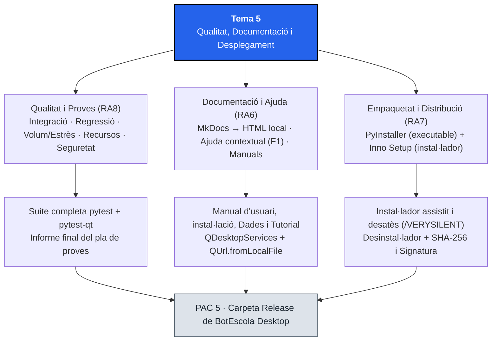
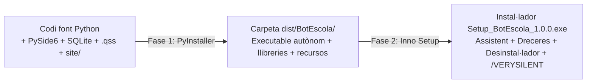

# Tema 5. Qualitat, Documentació i Desplegament

## 1. Identificació

* **Mòdul:** 0488. Desenvolupament d'interfícies
* **Curs:** 1r CFGS de Desenvolupament d'Aplicacions Multiplataforma (DAM)
* **Tema:** 5. Qualitat, Documentació i Desplegament
* **Durada presencial:** 14 hores
* **RA treballats:** RA6, RA7 i RA8 (completant les proves unitàries iniciades al Tema 2)
* **Prerequisits:** Domini de l'arquitectura MVP i d'`actions` (`QAction`) amb PySide6 (Tema 1), empaquetat de paquets Python i proves unitàries amb `pytest-qt` (Tema 2), integració de fils NUI (Tema 3) i persistència SQL i informes PDF (Tema 4).
* **Projecte transversal:** <mark style="color:violet;">**BotEscola Desktop**</mark>. En aquest últim tema tanquem el cicle de vida del producte: executem l'estratègia completa de proves sobre l'aplicació integrada (integració, regressió, volum, estrès, ús de recursos i seguretat), construïm el manual d'usuari i el sistema d'ajuda contextual amb <mark style="color:violet;">**`MkDocs`**</mark> i generem l'executable autònom i l'instal·lador final llest per distribuir al client amb <mark style="color:violet;">**`PyInstaller`**</mark> i <mark style="color:violet;">**`Inno Setup`**</mark>.

### Criteris d'avaluació treballats

#### RA6. Documenta aplicacions seleccionant i utilitzant eines específiques.

* CA 6.1: Identifica sistemes de generació d'ajudes.
* CA 6.2: Genera l'ajuda en els formats habituals per a la plataforma.
* CA 6.3: Genera l'ajuda sensible al context.
* CA 6.4: Documenta l'estructura de la informació persistent.
* CA 6.5: Confecciona el manual d'usuari i la guia de referència.
* CA 6.6: Confecciona els manuals d'instal·lació, configuració i administració.
* CA 6.7: Realitza tutorials.

#### Continguts Orientatius (RA6)

* 6.1 Eines de generació d'ajudes i documentació tècnica (`MkDocs`, `Qt Help`, HTML).
* 6.2 Tipus d'ajuda: en línia, fora de línia i ajuda sensible al context (`F1`, `whatsThis`, `statusTip`, obertura per secció).
* 6.3 Documentació de l'estructura de dades i fitxers de configuració.
* 6.4 Estructura d'un manual d'usuari, guia de referència, guia d'instal·lació i tutorial pas a pas.

#### RA7. Prepara aplicacions per a la seva distribució avaluant i utilitzant eines específiques.

* CA 7.1: Empaqueta l'aplicació per ser instal·lada.
* CA 7.2: Empaqueta l'aplicació per ser instal·lada de forma desatesa.
* CA 7.3: Inclou en el paquet tots els components i llibreries necessaris.
* CA 7.4: Personalitza l'assistent d'instal·lació.
* CA 7.5: Defineix la ubicació dels fitxers i les dreceres d'escriptori i menú d'inici.
* CA 7.6: Prepara paquets que puguin ser desinstal·lats.
* CA 7.7: Signa digitalment els paquets d'instal·lació.
* CA 7.8: Genera paquets per ser distribuïts per Internet o en xarxa local.

#### Continguts Orientatius (RA7)

* 7.1 Empaquetat d'aplicacions d'escriptori: congelació de l'intèrpret (`PyInstaller`) enfront de distribució de paquets Python (`.whl`).
* 7.2 Inclusió de recursos externs (`.qss`, `.ui`, models, documentació) i resolució de rutes en temps d'execució (`sys._MEIPASS`).
* 7.3 Creació d'instal·ladors personalitzats (`Inno Setup`), dreceres, desinstal·lador i instal·lació desatesa (`/SILENT`, `/VERYSILENT`).
* 7.4 Integritat i autenticitat en la distribució: sumes de verificació (`SHA-256`) i signatura digital de codi.

#### RA8. Avalua el funcionament d'aplicacions dissenyant i executant proves.

* CA 8.1: Estableix una estratègia de proves (iniciat al Tema 2).
* CA 8.2: Realitza proves d'integració dels diferents elements.
* CA 8.3: Realitza proves de regressió.
* CA 8.4: Realitza proves de volum i d'estrès.
* CA 8.5: Realitza proves d'ús de recursos per part de l'aplicació.
* CA 8.6: Realitza proves de seguretat.
* CA 8.7: Documenta les proves realitzades i els resultats obtinguts (iniciat al Tema 2).

#### Continguts Orientatius (RA8)

* 8.1 Nivells i tipologies de proves de programari: unitàries, integració, regressió, volum, estrès, recursos i seguretat.
* 8.2 Automatització de proves d'integració i regressió en interfícies gràfiques amb `pytest` i `pytest-qt`.
* 8.3 Mesura de temps de resposta, volum de registres i consum de recursos.
* 8.4 Informe final d'execució del pla de proves i criteris d'alliberament (_Release_).

## 2. Introducció

Un programari que només funciona dins de l'entorn virtual del desenvolupador encara no és un producte acabat. Perquè <mark style="color:violet;">**BotEscola Desktop**</mark> pugui arribar als ordinadors de secretaria i direcció d'un centre educatiu cal superar tres reptes finals que separen un prototip acadèmic d'un lliurament professional:

1. **Garantir la qualitat tècnica global (RA8):** als Temes 2, 3 i 4 hem escrit proves unitàries aïllades per als components, l'intèrpret NUI i el repositori SQL. Ara cal verificar que totes les peces encaixen entre si (**proves d'integració i de regressió**), que la finestra no es degrada quan hi ha centenars o milers de notificacions (**proves de volum, d'estrès i d'ús de recursos**) i que les entrades malicioses o fitxers corruptes no comprometen el sistema (**proves de seguretat**).
2. **Acompanyar l'usuari amb documentació i ajuda contextual (RA6):** aplicant la 10a heurística de Nielsen vista al Tema 1 (_Ajuda i documentació_), utilitzarem <mark style="color:violet;">**`MkDocs`**</mark> per transformar fitxers Markdown en un lloc web d'ajuda navegable que es pugui consultar sense connexió i obrir per la secció adequada en prémer `F1`. En la versió local oberta amb `file://`, desactivarem el cercador integrat de MkDocs, perquè no funciona de manera fiable sense servidor web en tots els navegadors; la navegació es farà amb l'índex i els enllaços interns.
3. **Empaquetar i desplegar sense dependències prèvies (RA7):** l'usuari final no sap què és Python, ni `pip`, ni un entorn virtual. Amb <mark style="color:violet;">**`PyInstaller`**</mark> congelarem l'aplicació, l'intèrpret de Python, les llibreries de Qt i els recursos (`.qss`, ajuda HTML) en una carpeta o executable autònom, i amb <mark style="color:violet;">**`Inno Setup`**</mark> construirem un instal·lador amb assistent personalitzat, dreceres, desinstal·lador, suport per a **instal·lació desatesa** i verificació d'integritat i signatura.

## 3. Objectius didàctics

En acabar el tema, l'alumne serà capaç de:

1. Dissenyar i executar un pla de proves complet que combini proves unitàries, d'integració, de regressió, de volum, d'estrès, d'ús de recursos i de seguretat amb `pytest` i `pytest-qt`, documentant-ne els resultats reals.
2. Comparar les eines de generació de documentació i sistemes d'ajuda (`MkDocs`, `Sphinx`, `Qt Help Framework`) i generar un sistema d'ajuda navegable en HTML estètic a partir de Markdown.
3. Implementar ajuda sensible al context dins de PySide6 combinant `toolTip`, `statusTip`, `whatsThis` i l'acció `F1` (`QKeySequence.StandardKey.HelpContents`) connectada a la secció corresponent del manual local amb `QDesktopServices.openUrl()`.
4. Redactar la documentació completa d'un producte: esquema de persistència, manual d'usuari, guia de referència d'ordres i dreceres, manual d'instal·lació/administració i tutorial pas a pas.
5. Distingir entre l'empaquetat d'una llibreria Python (`.whl`, Tema 2) i la congelació d'una aplicació final (`PyInstaller`), resolent la càrrega de fitxers externs (`.qss`, ajuda HTML) tant en desenvolupament com dins de l'executable congelat.
6. Construir un instal·lador amb assistent personalitzat, dreceres d'escriptori, desinstal·lador i mode d'instal·lació desatesa (silenciosa), i verificar la integritat (`SHA-256`) i el procés de signatura digital del paquet.

## 4. Mapa conceptual



## 5. Conceptes fonamentals

> **Convenció tipogràfica:** els noms ressaltats en color segueixen la dels temes anteriors: <mark style="color:red;">**classes de Qt i components**</mark>, <mark style="color:blue;">**propietats i senyals**</mark>, <mark style="color:orange;">**mètodes i funcions**</mark> i <mark style="color:violet;">**eines, fitxers i noms del projecte**</mark>.

### 5.1. L'espectre complet de les proves de programari (RA8)

Al Tema 2 vam començar l'estratègia de proves amb les **proves unitàries**, que comproven classes i funcions de manera aïllada. Quan l'aplicació ja està integrada, el pla s'amplia amb sis modalitats: integració, regressió, volum, estrès, ús de recursos i seguretat. Cap modalitat, tota sola, demostra que el sistema estigui lliure d'errors.

| Tipus de prova | Què verifica a BotEscola Desktop | Com l'automatitzem amb `pytest` / Python |
| :--- | :--- | :--- |
| **1. Unitària** | El contracte públic d'una classe o funció de manera aïllada | Suite acumulada: `test_selector.py`, `test_targeta.py`, `test_nui.py`, `test_informes.py`, entre d'altres |
| **2. D'integració** | Que components, intèrpret NUI i repositori SQL treballen plegats en un flux concret | Instanciar els components i el repositori amb BD `:memory:`, simular accions i comprovar la vista i les dades |
| **3. De regressió** | Que els canvis nous no trenquen funcionalitats anteriors | Executar tota la bateria `tests/` abans de cada lliurament |
| **4. De volum** | El comportament amb moltes dades, per exemple 500 o 1.000 notificacions | Inserir dades sintètiques, filtrar, calcular mètriques i generar un PDF; mesurar amb `time.perf_counter()` |
| **5. D'estrès** | La resposta davant d'una ràfega intensa d'operacions o canvis repetits | Repetir operacions de domini i, en proves d'integració, esdeveniments de Qt amb `qtbot` |
| **6. D'ús de recursos** | La memòria Python retinguda, les connexions obertes i el cicle de vida dels fils/diàlegs | `tracemalloc` per a assignacions Python; comprovacions específiques i proves de tancament per a recursos Qt |
| **7. De seguretat** | Resistència a injecció SQL, entrades malformades o grans i tractament segur del text en informes | Proves parametritzades amb cadenes hostils; comprovar que no s'altera la BD ni falla la generació d'informes |

**Limitacions de les mesures.** `tracemalloc` mesura assignacions de memòria de Python, no tota la memòria nativa de Qt ni la del procés. Una ràfega de 200 crides a funcions tampoc no és, per si sola, una prova de capacitat real de la GUI. Cal combinar proves automatitzades amb comprovacions manuals o de procés i documentar-ne l'entorn.

### 5.2. Sistemes d'ajuda i documentació d'aplicacions (RA6)

Una aplicació d'escriptori ofereix ajuda a l'usuari en tres capes complementàries, de la més immediata a la més completa:

| Capa d'ajuda | Mecanisme a Qt / Python | Quan s'utilitza | Exemple a BotEscola Desktop |
| :--- | :--- | :--- | :--- |
| **1. Microajuda immediata** | Propietats <mark style="color:blue;">`toolTip`</mark> i <mark style="color:blue;">`statusTip`</mark> (Tema 1) | En passar el ratolí per sobre d'un botó o explorar una opció de menú | `Marca la notificació seleccionada com a aprovada` |
| **2. Ajuda contextual ràpida** | Propietat <mark style="color:blue;">`whatsThis`</mark> (`Shift+F1`) o drecera `F1` que obre la pàgina exacta de la pantalla activa | Quan l'usuari no entén com funciona el panell, el filtre o el diàleg que té davant | Prémer `F1` al quadre de comandament obre directament la secció `informes.html` del manual |
| **3. Manual complet i guies** | Lloc web d'ajuda local generat amb <mark style="color:violet;">**`MkDocs`**</mark> (o col·lecció `.qhc` de `Qt Help`) | Consulta detallada, tutorial pas a pas, resolució de problemes i guia d'instal·lació | Menú `Ajuda > Manual d'usuari` (`F1`), consultable sense connexió; el cercador de MkDocs es desactiva quan s'obre amb `file://` |

#### Eines per generar ajuda i documentació (CA 6.1 i CA 6.2)

| Eina | Format de sortida | Ús típic | Avantatges | Limitacions |
| :--- | :--- | :--- | :--- | :--- |
| <mark style="color:violet;">**`MkDocs`**</mark> | HTML estàtic (carpeta `site/`) | Manuals d'usuari i documentació de projecte escrits en Markdown | Configuració simple (`mkdocs.yml`), s'instal·la amb `pip`, enllaços i navegació automàtics | No genera PDF ni `.chm` per si sol; convé fixar la versió (vegeu més avall) |
| **`Sphinx`** | HTML, PDF (via LaTeX), ePub i pàgines `man` | Documentació tècnica de llibreries i referència d'API a partir de _docstrings_ | Molt potent i extensible | Corba d'aprenentatge més alta (reStructuredText o MyST) |
| **`Qt Help Framework`** | Fitxers `.qch` / `.qhc` (a partir d'un `.qhp`), consultables amb `QHelpEngine` o Qt Assistant | Ajuda integrada a aplicacions Qt, amb índex i cerca | Cerca i índex integrats i ajuda contextual per identificador | Eines i flux més específics de Qt; més feina de configuració |
| **HTML Help (`.chm`)** | Un únic fitxer `.chm` | Ajuda clàssica de Windows | Un sol fitxer fàcil de distribuir | Format antic i només per a Windows; no es recomana per a projectes nous |

Els formats habituals depenen de la plataforma (`.chm` a Windows, pàgines `man` a Linux, _Help Book_ a macOS); un manual **HTML local** és el denominador comú que funciona igual als tres sistemes.

Per què escollim <mark style="color:violet;">**`MkDocs`**</mark> per al projecte?

* Permet escriure tota la documentació en **Markdown** (`.md`), el mateix format que ja utilitzem al repositori Git des del Tema 1.
* Amb una sola comanda (`mkdocs build`), compila els fitxers `.md` en una carpeta d'**HTML estàtic** (`site/`) amb índex navegable i fulls d'estil locals.
* Per obrir el manual directament amb `file://`, configura `site_url: ""` i `use_directory_urls: false`; així es generen pàgines com `index.html` i `guia_usuari.html` amb enllaços relatius. Es poden obrir des del disc amb <mark style="color:red;">`QDesktopServices.openUrl()`</mark> i <mark style="color:red;">`QUrl.fromLocalFile()`</mark>. També cal desactivar el connector de cerca (`plugins: []`), perquè el cercador predeterminat no funciona de manera fiable amb `file://`; això implica que no hi haurà cerca integrada. Per conservar-la, cal servir el lloc amb un servidor local o configurar una alternativa compatible amb `file://`.

* **Fixa la versió de MkDocs.** La versió estable actual és la 1.6.x; la 2.0 és una reescriptura en pre-llançament que no manté la compatibilitat amb la configuració actual de `mkdocs.yml`. Instal·la'l amb `"mkdocs>=1.6,<2"` i anota'n la versió al `README.md`.
* **L'àncora és una millora, no una garantia.** `QDesktopServices.openUrl()` sobre un fitxer local pot descartar el fragment (`#secció`) segons el sistema operatiu, la versió de Qt i el navegador (a Windows és un problema conegut; Qt hi va afegir una solució a partir de la 6.4, però convé comprovar-ho). Per això dissenya **una pàgina per context** i fes servir l'àncora només per afinar.

> **Dos públics, dos blocs.** El manual d'usuari (`index`, `guia_usuari`, `tutorial`) i el d'instal·lació s'adrecen al personal del centre; les fitxes de components, el catàleg NUI, les especificacions d'informes i el pla de proves són **documentació tècnica**. Publica'ls al mateix lloc però en seccions separades i sense etiquetes internes del curs (com «RA3»): un usuari no sap què és un RA.

#### Els quatre documents essencials d'un lliurament professional

El sistema documental d'una aplicació com <mark style="color:violet;">**BotEscola Desktop**</mark> ha de cobrir quatre perfils de necessitat:

1. **Manual d'usuari i guia de referència (CA 6.5):** explica què fa cada pantalla, com filtrar, com aprovar o descartar notificacions, com usar les ordres de veu i una taula de referència ràpida amb totes les dreceres de teclat (`Ctrl+Return`, `Supr`, `Ctrl+M`, `Ctrl+Shift+D`, `Ctrl+P`, `F1`, `Ctrl+Q`).
2. **Tutorial guiat pas a pas (CA 6.7):** un recorregut pràctic de 5 minuts ("La teva primera sessió amb BotEscola Desktop") pensat perquè un usuari nou aprengui fent una tasca real de principi a fi.
3. **Manual d'instal·lació, configuració i administració (CA 6.6):** requisits mínims del sistema, com executar l'instal·lador (en mode normal i en mode desatès per a l'administrador de sistemes de l'escola), on es desen els fitxers i com fer una còpia de seguretat.
4. **Documentació de l'estructura de la informació persistent (CA 6.4):** descripció tècnica d'on es guarda el fitxer SQLite (`botescola.db`), l'esquema de la taula `notificacions` (camps, tipus i valors admesos) i l'estructura del diccionari JSON/Python dels components (`to_dict()`).

### 5.3. Empaquetat de l'aplicació: de codi Python a executable autònom (RA7)

Al Tema 2 vam crear una distribució `.whl` (`botescola-modules`) pensada per a **altres programadors Python** que instal·len paquets amb `pip`. En canvi, el **RA7** exigeix preparar l'aplicació per a un **usuari final** que no hagi d'instal·lar manualment Python ni les dependències. `PyInstaller` no és un compilador multiplataforma: el paquet s'ha de construir i provar per al sistema operatiu i l'arquitectura de destinació.

Aquest procés es fa en dues fases complementàries:



#### Fase 1: Congelació amb `PyInstaller` (`onedir` vs `onefile`)

<mark style="color:violet;">**`PyInstaller`**</mark> analitza totes les importacions de <mark style="color:violet;">`botescola_app.py`</mark> i agrupa l'intèrpret de Python, els binaris de Qt (`PySide6`), les nostres carpetes (`components/`, `nui/`, `informes/`) i els fitxers de dades:

| Mode de PyInstaller | Com funciona | Avantatges | Limitacions |
| :--- | :--- | :--- | :--- |
| **`--onedir`** (recomanat amb instal·lador) | Crea una carpeta `dist/BotEscola/` amb l'executable i una subcarpeta `_internal/` amb les llibreries i recursos | Arrencada immediata; fàcil d'inspeccionar si falta un `.qss` o l'ajuda HTML; ideal per empaquetar després amb `Inno Setup` | S'ha de distribuir comprimit en `.zip` o dins d'un instal·lador |
| **`--onefile`** | Comprimeix tot dins d'un únic fitxer executable | Un sol fitxer per copiar | Arrencada més lenta (descomprimeix tot a una carpeta temporal cada cop que s'obre) i més falsos positius d'antivirus |

#### El problema de les rutes de recursos en aplicacions congelades

Al Tema 1 carregàvem el full d'estil amb `Path(__file__).parent / "styles"`. Quan l'aplicació s'empaqueta amb <mark style="color:violet;">`PyInstaller`</mark>, els fitxers de recursos afegits amb `--add-data` s'ubiquen al directori indicat per `sys._MEIPASS` (o al costat de l'executable). Perquè el mateix codi funcioni **tant en desenvolupament com un cop empaquetat**, centralitzem el càlcul de la ruta base en una petita funció:

```python
import sys
from pathlib import Path


def ruta_recurs(ruta_relativa):
    """Retorna la ruta absoluta a un recurs tant en desenvolupament com a PyInstaller."""
    if getattr(sys, "frozen", False) and hasattr(sys, "_MEIPASS"):
        base = Path(sys._MEIPASS)
    else:
        base = Path(__file__).resolve().parent
    return base / ruta_relativa
```

I un detall crític per a la base de dades SQLite (`botescola.db`): quan l'aplicació s'instal·la a `C:\Program Files\BotEscola Desktop\`, l'usuari estàndard **no té permisos d'escriptura** en aquella carpeta. Per això, en producció la base de dades gravable s'ubica a la carpeta de dades de l'usuari obtinguda amb <mark style="color:red;">`QStandardPaths`</mark> (`AppDataLocation`), mentre que els fitxers de només lectura (`styles/botescola.qss`, `site/index.html`) es llegeixen amb `ruta_recurs()`.

#### Dependències amb fitxers propis i mòduls que PyInstaller no veu

`PyInstaller` només troba les importacions estàtiques. Un paquet que importa mòduls dinàmicament o que porta fitxers de dades o executables propis pot funcionar a VS Code i **fallar només a l'executable congelat**. Als temes anteriors n'hi ha tres casos:

* **`SpeechRecognition` (Tema 3):** `recognize_google` envia l'àudio codificat en FLAC i el paquet porta els seus convertidors FLAC com a fitxers de dades. Si no s'inclouen a l'executable, la veu falla només al programa instal·lat. Afegeix `--collect-data speech_recognition` a la comanda i **prova la veu des de l'executable** (o amb el simulador si no hi ha micròfon).
* **`Matplotlib`, `ReportLab` i `PySide6` (Temes 1, 2 i 4):** tenen _hooks_ a `PyInstaller`, però cal comprovar a l'executable que el gràfic del quadre de comandament i l'exportació a PDF funcionen.
* **Importacions dinàmiques:** si falta un mòdul, afegeix-lo amb `--hidden-import nom_del_modul`.

Després de cada empaquetat, revisa `build/BotEscola/warn-BotEscola.txt`: llista els mòduls que `PyInstaller` no ha pogut resoldre. I recorda que amb `--windowed` **els errors desapareixen**: si l'executable es tanca en iniciar-se sense missatge, reconstrueix-lo temporalment sense `--windowed` per veure el _traceback_ a la consola.

### 5.4. Instal·ladors, instal·lació desatesa i signatura digital (RA7)

#### Creació de l'instal·lador amb `Inno Setup`

En aquest tema, l'exemple d'instal·lador està orientat a **Windows**: <mark style="color:violet;">**`Inno Setup`**</mark> pren la carpeta generada per `PyInstaller` (`dist/BotEscola/`) a partir d'un script (`.iss`) i genera un instal·lador `.exe` amb assistent, dreceres i desinstal·lador. Per a Linux i macOS cal construir el paquet en el sistema destinatari i emprar-ne les eines de distribució corresponents; el mateix `.iss` no genera paquets `.deb` ni `AppImage`.

* **Personalitza l'assistent (CA 7.4):** mostra el nom de l'aplicació, la versió i l'autor/centre. Si es disposa d'una icona `.ico`, es pot afegir amb la directiva `SetupIconFile`.
* **Defineix ubicacions i dreceres (CA 7.5):** copia els fitxers a `{autopf}\BotEscola Desktop` (segons `DefaultDirName`) i crea les dreceres al menú d'inici i, opcionalment, a l'escriptori.
* **Inclou desinstal·lador automàtic (CA 7.6):** registra l'aplicació al sistema operatiu perquè es pugui desinstal·lar netament des de _Configuració > Aplicacions_.
* **Permet la instal·lació desatesa (CA 7.2):** admet els paràmetres de línia d'ordres estàndard `/SILENT` (mostra només la barra de progrés, sense fer cap pregunta) i `/VERYSILENT` (instal·la en segon pla sense cap finestra, ideal perquè l'administrador TIC del centre ho desplegui a totes les aules d'informàtica amb un script).

* **Arquitectura de 64 bits:** afegeix `ArchitecturesAllowed=x64compatible` i `ArchitecturesInstallIn64BitMode=x64compatible` (Inno Setup 6.3 o posterior; en versions anteriors s'usa `x64`). Sense aquestes directives, l'instal·lador s'executa en mode de 32 bits i `{autopf}` apunta a `Program Files (x86)`, tot i que l'executable de `PyInstaller` és de 64 bits.
* **Dades d'usuari:** el desinstal·lador elimina els fitxers instal·lats, però **no** la base de dades que l'aplicació ha creat a `AppDataLocation`. Documenta-ho al manual d'administració (còpia de seguretat i neteja manual).
* **Diagnosi de desplegaments desatesos:** afegeix `/LOG="instalacio.log"` a la comanda; si una instal·lació massiva falla en algun equip, el registre en diu el motiu.

#### Distribució per Internet o per xarxa local (CA 7.8)

Un paquet «preparat per distribuir» és l'instal·lador més els elements que en permeten la verificació. Dues vies habituals al centre:

* **Internet (p. ex. una _Release_ de GitHub):** es puja `Setup_BotEscola_1.0.0.exe` i, **per un canal separat** (la descripció de la _Release_ o la pàgina del centre), l'empremta `SHA-256` i la versió.
* **Xarxa local (carpeta compartida de l'aula d'informàtica):** es deixa l'instal·lador i `checksums.sha256` en una carpeta de només lectura per als usuaris, i l'administrador el desplega amb `/VERYSILENT`.

En tots dos casos, `release/informe_release.md` documenta la versió, el canal de publicació, l'empremta i l'estat de la signatura.

#### Integritat (`SHA-256`) i signatura digital de paquets (CA 7.7 i CA 7.8)

Quan un instal·lador es distribueix per Internet o per la intranet del centre educatiu, l'usuari i el sistema operatiu necessiten verificar dues coses:

1. **Integritat (que el fitxer no s'ha corromput ni alterat durant la descàrrega):** es publica l'empremta criptogràfica **SHA-256** del paquet (`checksums.sha256`). Qualsevol canvi d'un sol byte al fitxer produeix un resum completament diferent.
2. **Autenticitat i autoria (signatura digital de codi — _Code Signing_):** es signa l'executable o l'instal·lador amb un certificat criptogràfic X.509 (clau privada del desenvolupador i clau pública verificable).
   * En un entorn comercial s'adquireix un certificat emès per una Autoritat de Certificació (CA) reconeguda pel sistema operatiu.
   * En l'entorn acadèmic generarem un **certificat autosignat (_self-signed_)** de prova i practicarem la signatura Authenticode a Windows (`signtool` o `Set-AuthenticodeSignature`). A Linux/macOS, `openssl` o `gpg` poden crear signatures separades; no són equivalents a una signatura Authenticode incrustada.

## 6. Entorn de treball

### 6.1. Estructura final del projecte (`Release`)

Aquest és l'estat complet del repositori de <mark style="color:violet;">**BotEscola Desktop**</mark> en finalitzar els cinc temes del mòdul:

```
botescola/
├── ui/
│   └── botescola.ui
├── generated/
│   └── ui_botescola.py
├── styles/
│   ├── botescola.qss
│   └── alt_contrast.qss
├── components/               <-- Tema 2 (RA3)
│   ├── __init__.py
│   ├── selector.py
│   ├── targeta.py
│   ├── interruptor.py        <-- si s'ha completat l'exercici D del Tema 2
│   └── comptador.py
├── nui/                      <-- Tema 3 (RA2)
│   ├── __init__.py
│   ├── interpret.py
│   └── escoltador_veu.py
├── informes/                 <-- Tema 4 (RA5)
│   ├── __init__.py
│   ├── repositori.py
│   ├── grafics.py
│   └── generador_pdf.py
├── tests/                    <-- Tema 2, 3, 4 i 5 (RA8: suite completa)
│   ├── test_selector.py
│   ├── test_targeta.py
│   ├── test_interruptor.py   <-- si s'ha completat l'exercici D del Tema 2
│   ├── test_comptador.py
│   ├── test_nui.py
│   ├── test_informes.py
│   ├── test_rutes.py         <-- proves de rutes i ajuda contextual (RA6, RA7)
│   └── test_sistema_ra8.py   <-- proves d'integració, regressió, volum, estrès, recursos i seguretat
├── docs/                     <-- Tema 5 (RA6): font Markdown per a MkDocs
│   ├── index.md              <-- portada i resum del manual d'usuari
│   ├── guia_usuari.md        <-- manual d'usuari i guia de referència (dreceres i menús)
│   ├── tutorial.md           <-- tutorial pas a pas per a nous usuaris
│   ├── instalacio.md         <-- manual d'instal·lació, configuració i administració
│   ├── dades_persistents.md  <-- documentació de l'estructura de dades persistent (SQL i JSON)
│   ├── components.md         <-- fitxes de components (Tema 2)
│   ├── nui.md                <-- catàleg d'ordres NUI i privadesa (Tema 3)
│   ├── informes.md           <-- especificació d'informes (Tema 4)
│   └── pla_proves_ra8.md     <-- estratègia i informe final del pla de proves complet
├── site/                     <-- HTML generat per MkDocs (es regenera; no s'edita)
├── installer/                <-- Tema 5 (RA7): configuració d'instal·lador
│   └── botescola.iss         <-- script d'Inno Setup (assistit i desatès)
├── release/                  <-- Carpeta d'evidències de distribució (RA6, RA7, RA8)
│   ├── checksums.sha256      <-- empremta SHA-256 del paquet distribuïble
│   └── informe_release.md    <-- resum de verificació de l'instal·lador i signatura
├── mkdocs.yml                <-- configuració del generador de documentació MkDocs
├── BotEscola.spec            <-- especificació generada amb --name BotEscola
├── rutes.py                  <-- resolució de rutes per a desenvolupament i PyInstaller
├── dades.py
├── botescola_app.py
├── pyproject.toml
├── pytest.ini
├── contrast.py
├── taula_contrast.md
├── .gitignore                <-- build/, dist/, .venv/, botescola.db...
└── README.md
```

> `site/` es regenera amb `mkdocs build`; si no es versiona, cal afegir-la a `.gitignore` i assegurar que el procés de construcció l'executa abans de PyInstaller.

### 6.2. Dependències

Amb l'entorn virtual activat, instal·la <mark style="color:violet;">`mkdocs`</mark> i <mark style="color:violet;">`pyinstaller`</mark>:

```bash
python -m pip install "mkdocs>=1.6,<2" pyinstaller
```

Fixem `MkDocs` a la sèrie 1.x (la 2.0 és una reescriptura en pre-llançament sense compatibilitat amb la configuració actual). Comprova que les eines responen correctament des de la terminal i anota'n les versions al <mark style="color:violet;">`README.md`</mark>:

```bash
python -m mkdocs --version
python -m PyInstaller --version
```

Per generar l'instal·lador `.exe` d'aquest exemple cal utilitzar <mark style="color:violet;">**`Inno Setup`**</mark> a Windows (disponible a `jrsoftware.org`). La política de llicències pot variar entre versions; abans d'utilitzar-lo en un projecte comercial, comprova les condicions vigents del proveïdor. Per a Linux o macOS, crea i prova el paquet en el sistema objectiu amb una eina de distribució adequada.

## 7. Exemple guiat: Proves RA8, Ajuda contextual amb MkDocs i Desplegament

### Pas 1. Resolució de rutes i connexió de l'ajuda sensible al context (`rutes.py`)

Creem el mòdul <mark style="color:violet;">`rutes.py`</mark> a l'arrel del projecte perquè els fulls d'estil (`.qss`), la documentació HTML compilada per `MkDocs` (`site/`) i la base de dades SQLite es localitzin sempre de manera fiable, i hi centralitzem també la decisió de **quina pàgina del manual s'obre** segons el control que té el focus:

```python
"""Rutes de recursos i dades i ajuda contextual (desenvolupament i PyInstaller)."""

import sys
from pathlib import Path

from PySide6.QtCore import QStandardPaths, QUrl
from PySide6.QtGui import QDesktopServices

# (pàgina, secció) del manual segons l'objectName del control, o d'un dels seus pares.
AJUDA_PER_CONTROL = {
    "cmb_filtre_prioritat": ("guia_usuari.html", "filtratge-i-cerca"),
    "cmb_filtre_estat": ("guia_usuari.html", "filtratge-i-cerca"),
    "txt_cerca": ("guia_usuari.html", "filtratge-i-cerca"),
    "sel_prioritat": ("guia_usuari.html", "nivells-de-prioritat"),
    "txt_simular_veu": ("nui.html", "cataleg-dordres-de-veu"),
    "btn_simular_veu": ("nui.html", "cataleg-dordres-de-veu"),
}
AJUDA_PER_DEFECTE = ("index.html", "")


def directori_base():
    """Retorna l'arrel del projecte o la carpeta desempaquetada per PyInstaller."""
    if getattr(sys, "frozen", False) and hasattr(sys, "_MEIPASS"):
        return Path(sys._MEIPASS)
    return Path(__file__).resolve().parent


def ruta_recurs(ruta_relativa):
    """Retorna el Path absolut d'un recurs inclòs amb l'aplicació (només lectura)."""
    return directori_base() / ruta_relativa


def ruta_bd_usuari(nom_fitxer="botescola.db"):
    """Retorna una ruta amb permisos d'escriptura per a la base de dades SQLite."""
    if getattr(sys, "frozen", False):
        carpeta = Path(QStandardPaths.writableLocation(QStandardPaths.StandardLocation.AppDataLocation))
        carpeta.mkdir(parents=True, exist_ok=True)
        return carpeta / nom_fitxer
    return directori_base() / nom_fitxer


def pagina_ajuda_per_widget(widget):
    """Retorna (pàgina, secció) de l'ajuda per a un widget, pujant per la cadena de pares.

    Cal pujar per la cadena perquè el focus pot ser dins d'un component compost:
    a SelectorPrioritat, per exemple, el focus és en un dels seus QPushButton interns,
    no al component amb objectName `sel_prioritat`.
    """
    while widget is not None:
        clau = widget.objectName()
        if clau in AJUDA_PER_CONTROL:
            return AJUDA_PER_CONTROL[clau]
        widget = widget.parentWidget()
    return AJUDA_PER_DEFECTE


def obrir_ajuda_contextual(pagina="index.html", ancora=""):
    """Obre la pàgina corresponent del manual HTML local generat per MkDocs.

    Retorna True si el sistema ha pogut obrir l'URL; False si falta el fitxer o no s'ha pogut obrir.
    """
    fitxer_html = ruta_recurs(Path("site") / pagina)
    if not fitxer_html.exists():
        return False
    url = QUrl.fromLocalFile(str(fitxer_html))
    if ancora:
        url.setFragment(ancora)
    return QDesktopServices.openUrl(url)
```

Els identificadors d'àncora (`filtratge-i-cerca`, `cataleg-dordres-de-veu`…) són els que `MkDocs` genera a partir dels títols de les pàgines (en minúscules, sense accents ni apòstrofs): comprova'ls a `site/`. El valor retornat per `QDesktopServices.openUrl()` també es comprova: que el fitxer existeixi no garanteix que el sistema hagi pogut obrir un navegador.

A `botescola_app.py`, defineix una identitat estable per a l'aplicació abans de cridar `ruta_bd_usuari()`; per exemple, després de crear `QApplication`, configura `app.setOrganizationName("BotEscola")` i `app.setApplicationName("BotEscola Desktop")`. Això fa que `QStandardPaths.AppDataLocation` resolgui un directori d'usuari previsible.

Per integrar aquests helpers, substitueix la càrrega antiga del full d'estil per una ruta de recurs i canvia la construcció del repositori perquè utilitzi la ruta de dades d'usuari. Al punt d'entrada de l'aplicació (un cop creat `QApplication`):

```python
from pathlib import Path
from rutes import ruta_recurs, ruta_bd_usuari

ruta_qss = ruta_recurs(Path("styles") / "botescola.qss")
app = QApplication(sys.argv)
app.setOrganizationName("BotEscola")
app.setApplicationName("BotEscola Desktop")
app.setStyleSheet(ruta_qss.read_text(encoding="utf-8"))
```

I dins del constructor del Presentador, en lloc de construir `botescola.db` amb `Path(__file__).parent`:

```python
self.repositori = RepositoriNotificacions(
    ruta_bd_usuari(), dades_inicials=NOTIFICACIONS_PROVA
)
```

Així els recursos de només lectura es busquen a la carpeta inclosa amb l'aplicació i la base de dades es desa en un directori d'usuari amb permisos d'escriptura.

Al Presentador (<mark style="color:violet;">`botescola_app.py`</mark>), afegim al menú `A&juda` (Tema 1) l'acció `act_manual_usuari` (`&Manual d'usuari`, drecera estàndard `F1` amb <mark style="color:red;">`QKeySequence.StandardKey.HelpContents`</mark>) i fem que l'ajuda sigui **sensible al context**:

```python
from functools import partial

from PySide6.QtGui import QKeySequence, QShortcut
from rutes import obrir_ajuda_contextual, pagina_ajuda_per_widget

def mostrar_ajuda_contextual(self):
    """Obre la secció de l'ajuda corresponent a la zona activa de la finestra (F1)."""
    pagina, seccio = pagina_ajuda_per_widget(self.focusWidget())
    self.obrir_ajuda(pagina, seccio)

def obrir_ajuda(self, pagina, seccio=""):
    if obrir_ajuda_contextual(pagina, seccio):
        self.statusBar().showMessage(f"Ajuda: oberta la pàgina «{pagina}».", 5000)
    else:
        self.statusBar().showMessage(
            "Ajuda: no s'ha pogut obrir el manual local; comprova que existeix i que hi ha un navegador associat.", 5000
        )
```

El quadre de comandament del Tema 4 és una **finestra pròpia** (un diàleg modal): la drecera `F1` de la finestra principal no hi arriba. Per tant, el diàleg necessita la seva pròpia drecera, que s'afegeix a `mostrar_quadre_comandament()` del Tema 4:

```python
# Dins de mostrar_quadre_comandament(), després de crear el diàleg:
dreceres_f1 = QShortcut(QKeySequence(QKeySequence.StandardKey.HelpContents), dialeg)
dreceres_f1.activated.connect(partial(self.obrir_ajuda, "informes.html"))
```

### Pas 2. Configurar i generar la documentació amb `MkDocs` (`mkdocs.yml`)

Creem el fitxer <mark style="color:violet;">`mkdocs.yml`</mark> a l'arrel del projecte. Les propietats `site_url: ""` i `use_directory_urls: false` generen enllaços relatius a fitxers HTML explícits. `plugins: []` desactiva el cercador integrat, que no funciona de manera fiable quan les pàgines s'obren directament amb `file://`. La navegació separa el manual d'usuari de la documentació tècnica; observa que això **no canvia els noms dels fitxers HTML** (`nui.html`, `guia_usuari.html`…), que són els que fa servir l'ajuda contextual:

```yaml
site_name: Manual i Ajuda de BotEscola Desktop
site_description: Documentació d'usuari, instal·lació, dades i proves del projecte BotEscola Desktop
site_url: ""
use_directory_urls: false
# Evita que la cerca de MkDocs falli en obrir el lloc directament amb file://.
# Si es necessita cercador, cal servir site/ amb un servidor local o afegir una alternativa compatible.
plugins: []

nav:
  - Manual d'usuari:
      - Inici: index.md
      - Guia d'usuari i referència: guia_usuari.md
      - Tutorial pas a pas: tutorial.md
  - Instal·lació i administració: instalacio.md
  - Documentació tècnica:
      - Estructura de dades persistent: dades_persistents.md
      - Components visuals: components.md
      - Interfície de veu (NUI): nui.md
      - Informes i gràfics: informes.md
      - Pla i informe de proves: pla_proves_ra8.md

theme:
  name: readthedocs
  # El contingut del manual és en català; el tema integrat pot mostrar els seus controls
  # en anglès perquè la traducció catalana no està inclosa en les localitzacions disponibles.
```

Per previsualitzar la documentació en viu mentre l'edites o per generar la carpeta `site/` definitiva:

```bash
# Previsualització en calent al navegador (http://127.0.0.1:8000):
python -m mkdocs serve

# Generació dels fitxers HTML estàtics a la carpeta site/ per distribuir amb l'aplicació.
# --strict converteix els avisos (per exemple, enllaços interns trencats) en errors:
python -m mkdocs build --clean --strict
```

### Pas 3. Automatitzar les proves avançades del RA8 (`tests/test_sistema_ra8.py` i `tests/test_rutes.py`)

El primer fitxer completa les proves unitàries dels Temes 2, 3 i 4 amb proves d'**integració**, **regressió**, **volum**, **estrès**, **ús de recursos** i **seguretat**. Fixa't que tots els repositoris es tanquen en acabar, passi el que passi, gràcies a un _fixture_:

```python
"""Bateria de proves del sistema per al RA8: integració, regressió, volum, estrès, recursos i seguretat."""

import sqlite3
import time
import tracemalloc
import gc

import pytest
from PySide6.QtCore import Qt
from PySide6.QtWidgets import QPushButton

from components import ComptadorPendents, SelectorPrioritat, TargetaNotificacio
from informes import RepositoriNotificacions, generar_informe_pdf
from nui import EscoltadorVeu, InterpretOrdres
from nui import escoltador_veu as mod_veu

LLINDAR_VOLUM_S = 5.0     # objectiu orientatiu a l'equip de referència del laboratori


def _generar_lot(quantitat):
    """Genera un lot de N notificacions sintètiques per a proves de volum i estrès."""
    nivells = ("Baixa", "Normal", "Alta")
    return [
        {
            "id": i,
            "remitent": f"Departament {(i % 5) + 1}",
            "assumpte": f"Comunicació interna número {i} per revisar",
            "data": f"2026-10-{(i % 28) + 1:02d}",
            "detall": f"Cos detallat de la notificació {i}.",
            "llegida": (i % 3 == 0),
            "prioritat": nivells[i % 3],
        }
        for i in range(1, quantitat + 1)
    ]


@pytest.fixture
def fabrica_repo():
    """Crea repositoris en memòria i els tanca tots en acabar el test."""
    creats = []

    def crear(quantitat):
        repo = RepositoriNotificacions(":memory:", dades_inicials=_generar_lot(quantitat))
        creats.append(repo)
        return repo

    yield crear
    for repo in creats:
        repo.tancar()


# 1. PROVA D'INTEGRACIÓ I REGRESSIÓ (components + NUI + repositori SQL)
def test_integracio_flux_complet_nui_component_i_sql(qtbot, fabrica_repo):
    repo = fabrica_repo(3)
    interpret = InterpretOrdres()
    comptador = ComptadorPendents(total=repo.calcular_resum()["pendents"])
    selector = SelectorPrioritat(prioritat="Baixa")
    qtbot.addWidget(comptador)
    qtbot.addWidget(selector)

    targeta = TargetaNotificacio.from_dict(repo.obtenir_per_id(1))
    qtbot.addWidget(targeta)

    # Cablatge equivalent al del Presentador
    targeta.llegida_clicada.connect(lambda id_n: repo.actualitzar_llegida(id_n, True))
    targeta.llegida_clicada.connect(lambda _id: setattr(comptador, "total", repo.calcular_resum()["pendents"]))
    interpret.prioritat_detectada.connect(lambda niv: setattr(selector, "prioritat", niv))
    selector.prioritat_canviada.connect(lambda niv: repo.actualitzar_prioritat(1, niv))

    # Ordre de veu de prioritat i clic de lectura
    assert comptador.total == 2
    interpret.processar_text("prioritat alta")
    qtbot.mouseClick(targeta.findChild(QPushButton, "btn_llegida"), Qt.MouseButton.LeftButton)

    # La vista, els components i l'SQL han quedat sincronitzats (sense regressions)
    actualitzada = repo.obtenir_per_id(1)
    assert actualitzada["llegida"] is True
    assert actualitzada["prioritat"] == "Alta"
    assert comptador.total == 1
```

> **Limitació d'aquesta prova d'integració.** El cablatge (`connect`) l'escrivim al propi test: demostra que els components, l'intèrpret i el repositori **encaixen**, però no que el Presentador real els connecti igual. Per provar la finestra real, el Presentador hauria de rebre el repositori per paràmetre (_injecció de dependències_) en lloc de crear-lo ell mateix: així un test li podria passar un repositori `:memory:`. Si el teu projecte ho permet, és la millora natural d'aquesta prova.

```python
# 2. PROVA DE VOLUM (500 notificacions a SQLite, filtratge i exportació PDF)
def test_volum_500_notificacions_rendiment(tmp_path, fabrica_repo):
    inici = time.perf_counter()
    repo = fabrica_repo(500)
    assert repo.comptar_total() == 500

    filtrades = repo.obtenir_notificacions(prioritat="Alta", estat_lectura="Pendents")
    resum = repo.calcular_resum(prioritat="Alta", estat_lectura="Pendents")
    pdf = generar_informe_pdf(tmp_path / "volum_500.pdf", filtrades, resum, "Volum 500")
    durada = time.perf_counter() - inici

    assert pdf.exists()
    assert durada < LLINDAR_VOLUM_S, f"Operació de volum massa lenta: {durada:.2f} s"


# 3. PROVA D'ESTRÈS (ràfega de 200 operacions consecutives)
def test_estres_rafega_canvis_i_ordres(qtbot, fabrica_repo):
    repo = fabrica_repo(20)
    interpret = InterpretOrdres()
    selector = SelectorPrioritat()
    qtbot.addWidget(selector)

    emesos = {"ordre": 0, "prioritat": 0, "desconeguda": 0}
    interpret.ordre_detectada.connect(lambda _o: emesos.__setitem__("ordre", emesos["ordre"] + 1))
    interpret.prioritat_detectada.connect(lambda _p: emesos.__setitem__("prioritat", emesos["prioritat"] + 1))
    interpret.ordre_desconeguda.connect(lambda _t: emesos.__setitem__("desconeguda", emesos["desconeguda"] + 1))

    ordres = ("seguent", "anterior", "prioritat alta", "prioritat baixa", "llegida", "inexistent")
    for i in range(200):
        interpret.processar_text(ordres[i % len(ordres)])
        nivell = SelectorPrioritat.NIVELLS[i % 3]
        selector.prioritat = nivell
        repo.actualitzar_prioritat((i % 20) + 1, nivell)

    # Cada ordre ha produït exactament un senyal i la BD continua consistent
    assert emesos == {"ordre": 101, "prioritat": 66, "desconeguda": 33}
    assert repo.comptar_total() == 20


# 4. PROVA D'ÚS DE RECURSOS (memòria Python retinguda, fil d'escolta i connexió SQL)
def test_recursos_memoria_retinguda_en_operacions_repetides(fabrica_repo):
    repo = fabrica_repo(100)
    tracemalloc.start()
    try:
        gc.collect()
        instantania_inicial = tracemalloc.take_snapshot()

        for _ in range(50):
            _ = repo.obtenir_notificacions(prioritat="Normal")
            _ = repo.calcular_resum()

        gc.collect()
        instantania_final = tracemalloc.take_snapshot()
        estadistiques = instantania_final.compare_to(instantania_inicial, "filename")
        increment_retingut = sum(max(0, estadistica.size_diff) for estadistica in estadistiques)
        assert increment_retingut < 15 * 1024 * 1024, (
            f"Massa memòria Python retinguda: {increment_retingut / (1024 * 1024):.2f} MB"
        )
    finally:
        tracemalloc.stop()


def test_recursos_fil_descolta_s_atura_i_s_allibera(qtbot, monkeypatch):
    class FalsSR:
        """Substitut de speech_recognition: sense micròfon, cada escolta caduca de seguida."""
        class WaitTimeoutError(Exception): ...
        class UnknownValueError(Exception): ...
        class RequestError(Exception): ...

        class _Font:
            def __enter__(self): return self
            def __exit__(self, *args): return False

        class Recognizer:
            operation_timeout = None
            def adjust_for_ambient_noise(self, font, duration=0.5): pass
            def listen(self, font, timeout=None, phrase_time_limit=None):
                time.sleep(0.02)
                raise FalsSR.WaitTimeoutError()

        @staticmethod
        def Microphone():
            return FalsSR._Font()

    monkeypatch.setattr(mod_veu, "sr", FalsSR)
    escoltador = EscoltadorVeu()
    escoltador.start()
    qtbot.waitUntil(escoltador.isRunning, timeout=2000)

    escoltador.aturar()
    assert escoltador.wait(3000)             # el fil acaba dins del temps d'espera
    assert not escoltador.isRunning()


def test_recursos_repositori_tancat_no_es_pot_reutilitzar():
    repo = RepositoriNotificacions(":memory:", dades_inicials=_generar_lot(3))
    repo.tancar()
    with pytest.raises(sqlite3.ProgrammingError):
        repo.comptar_total()


# 5. PROVA DE SEGURETAT (injecció SQL, entrades gegants i caràcters especials)
@pytest.mark.parametrize("entrada_maliciosa", [
    "'; DROP TABLE notificacions; --",
    "' UNION SELECT 1,2,3,4,5,6,7,8 --",
    "<script>alert('xss')</script>",
    "A" * 10000,
    "\x00\r\n\t'\"\\",
])
def test_seguretat_entrades_hostils_no_trenquen_sql_ni_nui(fabrica_repo, entrada_maliciosa):
    repo = fabrica_repo(5)
    interpret = InterpretOrdres()
    desconegudes = []
    interpret.ordre_desconeguda.connect(desconegudes.append)

    # Ni el cercador SQL ni l'intèrpret NUI han de caure ni esborrar la taula.
    assert isinstance(repo.obtenir_notificacions(cerca=entrada_maliciosa), list)
    interpret.processar_text(entrada_maliciosa)

    # Màxim una ordre desconeguda (cap si el text queda buit un cop normalitzat)
    assert len(desconegudes) <= 1
    assert repo.comptar_total() == 5


def test_pdf_escapa_text_html_en_camps_variables(tmp_path, fabrica_repo):
    """El text amb marques HTML no ha de trencar la composició del PDF."""
    repo = fabrica_repo(2)
    notificacions = repo.obtenir_notificacions()
    notificacions[0]["assumpte"] = "<script>alert('x')</script> & incidència"
    pdf = generar_informe_pdf(
        tmp_path / "text_hostil.pdf", notificacions, repo.calcular_resum(), "Cerca: <script> & text"
    )
    assert pdf.exists()
    assert pdf.stat().st_size > 0
```

El segon fitxer prova `rutes.py` **sense obrir cap navegador**: substitueix `QDesktopServices` i `QStandardPaths` per versions falses (_mocking_) i simula l'entorn congelat amb `monkeypatch`:

```python
"""Proves de rutes de recursos i d'ajuda contextual (RA6 i RA7)."""

import sys
from pathlib import Path

import pytest
from PySide6.QtWidgets import QPushButton, QWidget

import rutes


class FalsDesktopServices:
    obertes = []
    resultat = True

    @classmethod
    def openUrl(cls, url):
        cls.obertes.append(url)
        return cls.resultat


@pytest.fixture
def ajuda_falsa(tmp_path, monkeypatch):
    """Un manual local mínim a tmp_path i un QDesktopServices fals."""
    (tmp_path / "site").mkdir()
    (tmp_path / "site" / "guia_usuari.html").write_text("<h1>Guia</h1>", encoding="utf-8")
    FalsDesktopServices.obertes = []
    FalsDesktopServices.resultat = True
    monkeypatch.setattr(rutes, "directori_base", lambda: tmp_path)
    monkeypatch.setattr(rutes, "QDesktopServices", FalsDesktopServices)
    return tmp_path


def test_ajuda_retorna_false_si_no_existeix_la_pagina(ajuda_falsa):
    assert rutes.obrir_ajuda_contextual("inexistent.html") is False
    assert FalsDesktopServices.obertes == []


def test_ajuda_obre_la_pagina_amb_lancora(ajuda_falsa):
    assert rutes.obrir_ajuda_contextual("guia_usuari.html", "filtratge-i-cerca") is True
    url = FalsDesktopServices.obertes[0]
    assert url.isLocalFile()
    assert url.fragment() == "filtratge-i-cerca"


def test_ajuda_retorna_false_si_el_sistema_no_pot_obrir_lurl(ajuda_falsa):
    FalsDesktopServices.resultat = False
    assert rutes.obrir_ajuda_contextual("guia_usuari.html") is False


def test_ruta_recurs_en_desenvolupament_es_a_larrel_del_projecte():
    esperada = Path(rutes.__file__).resolve().parent / "styles" / "botescola.qss"
    assert rutes.ruta_recurs("styles/botescola.qss") == esperada


def test_ruta_recurs_congelat_utilitza_meipass(monkeypatch, tmp_path):
    monkeypatch.setattr(sys, "frozen", True, raising=False)
    monkeypatch.setattr(sys, "_MEIPASS", str(tmp_path), raising=False)
    assert rutes.ruta_recurs("site/index.html") == tmp_path / "site" / "index.html"


def test_ruta_bd_usuari_congelat_va_a_la_carpeta_de_dades(monkeypatch, tmp_path):
    class FalsStandardPaths:
        class StandardLocation:
            AppDataLocation = object()

        @staticmethod
        def writableLocation(_ubicacio):
            return str(tmp_path / "BotEscola")

    monkeypatch.setattr(sys, "frozen", True, raising=False)
    monkeypatch.setattr(rutes, "QStandardPaths", FalsStandardPaths)
    ruta = rutes.ruta_bd_usuari()
    assert ruta == tmp_path / "BotEscola" / "botescola.db"
    assert ruta.parent.is_dir()


def test_ajuda_contextual_puja_per_la_cadena_de_pares(qtbot):
    selector = QWidget()
    selector.setObjectName("sel_prioritat")
    boto_intern = QPushButton("Alta", selector)       # el focus és en un botó intern
    qtbot.addWidget(selector)

    assert rutes.pagina_ajuda_per_widget(boto_intern) == ("guia_usuari.html", "nivells-de-prioritat")
    assert rutes.pagina_ajuda_per_widget(QWidget()) == ("index.html", "")
    assert rutes.pagina_ajuda_per_widget(None) == ("index.html", "")
```

### Pas 4. Empaquetar l'aplicació amb `PyInstaller`

Des de l'arrel del projecte, havent executat prèviament `python -m mkdocs build --clean --strict` perquè existeixi la carpeta `site/`, executem <mark style="color:violet;">`PyInstaller`</mark> en mode `--onedir` i sense finestra de consola (`--windowed`):

```bash
# PyInstaller 6 o posterior; sintaxi SOURCE:DEST (vàlida també a Windows):
python -m PyInstaller --noconfirm --onedir --windowed --contents-directory _internal --name BotEscola --add-data "styles:styles" --add-data "site:site" --collect-data speech_recognition botescola_app.py
```

Per a aquesta PAC, executa la comanda a Windows perquè el resultat és un executable `.exe` i un instal·lador d'Inno Setup. Per empaquetar per a Linux o macOS, cal construir i provar el paquet en el sistema de destinació. Això genera la carpeta `dist/BotEscola/` amb l'executable autònom i el fitxer <mark style="color:violet;">`BotEscola.spec`</mark>, que podem versionar a Git per repetir l'empaquetat amb `python -m PyInstaller BotEscola.spec`. `--collect-data speech_recognition` inclou els fitxers de dades de la llibreria de veu (els convertidors FLAC); vegeu l'apartat 5.3. Revisa `build/BotEscola/warn-BotEscola.txt` després de cada empaquetat. Es fixa `--contents-directory _internal` perquè el camí a la documentació i als recursos de l'instal·lador coincideixi amb el que s'espera a l'exemple.

### Pas 5. Crear l'instal·lador amb `Inno Setup` (`installer/botescola.iss`)

Creem l'script <mark style="color:violet;">`installer/botescola.iss`</mark> que pren el contingut de `dist/BotEscola/` i genera `release/Setup_BotEscola_1.0.0.exe` amb dreceres, desinstal·lador i suport natiu per a instal·lació desatesa:

```ini
; Script d'Inno Setup per a BotEscola Desktop (RA7)
#define MyAppName "BotEscola Desktop"
#define MyAppVersion "1.0.0"
#define MyAppPublisher "CFGS DAM - Mòdul 0488"
#define MyAppExeName "BotEscola.exe"

[Setup]
; Mantén el mateix AppId en totes les versions publicades de l'aplicació.
AppId={{8F4B9A2E-3C1D-4E7A-9B5C-0488DA202610}
AppName={#MyAppName}
AppVersion={#MyAppVersion}
AppPublisher={#MyAppPublisher}
DefaultDirName={autopf}\{#MyAppName}
ArchitecturesAllowed=x64compatible
ArchitecturesInstallIn64BitMode=x64compatible
DefaultGroupName={#MyAppName}
DisableProgramGroupPage=yes
PrivilegesRequiredOverridesAllowed=dialog
OutputDir=..\release
OutputBaseFilename=Setup_BotEscola_{#MyAppVersion}
Compression=lzma
SolidCompression=yes
WizardStyle=modern
UninstallDisplayIcon={app}\{#MyAppExeName}

[Languages]
Name: "catalan"; MessagesFile: "compiler:Languages\Catalan.isl"

[Tasks]
Name: "desktopicon"; Description: "{cm:CreateDesktopIcon}"; GroupDescription: "{cm:AdditionalIcons}"; Flags: unchecked

[Files]
; La màscara ja inclou l'executable: evita declarar-lo dues vegades.
Source: "..\dist\BotEscola\*"; DestDir: "{app}"; Flags: ignoreversion recursesubdirs createallsubdirs

[Icons]
Name: "{group}\{#MyAppName}"; Filename: "{app}\{#MyAppExeName}"
Name: "{group}\Manual d'usuari"; Filename: "{app}\_internal\site\index.html"
Name: "{group}\{cm:UninstallProgram,{#MyAppName}}"; Filename: "{uninstallexe}"
Name: "{autodesktop}\{#MyAppName}"; Filename: "{app}\{#MyAppExeName}"; Tasks: desktopicon

[Run]
Filename: "{app}\{#MyAppExeName}"; Description: "{cm:LaunchProgram,{#StringChange(MyAppName, '&', '&&')}}"; Flags: nowait postinstall skipifsilent
```

Observa el flag `skipifsilent` a la secció `[Run]`: quan l'administrador executa l'instal·lador en **mode desatès** des de la terminal:

```powershell
.\release\Setup_BotEscola_1.0.0.exe /VERYSILENT /SUPPRESSMSGBOXES /NORESTART /LOG="instalacio.log"
```

l'aplicació s'instal·la automàticament sense mostrar cap finestra ni obrir el programa en acabar.

### Pas 6. Signatura digital i verificació d'integritat (`SHA-256`)

L'ordre és important: **signa primer i calcula el `SHA-256` després**, perquè la signatura Authenticode modifica el fitxer executable. Si es calcula l'empremta abans de signar, deixarà de coincidir amb la versió final distribuïda.

A Windows, per practicar la signatura de l'instal·lador amb un certificat autosignat de laboratori:

```powershell
# 1. Crear un certificat autosignat de prova al magatzem de l'usuari actual.
$cert = New-SelfSignedCertificate -Type CodeSigningCert -Subject "CN=BotEscola DAM 0488" -CertStoreLocation "Cert:\CurrentUser\My"

# 2. Signar l'instal·lador final.
Set-AuthenticodeSignature -FilePath ".\release\Setup_BotEscola_1.0.0.exe" -Certificate $cert

# 3. Consultar l'estat de la signatura.
Get-AuthenticodeSignature -FilePath ".\release\Setup_BotEscola_1.0.0.exe" | Format-List Status,StatusMessage,SignerCertificate
```

Un certificat autosignat serveix per practicar, però no és de confiança per defecte en altres ordinadors: el sistema pot indicar que el signant no és de confiança. Per a distribució real, cal una cadena de confiança acceptada pels destinataris i una protecció adequada de la clau privada.

Amb un certificat autosignat, `Get-AuthenticodeSignature` no mostrarà l'estat `Valid`, sinó un estat de signant no fiable: és el resultat esperat. Només en un **equip de proves**, es pot importar el certificat com a arrel de confiança per veure l'estat correcte (no ho facis mai en un equip de producció):

```powershell
Export-Certificate -Cert $cert -FilePath .\certificat_prova.cer
Import-Certificate -FilePath .\certificat_prova.cer -CertStoreLocation Cert:\CurrentUser\Root
```

Després de signar, calcula l'empremta del fitxer **final** amb un script que llegeixi en blocs i no carregui tot l'instal·lador a la memòria:

```python
from hashlib import sha256
from pathlib import Path

paquet = Path("release/Setup_BotEscola_1.0.0.exe")
empremta = sha256()
with paquet.open("rb") as fitxer:
    for bloc in iter(lambda: fitxer.read(1024 * 1024), b""):
        empremta.update(bloc)

sortida = Path("release/checksums.sha256")
sortida.write_text(f"{empremta.hexdigest()}  {paquet.name}\n", encoding="utf-8")
print(empremta.hexdigest())
```

El `SHA-256` permet comprovar la integritat respecte de l'empremta de referència, però per si sol no identifica qui ha publicat el fitxer. Publica el valor per un canal de confiança separat del paquet. Després de generar `checksums.sha256`, no modifiquis ni tornis a signar l'instal·lador sense recalcular l'empremta.

Qui rep el paquet pot **verificar-lo** comparant l'empremta publicada amb la del fitxer descarregat:

```powershell
Get-FileHash .\Setup_BotEscola_1.0.0.exe -Algorithm SHA256
```

A Linux o macOS, `sha256sum -c checksums.sha256` (o `shasum -a 256 -c`) fa la mateixa comprovació, perquè el fitxer segueix el format `empremta  nom_fitxer`.

En Linux/macOS, `openssl dgst -sha256 -sign` i `gpg --detach-sign` poden generar signatures separades (`.sig`); això és diferent de la signatura Authenticode incrustada que es verifica amb les eines de Windows.

## 8. Anàlisi tècnica

* **Coherència de la suite de proves (`tests/`):** en executar `python -m pytest -v` al Tema 5, s'executen automàticament totes les proves existents dels Temes 2–4 (per exemple `test_selector.py`, `test_targeta.py`, `test_interruptor.py` si s'ha implementat aquest exercici, `test_comptador.py`, `test_nui.py` i `test_informes.py`) i `test_sistema_ra8.py`. Això és una bateria de regressió útil sempre que les proves existents continuïn cobrint els comportaments importants. No detectarà automàticament qualsevol regressió: només els errors que els casos de prova exercitats siguin capaços de revelar.
* **Ajuda offline sense servidor:** `use_directory_urls: false` genera fitxers plans (`guia_usuari.html`) i els enllaços relatius permeten navegar pel protocol `file://`. El connector de cerca de MkDocs està desactivat (`plugins: []`) perquè el cercador per defecte no funciona de manera fiable amb `file://`; si la cerca és necessària, cal servir el lloc localment o adoptar una alternativa compatible.
* **Separació entre recursos de lectura i dades d'escriptura:** `ruta_recurs()` apunta als recursos inclosos amb l'aplicació, mentre que `ruta_bd_usuari()` apunta a `AppDataLocation` quan l'aplicació està congelada. Configura abans l'organització i el nom de l'aplicació amb Qt perquè la ruta sigui estable; no escriguis la BD a `Program Files`.
* **Instal·lació assistida vs desatesa:** el mateix binari generat per `Inno Setup` serveix per a un usuari domèstic (doble clic i assistent pas a pas) i per a un desplegament massiu en xarxa (`/VERYSILENT /DIR="C:\Apps\BotEscola"`).

* **`F1` puja per la cadena de pares.** Els components compostos del Tema 2 tenen botons interns que reben el focus: comparar només l'`objectName` del widget amb focus fa que el selector de prioritat mai no es reconegui. `pagina_ajuda_per_widget()` puja per `parentWidget()` fins a trobar un control del mapa. Cada finestra pròpia (com el quadre de comandament) necessita, a més, la seva drecera.
* **L'àncora és opcional.** El fragment (`#secció`) d'un URL local pot perdre's segons el sistema operatiu, la versió de Qt i el navegador; per això el mapa d'ajuda assigna **pàgines** a cada context i fa servir l'àncora només com a afinament.
* **Què demostra la prova d'integració i què no.** `test_integracio_flux_complet_nui_component_i_sql` demostra que les peces encaixen, però el cablatge és al test. Per verificar el Presentador real cal poder injectar-li el repositori.
* **Dependències amb fitxers propis.** Un executable congelat només inclou el que `PyInstaller` detecta. `speech_recognition` n'és el cas del projecte (convertidors FLAC): cal `--collect-data` i provar la funció des de l'executable, no només l'arrencada.
* **`mkdocs build --strict`** converteix els avisos (enllaços interns trencats) en errors i fa que la compilació del manual sigui un control de qualitat automatitzable.

## 9. Exercicis progressius

Tots els exercicis es lliuren a través del repositori del curs (per exemple, GitHub) amb el codi font i les captures indicades. No publiquis certificats amb clau privada, contrasenyes ni dades reals del centre.

**Ús de la IA:** pots utilitzar-la per consultar la sintaxi de `MkDocs`, `PyInstaller` o `Inno Setup`, però has de poder explicar què fa cada opció de cada comanda i cada directiva del `.iss`, i modificar-les al laboratori sense ajuda. A l'exercici D i a la PAC, deixa constància (en un comentari o al `README.md`) de les decisions que has pres tu i per què.

### Exercici A — Reproducció: Ajuda amb MkDocs i tecla `F1`

1. Crea <mark style="color:violet;">`mkdocs.yml`</mark>, <mark style="color:violet;">`rutes.py`</mark> i les pàgines inicials a `docs/`.
2. Executa `python -m mkdocs build --clean --strict` i verifica que s'ha creat la carpeta `site/` amb `index.html` i que no hi ha avisos.
3. Afegeix l'acció `act_manual_usuari` (drecera `F1`) al menú `A&juda` de <mark style="color:violet;">**BotEscola Desktop**</mark> i comprova que, en prémer `F1` amb el focus al cercador o al simulador de veu, s'obre la pàgina corresponent del manual al navegador.

**Lliurament:** codi, `mkdocs.yml` i una captura del navegador amb la pàgina oberta amb `F1`.

### Exercici B — Modificació: Ajuda ràpida `whatsThis` i guia de referència

1. Assigna la propietat <mark style="color:blue;">`whatsThis`</mark> als controls principals de la finestra (`lst_notificacions`, `sel_prioritat`, `cmb_filtre_prioritat`, `txt_simular_veu`) i afegeix al menú `A&juda` l'acció estàndard <mark style="color:red;">`QWhatsThis`</mark><mark style="color:orange;">`.createAction(self)`</mark> (`Shift+F1`).
2. Completa <mark style="color:violet;">`docs/guia_usuari.md`</mark> amb la taula de referència de totes les ordres de menú, botons, dreceres de teclat i comandes de veu de l'aplicació. Comprova que les dreceres del manual coincideixen amb les de l'aplicació.

**Lliurament:** codi, `docs/guia_usuari.md` i una captura del text `whatsThis` mostrat.

### Exercici C — Diagnosi

Analitza els quatre casos següents, explica la causa del problema i escriu la solució:

**Cas 1.** L'aplicació carrega el full d'estil perfectament des de VS Code, però quan s'executa l'executable creat amb `PyInstaller` des d'una altra carpeta o sense el codi font al costat, apareix sense estils o llança `FileNotFoundError: styles/botescola.qss`.

**Cas 2.** Un cop instal·lada l'aplicació a `C:\Program Files\BotEscola Desktop\`, en intentar marcar una notificació com a llegida llança `sqlite3.OperationalError: attempt to write a readonly database`.

**Cas 3.** En executar l'instal·lador amb `/VERYSILENT` en un script d'administració per instal·lar el programa a 30 ordinadors, l'instal·lador acaba però deixa oberta la finestra de `BotEscola Desktop` als 30 equips. Quina opció falta a la secció `[Run]` del fitxer `.iss`?

**Cas 4.** L'alumne ha implementat `F1` així i funciona amb el cercador, però en prémer `F1` amb el focus al selector de prioritat s'obre sempre la portada del manual:

```python
def mostrar_ajuda_contextual(self):
    nom = self.focusWidget().objectName()
    if nom == "sel_prioritat":
        obrir_ajuda_contextual("guia_usuari.html", "nivells-de-prioritat")
    else:
        obrir_ajuda_contextual("index.html")
```

### Exercici D — Repte: Suite de proves RA8 (`tests/test_sistema_ra8.py` i `tests/test_rutes.py`)

Implementa i executa <mark style="color:violet;">`tests/test_sistema_ra8.py`</mark> cobrint les categories addicionals a les proves unitàries (integració, regressió, volum amb 500 registres, estrès amb 200 operacions, ús de recursos i seguretat amb entrades malicioses), i <mark style="color:violet;">`tests/test_rutes.py`</mark> per a la resolució de rutes i l'ajuda contextual.

* No copiïs les proves del Pas 3 sense entendre-les: afegeix-hi **una prova pròpia** per a cada categoria (per exemple, un volum de 1.000 registres o una entrada hostil nova) i explica al `docs/pla_proves_ra8.md` què detecta cada prova i què no pot detectar.
* Verifica manualment la resposta a `F1` **fora de l'entorn de desenvolupament** (amb l'executable congelat), perquè les proves automàtiques només comproven la lògica, no el comportament del navegador.

**Lliurament:** els dos fitxers de proves, captura de `python -m pytest -v` i el `docs/pla_proves_ra8.md`.

### Exercici E — Aplicació al projecte: Congelació i instal·lador desatès

1. Executa `PyInstaller` per generar `dist/BotEscola/` incloent-hi `styles/` i `site/`.
2. Comprova que l'executable generat a `dist/BotEscola/` s'inicia, aplica el QSS, guarda canvis a la base de dades, genera un PDF, respon al simulador d'ordres de veu i obre l'ajuda amb `F1`. Si alguna funció falla només a l'executable, reconstrueix-lo sense `--windowed` per veure l'error i revisa `build/BotEscola/warn-BotEscola.txt`.
3. Crea <mark style="color:violet;">`installer/botescola.iss`</mark> i genera el paquet instal·lador. La signatura Authenticode i el càlcul final de `SHA-256` es documenten al pas de verificació de la PAC; calcula el hash després de signar.

**Lliurament:** `BotEscola.spec`, `installer/botescola.iss` i captures de l'executable en marxa i de l'assistent d'instal·lació.

### Exercici F — Anàlisi de tecnologies

Una empresa desenvolupa una eina d'escriptori en Python i PySide6 per a dos públics molt diferents: (a) altres desenvolupadors Python de l'empresa que volen reutilitzar els seus widgets en projectes nous, i (b) el personal administratiu de les oficines que utilitza Windows i no té coneixements tècnics. Compara en 8-12 línies quan cal distribuir una roda Python (`.whl` amb `pyproject.toml`), quan un executable congelat amb `PyInstaller` i quan un instal·lador amb `Inno Setup`, justificant l'elecció segons manteniment, actualitzacions, mida del paquet i experiència de l'usuari.

**Lliurament:** document breu en Markdown amb la recomanació justificada.

## 10. Errors habituals

| Símptoma | Causa probable | Solució | Prevenció |
| :--- | :--- | :--- | :--- |
| L'executable de `PyInstaller` no troba `styles/botescola.qss` ni `site/index.html` | No s'han inclòs amb `--add-data` o es busquen amb una ruta relativa al directori de treball | Empaqueta amb `--add-data "styles:styles" --add-data "site:site"` i usa `ruta_recurs()` | Prova l'executable fora de la carpeta del codi font |
| S'obre una finestra negra de terminal al darrere de la GUI en executar el `.exe` | S'ha executat `PyInstaller` sense l'opció `--windowed` (o `--noconsole`) | Afegeix `--windowed` a la comanda o `console=False` al `.spec` | Revisa les opcions del `.spec` abans de generar l'instal·lador |
| L'executable es tanca en iniciar-se o una funció (veu, informe) falla només al programa congelat | Falta un mòdul o un fitxer de dades que `PyInstaller` no ha detectat (per exemple, els convertidors FLAC de `SpeechRecognition`); amb `--windowed` l'error no es veu | Reconstrueix sense `--windowed` per veure el _traceback_, revisa `build/BotEscola/warn-BotEscola.txt` i afegeix `--collect-data` o `--hidden-import` | Prova cada funció de l'aplicació a l'executable, no només l'arrencada |
| En prémer `F1`, el navegador mostra error de fitxer no trobat amb rutes com `guia_usuari/index.html` | Falta `site_url: ""` o `use_directory_urls: false` a `mkdocs.yml`, o no s'ha executat `mkdocs build` | Afegeix `site_url: ""` i `use_directory_urls: false`, i regenera `site/` | Comprova que `site/index.html` i els enllaços interns funcionen amb `file://` |
| `F1` obre la portada tot i tenir el focus a un control amb ajuda pròpia (el selector de prioritat) | El focus és a un botó intern del component compost i es compara només l'`objectName` del widget amb focus | Puja per la cadena de pares (`parentWidget()`) fins a trobar un control conegut | Prova `pagina_ajuda_per_widget()` amb components compostos |
| `F1` no fa res dins del quadre de comandament | El diàleg és una finestra pròpia i la drecera de la finestra principal no hi arriba | Afegeix un `QShortcut` de `HelpContents` al diàleg | Prova `F1` a cada finestra i diàleg de l'aplicació |
| S'obre la pàgina d'ajuda però no es desplaça a la secció | `QDesktopServices.openUrl()` pot descartar el fragment d'un fitxer local segons el sistema operatiu, la versió de Qt i el navegador | Dissenya una pàgina per context i fes servir l'àncora només com a millora | Prova-ho al navegador del laboratori i documenta la limitació |
| El cercador de MkDocs no funciona quan el manual s'obre com a fitxer local | El navegador restringeix operacions del connector de cerca amb `file://` | Usa `plugins: []` per a la versió offline sense cercador, o serveix el manual en un servidor local | Documenta aquesta limitació i prova els enllaços interns sense Internet |
| `mkdocs build` falla o `mkdocs.yml` deixa de funcionar després d'actualitzar | S'ha instal·lat una versió 2.x (pre-llançament), que no manté la compatibilitat | Instal·la `"mkdocs>=1.6,<2"` | Anota i fixa les versions de les eines de documentació |
| `attempt to write a readonly database` després d'instal·lar a `Program Files` | El fitxer `botescola.db` s'intenta crear dins de la carpeta d'instal·lació protegida | Guarda la BD d'usuari a `QStandardPaths.StandardLocation.AppDataLocation` quan `sys.frozen` és cert | Separa sempre els recursos de només lectura de les dades d'usuari |
| L'aplicació s'instal·la a `Program Files (x86)` | L'instal·lador s'executa en mode de 32 bits | Afegeix `ArchitecturesInstallIn64BitMode=x64compatible` (o `x64` en versions antigues) | Comprova la ruta d'instal·lació al provar l'instal·lador |
| L'instal·lador en mode `/VERYSILENT` obre la finestra de l'aplicació en acabar | Falta el flag `skipifsilent` a la línia `[Run]` de l'script `.iss` | Afegeix `Flags: nowait postinstall skipifsilent` a `botescola.iss` | Prova sempre la instal·lació desatesa des de la terminal |
| Les proves de volum triguen molt perquè fan un `commit()` per cada fila inserida | S'insereixen 500 registres amb 500 transaccions independents | Agrupa la inserció massiva dins d'un únic bloc `with self._conn:` (`inserir_lot`) | Usa transaccions agrupades per a operacions en bloc |
| L'empremta `SHA-256` publicada no coincideix amb la de l'instal·lador | S'ha calculat abans de signar, o s'ha tornat a signar o modificar després | Signa primer i calcula l'empremta del fitxer final | Genera `checksums.sha256` com a darrer pas |

## 11. Bones pràctiques

* **Automatitza les proves de regressió.** Abans d'empaquetar qualsevol versió, executa `python -m pytest -v` i verifica que totes les proves dels Temes 2, 3, 4 i 5 passen en verd.
* **Mantén la documentació al costat del codi.** Escriu els manuals en Markdown dins de `docs/` i versiona'ls amb Git; així el manual evoluciona al mateix ritme que l'aplicació. Genera'l amb `mkdocs build --strict` perquè els enllaços trencats facin fallar la compilació.
* **Fes que l'ajuda sigui sensible al context i accessible sense Internet.** La tecla `F1` ha d'obrir la pàgina local de `site/` relacionada amb la tasca que l'usuari està fent, i si el manual no hi és, informar-ne a la barra d'estat sense llançar excepcions. Cada finestra i diàleg necessita la seva pròpia drecera `F1`.
* **Utilitza `ruta_recurs()` per a tots els fitxers estàtics i `ruta_bd_usuari()` per a les dades.** Cap ruta a `.qss` o `.html` ha de dependre del directori des d'on s'ha obert la terminal.
* **Prova l'executable congelat funció a funció.** Que arrenqui no vol dir que la veu, els informes o l'ajuda funcionin; amb `--windowed` els errors són invisibles.
* **Fixa les versions de les eines de construcció** (`PyInstaller`, `MkDocs`, `Inno Setup`) i anota-les a `README.md`, perquè el mateix empaquetat sigui repetible.
* **Prova l'instal·lador i el desinstal·lador.** Verifica tant la instal·lació amb assistent com la desatesa (`/VERYSILENT`) i comprova que la desinstal·lació elimina els fitxers i les dreceres creades (i documenta que les dades d'usuari es conserven).
* **Publica l'empremta `SHA-256` després de signar el paquet.** Permet detectar canvis respecte del fitxer final; no substitueix una signatura digital ni l'autenticació del canal de publicació.
* **No pugis secrets al repositori.** Cap clau privada, contrasenya ni dada real del centre.

## 12. PAC 5: Qualitat (RA8), Documentació i Ajuda (RA6) i Distribució (RA7) de BotEscola Desktop

### Context

El desenvolupament funcional de <mark style="color:violet;">**BotEscola Desktop**</mark> ha conclòs. Abans de lliurar el producte al centre educatiu, cal sotmetre'l al pla final de proves (integració, regressió, volum, estrès, recursos i seguretat), dotar-lo d'ajuda contextual i dels manuals d'usuari i administració amb <mark style="color:violet;">`MkDocs`</mark>, i generar el paquet d'instal·lació final amb <mark style="color:violet;">`PyInstaller`</mark> i <mark style="color:violet;">`Inno Setup`</mark>.

### Requisits funcionals

**1. Pla i bateria completa de proves (RA8 — `tests/test_sistema_ra8.py` i `docs/pla_proves_ra8.md`)**

1. Implementa <mark style="color:violet;">`tests/test_sistema_ra8.py`</mark> amb proves automatitzades que verifiquin (i `tests/test_rutes.py` per a les rutes i l'ajuda contextual):
   * **Integració i regressió:** flux combinat entre components del Tema 2, intèrpret NUI del Tema 3 i repositori SQL del Tema 4, mantenint en verd tota la suite de tests anteriors;
   * **Volum:** inserció, filtratge, càlcul de resum i generació de PDF amb almenys **500 notificacions**; registra el temps i compara'l amb l'objectiu de menys de 5 segons en l'equip de referència del laboratori;
   * **Estrès:** execució d'una ràfega mínima de **200 operacions consecutives** (canvis de prioritat, ordres NUI i consultes) sense errors ni bloquejos;
   * **Ús de recursos:** control orientatiu de la memòria Python retinguda amb `tracemalloc`; comprova separadament, sense micròfon físic, que el fil d'escolta (`EscoltadorVeu` simulat) s'atura i que la connexió SQL es tanca;
   * **Seguretat:** comprovació parametritzada amb entrades hostils (injecció SQL, etiquetes `<script>`, cadenes de 10.000 caràcters i caràcters de control) sobre el cercador SQL i l'intèrpret NUI, i una prova de generació del PDF amb text HTML escapable.
2. Redacta <mark style="color:violet;">`docs/pla_proves_ra8.md`</mark> amb l'estratègia global i l'informe final de resultats de tota la suite del curs.

**2. Documentació i sistema d'ajuda contextual (RA6 — `mkdocs.yml`, `docs/` i `F1`)**

3. Configura <mark style="color:violet;">`mkdocs.yml`</mark> (`site_url: ""`, `use_directory_urls: false` i `plugins: []` per a l'ajuda oberta com a `file://`) amb una navegació que separi el manual d'usuari de la documentació tècnica (sense etiquetes internes del curs com «RA3»), i redacta els documents de `docs/`:
   * <mark style="color:violet;">`docs/index.md`</mark> i <mark style="color:violet;">`docs/guia_usuari.md`</mark>: manual d'usuari de totes les pantalles i guia de referència de menús, dreceres de teclat i ordres de veu (CA 6.5);
   * <mark style="color:violet;">`docs/tutorial.md`</mark>: tutorial guiat pas a pas per completar una sessió de revisió i exportació d'informe (CA 6.7);
   * <mark style="color:violet;">`docs/instalacio.md`</mark>: manual d'instal·lació (assistida i desatesa), configuració i administració/còpia de seguretat (CA 6.6);
   * <mark style="color:violet;">`docs/dades_persistents.md`</mark>: documentació de l'esquema SQLite (`notificacions`) i de l'estructura de serialització JSON/diccionari dels components (CA 6.4).
4. Compila l'ajuda en HTML a `site/` amb `python -m mkdocs build --clean --strict` (CA 6.1, CA 6.2).
5. Integra l'**ajuda sensible al context (CA 6.3)** a <mark style="color:violet;">`botescola_app.py`</mark>:
   * afegeix l'acció `act_manual_usuari` (`&Manual d'usuari`, drecera `F1`) al menú `A&juda`;
   * en prémer `F1`, obre la pàgina i secció corresponent de `site/` segons quin control tingui el focus (filtres, NUI, detall/prioritat o portada general), incloent-hi els controls compostos i el quadre de comandament, que té la seva pròpia drecera `F1`;
   * afegeix textos <mark style="color:blue;">`whatsThis`</mark> als controls clau i l'acció `Què és això?` (`Shift+F1`) al menú `A&juda`.

**3. Empaquetat, instal·lador desatès i signatura (RA7 — `rutes.py`, `BotEscola.spec`, `installer/botescola.iss` i `release/`)**

6. Adapta la càrrega de recursos (`.qss`, `site/`) i la ruta de la base de dades amb <mark style="color:violet;">`rutes.py`</mark> perquè funcionin tant en desenvolupament com dins de l'executable congelat.
7. Empaqueta l'aplicació amb <mark style="color:violet;">`PyInstaller`</mark> (`--onedir --windowed`), incloent-hi totes les llibreries, `styles/` i `site/` (CA 7.1, CA 7.3).
8. Crea l'script <mark style="color:violet;">`installer/botescola.iss`</mark> (personalitzat amb nom, versió, idioma català, dreceres al menú d'inici i escriptori, desinstal·lador i compatibilitat amb `/SILENT` i `/VERYSILENT`) i genera el paquet d'instal·lació (CA 7.2, CA 7.4, CA 7.5, CA 7.6, CA 7.8).
9. Signa primer l'instal·lador final amb un certificat de prova, calcula després l'empremta `SHA-256` a <mark style="color:violet;">`release/checksums.sha256`</mark> i documenta el procés i les limitacions de confiança del certificat a <mark style="color:violet;">`release/informe_release.md`</mark> i el canal de publicació (Internet o xarxa local) i com es verifica l'empremta (CA 7.7, CA 7.8).

### Requisits no funcionals

* L'ajuda HTML de `site/` ha de funcionar completament fora de línia (sense connexió a Internet) i mantenir tots els enllaços interns operatius.
* L'executable congelat no ha de mostrar cap finestra de consola en segon pla.
* Les proves han de completar-se sense errors ni recursos penjats. El temps total s'ha de registrar en un equip de referència del laboratori; un llindar temporal fix no s'ha d'interpretar igual per a qualsevol ordinador.

### Restriccions

* No s'accepten rutes absolutes lligades a l'ordinador de l'alumne (`C:\Users\ElMeuNom\...`) ni al codi Python, ni a `BotEscola.spec`, ni a `botescola.iss`.
* No es puja la carpeta pesada `build/`, `dist/` ni l'entorn virtual `.venv/` al repositori Git; el fitxer d'instal·lació final s'adjunta com a _Release_ de GitHub (o dins de la carpeta `release/` del lliurament).

### Tasques

1. Escriu i executa <mark style="color:violet;">`tests/test_sistema_ra8.py`</mark> i redacta <mark style="color:violet;">`docs/pla_proves_ra8.md`</mark>.
2. Redacta els documents de `docs/`, configura <mark style="color:violet;">`mkdocs.yml`</mark> i genera la carpeta `site/` amb `mkdocs build`.
3. Implementa <mark style="color:violet;">`rutes.py`</mark> i integra l'ajuda sensible al context (`F1` i `Shift+F1`) a <mark style="color:violet;">`botescola_app.py`</mark>.
4. Congela l'aplicació amb <mark style="color:violet;">`PyInstaller`</mark> i verifica que l'executable arrenca amb estils, dades i ajuda.
5. Construeix l'instal·lador amb <mark style="color:violet;">`installer/botescola.iss`</mark>, prova la instal·lació assistida, la desatesa (`/VERYSILENT`) i la desinstal·lació.
6. Signa l'instal·lador final amb un certificat de prova; a continuació, calcula <mark style="color:violet;">`release/checksums.sha256`</mark> i completa <mark style="color:violet;">`release/informe_release.md`</mark>.

### Criteris d'acceptació

* [ ] `python -m pytest -v` executa tota la suite dels Temes 2, 3, 4 i 5 (incloent proves unitàries, d'integració, regressió, volum, estrès, recursos i seguretat) i totes passen en verd; les proves de tancament del fil no depenen d'un micròfon físic.
* [ ] `python -m mkdocs build --clean --strict` genera `site/` sense errors ni avisos i inclou manual d'usuari, guia de referència, tutorial, manual d'instal·lació/administració i estructura de dades persistent; els enllaços interns funcionen offline. El cercador està desactivat en la modalitat `file://`.
* [ ] Prémer `F1` obre la pàgina d'ajuda local corresponent al control que té el focus, i `Shift+F1` mostra el text `whatsThis`.
* [ ] L'executable generat per `PyInstaller` funciona de manera autònoma i carrega tant `botescola.qss` com l'ajuda de `site/`.
* [ ] L'instal·lador crea les dreceres, permet instal·lar-se en mode desatès (`/VERYSILENT`) i inclou desinstal·lador funcional.
* [ ] La carpeta `release/` conté l'instal·lador (o l'enllaç a la _Release_), el fitxer `checksums.sha256` i l'evidència de signatura i proves.

### Evidències de lliurament

* Repositori Git i carpeta de distribució (`Release`) amb:
  * Codi complet de l'aplicació, `rutes.py`, `mkdocs.yml`, `BotEscola.spec` i `installer/botescola.iss`.
  * Carpeta `docs/` i carpeta `site/` generada per `MkDocs`.
  * Suite completa de `tests/` (incloent `test_sistema_ra8.py` i `test_rutes.py`) i captura de `python -m pytest -v` amb tots els tests del curs en `PASSED`.
  * `docs/pla_proves_ra8.md` amb l'estratègia, l'informe de resultats i els criteris d'alliberament (apartat 13.3).
  * Instal·lador generat (`Setup_BotEscola_1.0.0.exe` o paquet equivalent), `release/checksums.sha256` i `release/informe_release.md` amb les captures de l'assistent, de l'execució desatesa i de la signatura digital.

### Rúbrica de la PAC

| Criteri observable | Insuficient | Suficient | Bo |
| :--- | :--- | :--- | :--- |
| Proves avançades i informe (RA8) | Només hi ha proves unitàries o falten proves de volum/seguretat i l'informe | `test_sistema_ra8.py` cobreix integració dels components, regressió, volum, estrès, recursos Python i seguretat; inclou `pla_proves_ra8.md` | A més, tota la suite acumulada passa, s'hi afegeixen proves manuals d'integració de la finestra i tancament de fils, i es documenten els temps i els resultats reals |
| Sistema d'ajuda i ajuda contextual (RA6) | No genera l'ajuda amb `MkDocs` o `F1` no obre res | Genera `site/` en HTML offline amb `MkDocs` i obre l'ajuda des del menú i amb `F1` | A més, `F1` és sensible al control amb focus (obre la pàgina/secció corresponent) i incorpora `whatsThis` (`Shift+F1`) |
| Manuals i documentació tècnica (RA6) | Falta el manual d'usuari, el d'instal·lació, el tutorial o l'estructura de dades | Inclou manual d'usuari, guia de referència, manual d'instal·lació, tutorial i estructura de dades persistent | A més, estan ben estructurats, inclouen captures i es naveguen netament des del menú de `MkDocs` |
| Empaquetat i rutes de recursos (RA7) | L'executable falla perquè no troba el `.qss`, l'ajuda o no pot escriure a la BD | Congela amb `PyInstaller` (`--windowed`) incloent-hi `styles/` i `site/`, i resol rutes amb `ruta_recurs()` | A més, separa la ruta d'escriptura de la BD (`QStandardPaths`) i conserva el `.spec` reproduïble |
| Instal·lador, mode desatès i signatura (RA7) | Només lliura el codi font o una carpeta sense instal·lador ni verificació | Genera l'instal·lador amb dreceres i desinstal·lador, i documenta el mode desatès i el `SHA-256` | A més, verifica la instal·lació amb `/VERYSILENT`, signa el paquet amb certificat de prova i documenta la validació |

## 13. Proves

### 13.1. Proves automatitzades del sistema (`tests/test_sistema_ra8.py` i `tests/test_rutes.py`)

| Cas | Tipus (RA8) | Procediment | Resultat esperat |
| :--- | :--- | :--- | :--- |
| Flux complet NUI + UI + SQL | Integració i regressió | Simular ordre de prioritat i clic de lectura sobre una targeta connectada a `:memory:` | S'actualitzen la targeta, el selector, el comptador i la fila a SQLite |
| Càrrega de 500 notificacions | Volum | Inserir 500 registres, filtrar i generar l'informe PDF a `tmp_path` | Completa tot el procés sense errors; objectiu de menys de 5,0 segons a l'equip de referència del laboratori |
| Ràfega de 200 operacions | Estrès | Enviar 200 ordres i canvis de prioritat consecutius en bucle | Cada ordre emet exactament un senyal (101 ordres, 66 prioritats, 33 desconegudes) i la BD continua consistent |
| Memòria Python retinguda | Ús de recursos | Executar 50 cicles de consulta i resum i comparar instantànies amb `tracemalloc` | L'increment de memòria Python retinguda queda per sota del llindar orientatiu de 15 MB; no mesura tota la memòria nativa de Qt |
| Aturada del fil d'escolta | Ús de recursos | Posar en marxa `EscoltadorVeu` amb un `speech_recognition` fals, demanar-ne l'aturada i esperar-lo | `wait()` retorna `True` i `isRunning()` és `False`, sense micròfon físic |
| Connexió SQL tancada | Ús de recursos | Tancar el repositori i intentar usar-lo | Es llança `sqlite3.ProgrammingError` |
| Entrades malicioses | Seguretat | Passar injeccions SQL i cadenes hostils al cercador/NUI, i text amb marques HTML al generador PDF | La taula SQL roman intacta, NUI comunica ordre desconeguda com a màxim una vegada i el PDF es genera sense error d'interpretació de marques |
| Ajuda contextual | Integració (RA6) | Cridar `obrir_ajuda_contextual()` amb pàgina inexistent, existent (amb àncora) i amb un sistema que no pot obrir l'URL | `False`, `True` amb l'URL local i el fragment correctes, i `False` |
| Focus en components compostos | Integració (RA6) | Cridar `pagina_ajuda_per_widget()` amb un botó intern de `sel_prioritat`, un widget desconegut i `None` | La pàgina del selector, la portada i la portada |
| Rutes congelades | Integració (RA7) | Simular `sys.frozen` i `sys._MEIPASS` i demanar un recurs i la ruta de la BD | El recurs es resol dins de `_MEIPASS` i la BD va al directori de dades d'usuari |

### 13.2. Proves manuals d'ajuda, empaquetat i desplegament

| Cas | Procediment | Resultat esperat | Resultat obtingut |
| :--- | :--- | :--- | :--- |
| Compilació de `MkDocs` | Executa `python -m mkdocs build --clean --strict` | Es crea la carpeta `site/` sense errors, avisos ni enllaços trencats | |
| Ajuda sensible al context (`F1`) | Situa el focus a `txt_cerca` i prem `F1`; després a `txt_simular_veu` i prem `F1` | S'obre el navegador amb `guia_usuari.html` en el primer cas i `nui.html` en el segon | |
| `F1` en un component compost | Situa el focus a un dels botons del selector de prioritat i prem `F1` | S'obre la pàgina de la guia d'usuari sobre els nivells de prioritat | |
| `F1` al quadre de comandament | Obre el quadre de comandament (`Ctrl+Shift+D`) i prem `F1` | S'obre `informes.html` | |
| Àncora a la secció | Repeteix els casos anteriors amb el navegador del laboratori | S'obre la pàgina i, si el sistema ho permet, es desplaça a la secció; anota si l'àncora s'ignora | |
| Ajuda `Què és això?` (`Shift+F1`) | Prem `Shift+F1` i fes clic sobre el selector de prioritat | Es mostra el quadre emergent amb l'explicació contextual del control | |
| Tancament segur del fil NUI | Inicia el fil d'escolta amb el micròfon simulat o el test de `nui/`; demana aturar-lo i tanca la finestra | El fil finalitza, `isRunning()` és `False` i no apareix l'avís `QThread: Destroyed while thread is still running` | |
| Execució del binari congelat | Executa `dist/BotEscola/BotEscola.exe` fora de l'entorn virtual | La finestra s'obre sense consola negra, amb l'estil QSS aplicat i les dades operatives | |
| Funcions al binari congelat | Des de l'executable: marca una notificació com a llegida, genera un PDF, obre el quadre de comandament i envia una ordre pel simulador de veu | Totes funcionen; si el micròfon real falla, el simulador i el PDF funcionen igualment | |
| Instal·lació amb assistent | Executa `Setup_BotEscola_1.0.0.exe` de manera interactiva | Mostra l'assistent en català, instal·la l'aplicació a `Program Files` (no `Program Files (x86)`) i crea les dreceres | |
| Instal·lació desatesa | Executa `Setup_BotEscola_1.0.0.exe /VERYSILENT /SUPPRESSMSGBOXES` | S'instal·la sense cap intervenció de l'usuari i sense obrir la finestra en acabar | |
| Desinstal·lació | Executa el desinstal·lador creat pel paquet | Elimina l'aplicació i les dreceres del sistema; la base de dades d'usuari es conserva | |
| Integritat i signatura | Comprova el hash `SHA-256` (`Get-FileHash`) i les propietats de signatura de l'instal·lador | El hash coincideix amb `checksums.sha256` i consta el certificat de signatura | |

### 13.3. Estratègia, informe i criteris d'alliberament (`docs/pla_proves_ra8.md`)

Segueix el mateix format dels Temes 2, 3 i 4. L'**estratègia** (una pàgina) ha de dir què es prova (cada modalitat de l'apartat 5.1), **què no es prova** (l'aspecte visual de la finestra i del PDF, la precisió del reconeixement de veu, el rendiment en maquinari diferent del de referència), les eines (`pytest`, `pytest-qt`, `tracemalloc`) i els criteris d'acceptació. L'**informe de resultats** inclou:

| Element | Contingut |
| :--- | :--- |
| Entorn | Sistema operatiu, equip de referència, versions de Python, PySide6, `pytest`, `pytest-qt`, `MkDocs`, `PyInstaller` i `Inno Setup` |
| Comanda i sortida | `python -m pytest -v` amb el nombre total de proves (Temes 2 a 5) i el resultat |
| Mesures | Temps de la prova de volum i increment de memòria de la prova de recursos, amb les limitacions de cada mesura |
| Proves manuals | Taula 13.2 completada amb el **resultat obtingut** |
| Incidències | Errors trobats (SQL, rutes, empaquetat, instal·lació), causa i correcció |
| Conclusió | Decisió d'alliberar o no la versió, segons els criteris següents |

**Criteris d'alliberament (_Release_).** La versió només s'allibera si es compleixen tots aquests punts: (1) tota la suite de `pytest` és en verd; (2) les proves manuals de 13.2 estan fetes i sense incidències crítiques obertes; (3) `mkdocs build --strict` passa sense avisos; (4) l'executable congelat funciona fora de l'entorn de desenvolupament; (5) la instal·lació assistida, la desatesa i la desinstal·lació s'han provat; (6) l'instal·lador està signat i `checksums.sha256` es correspon amb el fitxer final; i (7) `release/informe_release.md` documenta versió, canal de publicació, empremta i limitacions conegudes.

## 14. Autoavaluació

1. Quina diferència hi ha entre una prova unitària i una prova d'integració en el context de `BotEscola Desktop`?
2. En què es diferencien una prova de **volum** i una prova d'**estrès**? Posa un exemple de cadascuna aplicat al projecte.
3. Què és una prova de **regressió** i com ens ajuda `pytest` a executar-la al final del curs?
4. Quina diferència hi ha entre l'ajuda general del programa i l'**ajuda sensible al context**? Com s'implementa aquesta segona amb la tecla `F1`?
5. Per què configurem `use_directory_urls: false` a `mkdocs.yml` quan generem l'ajuda d'una aplicació d'escriptori?
6. Quina diferència hi ha entre empaquetar amb `python -m build` (`.whl`, Tema 2) i empaquetar amb `PyInstaller` (Tema 5)? A quin públic va dirigit cadascun?
7. Per què una aplicació congelada amb `PyInstaller` i instal·lada a `C:\Program Files\` no ha de guardar el fitxer `botescola.db` al mateix directori de l'executable? On l'ha de guardar?
8. Què és una **instal·lació desatesa** i en quin escenari real d'un centre educatiu és imprescindible?
9. Quina funció compleixen l'empremta `SHA-256` i la **signatura digital** d'un instal·lador? Són el mateix? En quin ordre es fan?
10. Quins quatre documents o guies principals formen la documentació completa d'una aplicació segons el RA6?
11. Per què `pagina_ajuda_per_widget()` puja per la cadena de pares del widget amb focus en lloc de comparar només el seu `objectName`?
12. Una funció de l'aplicació (per exemple, el reconeixement de veu) funciona a VS Code però falla només a l'executable congelat, i amb `--windowed` no es veu cap error. Com ho diagnostiques?

### Solucions orientatives

1. La prova unitària verifica un sol component o classe de manera aïllada (p. ex. `SelectorPrioritat` tot sol); la prova d'integració verifica que diverses capes treballen juntes (p. ex. que una ordre de l'intèrpret NUI canvia el selector i actualitza la fila a SQLite).
2. La prova de volum avalua el comportament amb una gran quantitat de dades emmagatzemades (p. ex. 500 o 1.000 notificacions a la BD i al PDF); la prova d'estrès sotmet l'aplicació a una càrrega intensa o ràfega ràpida d'operacions seguides per comprovar que no es bloqueja ni cau.
3. És la prova que comprova que els canvis nous no han espatllat funcionalitats que abans ja funcionaven. Amb `pytest`, executar tota la carpeta `tests/` de cop valida automàticament els requisits des del Tema 2 fins al Tema 5; només detecta les regressions que les proves existents siguin capaces de revelar.
4. L'ajuda general obre sempre la portada del manual; l'ajuda sensible al context detecta quin control o finestra està actiu (`self.focusWidget()`) i obre directament la pàgina o secció d'ajuda que explica aquell element concret. Cada finestra o diàleg ha de tenir la seva pròpia drecera `F1`.
5. Perquè els enllaços interns apuntin a fitxers `.html` explícits (`guia_usuari.html`) i es puguin navegar localment amb el protocol `file://` sense necessitat d'un servidor web.
6. Un fitxer `.whl` és un paquet de llibreria pensat per a desenvolupadors Python que l'instal·len amb `pip` dins d'un entorn Python; `PyInstaller` congela l'intèrpret de Python i totes les dependències en un executable autònom per a usuaris finals que no tenen Python instal·lat.
7. Perquè un usuari estàndard no té permisos d'escriptura a `C:\Program Files\` i SQLite fallaria en intentar modificar la base de dades. Cal desar-la al directori de dades de l'usuari obtingut amb `QStandardPaths.StandardLocation.AppDataLocation`.
8. És una instal·lació que s'executa de principi a fi sense fer cap pregunta a l'usuari ni mostrar assistents (`/VERYSILENT`). És imprescindible quan l'administrador de sistemes ha d'instal·lar o actualitzar el programa automàticament a desenes d'ordinadors de les aules.
9. No són el mateix: el hash `SHA-256` permet comprovar la **integritat** del fitxer respecte d'una empremta de referència fiable. La signatura digital permet detectar modificacions posteriors a la signatura i vincular-la a un certificat; la identitat del signant només es pot donar per fiable si el certificat i la seva cadena de confiança són vàlids. Es signa primer i es calcula l'empremta després, perquè signar modifica el fitxer.
10. (1) Manual d'usuari i guia de referència, (2) Tutorial pas a pas, (3) Manual d'instal·lació, configuració i administració, i (4) Documentació de l'estructura de la informació persistent.
11. Perquè el focus pot estar dins d'un component compost: a `SelectorPrioritat`, per exemple, el focus és en un dels seus `QPushButton` interns, i el seu `objectName` no és `sel_prioritat`. Pujant per `parentWidget()` es troba el component pare, que sí que té una entrada al mapa d'ajuda.
12. Reconstruint l'executable sense `--windowed` per veure el _traceback_ a la consola, revisant `build/BotEscola/warn-BotEscola.txt` i comprovant si el paquet porta fitxers de dades (a `SpeechRecognition`, els convertidors FLAC) que cal incloure amb `--collect-data`, o mòduls importats dinàmicament que cal afegir amb `--hidden-import`.

## 15. Repàs final

**Què hem après**

* La qualitat d'una aplicació d'escriptori es verifica amb una estratègia de proves progressiva: des de les proves unitàries de cada component fins a les proves d'integració, regressió, volum, estrès, ús de recursos (`tracemalloc`) i seguretat.
* Documentar una aplicació implica oferir tant ajuda dins de la pròpia interfície (`toolTip`, `statusTip`, `whatsThis` i `F1` sensible al context) com manuals estructurats d'usuari, instal·lació, dades i tutorials compilats en HTML offline amb <mark style="color:violet;">`MkDocs`</mark>.
* Congelar l'aplicació amb <mark style="color:violet;">`PyInstaller`</mark> i empaquetar-la amb <mark style="color:violet;">`Inno Setup`</mark> permet distribuir un instal·lador professional (assistit i desatès), desinstal·lable i verificable amb `SHA-256` i signatura digital, culminant el projecte <mark style="color:violet;">**BotEscola Desktop**</mark>.

**Què hauríem de saber fer**

* Automatitzar i documentar un pla de proves complet amb <mark style="color:violet;">`pytest`</mark> i <mark style="color:violet;">`pytest-qt`</mark>.
* Construir un sistema d'ajuda amb <mark style="color:violet;">`MkDocs`</mark> i enllaçar-lo amb la tecla `F1` de manera contextual.
* Generar un executable amb <mark style="color:violet;">`PyInstaller`</mark> i un instal·lador amb <mark style="color:violet;">`Inno Setup`</mark> llest per a producció.

## 16. Checklist de competències

* [ ] Executo proves d'integració i de regressió sobre l'aplicació completa amb `pytest` i `pytest-qt`.
* [ ] Dissenyo i executo proves de volum, d'estrès, d'ús de recursos i de seguretat, i en documento els resultats.
* [ ] Genero el sistema d'ajuda en HTML local amb `MkDocs` a partir de fitxers Markdown.
* [ ] Implemento l'ajuda sensible al context (`F1` i `Shift+F1`) oberta amb `QDesktopServices.openUrl()`.
* [ ] Redacto el manual d'usuari, la guia de referència, el tutorial, el manual d'instal·lació/administració i la documentació de les dades persistents.
* [ ] Resolc les rutes dels recursos estàtics (`sys._MEIPASS`) i de les dades gravables d'usuari (`QStandardPaths`).
* [ ] Empaqueto l'aplicació amb `PyInstaller` incloent-hi totes les dependències, fulls d'estil i ajuda HTML.
* [ ] Creo un instal·lador personalitzat amb dreceres, desinstal·lador i mode d'instal·lació desatesa (`/VERYSILENT`).
* [ ] Calculo l'empremta `SHA-256` i aplico el procediment de signatura digital al paquet distribuïble.

* [ ] Resolc l'ajuda contextual pujant per la cadena de pares del widget i dono a cada finestra pròpia la seva drecera `F1`.
* [ ] Diagnostico un executable congelat que falla només fora de l'entorn de desenvolupament (consola, `warn-*.txt`, `--collect-data`, `--hidden-import`).
* [ ] Verifico la integritat (`Get-FileHash`) i documento el canal de publicació i els criteris d'alliberament.

## 17. Referències tècniques actualitzades

* MkDocs — Project documentation with Markdown.\
  [https://www.mkdocs.org/user-guide/configuration/](https://www.mkdocs.org/user-guide/configuration/)
* Qt for Python — Deployment and `PyInstaller`.\
  [https://doc.qt.io/qtforpython-6/deployment/deployment-pyinstaller.html](https://doc.qt.io/qtforpython-6/deployment/deployment-pyinstaller.html)
* PyInstaller — Using Spec Files and Run-time Information (`sys._MEIPASS`).\
  [https://pyinstaller.org/en/stable/runtime-information.html](https://pyinstaller.org/en/stable/runtime-information.html)
* Inno Setup — Command Line Parameters (`/SILENT`, `/VERYSILENT`) and Script Reference.\
  [https://jrsoftware.org/ishelp/index.php?topic=setupcmdline](https://jrsoftware.org/ishelp/index.php?topic=setupcmdline)
* Python Standard Library — `tracemalloc` (Trace memory allocations).\
  [https://docs.python.org/3/library/tracemalloc.html](https://docs.python.org/3/library/tracemalloc.html)

* PyInstaller — Usage and options (`--add-data`, `--collect-data`, `--hidden-import`).\
  [https://pyinstaller.org/en/stable/usage.html](https://pyinstaller.org/en/stable/usage.html)
* Qt for Python — `QStandardPaths`.\
  [https://doc.qt.io/qtforpython-6/PySide6/QtCore/QStandardPaths.html](https://doc.qt.io/qtforpython-6/PySide6/QtCore/QStandardPaths.html)
* Qt bug tracker — QTBUG-14460: `QDesktopServices::openUrl()` ignora l'àncora en fitxers locals.\
  [https://bugreports.qt-project.org/browse/QTBUG-14460](https://bugreports.qt-project.org/browse/QTBUG-14460)

## 18. Glossari

* **Ajuda sensible al context:** ajuda que s'adapta a la finestra o al control que l'usuari té actiu en el moment de sol·licitar-la (per exemple, prement `F1`).
* **Congelació (_Freezing_):** procés d'empaquetar l'intèrpret de Python, el codi de l'aplicació i totes les seves llibreries en un executable autònom (`PyInstaller`).
* **Instal·lació desatesa (_Unattended / Silent Install_):** instal·lació que s'executa automàticament per línia d'ordres sense mostrar quadres de diàleg ni requerir intervenció humana.
* **Prova d'estrès:** prova que sotmet el programari a condicions límit o ràfegues intenses d'operacions per verificar la seva estabilitat.
* **Prova d'integració:** prova que verifica que diferents mòduls o capes de l'aplicació funcionen correctament quan es combinen.
* **Prova de regressió:** reexecució de les proves existents després de modificar el codi per assegurar que no s'han introduït errors nous en funcionalitats prèvies.
* **Prova de volum:** prova que avalua el rendiment i la resposta de l'aplicació quan treballa amb una quantitat elevada de dades emmagatzemades.
* **`SHA-256`:** funció resum criptogràfica que genera una empremta única de 256 bits per verificar la integritat d'un fitxer distribuït.
* **Signatura digital de codi (_Code Signing_):** signatura criptogràfica d'un executable o instal·lador que permet detectar modificacions posteriors i vincular el fitxer a un certificat. Que el certificat identifiqui una persona o organització de confiança depèn de la cadena de confiança i de la seva validació.
* **`sys._MEIPASS`:** atribut especial creat per `PyInstaller` en temps d'execució que apunta a la carpeta on es troben els fitxers de recursos empaquetats.
* **Àncora (_fragment_):** part final d'un URL (`#secció`) que fa que el navegador es desplaci a un punt de la pàgina; en fitxers locals, `QDesktopServices.openUrl()` pot ignorar-la.
* **Criteris d'alliberament (_Release criteria_):** llista de condicions que cal complir (proves en verd, instal·lador verificat, documentació generada…) abans de publicar una versió.
* **_Hook_ de PyInstaller:** fragment de configuració que indica a `PyInstaller` quins fitxers o mòduls addicionals cal incloure per a una llibreria concreta.
* **Injecció de dependències:** tècnica que consisteix a passar a una classe els objectes que necessita (per exemple, el repositori) en lloc que els creï ella mateixa, cosa que en facilita les proves.
